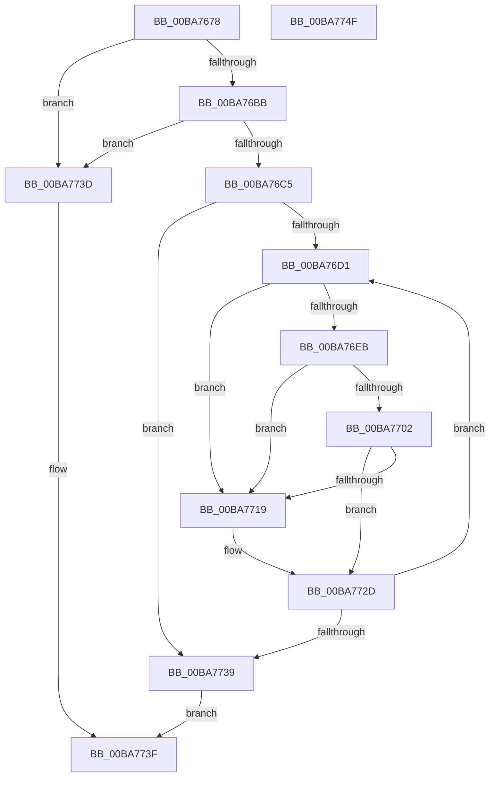

# ViThunkFindAllThunkedImports

- RVA: `0x00BA7678`–`0x00BA7750` (길이 `216` bytes)
- VA: `0x0000000140BA7678`
- 실행 섹션: `PAGEVRFY`
- PDB 이름 있음: `예`; PDB Function 태그: `아니요`
- unwind 정보 RVA: `0x000D25E0`
- 디코드: `62`개 명령, `216/216` bytes 표시
- 미해석 바이트: `0` (있으면 어셈블리에 `.byte`로 보존)

> 이 문서는 커널 이미지의 기계어와 PDB 기호를 분석해 생성했습니다. 4번과 5번은 함수 원형과 자료형을 바이너리 사용 방식에서 추정한 C 해석이며 원본 소스 복구 결과는 아닙니다.

## 1. Dependencies

- 직접 호출 지점: **4**; 고유 호출 대상: **2**
- 직접 호출자로 확인된 함수: **1**
- RIP 상대 이미지 참조: **4**

### Outgoing calls
- `0x00BA76AA` → [RtlImageDirectoryEntryToData](../../text/43/RtlImageDirectoryEntryToData_function_004328D0.md) (function, `0x004328D0`)
- `0x00BA76DE` → [ViThunkGetWdmThunk](ViThunkGetWdmThunk_function_00BA78A4.md) (function, `0x00BA78A4`)
- `0x00BA76F5` → [ViThunkGetWdmThunk](ViThunkGetWdmThunk_function_00BA78A4.md) (function, `0x00BA78A4`)
- `0x00BA770C` → [ViThunkGetWdmThunk](ViThunkGetWdmThunk_function_00BA78A4.md) (function, `0x00BA78A4`)

### Direct callers
- [ViThunkApplyWdmThunksCurrentSession](ViThunkApplyWdmThunksCurrentSession_function_00BA7414.md) at `0x00BA7485`

### Static image references
- `0x00BA7694` → RVA `0x00F04390` (`.data`; read)
- `0x00BA76D4` → RVA `0x00FF4A40` (`PAGEVRFD`; read)
- `0x00BA76EB` → RVA `0x00FF51B0` (`PAGEVRFD`; read)
- `0x00BA7702` → RVA `0x00FF5F20` (`PAGEVRFD`; read)

## 2. Other-region calls and transfers

- 다른 실행 섹션으로 향하는 call: **1**
  - `0x00BA76AA` → [RtlImageDirectoryEntryToData](../../text/43/RtlImageDirectoryEntryToData_function_004328D0.md) (`PAGEVRFY` → `.text`)
- 별도 외부 분기/꼬리 이동을 확인하지 못했습니다.

## 3. Assembly (complete function range)

```asm
00BA7678  48 8B C4                        mov rax, rsp
00BA767B  48 89 58 08                     mov qword ptr [rax + 8], rbx
00BA767F  48 89 70 18                     mov qword ptr [rax + 0x18], rsi
00BA7683  48 89 50 10                     mov qword ptr [rax + 0x10], rdx
00BA7687  57                              push rdi
00BA7688  48 83 EC 20                     sub rsp, 0x20
00BA768C  48 8B 49 30                     mov rcx, qword ptr [rcx + 0x30]
00BA7690  4C 8D 48 10                     lea r9, [rax + 0x10]
00BA7694  48 8B 35 F5 CC 35 00            mov rsi, qword ptr [rip + 0x35ccf5]
00BA769B  49 8B F8                        mov rdi, r8
00BA769E  83 60 10 00                     and dword ptr [rax + 0x10], 0
00BA76A2  41 B8 0C 00 00 00               mov r8d, 0xc
00BA76A8  B2 01                           mov dl, 1
00BA76AA  E8 21 B2 88 FF                  call 0x1404328d0
00BA76AF  4C 8B D8                        mov r11, rax
00BA76B2  48 85 C0                        test rax, rax
00BA76B5  0F 84 82 00 00 00               je 0x140ba773d
00BA76BB  44 8B 44 24 38                  mov r8d, dword ptr [rsp + 0x38]
00BA76C0  45 85 C0                        test r8d, r8d
00BA76C3  74 78                           je 0x140ba773d
00BA76C5  41 C1 E8 03                     shr r8d, 3
00BA76C9  45 33 C9                        xor r9d, r9d
00BA76CC  45 85 C0                        test r8d, r8d
00BA76CF  74 68                           je 0x140ba7739
00BA76D1  49 8B 1B                        mov rbx, qword ptr [r11]
00BA76D4  48 8D 15 65 D3 44 00            lea rdx, [rip + 0x44d365]
00BA76DB  48 8B CB                        mov rcx, rbx
00BA76DE  E8 C1 01 00 00                  call 0x140ba78a4
00BA76E3  4C 8B D0                        mov r10, rax
00BA76E6  48 85 C0                        test rax, rax
00BA76E9  75 2E                           jne 0x140ba7719
00BA76EB  48 8D 15 BE DA 44 00            lea rdx, [rip + 0x44dabe]
00BA76F2  48 8B CB                        mov rcx, rbx
00BA76F5  E8 AA 01 00 00                  call 0x140ba78a4
00BA76FA  4C 8B D0                        mov r10, rax
00BA76FD  48 85 C0                        test rax, rax
00BA7700  75 17                           jne 0x140ba7719
00BA7702  48 8D 15 17 E8 44 00            lea rdx, [rip + 0x44e817]
00BA7709  48 8B CB                        mov rcx, rbx
00BA770C  E8 93 01 00 00                  call 0x140ba78a4
00BA7711  4C 8B D0                        mov r10, rax
00BA7714  48 85 C0                        test rax, rax
00BA7717  74 14                           je 0x140ba772d
00BA7719  8B 0F                           mov ecx, dword ptr [rdi]
00BA771B  48 8D 04 49                     lea rax, [rcx + rcx*2]
00BA771F  44 89 0C C6                     mov dword ptr [rsi + rax*8], r9d
00BA7723  4C 89 54 C6 08                  mov qword ptr [rsi + rax*8 + 8], r10
00BA7728  8D 41 01                        lea eax, [rcx + 1]
00BA772B  89 07                           mov dword ptr [rdi], eax
00BA772D  41 FF C1                        inc r9d
00BA7730  49 83 C3 08                     add r11, 8
00BA7734  45 3B C8                        cmp r9d, r8d
00BA7737  72 98                           jb 0x140ba76d1
00BA7739  8B 07                           mov eax, dword ptr [rdi]
00BA773B  EB 02                           jmp 0x140ba773f
00BA773D  33 C0                           xor eax, eax
00BA773F  48 8B 5C 24 30                  mov rbx, qword ptr [rsp + 0x30]
00BA7744  48 8B 74 24 40                  mov rsi, qword ptr [rsp + 0x40]
00BA7749  48 83 C4 20                     add rsp, 0x20
00BA774D  5F                              pop rdi
00BA774E  C3                              ret
00BA774F  CC                              int3
```

## 4. C-style interpretation (structured pseudocode)

```c
__int64 __fastcall ViThunkFindAllThunkedImports(__int64 a1, __int64 a2, __int64 a3)
{
    __int64 result;
    __int64 v_r11;
    __int64 v_rsp;
    unsigned int v_stack_p10;
    unsigned __int64 v_stack_p18;
    unsigned __int64 v_stack_p8;

    *(unsigned __int64 *)(v_rsp + 8) = v_rbx;
    *(unsigned __int64 *)(v_rsp + 24) = v_rsi;
    *(unsigned __int64 *)(v_rsp + 16) = a2;
    v_rsp = (v_rsp) - (32);
    result = RtlImageDirectoryEntryToData(*(unsigned __int64 *)(a1 + 48), 1, 12, v_rsp + 16);
    if (result == 0) goto loc_00BA773D;
    if ((unsigned int)((unsigned int)(v_stack_p10)) == 0) goto loc_00BA773D;
    a3 = (unsigned int)(((unsigned int)(v_stack_p10)) >> (3));
    a4 = 0;
    if ((unsigned int)(a3) == 0) goto loc_00BA7739;
loc_00BA76D1:
    result = ViThunkGetWdmThunk(*(unsigned __int64 *)(result), v_rip + 4510565, a3, a4);
    if (result != 0) goto loc_00BA7719;
    result = ViThunkGetWdmThunk(*(unsigned __int64 *)(result), v_rip + 4512446, a3, a4);
    if (result != 0) goto loc_00BA7719;
    result = ViThunkGetWdmThunk(*(unsigned __int64 *)(result), v_rip + 4515863, a3, a4);
    if (result != 0) {
        a1 = *(unsigned int *)(a3);
        result = a1 + a1 * 2;
        *(unsigned int *)(*(unsigned __int64 *)(v_rip + 3525877) + result * 8) = 0;
        *(unsigned __int64 *)(*(unsigned __int64 *)(v_rip + 3525877) + result * 8 + 8) = result;
        result = a1 + 1;
        *(unsigned int *)(a3) = (unsigned int)(result);
    }
    a4 = (unsigned int)((a4) + 1);
    v_r11 = (result) + (8);
    if (((unsigned int)(a4)) < ((unsigned int)(a3))) goto loc_00BA76D1;
loc_00BA7739:
    goto loc_00BA773F;
loc_00BA773D:
    result = 0;
loc_00BA773F:
    v_rsp = (v_rsp) + (32);
    return result;
}
```

## 5. (Beta) C Style

```c
int64_t ViThunkFindAllThunkedImports(void *Arg1, int64_t Arg2, void *Arg3)
{
    uint8_t *arg1 = (uint8_t *)Arg1;
    uint8_t *arg3 = (uint8_t *)Arg3;

    int64_t result;
    int64_t local_r11;
    int64_t local_rsp;
    uint32_t v_stack_p10;
    uint64_t v_stack_p18;
    uint64_t v_stack_p8;

    *(uint64_t *)(local_rsp + 0x8) = local_rbx;
    *(uint64_t *)(local_rsp + 0x18) = local_rsi;
    *(uint64_t *)(local_rsp + 0x10) = Arg2;
    local_rsp = (local_rsp) - (32);
    result = RtlImageDirectoryEntryToData(*(uint64_t *)(arg1 + 0x30), 1, 12, local_rsp + 16);
    if (result == 0) goto loc_00BA773D;
    if ((uint32_t)((uint32_t)(v_stack_p10)) == 0) goto loc_00BA773D;
    Arg3 = (uint32_t)(((uint32_t)(v_stack_p10)) >> (3));
    a4 = 0;
    if ((uint32_t)(Arg3) == 0) goto loc_00BA7739;
loc_00BA76D1:
    result = ViThunkGetWdmThunk(*(uint64_t *)(result), v_rip + 4510565, Arg3, a4);
    if (result != 0) goto loc_00BA7719;
    result = ViThunkGetWdmThunk(*(uint64_t *)(result), v_rip + 4512446, Arg3, a4);
    if (result != 0) goto loc_00BA7719;
    result = ViThunkGetWdmThunk(*(uint64_t *)(result), v_rip + 4515863, Arg3, a4);
    if (result != 0) {
        Arg1 = *(uint32_t *)(arg3);
        result = Arg1 + Arg1 * 2;
        *(uint32_t *)(*(uint64_t *)(v_rip + 0x35CCF5) + result * 8) = 0;
        *(uint64_t *)(*(uint64_t *)(v_rip + 0x35CCF5) + result * 8 + 0x8) = result;
        result = Arg1 + 1;
        *(uint32_t *)(arg3) = (uint32_t)(result);
    }
    a4 = (uint32_t)((a4) + 1);
    local_r11 = (result) + (8);
    if (((uint32_t)(a4)) < ((uint32_t)(Arg3))) goto loc_00BA76D1;
loc_00BA7739:
    goto loc_00BA773F;
loc_00BA773D:
    result = 0;
loc_00BA773F:
    local_rsp = (local_rsp) + (32);
    return result;
}
```

### 관측된 메모리 오프셋

구조체 형식이 확인되지 않은 접근은 인자 기준의 오프셋으로만 기록했습니다.

| 기준 인자 | 오프셋 표현 | 폭 (bit) | 접근 |
|---|---:|---:|---|
| `Arg1` | `+ 0x30` | `64` | `R` |
| `Arg3` | `+ 0x0` | `32` | `R` |
| `Arg3` | `+ 0x0` | `32` | `W` |

## 6. Execution-region graph

[열기: 2D/3D 그래프와 함수 탐색 컨트롤 패널](../../../control-panel.html?section=pagevrfy&rva=0x00BA7678&view=graph)

- 2D 그래프는 위에서 아래로 흐르고, 3D 그래프는 빈 공간을 드래그해 회전합니다. Shift+드래그는 이동, 휠은 확대·축소, 함수 노드 선택은 대상 보고서 이동입니다.

### Static fallback


