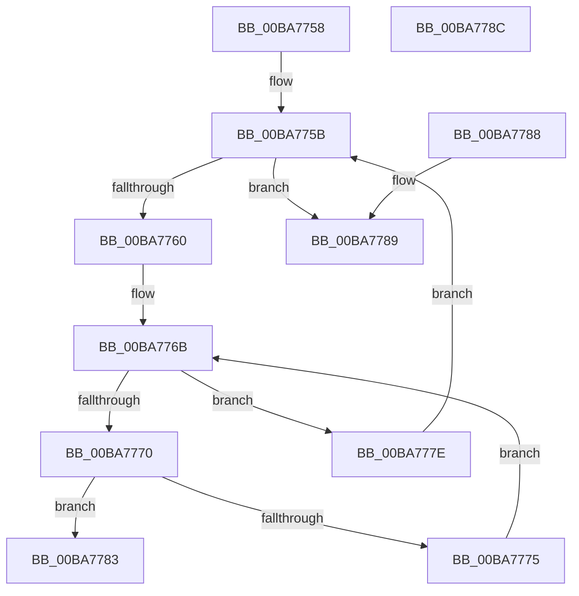

# ViThunkFindDriverImportEntry

- RVA: `0x00BA7758`–`0x00BA778D` (길이 `53` bytes)
- VA: `0x0000000140BA7758`
- 실행 섹션: `PAGEVRFY`
- PDB 이름 있음: `예`; PDB Function 태그: `아니요`
- unwind 정보 RVA: `0x000DB714`
- 디코드: `21`개 명령, `53/53` bytes 표시
- 미해석 바이트: `0` (있으면 어셈블리에 `.byte`로 보존)

> 이 문서는 커널 이미지의 기계어와 PDB 기호를 분석해 생성했습니다. 4번과 5번은 함수 원형과 자료형을 바이너리 사용 방식에서 추정한 C 해석이며 원본 소스 복구 결과는 아닙니다.

## 1. Dependencies

- 직접 호출 지점: **0**; 고유 호출 대상: **0**
- 직접 호출자로 확인된 함수: **1**
- RIP 상대 이미지 참조: **0**

### Outgoing calls
- 직접 디코드된 call 명령이 없습니다.

### Direct callers
- [VfThunkApplyDriverAddedThunks](VfThunkApplyDriverAddedThunks_function_00BA7008.md) at `0x00BA70D3`
- [VfThunkApplyDriverAddedThunks](VfThunkApplyDriverAddedThunks_function_00BA7008.md) at `0x00BA70F6`

### Static image references
- 디코드된 RIP-relative 메모리 참조가 없습니다.

## 2. Other-region calls and transfers

- 다른 실행 섹션으로 향하는 call: **0**
- 별도 외부 분기/꼬리 이동을 확인하지 못했습니다.

## 3. Assembly (complete function range)

```asm
00BA7758  48 8B 01                        mov rax, qword ptr [rcx]
00BA775B  48 3B C1                        cmp rax, rcx
00BA775E  74 29                           je 0x140ba7789
00BA7760  44 8B 50 18                     mov r10d, dword ptr [rax + 0x18]
00BA7764  4C 8D 40 20                     lea r8, [rax + 0x20]
00BA7768  45 33 C9                        xor r9d, r9d
00BA776B  45 3B CA                        cmp r9d, r10d
00BA776E  73 0E                           jae 0x140ba777e
00BA7770  49 3B 10                        cmp rdx, qword ptr [r8]
00BA7773  74 0E                           je 0x140ba7783
00BA7775  49 83 C0 10                     add r8, 0x10
00BA7779  41 FF C1                        inc r9d
00BA777C  EB ED                           jmp 0x140ba776b
00BA777E  48 8B 00                        mov rax, qword ptr [rax]
00BA7781  EB D8                           jmp 0x140ba775b
00BA7783  49 8B 40 08                     mov rax, qword ptr [r8 + 8]
00BA7787  C3                              ret
00BA7788  CC                              int3
00BA7789  33 C0                           xor eax, eax
00BA778B  C3                              ret
00BA778C  CC                              int3
```

## 4. C-style interpretation (structured pseudocode)

```c
__int64 __fastcall ViThunkFindDriverImportEntry(__int64 a1, __int64 a2, __int64 a3, int a4)
{
    __int64 result;

loc_00BA775B:
    if ((*(unsigned __int64 *)(a1)) == a1) goto loc_00BA7789;
    a4 = 0;
loc_00BA776B:
    if (0 >= ((unsigned int)((unsigned int)(*(unsigned int *)(*(unsigned __int64 *)(a1) + 24))))) goto loc_00BA777E;
    if (a2 == (*(unsigned __int64 *)(*(unsigned __int64 *)(a1) + 32))) goto loc_00BA7783;
    a3 = (*(unsigned __int64 *)(a1) + 32) + (16);
    a4 = (unsigned int)((a4) + 1);
    goto loc_00BA776B;
loc_00BA777E:
    goto loc_00BA775B;
loc_00BA7783:
    return *(unsigned __int64 *)(a3 + 8);
loc_00BA7789:
    result = 0;
    return result;
}
```

## 5. (Beta) C Style

```c
int64_t ViThunkFindDriverImportEntry(void *Arg1, int64_t Arg2, int64_t Arg3, int32_t Arg4)
{
    uint8_t *arg1 = (uint8_t *)Arg1;

    int64_t result;

loc_00BA775B:
    if ((*(uint64_t *)(arg1)) == Arg1) goto loc_00BA7789;
    Arg4 = 0;
loc_00BA776B:
    if (0 >= ((uint32_t)((uint32_t)(*(uint32_t *)(*(uint64_t *)(arg1) + 0x18))))) goto loc_00BA777E;
    if (Arg2 == (*(uint64_t *)(*(uint64_t *)(arg1) + 0x20))) goto loc_00BA7783;
    Arg3 = (*(uint64_t *)(arg1) + 32) + (16);
    Arg4 = (uint32_t)((Arg4) + 1);
    goto loc_00BA776B;
loc_00BA777E:
    goto loc_00BA775B;
loc_00BA7783:
    return *(uint64_t *)(Arg3 + 0x8);
loc_00BA7789:
    result = 0;
    return result;
}
```

### 관측된 메모리 오프셋

구조체 형식이 확인되지 않은 접근은 인자 기준의 오프셋으로만 기록했습니다.

| 기준 인자 | 오프셋 표현 | 폭 (bit) | 접근 |
|---|---:|---:|---|
| `Arg1` | `+ 0x0` | `64` | `R` |

## 6. Execution-region graph

[열기: 2D/3D 그래프와 함수 탐색 컨트롤 패널](../../../control-panel.html?section=pagevrfy&rva=0x00BA7758&view=graph)

- 2D 그래프는 위에서 아래로 흐르고, 3D 그래프는 빈 공간을 드래그해 회전합니다. Shift+드래그는 이동, 휠은 확대·축소, 함수 노드 선택은 대상 보고서 이동입니다.

### Static fallback


