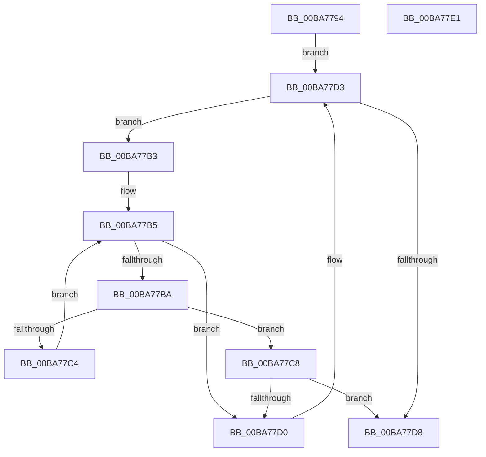

# ViThunkFindNextSpecialTable

- RVA: `0x00BA7794`–`0x00BA77E2` (길이 `78` bytes)
- VA: `0x0000000140BA7794`
- 실행 섹션: `PAGEVRFY`
- PDB 이름 있음: `예`; PDB Function 태그: `아니요`
- unwind 정보 RVA: `0x00071750`
- 디코드: `25`개 명령, `78/78` bytes 표시
- 미해석 바이트: `0` (있으면 어셈블리에 `.byte`로 보존)

> 이 문서는 커널 이미지의 기계어와 PDB 기호를 분석해 생성했습니다. 4번과 5번은 함수 원형과 자료형을 바이너리 사용 방식에서 추정한 C 해석이며 원본 소스 복구 결과는 아닙니다.

## 1. Dependencies

- 직접 호출 지점: **0**; 고유 호출 대상: **0**
- 직접 호출자로 확인된 함수: **2**
- RIP 상대 이미지 참조: **1**

### Outgoing calls
- 직접 디코드된 call 명령이 없습니다.

### Direct callers
- [VfThunkAddSpecialDriverThunks](VfThunkAddSpecialDriverThunks_function_00BA6EC4.md) at `0x00BA6F25`
- [ViThunkFindAllSpecialTables](ViThunkFindAllSpecialTables_function_00BA75E8.md) at `0x00BA7604`
- [ViThunkFindAllSpecialTables](ViThunkFindAllSpecialTables_function_00BA75E8.md) at `0x00BA7643`

### Static image references
- `0x00BA779C` → RVA `0x00F048A0` (`.data`; read)

## 2. Other-region calls and transfers

- 다른 실행 섹션으로 향하는 call: **0**
- 별도 외부 분기/꼬리 이동을 확인하지 못했습니다.

## 3. Assembly (complete function range)

```asm
00BA7794  48 89 5C 24 08                  mov qword ptr [rsp + 8], rbx
00BA7799  45 33 C9                        xor r9d, r9d
00BA779C  48 8D 1D FD D0 35 00            lea rbx, [rip + 0x35d0fd]
00BA77A3  4D 85 C0                        test r8, r8
00BA77A6  44 8B D2                        mov r10d, edx
00BA77A9  4C 0F 44 05 EF D0 35 00         cmove r8, qword ptr [rip + 0x35d0ef]
00BA77B1  EB 20                           jmp 0x140ba77d3
00BA77B3  33 D2                           xor edx, edx
00BA77B5  41 3B D2                        cmp edx, r10d
00BA77B8  73 16                           jae 0x140ba77d0
00BA77BA  49 8B 40 10                     mov rax, qword ptr [r8 + 0x10]
00BA77BE  48 39 04 D1                     cmp qword ptr [rcx + rdx*8], rax
00BA77C2  74 04                           je 0x140ba77c8
00BA77C4  FF C2                           inc edx
00BA77C6  EB ED                           jmp 0x140ba77b5
00BA77C8  4D 8B C8                        mov r9, r8
00BA77CB  4D 85 C0                        test r8, r8
00BA77CE  75 08                           jne 0x140ba77d8
00BA77D0  4D 8B 00                        mov r8, qword ptr [r8]
00BA77D3  4C 3B C3                        cmp r8, rbx
00BA77D6  75 DB                           jne 0x140ba77b3
00BA77D8  48 8B 5C 24 08                  mov rbx, qword ptr [rsp + 8]
00BA77DD  49 8B C1                        mov rax, r9
00BA77E0  C3                              ret
00BA77E1  CC                              int3
```

## 4. C-style interpretation (structured pseudocode)

```c
__int64 __fastcall ViThunkFindNextSpecialTable(__int64 a1, int a2, __int64 a3, int a4)
{
    unsigned __int64 v_stack_p8;

    v_stack_p8 = v_rbx;
    a4 = 0;
    if (a3 == 0) { a3 = *(unsigned __int64 *)(v_rip + 3526895); }
    goto loc_00BA77D3;
loc_00BA77B3:
    a2 = 0;
loc_00BA77B5:
    if (0 >= ((unsigned int)((unsigned int)(a2)))) goto loc_00BA77D0;
    if ((*(unsigned __int64 *)(a1 + a2 * 8)) == (*(unsigned __int64 *)(a3 + 16))) goto loc_00BA77C8;
    a2 = (unsigned int)((a2) + 1);
    goto loc_00BA77B5;
loc_00BA77C8:
    if (a3 != 0) goto loc_00BA77D8;
loc_00BA77D0:
loc_00BA77D3:
    if ((*(unsigned __int64 *)(a3)) != (v_rip + 3526909)) goto loc_00BA77B3;
loc_00BA77D8:
    return a3;
}
```

## 5. (Beta) C Style

```c
int64_t ViThunkFindNextSpecialTable(void *Arg1, int32_t Arg2, int64_t Arg3, int32_t Arg4)
{
    uint8_t *arg1 = (uint8_t *)Arg1;

    uint64_t v_stack_p8;

    v_stack_p8 = local_rbx;
    Arg4 = 0;
    if (Arg3 == 0) { Arg3 = *(uint64_t *)(v_rip + 0x35D0EF); }
    goto loc_00BA77D3;
loc_00BA77B3:
    Arg2 = 0;
loc_00BA77B5:
    if (0 >= ((uint32_t)((uint32_t)(Arg2)))) goto loc_00BA77D0;
    if ((*(uint64_t *)(arg1 + Arg2 * 8)) == (*(uint64_t *)(Arg3 + 0x10))) goto loc_00BA77C8;
    Arg2 = (uint32_t)((Arg2) + 1);
    goto loc_00BA77B5;
loc_00BA77C8:
    if (Arg3 != 0) goto loc_00BA77D8;
loc_00BA77D0:
loc_00BA77D3:
    if ((*(uint64_t *)(Arg3)) != (v_rip + 3526909)) goto loc_00BA77B3;
loc_00BA77D8:
    return Arg3;
}
```

### 관측된 메모리 오프셋

구조체 형식이 확인되지 않은 접근은 인자 기준의 오프셋으로만 기록했습니다.

| 기준 인자 | 오프셋 표현 | 폭 (bit) | 접근 |
|---|---:|---:|---|
| `Arg1` | `+ 0x0 + rdx*8` | `64` | `R` |

## 6. Execution-region graph

[열기: 2D/3D 그래프와 함수 탐색 컨트롤 패널](../../../control-panel.html?section=pagevrfy&rva=0x00BA7794&view=graph)

- 2D 그래프는 위에서 아래로 흐르고, 3D 그래프는 빈 공간을 드래그해 회전합니다. Shift+드래그는 이동, 휠은 확대·축소, 함수 노드 선택은 대상 보고서 이동입니다.

### Static fallback


