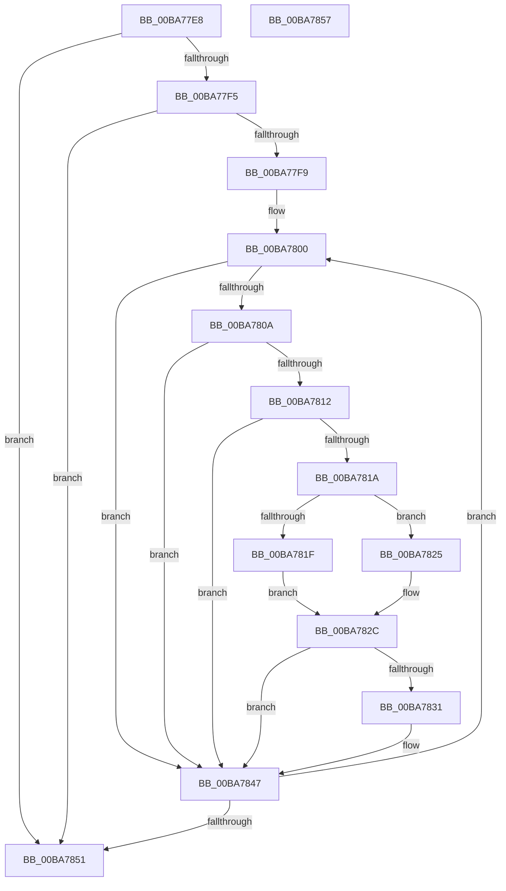

# ViThunkFindSharedExports

- RVA: `0x00BA77E8`–`0x00BA7858` (길이 `112` bytes)
- VA: `0x0000000140BA77E8`
- 실행 섹션: `PAGEVRFY`
- PDB 이름 있음: `예`; PDB Function 태그: `아니요`
- unwind 정보 RVA: `0x00071750`
- 디코드: `37`개 명령, `112/112` bytes 표시
- 미해석 바이트: `0` (있으면 어셈블리에 `.byte`로 보존)

> 이 문서는 커널 이미지의 기계어와 PDB 기호를 분석해 생성했습니다. 4번과 5번은 함수 원형과 자료형을 바이너리 사용 방식에서 추정한 C 해석이며 원본 소스 복구 결과는 아닙니다.

## 1. Dependencies

- 직접 호출 지점: **0**; 고유 호출 대상: **0**
- 직접 호출자로 확인된 함수: **1**
- RIP 상대 이미지 참조: **0**

### Outgoing calls
- 직접 디코드된 call 명령이 없습니다.

### Direct callers
- [ViThunkFindAllSharedExports](ViThunkFindAllSharedExports_function_00BA755C.md) at `0x00BA7590`
- [ViThunkFindAllSharedExports](ViThunkFindAllSharedExports_function_00BA755C.md) at `0x00BA75AD`
- [ViThunkFindAllSharedExports](ViThunkFindAllSharedExports_function_00BA755C.md) at `0x00BA75CA`

### Static image references
- 디코드된 RIP-relative 메모리 참조가 없습니다.

## 2. Other-region calls and transfers

- 다른 실행 섹션으로 향하는 call: **0**
- 별도 외부 분기/꼬리 이동을 확인하지 못했습니다.

## 3. Assembly (complete function range)

```asm
00BA77E8  48 89 5C 24 08                  mov qword ptr [rsp + 8], rbx
00BA77ED  49 8B D8                        mov rbx, r8
00BA77F0  48 85 C9                        test rcx, rcx
00BA77F3  74 5C                           je 0x140ba7851
00BA77F5  85 D2                           test edx, edx
00BA77F7  74 58                           je 0x140ba7851
00BA77F9  4C 8D 51 10                     lea r10, [rcx + 0x10]
00BA77FD  44 8B DA                        mov r11d, edx
00BA7800  45 8B 42 F8                     mov r8d, dword ptr [r10 - 8]
00BA7804  41 83 F8 FF                     cmp r8d, -1
00BA7808  74 3D                           je 0x140ba7847
00BA780A  49 8B 02                        mov rax, qword ptr [r10]
00BA780D  48 85 C0                        test rax, rax
00BA7810  74 35                           je 0x140ba7847
00BA7812  8B 48 20                        mov ecx, dword ptr [rax + 0x20]
00BA7815  F6 C1 01                        test cl, 1
00BA7818  74 2D                           je 0x140ba7847
00BA781A  F6 C1 04                        test cl, 4
00BA781D  74 06                           je 0x140ba7825
00BA781F  48 8B 50 08                     mov rdx, qword ptr [rax + 8]
00BA7823  EB 07                           jmp 0x140ba782c
00BA7825  48 8B 40 28                     mov rax, qword ptr [rax + 0x28]
00BA7829  48 8B 10                        mov rdx, qword ptr [rax]
00BA782C  48 85 D2                        test rdx, rdx
00BA782F  74 16                           je 0x140ba7847
00BA7831  41 8B 09                        mov ecx, dword ptr [r9]
00BA7834  48 8D 04 49                     lea rax, [rcx + rcx*2]
00BA7838  44 89 04 C3                     mov dword ptr [rbx + rax*8], r8d
00BA783C  48 89 54 C3 08                  mov qword ptr [rbx + rax*8 + 8], rdx
00BA7841  8D 41 01                        lea eax, [rcx + 1]
00BA7844  41 89 01                        mov dword ptr [r9], eax
00BA7847  49 83 C2 18                     add r10, 0x18
00BA784B  49 83 EB 01                     sub r11, 1
00BA784F  75 AF                           jne 0x140ba7800
00BA7851  48 8B 5C 24 08                  mov rbx, qword ptr [rsp + 8]
00BA7856  C3                              ret
00BA7857  CC                              int3
```

## 4. C-style interpretation (structured pseudocode)

```c
__int64 __fastcall ViThunkFindSharedExports(__int64 a1, int a2, __int64 a3, __int64 a4)
{
    __int64 result;
    __int64 v_r10;
    __int64 v_r11;
    unsigned __int64 v_stack_p8;

    v_stack_p8 = v_rbx;
    if (a1 == 0) goto loc_00BA7851;
    if (a2 == 0) goto loc_00BA7851;
loc_00BA7800:
    if (((unsigned int)((unsigned int)(*(unsigned int *)(a1 + 16 - 8)))) == -1) goto loc_00BA7847;
    if (*(unsigned __int64 *)(a1 + 16) == 0) goto loc_00BA7847;
    if ((((unsigned __int8)((unsigned int)(*(unsigned int *)(*(unsigned __int64 *)(a1 + 16) + 32)))) & (1)) == 0) goto loc_00BA7847;
    if ((((unsigned __int8)((unsigned int)(*(unsigned int *)(*(unsigned __int64 *)(a1 + 16) + 32)))) & (4)) == 0) goto loc_00BA7825;
    goto loc_00BA782C;
loc_00BA7825:
loc_00BA782C:
    result = *(unsigned __int64 *)(*(unsigned __int64 *)(a1 + 16) + 40);
    if (*(unsigned __int64 *)(*(unsigned __int64 *)(*(unsigned __int64 *)(a1 + 16) + 40)) != 0) {
        a1 = *(unsigned int *)(a4);
        result = a1 + a1 * 2;
        *(unsigned int *)(a3 + result * 8) = (unsigned int)((unsigned int)(*(unsigned int *)(a1 + 16 - 8)));
        *(unsigned __int64 *)(a3 + result * 8 + 8) = *(unsigned __int64 *)(*(unsigned __int64 *)(*(unsigned __int64 *)(a1 + 16) + 40));
        result = a1 + 1;
        *(unsigned int *)(a4) = (unsigned int)(result);
    }
    v_r10 = (a1 + 16) + (24);
    v_r11 = ((unsigned int)(a2)) - (1);
    if (condition_is_not_equal) goto loc_00BA7800;
loc_00BA7851:
    return result;
}
```

## 5. (Beta) C Style

```c
int64_t ViThunkFindSharedExports(int64_t Arg1, int32_t Arg2, void *Arg3, void *Arg4)
{
    uint8_t *arg3 = (uint8_t *)Arg3;
    uint8_t *arg4 = (uint8_t *)Arg4;

    int64_t result;
    int64_t local_r10;
    int64_t local_r11;
    uint64_t v_stack_p8;

    v_stack_p8 = local_rbx;
    if (Arg1 == 0) goto loc_00BA7851;
    if (Arg2 == 0) goto loc_00BA7851;
loc_00BA7800:
    if (((uint32_t)((uint32_t)(*(uint32_t *)(Arg1 + 0x10 - 0x8)))) == -1) goto loc_00BA7847;
    if (*(uint64_t *)(Arg1 + 0x10) == 0) goto loc_00BA7847;
    if ((((uint8_t)((uint32_t)(*(uint32_t *)(*(uint64_t *)(Arg1 + 0x10) + 0x20)))) & (1)) == 0) goto loc_00BA7847;
    if ((((uint8_t)((uint32_t)(*(uint32_t *)(*(uint64_t *)(Arg1 + 0x10) + 0x20)))) & (4)) == 0) goto loc_00BA7825;
    goto loc_00BA782C;
loc_00BA7825:
loc_00BA782C:
    result = *(uint64_t *)(*(uint64_t *)(Arg1 + 0x10) + 0x28);
    if (*(uint64_t *)(*(uint64_t *)(*(uint64_t *)(Arg1 + 0x10) + 0x28)) != 0) {
        Arg1 = *(uint32_t *)(arg4);
        result = Arg1 + Arg1 * 2;
        *(uint32_t *)(arg3 + result * 8) = (uint32_t)((uint32_t)(*(uint32_t *)(Arg1 + 0x10 - 0x8)));
        *(uint64_t *)(arg3 + result * 8 + 0x8) = *(uint64_t *)(*(uint64_t *)(*(uint64_t *)(Arg1 + 0x10) + 0x28));
        result = Arg1 + 1;
        *(uint32_t *)(arg4) = (uint32_t)(result);
    }
    local_r10 = (Arg1 + 16) + (24);
    local_r11 = ((uint32_t)(Arg2)) - (1);
    if (condition_is_not_equal) goto loc_00BA7800;
loc_00BA7851:
    return result;
}
```

### 관측된 메모리 오프셋

구조체 형식이 확인되지 않은 접근은 인자 기준의 오프셋으로만 기록했습니다.

| 기준 인자 | 오프셋 표현 | 폭 (bit) | 접근 |
|---|---:|---:|---|
| `Arg3` | `+ 0x0 + rax*8` | `32` | `W` |
| `Arg3` | `+ 0x8 + rax*8` | `64` | `W` |
| `Arg4` | `+ 0x0` | `32` | `R` |
| `Arg4` | `+ 0x0` | `32` | `W` |

## 6. Execution-region graph

[열기: 2D/3D 그래프와 함수 탐색 컨트롤 패널](../../../control-panel.html?section=pagevrfy&rva=0x00BA77E8&view=graph)

- 2D 그래프는 위에서 아래로 흐르고, 3D 그래프는 빈 공간을 드래그해 회전합니다. Shift+드래그는 이동, 휠은 확대·축소, 함수 노드 선택은 대상 보고서 이동입니다.

### Static fallback


