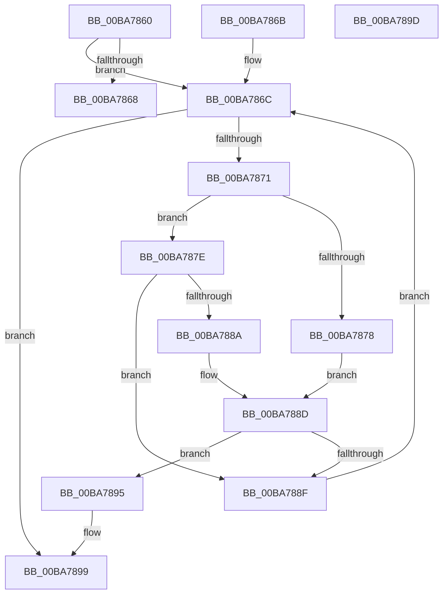

# ViThunkGetPristine

- RVA: `0x00BA7860`–`0x00BA789E` (길이 `62` bytes)
- VA: `0x0000000140BA7860`
- 실행 섹션: `PAGEVRFY`
- PDB 이름 있음: `예`; PDB Function 태그: `아니요`
- unwind 정보 RVA: `0x000DB714`
- 디코드: `25`개 명령, `62/62` bytes 표시
- 미해석 바이트: `0` (있으면 어셈블리에 `.byte`로 보존)

> 이 문서는 커널 이미지의 기계어와 PDB 기호를 분석해 생성했습니다. 4번과 5번은 함수 원형과 자료형을 바이너리 사용 방식에서 추정한 C 해석이며 원본 소스 복구 결과는 아닙니다.

## 1. Dependencies

- 직접 호출 지점: **0**; 고유 호출 대상: **0**
- 직접 호출자로 확인된 함수: **1**
- RIP 상대 이미지 참조: **0**

### Outgoing calls
- 직접 디코드된 call 명령이 없습니다.

### Direct callers
- [ViThunkApplyPristineCurrentSession](ViThunkApplyPristineCurrentSession_function_00BA72E4.md) at `0x00BA7378`
- [ViThunkApplyPristineCurrentSession](ViThunkApplyPristineCurrentSession_function_00BA72E4.md) at `0x00BA738C`
- [ViThunkApplyPristineCurrentSession](ViThunkApplyPristineCurrentSession_function_00BA72E4.md) at `0x00BA73A0`

### Static image references
- 디코드된 RIP-relative 메모리 참조가 없습니다.

## 2. Other-region calls and transfers

- 다른 실행 섹션으로 향하는 call: **0**
- 별도 외부 분기/꼬리 이동을 확인하지 못했습니다.

## 3. Assembly (complete function range)

```asm
00BA7860  45 33 C0                        xor r8d, r8d
00BA7863  48 85 C9                        test rcx, rcx
00BA7866  75 04                           jne 0x140ba786c
00BA7868  33 C0                           xor eax, eax
00BA786A  C3                              ret
00BA786B  CC                              int3
00BA786C  4C 39 02                        cmp qword ptr [rdx], r8
00BA786F  74 28                           je 0x140ba7899
00BA7871  8B 42 20                        mov eax, dword ptr [rdx + 0x20]
00BA7874  A8 04                           test al, 4
00BA7876  74 06                           je 0x140ba787e
00BA7878  48 3B 4A 08                     cmp rcx, qword ptr [rdx + 8]
00BA787C  EB 0F                           jmp 0x140ba788d
00BA787E  48 8B 42 28                     mov rax, qword ptr [rdx + 0x28]
00BA7882  4C 8B 08                        mov r9, qword ptr [rax]
00BA7885  4D 85 C9                        test r9, r9
00BA7888  74 05                           je 0x140ba788f
00BA788A  49 3B C9                        cmp rcx, r9
00BA788D  74 06                           je 0x140ba7895
00BA788F  48 83 C2 38                     add rdx, 0x38
00BA7893  EB D7                           jmp 0x140ba786c
00BA7895  4C 8B 42 18                     mov r8, qword ptr [rdx + 0x18]
00BA7899  49 8B C0                        mov rax, r8
00BA789C  C3                              ret
00BA789D  CC                              int3
```

## 4. C-style interpretation (structured pseudocode)

```c
__int64 __fastcall ViThunkGetPristine(__int64 a1, __int64 a2, int a3)
{
    __int64 result;

    a3 = 0;
    if (a1 != 0) goto loc_00BA786C;
    result = 0;
    return result;
loc_00BA786C:
    if ((*(unsigned __int64 *)(a2)) == 0) goto loc_00BA7899;
    if ((((unsigned __int8)((unsigned int)(*(unsigned int *)(a2 + 32)))) & (4)) == 0) goto loc_00BA787E;
    goto loc_00BA788D;
loc_00BA787E:
    if (*(unsigned __int64 *)(*(unsigned __int64 *)(a2 + 40)) == 0) goto loc_00BA788F;
loc_00BA788D:
    if (a1 == (*(unsigned __int64 *)(*(unsigned __int64 *)(a2 + 40)))) goto loc_00BA7895;
loc_00BA788F:
    a2 = (a2) + (56);
    goto loc_00BA786C;
loc_00BA7895:
loc_00BA7899:
    return *(unsigned __int64 *)(a2 + 24);
}
```

## 5. (Beta) C Style

```c
int64_t ViThunkGetPristine(int64_t Arg1, void *Arg2, int32_t Arg3)
{
    uint8_t *arg2 = (uint8_t *)Arg2;

    int64_t result;

    Arg3 = 0;
    if (Arg1 != 0) goto loc_00BA786C;
    result = 0;
    return result;
loc_00BA786C:
    if ((*(uint64_t *)(arg2)) == 0) goto loc_00BA7899;
    if ((((uint8_t)((uint32_t)(*(uint32_t *)(arg2 + 0x20)))) & (4)) == 0) goto loc_00BA787E;
    goto loc_00BA788D;
loc_00BA787E:
    if (*(uint64_t *)(*(uint64_t *)(arg2 + 0x28)) == 0) goto loc_00BA788F;
loc_00BA788D:
    if (Arg1 == (*(uint64_t *)(*(uint64_t *)(arg2 + 0x28)))) goto loc_00BA7895;
loc_00BA788F:
    Arg2 = (Arg2) + (56);
    goto loc_00BA786C;
loc_00BA7895:
loc_00BA7899:
    return *(uint64_t *)(arg2 + 0x18);
}
```

### 관측된 메모리 오프셋

구조체 형식이 확인되지 않은 접근은 인자 기준의 오프셋으로만 기록했습니다.

| 기준 인자 | 오프셋 표현 | 폭 (bit) | 접근 |
|---|---:|---:|---|
| `Arg2` | `+ 0x0` | `64` | `R` |
| `Arg2` | `+ 0x8` | `64` | `R` |
| `Arg2` | `+ 0x18` | `64` | `R` |
| `Arg2` | `+ 0x20` | `32` | `R` |
| `Arg2` | `+ 0x28` | `64` | `R` |

## 6. Execution-region graph

[열기: 2D/3D 그래프와 함수 탐색 컨트롤 패널](../../../control-panel.html?section=pagevrfy&rva=0x00BA7860&view=graph)

- 2D 그래프는 위에서 아래로 흐르고, 3D 그래프는 빈 공간을 드래그해 회전합니다. Shift+드래그는 이동, 휠은 확대·축소, 함수 노드 선택은 대상 보고서 이동입니다.

### Static fallback


