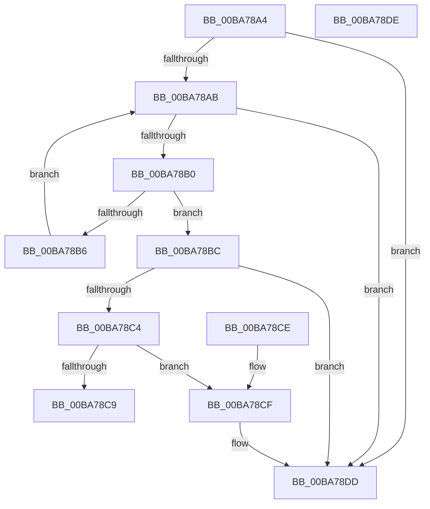

# ViThunkGetWdmThunk

- RVA: `0x00BA78A4`–`0x00BA78DF` (길이 `59` bytes)
- VA: `0x0000000140BA78A4`
- 실행 섹션: `PAGEVRFY`
- PDB 이름 있음: `예`; PDB Function 태그: `아니요`
- unwind 정보 RVA: `0x000DB714`
- 디코드: `23`개 명령, `59/59` bytes 표시
- 미해석 바이트: `0` (있으면 어셈블리에 `.byte`로 보존)

> 이 문서는 커널 이미지의 기계어와 PDB 기호를 분석해 생성했습니다. 4번과 5번은 함수 원형과 자료형을 바이너리 사용 방식에서 추정한 C 해석이며 원본 소스 복구 결과는 아닙니다.

## 1. Dependencies

- 직접 호출 지점: **0**; 고유 호출 대상: **0**
- 직접 호출자로 확인된 함수: **1**
- RIP 상대 이미지 참조: **0**

### Outgoing calls
- 직접 디코드된 call 명령이 없습니다.

### Direct callers
- [ViThunkFindAllThunkedImports](ViThunkFindAllThunkedImports_function_00BA7678.md) at `0x00BA76DE`
- [ViThunkFindAllThunkedImports](ViThunkFindAllThunkedImports_function_00BA7678.md) at `0x00BA76F5`
- [ViThunkFindAllThunkedImports](ViThunkFindAllThunkedImports_function_00BA7678.md) at `0x00BA770C`

### Static image references
- 디코드된 RIP-relative 메모리 참조가 없습니다.

## 2. Other-region calls and transfers

- 다른 실행 섹션으로 향하는 call: **0**
- 별도 외부 분기/꼬리 이동을 확인하지 못했습니다.

## 3. Assembly (complete function range)

```asm
00BA78A4  33 C0                           xor eax, eax
00BA78A6  48 85 C9                        test rcx, rcx
00BA78A9  74 32                           je 0x140ba78dd
00BA78AB  48 39 02                        cmp qword ptr [rdx], rax
00BA78AE  74 2D                           je 0x140ba78dd
00BA78B0  48 3B 4A 10                     cmp rcx, qword ptr [rdx + 0x10]
00BA78B4  74 06                           je 0x140ba78bc
00BA78B6  48 83 C2 38                     add rdx, 0x38
00BA78BA  EB EF                           jmp 0x140ba78ab
00BA78BC  8B 4A 20                        mov ecx, dword ptr [rdx + 0x20]
00BA78BF  F6 C1 01                        test cl, 1
00BA78C2  74 19                           je 0x140ba78dd
00BA78C4  F6 C1 04                        test cl, 4
00BA78C7  74 06                           je 0x140ba78cf
00BA78C9  48 8B 42 08                     mov rax, qword ptr [rdx + 8]
00BA78CD  C3                              ret
00BA78CE  CC                              int3
00BA78CF  48 8B 4A 28                     mov rcx, qword ptr [rdx + 0x28]
00BA78D3  48 8B 11                        mov rdx, qword ptr [rcx]
00BA78D6  48 85 D2                        test rdx, rdx
00BA78D9  48 0F 45 C2                     cmovne rax, rdx
00BA78DD  C3                              ret
00BA78DE  CC                              int3
```

## 4. C-style interpretation (structured pseudocode)

```c
__int64 __fastcall ViThunkGetWdmThunk(__int64 a1, __int64 a2)
{
    __int64 result;

    result = 0;
    if (a1 == 0) goto loc_00BA78DD;
loc_00BA78AB:
    if ((*(unsigned __int64 *)(a2)) == 0) goto loc_00BA78DD;
    if (a1 == (*(unsigned __int64 *)(a2 + 16))) goto loc_00BA78BC;
    a2 = (a2) + (56);
    goto loc_00BA78AB;
loc_00BA78BC:
    if ((((unsigned __int8)((unsigned int)(*(unsigned int *)(a2 + 32)))) & (1)) == 0) goto loc_00BA78DD;
    if ((((unsigned __int8)((unsigned int)(*(unsigned int *)(a2 + 32)))) & (4)) == 0) goto loc_00BA78CF;
    return *(unsigned __int64 *)(a2 + 8);
loc_00BA78CF:
    result = *(unsigned __int64 *)(a2 + 8);
    if (*(unsigned __int64 *)(*(unsigned __int64 *)(a2 + 40)) != 0) { result = *(unsigned __int64 *)(*(unsigned __int64 *)(a2 + 40)); }
loc_00BA78DD:
    return result;
}
```

## 5. (Beta) C Style

```c
int64_t ViThunkGetWdmThunk(int64_t Arg1, void *Arg2)
{
    uint8_t *arg2 = (uint8_t *)Arg2;

    int64_t result;

    result = 0;
    if (Arg1 == 0) goto loc_00BA78DD;
loc_00BA78AB:
    if ((*(uint64_t *)(arg2)) == 0) goto loc_00BA78DD;
    if (Arg1 == (*(uint64_t *)(arg2 + 0x10))) goto loc_00BA78BC;
    Arg2 = (Arg2) + (56);
    goto loc_00BA78AB;
loc_00BA78BC:
    if ((((uint8_t)((uint32_t)(*(uint32_t *)(arg2 + 0x20)))) & (1)) == 0) goto loc_00BA78DD;
    if ((((uint8_t)((uint32_t)(*(uint32_t *)(arg2 + 0x20)))) & (4)) == 0) goto loc_00BA78CF;
    return *(uint64_t *)(arg2 + 0x8);
loc_00BA78CF:
    result = *(uint64_t *)(arg2 + 0x8);
    if (*(uint64_t *)(*(uint64_t *)(arg2 + 0x28)) != 0) { result = *(uint64_t *)(*(uint64_t *)(arg2 + 0x28)); }
loc_00BA78DD:
    return result;
}
```

### 관측된 메모리 오프셋

구조체 형식이 확인되지 않은 접근은 인자 기준의 오프셋으로만 기록했습니다.

| 기준 인자 | 오프셋 표현 | 폭 (bit) | 접근 |
|---|---:|---:|---|
| `Arg2` | `+ 0x0` | `64` | `R` |
| `Arg2` | `+ 0x8` | `64` | `R` |
| `Arg2` | `+ 0x10` | `64` | `R` |
| `Arg2` | `+ 0x20` | `32` | `R` |
| `Arg2` | `+ 0x28` | `64` | `R` |

## 6. Execution-region graph

[열기: 2D/3D 그래프와 함수 탐색 컨트롤 패널](../../../control-panel.html?section=pagevrfy&rva=0x00BA78A4&view=graph)

- 2D 그래프는 위에서 아래로 흐르고, 3D 그래프는 빈 공간을 드래그해 회전합니다. Shift+드래그는 이동, 휠은 확대·축소, 함수 노드 선택은 대상 보고서 이동입니다.

### Static fallback


