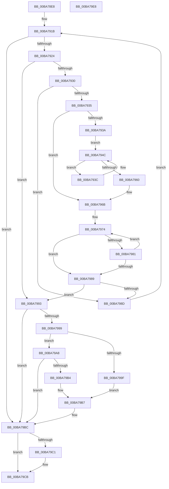

# ViThunkHookExportAddress

- RVA: `0x00BA78E8`–`0x00BA79E9` (길이 `257` bytes)
- VA: `0x0000000140BA78E8`
- 실행 섹션: `PAGEVRFY`
- PDB 이름 있음: `예`; PDB Function 태그: `아니요`
- unwind 정보 RVA: `0x0005D7BC`
- 디코드: `78`개 명령, `257/257` bytes 표시
- 미해석 바이트: `0` (있으면 어셈블리에 `.byte`로 보존)

> 이 문서는 커널 이미지의 기계어와 PDB 기호를 분석해 생성했습니다. 4번과 5번은 함수 원형과 자료형을 바이너리 사용 방식에서 추정한 C 해석이며 원본 소스 복구 결과는 아닙니다.

## 1. Dependencies

- 직접 호출 지점: **3**; 고유 호출 대상: **3**
- 직접 호출자로 확인된 함수: **1**
- RIP 상대 이미지 참조: **1**

### Outgoing calls
- `0x00BA7947` → [KeDelayExecutionThread](../../text/20/KeDelayExecutionThread_function_00209550.md) (function, `0x00209550`)
- `0x00BA7957` → [RtlUnicodeStringToAnsiString](../../page/90/RtlUnicodeStringToAnsiString_function_0090D1F0.md) (function, `0x0090D1F0`)
- `0x00BA79C6` → [RtlFreeAnsiString](../../page/9C/RtlFreeAnsiString_function_009C0800.md) (function, `0x009C0800`)

### Direct callers
- [VerifierMmGetSystemRoutineAddress](../BB/VerifierMmGetSystemRoutineAddress_function_00BB0900.md) at `0x00BB092E`
- [VerifierMmGetSystemRoutineAddress](../BB/VerifierMmGetSystemRoutineAddress_function_00BB0900.md) at `0x00BB0946`
- [VerifierMmGetSystemRoutineAddress](../BB/VerifierMmGetSystemRoutineAddress_function_00BB0900.md) at `0x00BB095E`

### Static image references
- `0x00BA793C` → RVA `0x00B8B030` (`ViShortTime`; read)

## 2. Other-region calls and transfers

- 다른 실행 섹션으로 향하는 call: **3**
  - `0x00BA7947` → [KeDelayExecutionThread](../../text/20/KeDelayExecutionThread_function_00209550.md) (`PAGEVRFY` → `.text`)
  - `0x00BA7957` → [RtlUnicodeStringToAnsiString](../../page/90/RtlUnicodeStringToAnsiString_function_0090D1F0.md) (`PAGEVRFY` → `PAGE`)
  - `0x00BA79C6` → [RtlFreeAnsiString](../../page/9C/RtlFreeAnsiString_function_009C0800.md) (`PAGEVRFY` → `PAGE`)
- 별도 외부 분기/꼬리 이동을 확인하지 못했습니다.

## 3. Assembly (complete function range)

```asm
00BA78E8  48 8B C4                        mov rax, rsp
00BA78EB  48 89 58 08                     mov qword ptr [rax + 8], rbx
00BA78EF  48 89 68 10                     mov qword ptr [rax + 0x10], rbp
00BA78F3  48 89 70 18                     mov qword ptr [rax + 0x18], rsi
00BA78F7  48 89 78 20                     mov qword ptr [rax + 0x20], rdi
00BA78FB  41 56                           push r14
00BA78FD  48 83 EC 30                     sub rsp, 0x30
00BA7901  48 83 60 E8 00                  and qword ptr [rax - 0x18], 0
00BA7906  33 FF                           xor edi, edi
00BA7908  45 33 C9                        xor r9d, r9d
00BA790B  49 8B D8                        mov rbx, r8
00BA790E  45 33 D2                        xor r10d, r10d
00BA7911  4C 8B F2                        mov r14, rdx
00BA7914  4C 89 50 F0                     mov qword ptr [rax - 0x10], r10
00BA7918  48 8B F1                        mov rsi, rcx
00BA791B  48 39 3B                        cmp qword ptr [rbx], rdi
00BA791E  0F 84 98 00 00 00               je 0x140ba79bc
00BA7924  48 8B 43 10                     mov rax, qword ptr [rbx + 0x10]
00BA7928  8B 6B 20                        mov ebp, dword ptr [rbx + 0x20]
00BA792B  48 3B 06                        cmp rax, qword ptr [rsi]
00BA792E  74 63                           je 0x140ba7993
00BA7930  48 85 C0                        test rax, rax
00BA7933  75 58                           jne 0x140ba798d
00BA7935  45 85 C9                        test r9d, r9d
00BA7938  75 31                           jne 0x140ba796b
00BA793A  EB 10                           jmp 0x140ba794c
00BA793C  4C 8D 05 ED 36 FE FF            lea r8, [rip - 0x1c913]
00BA7943  33 D2                           xor edx, edx
00BA7945  33 C9                           xor ecx, ecx
00BA7947  E8 04 1C 66 FF                  call 0x140209550
00BA794C  41 B0 01                        mov r8b, 1
00BA794F  48 8D 4C 24 20                  lea rcx, [rsp + 0x20]
00BA7954  49 8B D6                        mov rdx, r14
00BA7957  E8 94 58 D6 FF                  call 0x14090d1f0
00BA795C  85 C0                           test eax, eax
00BA795E  78 DC                           js 0x140ba793c
00BA7960  4C 8B 54 24 28                  mov r10, qword ptr [rsp + 0x28]
00BA7965  41 B9 01 00 00 00               mov r9d, 1
00BA796B  48 8B 03                        mov rax, qword ptr [rbx]
00BA796E  49 8B D2                        mov rdx, r10
00BA7971  48 2B D0                        sub rdx, rax
00BA7974  0F B6 08                        movzx ecx, byte ptr [rax]
00BA7977  44 0F B6 04 10                  movzx r8d, byte ptr [rax + rdx]
00BA797C  41 2B C8                        sub ecx, r8d
00BA797F  75 08                           jne 0x140ba7989
00BA7981  48 FF C0                        inc rax
00BA7984  45 85 C0                        test r8d, r8d
00BA7987  75 EB                           jne 0x140ba7974
00BA7989  85 C9                           test ecx, ecx
00BA798B  74 06                           je 0x140ba7993
00BA798D  48 83 C3 38                     add rbx, 0x38
00BA7991  EB 88                           jmp 0x140ba791b
00BA7993  40 F6 C5 01                     test bpl, 1
00BA7997  74 23                           je 0x140ba79bc
00BA7999  40 F6 C5 04                     test bpl, 4
00BA799D  74 09                           je 0x140ba79a8
00BA799F  48 8B 43 08                     mov rax, qword ptr [rbx + 8]
00BA79A3  48 89 06                        mov qword ptr [rsi], rax
00BA79A6  EB 0F                           jmp 0x140ba79b7
00BA79A8  48 8B 43 28                     mov rax, qword ptr [rbx + 0x28]
00BA79AC  48 8B 08                        mov rcx, qword ptr [rax]
00BA79AF  48 85 C9                        test rcx, rcx
00BA79B2  74 08                           je 0x140ba79bc
00BA79B4  48 89 0E                        mov qword ptr [rsi], rcx
00BA79B7  BF 01 00 00 00                  mov edi, 1
00BA79BC  45 85 C9                        test r9d, r9d
00BA79BF  74 0A                           je 0x140ba79cb
00BA79C1  48 8D 4C 24 20                  lea rcx, [rsp + 0x20]
00BA79C6  E8 35 8E E1 FF                  call 0x1409c0800
00BA79CB  48 8B 5C 24 40                  mov rbx, qword ptr [rsp + 0x40]
00BA79D0  8B C7                           mov eax, edi
00BA79D2  48 8B 7C 24 58                  mov rdi, qword ptr [rsp + 0x58]
00BA79D7  48 8B 6C 24 48                  mov rbp, qword ptr [rsp + 0x48]
00BA79DC  48 8B 74 24 50                  mov rsi, qword ptr [rsp + 0x50]
00BA79E1  48 83 C4 30                     add rsp, 0x30
00BA79E5  41 5E                           pop r14
00BA79E7  C3                              ret
00BA79E8  CC                              int3
```

## 4. C-style interpretation (structured pseudocode)

```c
__int64 __fastcall ViThunkHookExportAddress(__int64 a1, __int64 a2, __int64 a3, int a4)
{
    __int64 result;
    __int64 v_r10;
    __int64 v_rbx;
    __int64 v_rdi;
    __int64 v_rsp;
    unsigned __int64 v_stack_m10;
    unsigned __int64 v_stack_m18;
    unsigned __int64 v_stack_p10;
    unsigned __int64 v_stack_p18;
    unsigned __int64 v_stack_p20;
    unsigned __int64 v_stack_p8;

    *(unsigned __int64 *)(v_rsp + 8) = v_rbx;
    *(unsigned __int64 *)(v_rsp + 16) = v_rbp;
    *(unsigned __int64 *)(v_rsp + 24) = v_rsi;
    *(unsigned __int64 *)(v_rsp + 32) = v_rdi;
    v_rsp = (v_rsp) - (48);
    v_rdi = 0;
    a4 = 0;
    v_r10 = 0;
    *(unsigned __int64 *)(v_rsp - 16) = 0;
loc_00BA791B:
    if ((*(unsigned __int64 *)(a3)) == 0) goto loc_00BA79BC;
    if ((*(unsigned __int64 *)(a3 + 16)) == (*(unsigned __int64 *)(a1))) goto loc_00BA7993;
    if (*(unsigned __int64 *)(a3 + 16) != 0) goto loc_00BA798D;
    if (0 != 0) goto loc_00BA796B;
    goto loc_00BA794C;
loc_00BA793C:
    a2 = 0;
    a1 = 0;
    result = KeDelayExecutionThread(a1, a2, v_rip - 117011, a4);
loc_00BA794C:
    result = RtlUnicodeStringToAnsiString(v_stack_m18, 0, 1, a4);
    if (sign_flag) goto loc_00BA793C;
loc_00BA796B:
    a2 = (v_stack_m10) - (*(unsigned __int64 *)(a3));
loc_00BA7974:
    a1 = (unsigned int)((*(unsigned __int8 *)(*(unsigned __int64 *)(a3))) - ((unsigned int)(*(unsigned __int8 *)(*(unsigned __int64 *)(a3) + a2 * 1))));
    if (condition_is_not_equal) goto loc_00BA7989;
    result = (*(unsigned __int64 *)(a3)) + 1;
    if ((unsigned int)(*(unsigned __int8 *)(*(unsigned __int64 *)(a3) + a2 * 1)) != 0) goto loc_00BA7974;
loc_00BA7989:
    if ((unsigned int)(a1) == 0) goto loc_00BA7993;
loc_00BA798D:
    v_rbx = (a3) + (56);
    goto loc_00BA791B;
loc_00BA7993:
    if ((((unsigned __int8)((unsigned int)(*(unsigned int *)(a3 + 32)))) & (1)) == 0) goto loc_00BA79BC;
    if ((((unsigned __int8)((unsigned int)(*(unsigned int *)(a3 + 32)))) & (4)) == 0) goto loc_00BA79A8;
    *(unsigned __int64 *)(a1) = *(unsigned __int64 *)(v_rbx + 8);
    goto loc_00BA79B7;
loc_00BA79A8:
    if (*(unsigned __int64 *)(*(unsigned __int64 *)(v_rbx + 40)) == 0) goto loc_00BA79BC;
    *(unsigned __int64 *)(a1) = *(unsigned __int64 *)(*(unsigned __int64 *)(v_rbx + 40));
loc_00BA79B7:
loc_00BA79BC:
    result = *(unsigned __int64 *)(v_rbx + 40);
    if (1 != 0) {
        a1 = v_stack_m18;
        result = RtlFreeAnsiString(a1, a2, *(unsigned __int8 *)(*(unsigned __int64 *)(a3) + a2 * 1), 1);
    }
    v_rsp = (v_rsp) + (48);
    return 1;
}
```

## 5. (Beta) C Style

```c
int64_t ViThunkHookExportAddress(void *Arg1, int64_t Arg2, void *Arg3, int32_t Arg4)
{
    uint8_t *arg1 = (uint8_t *)Arg1;
    uint8_t *arg3 = (uint8_t *)Arg3;

    int64_t result;
    int64_t local_r10;
    int64_t local_rbx;
    int64_t local_rdi;
    int64_t local_rsp;
    uint64_t v_stack_m10;
    uint64_t v_stack_m18;
    uint64_t v_stack_p10;
    uint64_t v_stack_p18;
    uint64_t v_stack_p20;
    uint64_t v_stack_p8;

    *(uint64_t *)(local_rsp + 0x8) = local_rbx;
    *(uint64_t *)(local_rsp + 0x10) = local_rbp;
    *(uint64_t *)(local_rsp + 0x18) = local_rsi;
    *(uint64_t *)(local_rsp + 0x20) = local_rdi;
    local_rsp = (local_rsp) - (48);
    local_rdi = 0;
    Arg4 = 0;
    local_r10 = 0;
    *(uint64_t *)(local_rsp - 0x10) = 0;
loc_00BA791B:
    if ((*(uint64_t *)(arg3)) == 0) goto loc_00BA79BC;
    if ((*(uint64_t *)(arg3 + 0x10)) == (*(uint64_t *)(arg1))) goto loc_00BA7993;
    if (*(uint64_t *)(arg3 + 0x10) != 0) goto loc_00BA798D;
    if (0 != 0) goto loc_00BA796B;
    goto loc_00BA794C;
loc_00BA793C:
    Arg2 = 0;
    Arg1 = 0;
    result = KeDelayExecutionThread(Arg1, Arg2, v_rip - 117011, Arg4);
loc_00BA794C:
    result = RtlUnicodeStringToAnsiString(v_stack_m18, 0, 1, Arg4);
    if (sign_flag) goto loc_00BA793C;
loc_00BA796B:
    Arg2 = (v_stack_m10) - (*(uint64_t *)(arg3));
loc_00BA7974:
    Arg1 = (uint32_t)((*(uint8_t *)(*(uint64_t *)(arg3))) - ((uint32_t)(*(uint8_t *)(*(uint64_t *)(arg3) + Arg2 * 1))));
    if (condition_is_not_equal) goto loc_00BA7989;
    result = (*(uint64_t *)(arg3)) + 1;
    if ((uint32_t)(*(uint8_t *)(*(uint64_t *)(arg3) + Arg2 * 1)) != 0) goto loc_00BA7974;
loc_00BA7989:
    if ((uint32_t)(Arg1) == 0) goto loc_00BA7993;
loc_00BA798D:
    local_rbx = (Arg3) + (56);
    goto loc_00BA791B;
loc_00BA7993:
    if ((((uint8_t)((uint32_t)(*(uint32_t *)(arg3 + 0x20)))) & (1)) == 0) goto loc_00BA79BC;
    if ((((uint8_t)((uint32_t)(*(uint32_t *)(arg3 + 0x20)))) & (4)) == 0) goto loc_00BA79A8;
    *(uint64_t *)(arg1) = *(uint64_t *)(local_rbx + 0x8);
    goto loc_00BA79B7;
loc_00BA79A8:
    if (*(uint64_t *)(*(uint64_t *)(local_rbx + 0x28)) == 0) goto loc_00BA79BC;
    *(uint64_t *)(arg1) = *(uint64_t *)(*(uint64_t *)(local_rbx + 0x28));
loc_00BA79B7:
loc_00BA79BC:
    result = *(uint64_t *)(local_rbx + 0x28);
    if (1 != 0) {
        Arg1 = v_stack_m18;
        result = RtlFreeAnsiString(Arg1, Arg2, *(uint8_t *)(*(uint64_t *)(arg3) + Arg2 * 1), 1);
    }
    local_rsp = (local_rsp) + (48);
    return 1;
}
```

### 관측된 메모리 오프셋

구조체 형식이 확인되지 않은 접근은 인자 기준의 오프셋으로만 기록했습니다.

| 기준 인자 | 오프셋 표현 | 폭 (bit) | 접근 |
|---|---:|---:|---|
| `Arg1` | `+ 0x0` | `64` | `R` |
| `Arg1` | `+ 0x0` | `64` | `W` |
| `Arg3` | `+ 0x0` | `64` | `R` |
| `Arg3` | `+ 0x8` | `64` | `R` |
| `Arg3` | `+ 0x10` | `64` | `R` |
| `Arg3` | `+ 0x20` | `32` | `R` |
| `Arg3` | `+ 0x28` | `64` | `R` |

## 6. Execution-region graph

[열기: 2D/3D 그래프와 함수 탐색 컨트롤 패널](../../../control-panel.html?section=pagevrfy&rva=0x00BA78E8&view=graph)

- 2D 그래프는 위에서 아래로 흐르고, 3D 그래프는 빈 공간을 드래그해 회전합니다. Shift+드래그는 이동, 휠은 확대·축소, 함수 노드 선택은 대상 보고서 이동입니다.

### Static fallback


