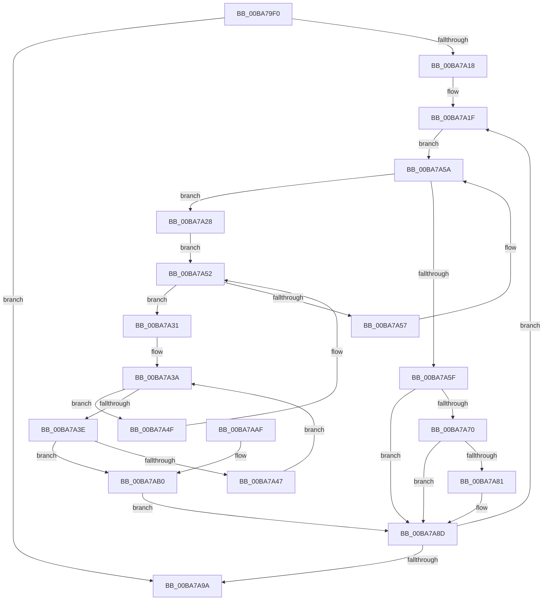

# ViThunkRecoverPristines

- RVA: `0x00BA79F0`–`0x00BA7AB8` (길이 `200` bytes)
- VA: `0x0000000140BA79F0`
- 실행 섹션: `PAGEVRFY`
- PDB 이름 있음: `예`; PDB Function 태그: `아니요`
- unwind 정보 RVA: `0x000C3CC0`
- 디코드: `57`개 명령, `200/200` bytes 표시
- 미해석 바이트: `0` (있으면 어셈블리에 `.byte`로 보존)

> 이 문서는 커널 이미지의 기계어와 PDB 기호를 분석해 생성했습니다. 4번과 5번은 함수 원형과 자료형을 바이너리 사용 방식에서 추정한 C 해석이며 원본 소스 복구 결과는 아닙니다.

## 1. Dependencies

- 직접 호출 지점: **3**; 고유 호출 대상: **1**
- 직접 호출자로 확인된 함수: **1**
- RIP 상대 이미지 참조: **4**

### Outgoing calls
- `0x00BA7A66` → [ViThunkReplacePristine](ViThunkReplacePristine_function_00BA7D34.md) (function, `0x00BA7D34`)
- `0x00BA7A77` → [ViThunkReplacePristine](ViThunkReplacePristine_function_00BA7D34.md) (function, `0x00BA7D34`)
- `0x00BA7A88` → [ViThunkReplacePristine](ViThunkReplacePristine_function_00BA7D34.md) (function, `0x00BA7D34`)

### Direct callers
- [VfThunkAddSpecialDriverThunks](VfThunkAddSpecialDriverThunks_function_00BA6EC4.md) at `0x00BA6F14`

### Static image references
- `0x00BA7A18` → RVA `0x00F048A0` (`.data`; read)
- `0x00BA7A5F` → RVA `0x00FF51B0` (`PAGEVRFD`; read)
- `0x00BA7A70` → RVA `0x00FF4A40` (`PAGEVRFD`; read)
- `0x00BA7A81` → RVA `0x00FF5F20` (`PAGEVRFD`; read)

## 2. Other-region calls and transfers

- 다른 실행 섹션으로 향하는 call: **0**
- 별도 외부 분기/꼬리 이동을 확인하지 못했습니다.

## 3. Assembly (complete function range)

```asm
00BA79F0  48 89 5C 24 08                  mov qword ptr [rsp + 8], rbx
00BA79F5  48 89 6C 24 10                  mov qword ptr [rsp + 0x10], rbp
00BA79FA  48 89 74 24 18                  mov qword ptr [rsp + 0x18], rsi
00BA79FF  57                              push rdi
00BA7A00  48 83 EC 20                     sub rsp, 0x20
00BA7A04  45 33 DB                        xor r11d, r11d
00BA7A07  4C 8D 41 20                     lea r8, [rcx + 0x20]
00BA7A0B  4C 8B D1                        mov r10, rcx
00BA7A0E  44 39 59 18                     cmp dword ptr [rcx + 0x18], r11d
00BA7A12  0F 86 82 00 00 00               jbe 0x140ba7a9a
00BA7A18  48 8D 2D 81 CE 35 00            lea rbp, [rip + 0x35ce81]
00BA7A1F  48 8B 15 7A CE 35 00            mov rdx, qword ptr [rip + 0x35ce7a]
00BA7A26  EB 32                           jmp 0x140ba7a5a
00BA7A28  48 8D 5A 18                     lea rbx, [rdx + 0x18]
00BA7A2C  48 8B 0B                        mov rcx, qword ptr [rbx]
00BA7A2F  EB 21                           jmp 0x140ba7a52
00BA7A31  8B 71 18                        mov esi, dword ptr [rcx + 0x18]
00BA7A34  4C 8D 49 20                     lea r9, [rcx + 0x20]
00BA7A38  33 FF                           xor edi, edi
00BA7A3A  3B FE                           cmp edi, esi
00BA7A3C  73 11                           jae 0x140ba7a4f
00BA7A3E  49 8B 41 08                     mov rax, qword ptr [r9 + 8]
00BA7A42  49 39 00                        cmp qword ptr [r8], rax
00BA7A45  74 69                           je 0x140ba7ab0
00BA7A47  49 83 C1 10                     add r9, 0x10
00BA7A4B  FF C7                           inc edi
00BA7A4D  EB EB                           jmp 0x140ba7a3a
00BA7A4F  48 8B 09                        mov rcx, qword ptr [rcx]
00BA7A52  48 3B CB                        cmp rcx, rbx
00BA7A55  75 DA                           jne 0x140ba7a31
00BA7A57  48 8B 12                        mov rdx, qword ptr [rdx]
00BA7A5A  48 3B D5                        cmp rdx, rbp
00BA7A5D  75 C9                           jne 0x140ba7a28
00BA7A5F  48 8D 0D 4A D7 44 00            lea rcx, [rip + 0x44d74a]
00BA7A66  E8 C9 02 00 00                  call 0x140ba7d34
00BA7A6B  83 F8 01                        cmp eax, 1
00BA7A6E  74 1D                           je 0x140ba7a8d
00BA7A70  48 8D 0D C9 CF 44 00            lea rcx, [rip + 0x44cfc9]
00BA7A77  E8 B8 02 00 00                  call 0x140ba7d34
00BA7A7C  83 F8 01                        cmp eax, 1
00BA7A7F  74 0C                           je 0x140ba7a8d
00BA7A81  48 8D 0D 98 E4 44 00            lea rcx, [rip + 0x44e498]
00BA7A88  E8 A7 02 00 00                  call 0x140ba7d34
00BA7A8D  49 83 C0 10                     add r8, 0x10
00BA7A91  41 FF C3                        inc r11d
00BA7A94  45 3B 5A 18                     cmp r11d, dword ptr [r10 + 0x18]
00BA7A98  72 85                           jb 0x140ba7a1f
00BA7A9A  48 8B 5C 24 30                  mov rbx, qword ptr [rsp + 0x30]
00BA7A9F  48 8B 6C 24 38                  mov rbp, qword ptr [rsp + 0x38]
00BA7AA4  48 8B 74 24 40                  mov rsi, qword ptr [rsp + 0x40]
00BA7AA9  48 83 C4 20                     add rsp, 0x20
00BA7AAD  5F                              pop rdi
00BA7AAE  C3                              ret
00BA7AAF  CC                              int3
00BA7AB0  49 8B 01                        mov rax, qword ptr [r9]
00BA7AB3  49 89 00                        mov qword ptr [r8], rax
00BA7AB6  EB D5                           jmp 0x140ba7a8d
```

## 4. C-style interpretation (structured pseudocode)

```c
__int64 __fastcall ViThunkRecoverPristines(__int64 a1)
{
    __int64 result;
    __int64 v_r11;
    __int64 v_rdi;
    __int64 v_rsp;
    unsigned __int64 v_stack_p10;
    unsigned __int64 v_stack_p18;
    unsigned __int64 v_stack_p8;

    v_stack_p8 = v_rbx;
    v_stack_p10 = v_rbp;
    v_stack_p18 = v_rsi;
    v_rsp = (v_rsp) - (32);
    v_r11 = 0;
    if ((*(unsigned int *)(a1 + 24)) <= 0) goto loc_00BA7A9A;
loc_00BA7A1F:
    goto loc_00BA7A5A;
loc_00BA7A28:
    goto loc_00BA7A52;
loc_00BA7A31:
    v_rdi = 0;
loc_00BA7A3A:
    if (0 >= ((unsigned int)((unsigned int)(*(unsigned int *)(*(unsigned __int64 *)(*(unsigned __int64 *)(v_rip + 3526266) + 24) + 24))))) goto loc_00BA7A4F;
    if ((*(unsigned __int64 *)(a1 + 32)) == (*(unsigned __int64 *)(*(unsigned __int64 *)(*(unsigned __int64 *)(v_rip + 3526266) + 24) + 32 + 8))) goto loc_00BA7AB0;
    a4 = (*(unsigned __int64 *)(*(unsigned __int64 *)(v_rip + 3526266) + 24) + 32) + (16);
    v_rdi = (unsigned int)((v_rdi) + 1);
    goto loc_00BA7A3A;
loc_00BA7A4F:
loc_00BA7A52:
    if ((*(unsigned __int64 *)(*(unsigned __int64 *)(*(unsigned __int64 *)(v_rip + 3526266) + 24))) != (*(unsigned __int64 *)(v_rip + 3526266) + 24)) goto loc_00BA7A31;
loc_00BA7A5A:
    if ((*(unsigned __int64 *)(*(unsigned __int64 *)(v_rip + 3526266))) != (v_rip + 3526273)) goto loc_00BA7A28;
    result = ViThunkReplacePristine(v_rip + 4511562, *(unsigned __int64 *)(*(unsigned __int64 *)(v_rip + 3526266)), a1 + 32, a4);
    if (((unsigned int)(result)) == 1) goto loc_00BA7A8D;
    result = ViThunkReplacePristine(v_rip + 4509641, *(unsigned __int64 *)(*(unsigned __int64 *)(v_rip + 3526266)), a1 + 32, a4);
    if (((unsigned int)(result)) != 1) {
        a1 = v_rip + 4514968;
        result = ViThunkReplacePristine(a1, *(unsigned __int64 *)(*(unsigned __int64 *)(v_rip + 3526266)), a1 + 32, a4);
    }
    a3 = (a1 + 32) + (16);
    v_r11 = (unsigned int)((v_r11) + 1);
    if (((unsigned int)(v_r11)) < (*(unsigned int *)(a1 + 24))) goto loc_00BA7A1F;
loc_00BA7A9A:
    v_rsp = (v_rsp) + (32);
    return result;
loc_00BA7AB0:
    *(unsigned __int64 *)(a3) = *(unsigned __int64 *)(a4);
    goto loc_00BA7A8D;
}
```

## 5. (Beta) C Style

```c
int64_t ViThunkRecoverPristines(void *Arg1)
{
    uint8_t *arg1 = (uint8_t *)Arg1;

    int64_t result;
    int64_t local_r11;
    int64_t local_rdi;
    int64_t local_rsp;
    uint64_t v_stack_p10;
    uint64_t v_stack_p18;
    uint64_t v_stack_p8;

    v_stack_p8 = local_rbx;
    v_stack_p10 = local_rbp;
    v_stack_p18 = local_rsi;
    local_rsp = (local_rsp) - (32);
    local_r11 = 0;
    if ((*(uint32_t *)(arg1 + 0x18)) <= 0) goto loc_00BA7A9A;
loc_00BA7A1F:
    goto loc_00BA7A5A;
loc_00BA7A28:
    goto loc_00BA7A52;
loc_00BA7A31:
    local_rdi = 0;
loc_00BA7A3A:
    if (0 >= ((uint32_t)((uint32_t)(*(uint32_t *)(*(uint64_t *)(*(uint64_t *)(v_rip + 0x35CE7A) + 0x18) + 0x18))))) goto loc_00BA7A4F;
    if ((*(uint64_t *)(arg1 + 0x20)) == (*(uint64_t *)(*(uint64_t *)(*(uint64_t *)(v_rip + 0x35CE7A) + 0x18) + 0x20 + 0x8))) goto loc_00BA7AB0;
    a4 = (*(uint64_t *)(*(uint64_t *)(v_rip + 0x35CE7A) + 0x18) + 32) + (16);
    local_rdi = (uint32_t)((local_rdi) + 1);
    goto loc_00BA7A3A;
loc_00BA7A4F:
loc_00BA7A52:
    if ((*(uint64_t *)(*(uint64_t *)(*(uint64_t *)(v_rip + 0x35CE7A) + 0x18))) != (*(uint64_t *)(v_rip + 0x35CE7A) + 24)) goto loc_00BA7A31;
loc_00BA7A5A:
    if ((*(uint64_t *)(*(uint64_t *)(v_rip + 0x35CE7A))) != (v_rip + 3526273)) goto loc_00BA7A28;
    result = ViThunkReplacePristine(v_rip + 4511562, *(uint64_t *)(*(uint64_t *)(v_rip + 0x35CE7A)), Arg1 + 32, a4);
    if (((uint32_t)(result)) == 1) goto loc_00BA7A8D;
    result = ViThunkReplacePristine(v_rip + 4509641, *(uint64_t *)(*(uint64_t *)(v_rip + 0x35CE7A)), Arg1 + 32, a4);
    if (((uint32_t)(result)) != 1) {
        Arg1 = v_rip + 4514968;
        result = ViThunkReplacePristine(Arg1, *(uint64_t *)(*(uint64_t *)(v_rip + 0x35CE7A)), Arg1 + 32, a4);
    }
    a3 = (Arg1 + 32) + (16);
    local_r11 = (uint32_t)((local_r11) + 1);
    if (((uint32_t)(local_r11)) < (*(uint32_t *)(arg1 + 0x18))) goto loc_00BA7A1F;
loc_00BA7A9A:
    local_rsp = (local_rsp) + (32);
    return result;
loc_00BA7AB0:
    *(uint64_t *)(a3) = *(uint64_t *)(a4);
    goto loc_00BA7A8D;
}
```

### 관측된 메모리 오프셋

구조체 형식이 확인되지 않은 접근은 인자 기준의 오프셋으로만 기록했습니다.

| 기준 인자 | 오프셋 표현 | 폭 (bit) | 접근 |
|---|---:|---:|---|
| `Arg1` | `+ 0x18` | `32` | `R` |
| `Arg1` | `+ 0x20` | `64` | `R` |

## 6. Execution-region graph

[열기: 2D/3D 그래프와 함수 탐색 컨트롤 패널](../../../control-panel.html?section=pagevrfy&rva=0x00BA79F0&view=graph)

- 2D 그래프는 위에서 아래로 흐르고, 3D 그래프는 빈 공간을 드래그해 회전합니다. Shift+드래그는 이동, 휠은 확대·축소, 함수 노드 선택은 대상 보고서 이동입니다.

### Static fallback


