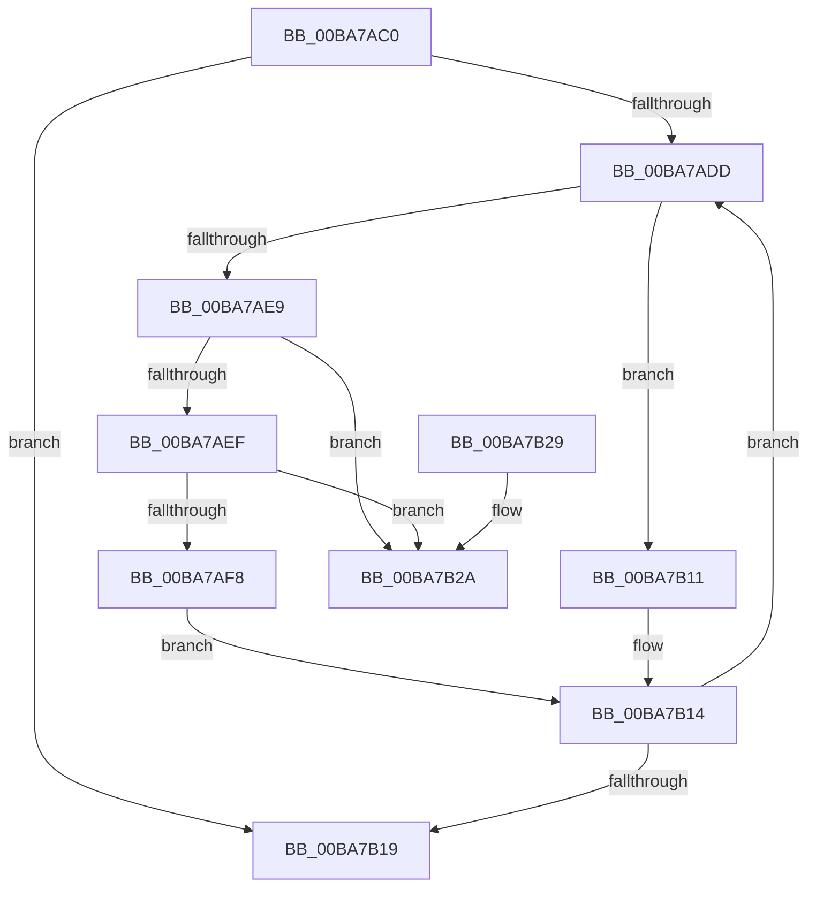

# ViThunkRemoveImportEntry

- RVA: `0x00BA7AC0`–`0x00BA7B31` (길이 `113` bytes)
- VA: `0x0000000140BA7AC0`
- 실행 섹션: `PAGEVRFY`
- PDB 이름 있음: `예`; PDB Function 태그: `아니요`
- unwind 정보 RVA: `0x0006383C`
- 디코드: `36`개 명령, `113/113` bytes 표시
- 미해석 바이트: `0` (있으면 어셈블리에 `.byte`로 보존)

> 이 문서는 커널 이미지의 기계어와 PDB 기호를 분석해 생성했습니다. 4번과 5번은 함수 원형과 자료형을 바이너리 사용 방식에서 추정한 C 해석이며 원본 소스 복구 결과는 아닙니다.

## 1. Dependencies

- 직접 호출 지점: **1**; 고유 호출 대상: **1**
- 직접 호출자로 확인된 함수: **1**
- RIP 상대 이미지 참조: **1**

### Outgoing calls
- `0x00BA7B04` → [ExFreePoolWithTag](../../poolcode/B8/ExFreePoolWithTag_function_00B82870.md) (function, `0x00B82870`)

### Direct callers
- [VfThunkCheckDriverUnloading](../BB/VfThunkCheckDriverUnloading_function_00BB8F04.md) at `0x00BB8F33`
- [VfThunkCheckDriverUnloading](../BB/VfThunkCheckDriverUnloading_function_00BB8F04.md) at `0x00BB8F55`

### Static image references
- `0x00BA7B09` → RVA `0x00F048B0` (`.data`; read/write)

## 2. Other-region calls and transfers

- 다른 실행 섹션으로 향하는 call: **1**
  - `0x00BA7B04` → [ExFreePoolWithTag](../../poolcode/B8/ExFreePoolWithTag_function_00B82870.md) (`PAGEVRFY` → `POOLCODE`)
- 별도 외부 분기/꼬리 이동을 확인하지 못했습니다.

## 3. Assembly (complete function range)

```asm
00BA7AC0  48 89 5C 24 08                  mov qword ptr [rsp + 8], rbx
00BA7AC5  48 89 74 24 10                  mov qword ptr [rsp + 0x10], rsi
00BA7ACA  57                              push rdi
00BA7ACB  48 83 EC 20                     sub rsp, 0x20
00BA7ACF  48 8B 19                        mov rbx, qword ptr [rcx]
00BA7AD2  48 8B F2                        mov rsi, rdx
00BA7AD5  48 8B F9                        mov rdi, rcx
00BA7AD8  48 3B D9                        cmp rbx, rcx
00BA7ADB  74 3C                           je 0x140ba7b19
00BA7ADD  48 8B CB                        mov rcx, rbx
00BA7AE0  48 8B 03                        mov rax, qword ptr [rbx]
00BA7AE3  48 39 73 10                     cmp qword ptr [rbx + 0x10], rsi
00BA7AE7  75 28                           jne 0x140ba7b11
00BA7AE9  48 39 58 08                     cmp qword ptr [rax + 8], rbx
00BA7AED  75 3B                           jne 0x140ba7b2a
00BA7AEF  48 8B 53 08                     mov rdx, qword ptr [rbx + 8]
00BA7AF3  48 39 1A                        cmp qword ptr [rdx], rbx
00BA7AF6  75 32                           jne 0x140ba7b2a
00BA7AF8  48 89 02                        mov qword ptr [rdx], rax
00BA7AFB  48 89 50 08                     mov qword ptr [rax + 8], rdx
00BA7AFF  33 D2                           xor edx, edx
00BA7B01  48 8B 1B                        mov rbx, qword ptr [rbx]
00BA7B04  E8 67 AD FD FF                  call 0x140b82870
00BA7B09  FF 0D A1 CD 35 00               dec dword ptr [rip + 0x35cda1]
00BA7B0F  EB 03                           jmp 0x140ba7b14
00BA7B11  48 8B D8                        mov rbx, rax
00BA7B14  48 3B DF                        cmp rbx, rdi
00BA7B17  75 C4                           jne 0x140ba7add
00BA7B19  48 8B 5C 24 30                  mov rbx, qword ptr [rsp + 0x30]
00BA7B1E  48 8B 74 24 38                  mov rsi, qword ptr [rsp + 0x38]
00BA7B23  48 83 C4 20                     add rsp, 0x20
00BA7B27  5F                              pop rdi
00BA7B28  C3                              ret
00BA7B29  CC                              int3
00BA7B2A  B9 03 00 00 00                  mov ecx, 3
00BA7B2F  CD 29                           int 0x29
```

## 4. C-style interpretation (structured pseudocode)

```c
__int64 __fastcall ViThunkRemoveImportEntry(__int64 a1, __int64 a2)
{
    __int64 result;
    __int64 v_rsp;
    unsigned __int64 v_stack_p10;
    unsigned __int64 v_stack_p8;

    v_stack_p8 = v_rbx;
    v_stack_p10 = v_rsi;
    v_rsp = (v_rsp) - (32);
    if ((*(unsigned __int64 *)(a1)) == a1) goto loc_00BA7B19;
loc_00BA7ADD:
    if ((*(unsigned __int64 *)(*(unsigned __int64 *)(a1) + 16)) != a2) goto loc_00BA7B11;
    if ((*(unsigned __int64 *)(*(unsigned __int64 *)(*(unsigned __int64 *)(a1)) + 8)) != (*(unsigned __int64 *)(a1))) goto loc_00BA7B2A;
    if ((*(unsigned __int64 *)(*(unsigned __int64 *)(*(unsigned __int64 *)(a1) + 8))) != (*(unsigned __int64 *)(a1))) goto loc_00BA7B2A;
    *(unsigned __int64 *)(*(unsigned __int64 *)(*(unsigned __int64 *)(a1) + 8)) = *(unsigned __int64 *)(*(unsigned __int64 *)(a1));
    *(unsigned __int64 *)(*(unsigned __int64 *)(*(unsigned __int64 *)(a1)) + 8) = *(unsigned __int64 *)(*(unsigned __int64 *)(a1) + 8);
    a2 = 0;
    result = ExFreePoolWithTag(*(unsigned __int64 *)(a1), a2, a3, a4);
    goto loc_00BA7B14;
loc_00BA7B11:
loc_00BA7B14:
    if (result != a1) goto loc_00BA7ADD;
loc_00BA7B19:
    v_rsp = (v_rsp) + (32);
    return result;
loc_00BA7B2A:
    return result;
}
```

## 5. (Beta) C Style

```c
int64_t ViThunkRemoveImportEntry(void *Arg1, int64_t Arg2)
{
    uint8_t *arg1 = (uint8_t *)Arg1;

    int64_t result;
    int64_t local_rsp;
    uint64_t v_stack_p10;
    uint64_t v_stack_p8;

    v_stack_p8 = local_rbx;
    v_stack_p10 = local_rsi;
    local_rsp = (local_rsp) - (32);
    if ((*(uint64_t *)(arg1)) == Arg1) goto loc_00BA7B19;
loc_00BA7ADD:
    if ((*(uint64_t *)(*(uint64_t *)(arg1) + 0x10)) != Arg2) goto loc_00BA7B11;
    if ((*(uint64_t *)(*(uint64_t *)(*(uint64_t *)(arg1)) + 0x8)) != (*(uint64_t *)(arg1))) goto loc_00BA7B2A;
    if ((*(uint64_t *)(*(uint64_t *)(*(uint64_t *)(arg1) + 0x8))) != (*(uint64_t *)(arg1))) goto loc_00BA7B2A;
    *(uint64_t *)(*(uint64_t *)(*(uint64_t *)(arg1) + 0x8)) = *(uint64_t *)(*(uint64_t *)(arg1));
    *(uint64_t *)(*(uint64_t *)(*(uint64_t *)(arg1)) + 0x8) = *(uint64_t *)(*(uint64_t *)(arg1) + 0x8);
    Arg2 = 0;
    result = ExFreePoolWithTag(*(uint64_t *)(arg1), Arg2, a3, a4);
    goto loc_00BA7B14;
loc_00BA7B11:
loc_00BA7B14:
    if (result != Arg1) goto loc_00BA7ADD;
loc_00BA7B19:
    local_rsp = (local_rsp) + (32);
    return result;
loc_00BA7B2A:
    return result;
}
```

### 관측된 메모리 오프셋

구조체 형식이 확인되지 않은 접근은 인자 기준의 오프셋으로만 기록했습니다.

| 기준 인자 | 오프셋 표현 | 폭 (bit) | 접근 |
|---|---:|---:|---|
| `Arg1` | `+ 0x0` | `64` | `R` |

## 6. Execution-region graph

[열기: 2D/3D 그래프와 함수 탐색 컨트롤 패널](../../../control-panel.html?section=pagevrfy&rva=0x00BA7AC0&view=graph)

- 2D 그래프는 위에서 아래로 흐르고, 3D 그래프는 빈 공간을 드래그해 회전합니다. Shift+드래그는 이동, 휠은 확대·축소, 함수 노드 선택은 대상 보고서 이동입니다.

### Static fallback


