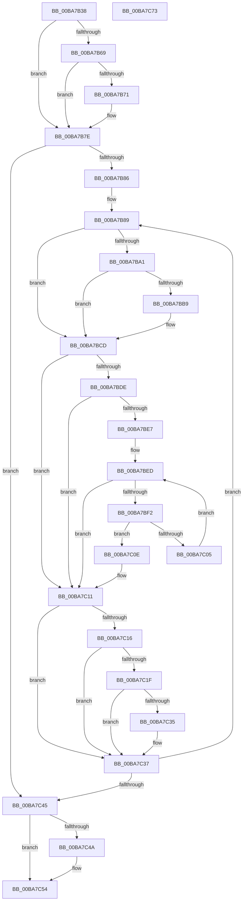

# ViThunkReplaceAllThunkedImports

- RVA: `0x00BA7B38`–`0x00BA7C74` (길이 `316` bytes)
- VA: `0x0000000140BA7B38`
- 실행 섹션: `PAGEVRFY`
- PDB 이름 있음: `예`; PDB Function 태그: `아니요`
- unwind 정보 RVA: `0x00075C18`
- 디코드: `99`개 명령, `316/316` bytes 표시
- 미해석 바이트: `0` (있으면 어셈블리에 `.byte`로 보존)

> 이 문서는 커널 이미지의 기계어와 PDB 기호를 분석해 생성했습니다. 4번과 5번은 함수 원형과 자료형을 바이너리 사용 방식에서 추정한 C 해석이며 원본 소스 복구 결과는 아닙니다.

## 1. Dependencies

- 직접 호출 지점: **7**; 고유 호출 대상: **4**
- 직접 호출자로 확인된 함수: **1**
- RIP 상대 이미지 참조: **5**

### Outgoing calls
- `0x00BA7B76` → [ViThunkFindAllSpecialTables](ViThunkFindAllSpecialTables_function_00BA75E8.md) (function, `0x00BA75E8`)
- `0x00BA7B96` → [ViThunkReplaceIatEntryForWdmThunk](ViThunkReplaceIatEntryForWdmThunk_function_00BA7CD8.md) (function, `0x00BA7CD8`)
- `0x00BA7BAE` → [ViThunkReplaceIatEntryForWdmThunk](ViThunkReplaceIatEntryForWdmThunk_function_00BA7CD8.md) (function, `0x00BA7CD8`)
- `0x00BA7BC6` → [ViThunkReplaceIatEntryForWdmThunk](ViThunkReplaceIatEntryForWdmThunk_function_00BA7CD8.md) (function, `0x00BA7CD8`)
- `0x00BA7BFC` → [ViThunkReplaceIatEntryForClassDriverThunk](ViThunkReplaceIatEntryForClassDriverThunk_function_00BA7C7C.md) (function, `0x00BA7C7C`)
- `0x00BA7C2C` → [ViThunkReplaceIatEntryForClassDriverThunk](ViThunkReplaceIatEntryForClassDriverThunk_function_00BA7C7C.md) (function, `0x00BA7C7C`)
- `0x00BA7C4F` → [ExFreePoolWithTag](../../poolcode/B8/ExFreePoolWithTag_function_00B82870.md) (function, `0x00B82870`)

### Direct callers
- [VfThunkApplyThunksCurrentSession](VfThunkApplyThunksCurrentSession_function_00BA719C.md) at `0x00BA7218`

### Static image references
- `0x00BA7B69` → RVA `0x00F04ABC` (`.data`; read)
- `0x00BA7B89` → RVA `0x00FF4A40` (`PAGEVRFD`; read)
- `0x00BA7BA1` → RVA `0x00FF51B0` (`PAGEVRFD`; read)
- `0x00BA7BB9` → RVA `0x00FF5F20` (`PAGEVRFD`; read)
- `0x00BA7C22` → RVA `0x00F04890` (`.data`; read)

## 2. Other-region calls and transfers

- 다른 실행 섹션으로 향하는 call: **1**
  - `0x00BA7C4F` → [ExFreePoolWithTag](../../poolcode/B8/ExFreePoolWithTag_function_00B82870.md) (`PAGEVRFY` → `POOLCODE`)
- 별도 외부 분기/꼬리 이동을 확인하지 못했습니다.

## 3. Assembly (complete function range)

```asm
00BA7B38  48 89 5C 24 08                  mov qword ptr [rsp + 8], rbx
00BA7B3D  48 89 6C 24 10                  mov qword ptr [rsp + 0x10], rbp
00BA7B42  48 89 74 24 18                  mov qword ptr [rsp + 0x18], rsi
00BA7B47  57                              push rdi
00BA7B48  41 54                           push r12
00BA7B4A  41 55                           push r13
00BA7B4C  41 56                           push r14
00BA7B4E  41 57                           push r15
00BA7B50  48 83 EC 20                     sub rsp, 0x20
00BA7B54  33 F6                           xor esi, esi
00BA7B56  41 8B E8                        mov ebp, r8d
00BA7B59  33 DB                           xor ebx, ebx
00BA7B5B  45 8B E9                        mov r13d, r9d
00BA7B5E  48 8B FA                        mov rdi, rdx
00BA7B61  4C 8B F9                        mov r15, rcx
00BA7B64  45 85 C9                        test r9d, r9d
00BA7B67  74 15                           je 0x140ba7b7e
00BA7B69  39 1D 4D CF 35 00               cmp dword ptr [rip + 0x35cf4d], ebx
00BA7B6F  75 0D                           jne 0x140ba7b7e
00BA7B71  8B D5                           mov edx, ebp
00BA7B73  48 8B CF                        mov rcx, rdi
00BA7B76  E8 6D FA FF FF                  call 0x140ba75e8
00BA7B7B  48 8B F0                        mov rsi, rax
00BA7B7E  85 ED                           test ebp, ebp
00BA7B80  0F 84 BF 00 00 00               je 0x140ba7c45
00BA7B86  4C 8B E5                        mov r12, rbp
00BA7B89  4C 8D 05 B0 CE 44 00            lea r8, [rip + 0x44ceb0]
00BA7B90  48 8B D7                        mov rdx, rdi
00BA7B93  49 8B CF                        mov rcx, r15
00BA7B96  E8 3D 01 00 00                  call 0x140ba7cd8
00BA7B9B  8B C8                           mov ecx, eax
00BA7B9D  85 C0                           test eax, eax
00BA7B9F  75 2C                           jne 0x140ba7bcd
00BA7BA1  4C 8D 05 08 D6 44 00            lea r8, [rip + 0x44d608]
00BA7BA8  48 8B D7                        mov rdx, rdi
00BA7BAB  49 8B CF                        mov rcx, r15
00BA7BAE  E8 25 01 00 00                  call 0x140ba7cd8
00BA7BB3  8B C8                           mov ecx, eax
00BA7BB5  85 C0                           test eax, eax
00BA7BB7  75 14                           jne 0x140ba7bcd
00BA7BB9  4C 8D 05 60 E3 44 00            lea r8, [rip + 0x44e360]
00BA7BC0  48 8B D7                        mov rdx, rdi
00BA7BC3  49 8B CF                        mov rcx, r15
00BA7BC6  E8 0D 01 00 00                  call 0x140ba7cd8
00BA7BCB  8B C8                           mov ecx, eax
00BA7BCD  85 C9                           test ecx, ecx
00BA7BCF  8D 43 01                        lea eax, [rbx + 1]
00BA7BD2  0F 44 C3                        cmove eax, ebx
00BA7BD5  8B D8                           mov ebx, eax
00BA7BD7  8B E8                           mov ebp, eax
00BA7BD9  48 85 F6                        test rsi, rsi
00BA7BDC  74 33                           je 0x140ba7c11
00BA7BDE  83 3D D7 CE 35 00 00            cmp dword ptr [rip + 0x35ced7], 0
00BA7BE5  75 2A                           jne 0x140ba7c11
00BA7BE7  48 8B 16                        mov rdx, qword ptr [rsi]
00BA7BEA  45 33 F6                        xor r14d, r14d
00BA7BED  48 85 D2                        test rdx, rdx
00BA7BF0  74 1F                           je 0x140ba7c11
00BA7BF2  48 83 C2 18                     add rdx, 0x18
00BA7BF6  4C 8B C7                        mov r8, rdi
00BA7BF9  49 8B CF                        mov rcx, r15
00BA7BFC  E8 7B 00 00 00                  call 0x140ba7c7c
00BA7C01  85 C0                           test eax, eax
00BA7C03  75 09                           jne 0x140ba7c0e
00BA7C05  41 FF C6                        inc r14d
00BA7C08  4A 8B 14 F6                     mov rdx, qword ptr [rsi + r14*8]
00BA7C0C  EB DF                           jmp 0x140ba7bed
00BA7C0E  8D 5D 01                        lea ebx, [rbp + 1]
00BA7C11  45 85 ED                        test r13d, r13d
00BA7C14  74 21                           je 0x140ba7c37
00BA7C16  83 3D 9F CE 35 00 00            cmp dword ptr [rip + 0x35ce9f], 0
00BA7C1D  75 18                           jne 0x140ba7c37
00BA7C1F  4C 8B C7                        mov r8, rdi
00BA7C22  48 8D 15 67 CC 35 00            lea rdx, [rip + 0x35cc67]
00BA7C29  49 8B CF                        mov rcx, r15
00BA7C2C  E8 4B 00 00 00                  call 0x140ba7c7c
00BA7C31  85 C0                           test eax, eax
00BA7C33  74 02                           je 0x140ba7c37
00BA7C35  FF C3                           inc ebx
00BA7C37  48 83 C7 08                     add rdi, 8
00BA7C3B  49 83 EC 01                     sub r12, 1
00BA7C3F  0F 85 44 FF FF FF               jne 0x140ba7b89
00BA7C45  48 85 F6                        test rsi, rsi
00BA7C48  74 0A                           je 0x140ba7c54
00BA7C4A  33 D2                           xor edx, edx
00BA7C4C  48 8B CE                        mov rcx, rsi
00BA7C4F  E8 1C AC FD FF                  call 0x140b82870
00BA7C54  48 8B 6C 24 58                  mov rbp, qword ptr [rsp + 0x58]
00BA7C59  8B C3                           mov eax, ebx
00BA7C5B  48 8B 5C 24 50                  mov rbx, qword ptr [rsp + 0x50]
00BA7C60  48 8B 74 24 60                  mov rsi, qword ptr [rsp + 0x60]
00BA7C65  48 83 C4 20                     add rsp, 0x20
00BA7C69  41 5F                           pop r15
00BA7C6B  41 5E                           pop r14
00BA7C6D  41 5D                           pop r13
00BA7C6F  41 5C                           pop r12
00BA7C71  5F                              pop rdi
00BA7C72  C3                              ret
00BA7C73  CC                              int3
```

## 4. C-style interpretation (structured pseudocode)

```c
__int64 __fastcall ViThunkReplaceAllThunkedImports(__int64 a1, __int64 a2, int a3, int a4)
{
    __int64 result;
    __int64 v_r12;
    __int64 v_r14;
    __int64 v_rbx;
    __int64 v_rdi;
    __int64 v_rsi;
    __int64 v_rsp;
    unsigned __int64 v_stack_p10;
    unsigned __int64 v_stack_p18;
    unsigned __int64 v_stack_p8;

    v_stack_p8 = v_rbx;
    v_stack_p10 = v_rbp;
    v_stack_p18 = v_rsi;
    v_rsp = (v_rsp) - (32);
    v_rsi = 0;
    v_rbx = 0;
    if (a4 == 0) goto loc_00BA7B7E;
    if ((*(unsigned int *)(v_rip + 3526477)) == 0) {
        a2 = (unsigned int)((unsigned int)(a3));
        a1 = a2;
        result = ViThunkFindAllSpecialTables(a1, a2, a3, a4);
        v_rsi = result;
    }
    if ((unsigned int)((unsigned int)(a3)) == 0) goto loc_00BA7C45;
loc_00BA7B89:
    result = ViThunkReplaceIatEntryForWdmThunk(a1, a2, v_rip + 4509360, a4);
    if ((unsigned int)(result) != 0) goto loc_00BA7BCD;
    result = ViThunkReplaceIatEntryForWdmThunk(a1, a2, v_rip + 4511240, a4);
    if ((unsigned int)(result) == 0) {
        a3 = v_rip + 4514656;
        a2 = a2;
        a1 = a1;
        result = ViThunkReplaceIatEntryForWdmThunk(a1, a2, a3, a4);
        a1 = (unsigned int)(result);
    }
    result = v_rbx + 1;
    if ((unsigned int)(a1) == 0) { result = 0; }
    if (v_rsi == 0) goto loc_00BA7C11;
    if ((*(unsigned int *)(v_rip + 3526359)) != 0) goto loc_00BA7C11;
    v_r14 = 0;
loc_00BA7BED:
    if (*(unsigned __int64 *)(v_rsi) == 0) goto loc_00BA7C11;
    a2 = (*(unsigned __int64 *)(v_rsi)) + (24);
    result = ViThunkReplaceIatEntryForClassDriverThunk(a1, a2, a2, a4);
    if ((unsigned int)(result) != 0) goto loc_00BA7C0E;
    v_r14 = (unsigned int)((v_r14) + 1);
    goto loc_00BA7BED;
loc_00BA7C0E:
loc_00BA7C11:
    if ((unsigned int)((unsigned int)(a4)) == 0) goto loc_00BA7C37;
    if ((*(unsigned int *)(v_rip + 3526303)) != 0) goto loc_00BA7C37;
    result = ViThunkReplaceIatEntryForClassDriverThunk(a1, v_rip + 3525735, a2, a4);
    v_rbx = (unsigned int)((unsigned int)(result)) + 1;
    if ((unsigned int)(result) != 0) {
        v_rbx = (unsigned int)(((unsigned int)((unsigned int)(result)) + 1) + 1);
    }
    v_rdi = (a2) + (8);
    v_r12 = ((unsigned int)(a3)) - (1);
    if (condition_is_not_equal) goto loc_00BA7B89;
loc_00BA7C45:
    if (v_rsi != 0) {
        a2 = 0;
        a1 = v_rsi;
        result = ExFreePoolWithTag(a1, a2, a2, a4);
    }
    v_rsp = (v_rsp) + (32);
    return (unsigned int)((unsigned int)(v_rbx));
}
```

## 5. (Beta) C Style

```c
int64_t ViThunkReplaceAllThunkedImports(int64_t Arg1, int64_t Arg2, int32_t Arg3, int32_t Arg4)
{
    int64_t result;
    int64_t local_r12;
    int64_t local_r14;
    int64_t local_rbx;
    int64_t local_rdi;
    int64_t local_rsi;
    int64_t local_rsp;
    uint64_t v_stack_p10;
    uint64_t v_stack_p18;
    uint64_t v_stack_p8;

    v_stack_p8 = local_rbx;
    v_stack_p10 = local_rbp;
    v_stack_p18 = local_rsi;
    local_rsp = (local_rsp) - (32);
    local_rsi = 0;
    local_rbx = 0;
    if (Arg4 == 0) goto loc_00BA7B7E;
    if ((*(uint32_t *)(v_rip + 0x35CF4D)) == 0) {
        Arg2 = (uint32_t)((uint32_t)(Arg3));
        Arg1 = Arg2;
        result = ViThunkFindAllSpecialTables(Arg1, Arg2, Arg3, Arg4);
        local_rsi = result;
    }
    if ((uint32_t)((uint32_t)(Arg3)) == 0) goto loc_00BA7C45;
loc_00BA7B89:
    result = ViThunkReplaceIatEntryForWdmThunk(Arg1, Arg2, v_rip + 4509360, Arg4);
    if ((uint32_t)(result) != 0) goto loc_00BA7BCD;
    result = ViThunkReplaceIatEntryForWdmThunk(Arg1, Arg2, v_rip + 4511240, Arg4);
    if ((uint32_t)(result) == 0) {
        Arg3 = v_rip + 4514656;
        Arg2 = Arg2;
        Arg1 = Arg1;
        result = ViThunkReplaceIatEntryForWdmThunk(Arg1, Arg2, Arg3, Arg4);
        Arg1 = (uint32_t)(result);
    }
    result = local_rbx + 1;
    if ((uint32_t)(Arg1) == 0) { result = 0; }
    if (local_rsi == 0) goto loc_00BA7C11;
    if ((*(uint32_t *)(v_rip + 0x35CED7)) != 0) goto loc_00BA7C11;
    local_r14 = 0;
loc_00BA7BED:
    if (*(uint64_t *)(local_rsi) == 0) goto loc_00BA7C11;
    Arg2 = (*(uint64_t *)(local_rsi)) + (24);
    result = ViThunkReplaceIatEntryForClassDriverThunk(Arg1, Arg2, Arg2, Arg4);
    if ((uint32_t)(result) != 0) goto loc_00BA7C0E;
    local_r14 = (uint32_t)((local_r14) + 1);
    goto loc_00BA7BED;
loc_00BA7C0E:
loc_00BA7C11:
    if ((uint32_t)((uint32_t)(Arg4)) == 0) goto loc_00BA7C37;
    if ((*(uint32_t *)(v_rip + 0x35CE9F)) != 0) goto loc_00BA7C37;
    result = ViThunkReplaceIatEntryForClassDriverThunk(Arg1, v_rip + 3525735, Arg2, Arg4);
    local_rbx = (uint32_t)((uint32_t)(result)) + 1;
    if ((uint32_t)(result) != 0) {
        local_rbx = (uint32_t)(((uint32_t)((uint32_t)(result)) + 1) + 1);
    }
    local_rdi = (Arg2) + (8);
    local_r12 = ((uint32_t)(Arg3)) - (1);
    if (condition_is_not_equal) goto loc_00BA7B89;
loc_00BA7C45:
    if (local_rsi != 0) {
        Arg2 = 0;
        Arg1 = local_rsi;
        result = ExFreePoolWithTag(Arg1, Arg2, Arg2, Arg4);
    }
    local_rsp = (local_rsp) + (32);
    return (uint32_t)((uint32_t)(local_rbx));
}
```

## 6. Execution-region graph

[열기: 2D/3D 그래프와 함수 탐색 컨트롤 패널](../../../control-panel.html?section=pagevrfy&rva=0x00BA7B38&view=graph)

- 2D 그래프는 위에서 아래로 흐르고, 3D 그래프는 빈 공간을 드래그해 회전합니다. Shift+드래그는 이동, 휠은 확대·축소, 함수 노드 선택은 대상 보고서 이동입니다.

### Static fallback


