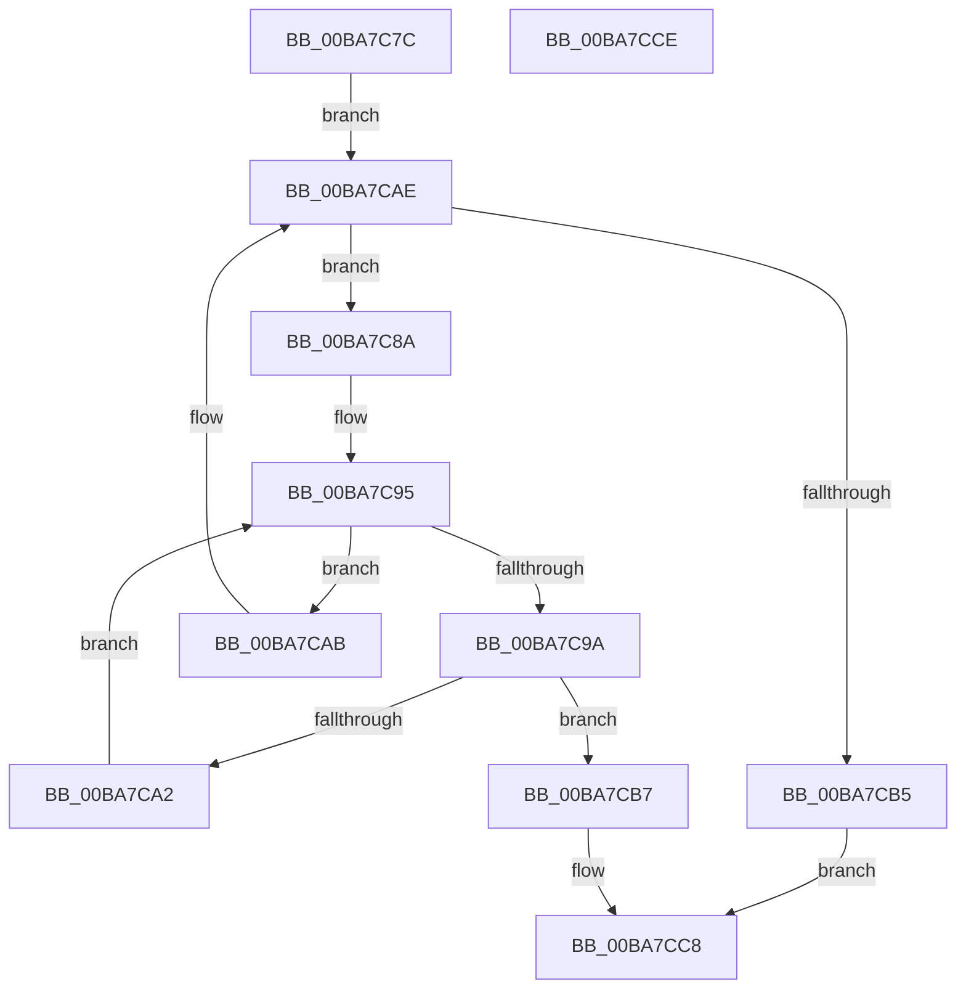

# ViThunkReplaceIatEntryForClassDriverThunk

- RVA: `0x00BA7C7C`–`0x00BA7CCF` (길이 `83` bytes)
- VA: `0x0000000140BA7C7C`
- 실행 섹션: `PAGEVRFY`
- PDB 이름 있음: `예`; PDB Function 태그: `아니요`
- unwind 정보 RVA: `0x0005CF00`
- 디코드: `29`개 명령, `83/83` bytes 표시
- 미해석 바이트: `0` (있으면 어셈블리에 `.byte`로 보존)

> 이 문서는 커널 이미지의 기계어와 PDB 기호를 분석해 생성했습니다. 4번과 5번은 함수 원형과 자료형을 바이너리 사용 방식에서 추정한 C 해석이며 원본 소스 복구 결과는 아닙니다.

## 1. Dependencies

- 직접 호출 지점: **1**; 고유 호출 대상: **1**
- 직접 호출자로 확인된 함수: **1**
- RIP 상대 이미지 참조: **0**

### Outgoing calls
- `0x00BA7CBE` → [MmReplaceImportEntry](../../text/67/MmReplaceImportEntry_function_0067175C.md) (function, `0x0067175C`)

### Direct callers
- [ViThunkReplaceAllThunkedImports](ViThunkReplaceAllThunkedImports_function_00BA7B38.md) at `0x00BA7BFC`
- [ViThunkReplaceAllThunkedImports](ViThunkReplaceAllThunkedImports_function_00BA7B38.md) at `0x00BA7C2C`

### Static image references
- 디코드된 RIP-relative 메모리 참조가 없습니다.

## 2. Other-region calls and transfers

- 다른 실행 섹션으로 향하는 call: **1**
  - `0x00BA7CBE` → [MmReplaceImportEntry](../../text/67/MmReplaceImportEntry_function_0067175C.md) (`PAGEVRFY` → `.text`)
- 별도 외부 분기/꼬리 이동을 확인하지 못했습니다.

## 3. Assembly (complete function range)

```asm
00BA7C7C  40 53                           push rbx
00BA7C7E  48 83 EC 20                     sub rsp, 0x20
00BA7C82  4C 8B 0A                        mov r9, qword ptr [rdx]
00BA7C85  4D 8B D8                        mov r11, r8
00BA7C88  EB 24                           jmp 0x140ba7cae
00BA7C8A  41 8B 59 18                     mov ebx, dword ptr [r9 + 0x18]
00BA7C8E  4D 8D 41 20                     lea r8, [r9 + 0x20]
00BA7C92  45 33 D2                        xor r10d, r10d
00BA7C95  44 3B D3                        cmp r10d, ebx
00BA7C98  73 11                           jae 0x140ba7cab
00BA7C9A  49 8B 00                        mov rax, qword ptr [r8]
00BA7C9D  49 39 03                        cmp qword ptr [r11], rax
00BA7CA0  74 15                           je 0x140ba7cb7
00BA7CA2  49 83 C0 10                     add r8, 0x10
00BA7CA6  41 FF C2                        inc r10d
00BA7CA9  EB EA                           jmp 0x140ba7c95
00BA7CAB  4D 8B 09                        mov r9, qword ptr [r9]
00BA7CAE  33 C0                           xor eax, eax
00BA7CB0  4C 3B CA                        cmp r9, rdx
00BA7CB3  75 D5                           jne 0x140ba7c8a
00BA7CB5  EB 11                           jmp 0x140ba7cc8
00BA7CB7  4D 8B 40 08                     mov r8, qword ptr [r8 + 8]
00BA7CBB  49 8B D3                        mov rdx, r11
00BA7CBE  E8 99 9A AC FF                  call 0x14067175c
00BA7CC3  B8 01 00 00 00                  mov eax, 1
00BA7CC8  48 83 C4 20                     add rsp, 0x20
00BA7CCC  5B                              pop rbx
00BA7CCD  C3                              ret
00BA7CCE  CC                              int3
```

## 4. C-style interpretation (structured pseudocode)

```c
__int64 __fastcall ViThunkReplaceIatEntryForClassDriverThunk(__int64 a1, __int64 a2, __int64 a3)
{
    __int64 result;
    __int64 v_r10;
    __int64 v_rsp;

    v_rsp = (v_rsp) - (32);
    goto loc_00BA7CAE;
loc_00BA7C8A:
    v_r10 = 0;
loc_00BA7C95:
    if (0 >= ((unsigned int)((unsigned int)(*(unsigned int *)(*(unsigned __int64 *)(a2) + 24))))) goto loc_00BA7CAB;
    if ((*(unsigned __int64 *)(a3)) == (*(unsigned __int64 *)(*(unsigned __int64 *)(a2) + 32))) goto loc_00BA7CB7;
    a3 = (*(unsigned __int64 *)(a2) + 32) + (16);
    v_r10 = (unsigned int)((v_r10) + 1);
    goto loc_00BA7C95;
loc_00BA7CAB:
loc_00BA7CAE:
    result = 0;
    if ((*(unsigned __int64 *)(*(unsigned __int64 *)(a2))) != a2) goto loc_00BA7C8A;
    goto loc_00BA7CC8;
loc_00BA7CB7:
    result = MmReplaceImportEntry(a1, a3, *(unsigned __int64 *)(a3 + 8), *(unsigned __int64 *)(*(unsigned __int64 *)(a2)));
loc_00BA7CC8:
    v_rsp = (v_rsp) + (32);
    return 1;
}
```

## 5. (Beta) C Style

```c
int64_t ViThunkReplaceIatEntryForClassDriverThunk(int64_t Arg1, void *Arg2, void *Arg3)
{
    uint8_t *arg2 = (uint8_t *)Arg2;
    uint8_t *arg3 = (uint8_t *)Arg3;

    int64_t result;
    int64_t local_r10;
    int64_t local_rsp;

    local_rsp = (local_rsp) - (32);
    goto loc_00BA7CAE;
loc_00BA7C8A:
    local_r10 = 0;
loc_00BA7C95:
    if (0 >= ((uint32_t)((uint32_t)(*(uint32_t *)(*(uint64_t *)(arg2) + 0x18))))) goto loc_00BA7CAB;
    if ((*(uint64_t *)(arg3)) == (*(uint64_t *)(*(uint64_t *)(arg2) + 0x20))) goto loc_00BA7CB7;
    Arg3 = (*(uint64_t *)(arg2) + 32) + (16);
    local_r10 = (uint32_t)((local_r10) + 1);
    goto loc_00BA7C95;
loc_00BA7CAB:
loc_00BA7CAE:
    result = 0;
    if ((*(uint64_t *)(*(uint64_t *)(arg2))) != Arg2) goto loc_00BA7C8A;
    goto loc_00BA7CC8;
loc_00BA7CB7:
    result = MmReplaceImportEntry(Arg1, Arg3, *(uint64_t *)(arg3 + 0x8), *(uint64_t *)(*(uint64_t *)(arg2)));
loc_00BA7CC8:
    local_rsp = (local_rsp) + (32);
    return 1;
}
```

### 관측된 메모리 오프셋

구조체 형식이 확인되지 않은 접근은 인자 기준의 오프셋으로만 기록했습니다.

| 기준 인자 | 오프셋 표현 | 폭 (bit) | 접근 |
|---|---:|---:|---|
| `Arg2` | `+ 0x0` | `64` | `R` |
| `Arg3` | `+ 0x0` | `64` | `R` |

## 6. Execution-region graph

[열기: 2D/3D 그래프와 함수 탐색 컨트롤 패널](../../../control-panel.html?section=pagevrfy&rva=0x00BA7C7C&view=graph)

- 2D 그래프는 위에서 아래로 흐르고, 3D 그래프는 빈 공간을 드래그해 회전합니다. Shift+드래그는 이동, 휠은 확대·축소, 함수 노드 선택은 대상 보고서 이동입니다.

### Static fallback


