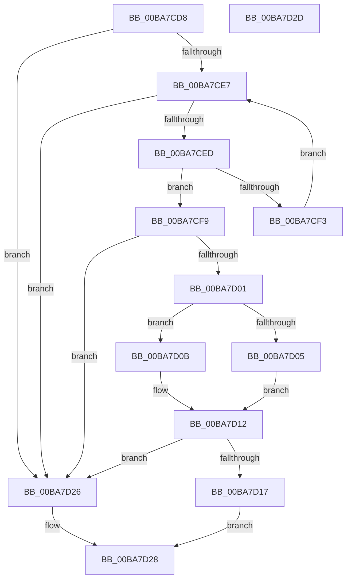

# ViThunkReplaceIatEntryForWdmThunk

- RVA: `0x00BA7CD8`–`0x00BA7D2E` (길이 `86` bytes)
- VA: `0x0000000140BA7CD8`
- 실행 섹션: `PAGEVRFY`
- PDB 이름 있음: `예`; PDB Function 태그: `아니요`
- unwind 정보 RVA: `0x0005C788`
- 디코드: `30`개 명령, `86/86` bytes 표시
- 미해석 바이트: `0` (있으면 어셈블리에 `.byte`로 보존)

> 이 문서는 커널 이미지의 기계어와 PDB 기호를 분석해 생성했습니다. 4번과 5번은 함수 원형과 자료형을 바이너리 사용 방식에서 추정한 C 해석이며 원본 소스 복구 결과는 아닙니다.

## 1. Dependencies

- 직접 호출 지점: **1**; 고유 호출 대상: **1**
- 직접 호출자로 확인된 함수: **1**
- RIP 상대 이미지 참조: **0**

### Outgoing calls
- `0x00BA7D1A` → [MmReplaceImportEntry](../../text/67/MmReplaceImportEntry_function_0067175C.md) (function, `0x0067175C`)

### Direct callers
- [ViThunkReplaceAllThunkedImports](ViThunkReplaceAllThunkedImports_function_00BA7B38.md) at `0x00BA7B96`
- [ViThunkReplaceAllThunkedImports](ViThunkReplaceAllThunkedImports_function_00BA7B38.md) at `0x00BA7BAE`
- [ViThunkReplaceAllThunkedImports](ViThunkReplaceAllThunkedImports_function_00BA7B38.md) at `0x00BA7BC6`

### Static image references
- 디코드된 RIP-relative 메모리 참조가 없습니다.

## 2. Other-region calls and transfers

- 다른 실행 섹션으로 향하는 call: **1**
  - `0x00BA7D1A` → [MmReplaceImportEntry](../../text/67/MmReplaceImportEntry_function_0067175C.md) (`PAGEVRFY` → `.text`)
- 별도 외부 분기/꼬리 이동을 확인하지 못했습니다.

## 3. Assembly (complete function range)

```asm
00BA7CD8  48 83 EC 28                     sub rsp, 0x28
00BA7CDC  48 8B 02                        mov rax, qword ptr [rdx]
00BA7CDF  4C 8B C9                        mov r9, rcx
00BA7CE2  48 85 C0                        test rax, rax
00BA7CE5  74 3F                           je 0x140ba7d26
00BA7CE7  49 83 38 00                     cmp qword ptr [r8], 0
00BA7CEB  74 39                           je 0x140ba7d26
00BA7CED  49 3B 40 10                     cmp rax, qword ptr [r8 + 0x10]
00BA7CF1  74 06                           je 0x140ba7cf9
00BA7CF3  49 83 C0 38                     add r8, 0x38
00BA7CF7  EB EE                           jmp 0x140ba7ce7
00BA7CF9  41 8B 40 20                     mov eax, dword ptr [r8 + 0x20]
00BA7CFD  A8 01                           test al, 1
00BA7CFF  74 25                           je 0x140ba7d26
00BA7D01  A8 04                           test al, 4
00BA7D03  74 06                           je 0x140ba7d0b
00BA7D05  4D 8B 40 08                     mov r8, qword ptr [r8 + 8]
00BA7D09  EB 07                           jmp 0x140ba7d12
00BA7D0B  49 8B 48 28                     mov rcx, qword ptr [r8 + 0x28]
00BA7D0F  4C 8B 01                        mov r8, qword ptr [rcx]
00BA7D12  4D 85 C0                        test r8, r8
00BA7D15  74 0F                           je 0x140ba7d26
00BA7D17  49 8B C9                        mov rcx, r9
00BA7D1A  E8 3D 9A AC FF                  call 0x14067175c
00BA7D1F  B8 01 00 00 00                  mov eax, 1
00BA7D24  EB 02                           jmp 0x140ba7d28
00BA7D26  33 C0                           xor eax, eax
00BA7D28  48 83 C4 28                     add rsp, 0x28
00BA7D2C  C3                              ret
00BA7D2D  CC                              int3
```

## 4. C-style interpretation (structured pseudocode)

```c
__int64 __fastcall ViThunkReplaceIatEntryForWdmThunk(__int64 a1, __int64 a2, __int64 a3)
{
    __int64 result;
    __int64 v_rsp;

    v_rsp = (v_rsp) - (40);
    if (*(unsigned __int64 *)(a2) == 0) goto loc_00BA7D26;
loc_00BA7CE7:
    if ((*(unsigned __int64 *)(a3)) == 0) goto loc_00BA7D26;
    if ((*(unsigned __int64 *)(a2)) == (*(unsigned __int64 *)(a3 + 16))) goto loc_00BA7CF9;
    a3 = (a3) + (56);
    goto loc_00BA7CE7;
loc_00BA7CF9:
    if ((((unsigned __int8)((unsigned int)(*(unsigned int *)(a3 + 32)))) & (1)) == 0) goto loc_00BA7D26;
    if ((((unsigned __int8)((unsigned int)(*(unsigned int *)(a3 + 32)))) & (4)) == 0) goto loc_00BA7D0B;
    goto loc_00BA7D12;
loc_00BA7D0B:
loc_00BA7D12:
    if (*(unsigned __int64 *)(*(unsigned __int64 *)(*(unsigned __int64 *)(a3 + 8) + 40)) == 0) goto loc_00BA7D26;
    result = MmReplaceImportEntry(a1, a2, *(unsigned __int64 *)(*(unsigned __int64 *)(*(unsigned __int64 *)(a3 + 8) + 40)), a1);
    goto loc_00BA7D28;
loc_00BA7D26:
    result = 0;
loc_00BA7D28:
    v_rsp = (v_rsp) + (40);
    return result;
}
```

## 5. (Beta) C Style

```c
int64_t ViThunkReplaceIatEntryForWdmThunk(int64_t Arg1, void *Arg2, void *Arg3)
{
    uint8_t *arg2 = (uint8_t *)Arg2;
    uint8_t *arg3 = (uint8_t *)Arg3;

    int64_t result;
    int64_t local_rsp;

    local_rsp = (local_rsp) - (40);
    if (*(uint64_t *)(arg2) == 0) goto loc_00BA7D26;
loc_00BA7CE7:
    if ((*(uint64_t *)(arg3)) == 0) goto loc_00BA7D26;
    if ((*(uint64_t *)(arg2)) == (*(uint64_t *)(arg3 + 0x10))) goto loc_00BA7CF9;
    Arg3 = (Arg3) + (56);
    goto loc_00BA7CE7;
loc_00BA7CF9:
    if ((((uint8_t)((uint32_t)(*(uint32_t *)(arg3 + 0x20)))) & (1)) == 0) goto loc_00BA7D26;
    if ((((uint8_t)((uint32_t)(*(uint32_t *)(arg3 + 0x20)))) & (4)) == 0) goto loc_00BA7D0B;
    goto loc_00BA7D12;
loc_00BA7D0B:
loc_00BA7D12:
    if (*(uint64_t *)(*(uint64_t *)(*(uint64_t *)(arg3 + 0x8) + 0x28)) == 0) goto loc_00BA7D26;
    result = MmReplaceImportEntry(Arg1, Arg2, *(uint64_t *)(*(uint64_t *)(*(uint64_t *)(arg3 + 0x8) + 0x28)), Arg1);
    goto loc_00BA7D28;
loc_00BA7D26:
    result = 0;
loc_00BA7D28:
    local_rsp = (local_rsp) + (40);
    return result;
}
```

### 관측된 메모리 오프셋

구조체 형식이 확인되지 않은 접근은 인자 기준의 오프셋으로만 기록했습니다.

| 기준 인자 | 오프셋 표현 | 폭 (bit) | 접근 |
|---|---:|---:|---|
| `Arg2` | `+ 0x0` | `64` | `R` |
| `Arg3` | `+ 0x0` | `64` | `R` |
| `Arg3` | `+ 0x8` | `64` | `R` |
| `Arg3` | `+ 0x10` | `64` | `R` |
| `Arg3` | `+ 0x20` | `32` | `R` |
| `Arg3` | `+ 0x28` | `64` | `R` |

## 6. Execution-region graph

[열기: 2D/3D 그래프와 함수 탐색 컨트롤 패널](../../../control-panel.html?section=pagevrfy&rva=0x00BA7CD8&view=graph)

- 2D 그래프는 위에서 아래로 흐르고, 3D 그래프는 빈 공간을 드래그해 회전합니다. Shift+드래그는 이동, 휠은 확대·축소, 함수 노드 선택은 대상 보고서 이동입니다.

### Static fallback


