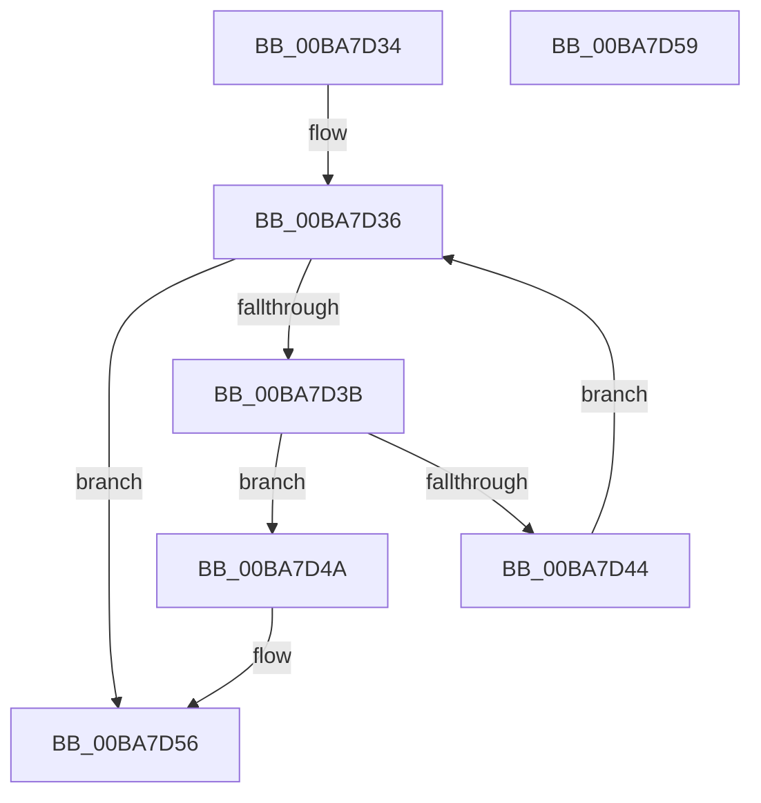

# ViThunkReplacePristine

- RVA: `0x00BA7D34`–`0x00BA7D5A` (길이 `38` bytes)
- VA: `0x0000000140BA7D34`
- 실행 섹션: `PAGEVRFY`
- PDB 이름 있음: `예`; PDB Function 태그: `아니요`
- unwind 정보 RVA: `0x000DB714`
- 디코드: `14`개 명령, `38/38` bytes 표시
- 미해석 바이트: `0` (있으면 어셈블리에 `.byte`로 보존)

> 이 문서는 커널 이미지의 기계어와 PDB 기호를 분석해 생성했습니다. 4번과 5번은 함수 원형과 자료형을 바이너리 사용 방식에서 추정한 C 해석이며 원본 소스 복구 결과는 아닙니다.

## 1. Dependencies

- 직접 호출 지점: **0**; 고유 호출 대상: **0**
- 직접 호출자로 확인된 함수: **1**
- RIP 상대 이미지 참조: **0**

### Outgoing calls
- 직접 디코드된 call 명령이 없습니다.

### Direct callers
- [ViThunkRecoverPristines](ViThunkRecoverPristines_function_00BA79F0.md) at `0x00BA7A66`
- [ViThunkRecoverPristines](ViThunkRecoverPristines_function_00BA79F0.md) at `0x00BA7A77`
- [ViThunkRecoverPristines](ViThunkRecoverPristines_function_00BA79F0.md) at `0x00BA7A88`

### Static image references
- 디코드된 RIP-relative 메모리 참조가 없습니다.

## 2. Other-region calls and transfers

- 다른 실행 섹션으로 향하는 call: **0**
- 별도 외부 분기/꼬리 이동을 확인하지 못했습니다.

## 3. Assembly (complete function range)

```asm
00BA7D34  33 D2                           xor edx, edx
00BA7D36  48 39 11                        cmp qword ptr [rcx], rdx
00BA7D39  74 1B                           je 0x140ba7d56
00BA7D3B  48 8B 41 08                     mov rax, qword ptr [rcx + 8]
00BA7D3F  49 39 00                        cmp qword ptr [r8], rax
00BA7D42  74 06                           je 0x140ba7d4a
00BA7D44  48 83 C1 38                     add rcx, 0x38
00BA7D48  EB EC                           jmp 0x140ba7d36
00BA7D4A  48 8B 41 10                     mov rax, qword ptr [rcx + 0x10]
00BA7D4E  BA 01 00 00 00                  mov edx, 1
00BA7D53  49 89 00                        mov qword ptr [r8], rax
00BA7D56  8B C2                           mov eax, edx
00BA7D58  C3                              ret
00BA7D59  CC                              int3
```

## 4. C-style interpretation (structured pseudocode)

```c
__int64 __fastcall ViThunkReplacePristine(__int64 a1, int a2, __int64 a3)
{
    a2 = 0;
loc_00BA7D36:
    if ((*(unsigned __int64 *)(a1)) == 0) goto loc_00BA7D56;
    if ((*(unsigned __int64 *)(a3)) == (*(unsigned __int64 *)(a1 + 8))) goto loc_00BA7D4A;
    a1 = (a1) + (56);
    goto loc_00BA7D36;
loc_00BA7D4A:
    *(unsigned __int64 *)(a3) = *(unsigned __int64 *)(a1 + 16);
loc_00BA7D56:
    return 1;
}
```

## 5. (Beta) C Style

```c
int64_t ViThunkReplacePristine(void *Arg1, int32_t Arg2, void *Arg3)
{
    uint8_t *arg1 = (uint8_t *)Arg1;
    uint8_t *arg3 = (uint8_t *)Arg3;

    Arg2 = 0;
loc_00BA7D36:
    if ((*(uint64_t *)(arg1)) == 0) goto loc_00BA7D56;
    if ((*(uint64_t *)(arg3)) == (*(uint64_t *)(arg1 + 0x8))) goto loc_00BA7D4A;
    Arg1 = (Arg1) + (56);
    goto loc_00BA7D36;
loc_00BA7D4A:
    *(uint64_t *)(arg3) = *(uint64_t *)(arg1 + 0x10);
loc_00BA7D56:
    return 1;
}
```

### 관측된 메모리 오프셋

구조체 형식이 확인되지 않은 접근은 인자 기준의 오프셋으로만 기록했습니다.

| 기준 인자 | 오프셋 표현 | 폭 (bit) | 접근 |
|---|---:|---:|---|
| `Arg1` | `+ 0x0` | `64` | `R` |
| `Arg1` | `+ 0x8` | `64` | `R` |
| `Arg1` | `+ 0x10` | `64` | `R` |
| `Arg3` | `+ 0x0` | `64` | `R` |
| `Arg3` | `+ 0x0` | `64` | `W` |

## 6. Execution-region graph

[열기: 2D/3D 그래프와 함수 탐색 컨트롤 패널](../../../control-panel.html?section=pagevrfy&rva=0x00BA7D34&view=graph)

- 2D 그래프는 위에서 아래로 흐르고, 3D 그래프는 빈 공간을 드래그해 회전합니다. Shift+드래그는 이동, 휠은 확대·축소, 함수 노드 선택은 대상 보고서 이동입니다.

### Static fallback


