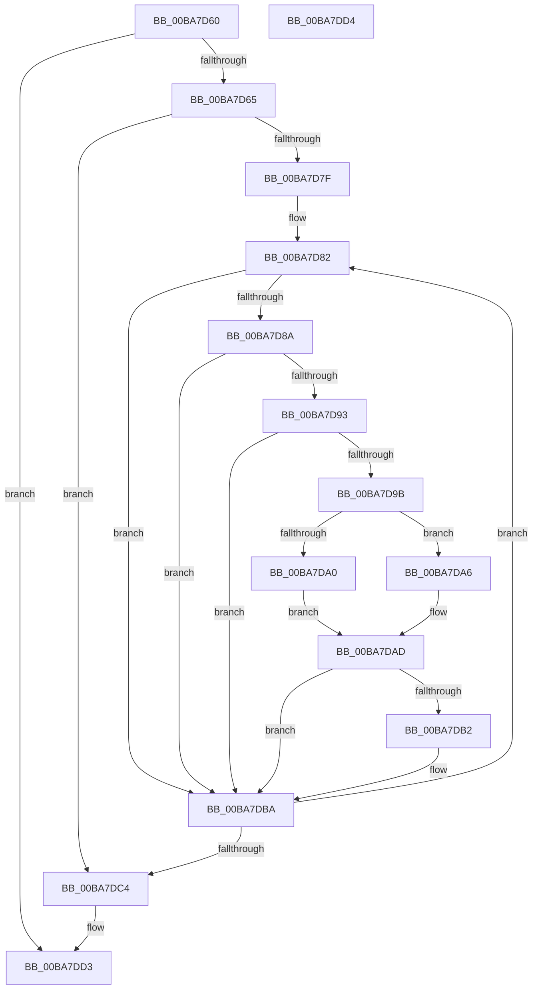

# ViThunkReplaceSharedExports

- RVA: `0x00BA7D60`–`0x00BA7DD5` (길이 `117` bytes)
- VA: `0x0000000140BA7D60`
- 실행 섹션: `PAGEVRFY`
- PDB 이름 있음: `예`; PDB Function 태그: `아니요`
- unwind 정보 RVA: `0x000ADC24`
- 디코드: `39`개 명령, `117/117` bytes 표시
- 미해석 바이트: `0` (있으면 어셈블리에 `.byte`로 보존)

> 이 문서는 커널 이미지의 기계어와 PDB 기호를 분석해 생성했습니다. 4번과 5번은 함수 원형과 자료형을 바이너리 사용 방식에서 추정한 C 해석이며 원본 소스 복구 결과는 아닙니다.

## 1. Dependencies

- 직접 호출 지점: **1**; 고유 호출 대상: **1**
- 직접 호출자로 확인된 함수: **1**
- RIP 상대 이미지 참조: **0**

### Outgoing calls
- `0x00BA7DB5` → [MmReplaceImportEntry](../../text/67/MmReplaceImportEntry_function_0067175C.md) (function, `0x0067175C`)

### Direct callers
- [VfThunkApplyThunksCurrentSession](VfThunkApplyThunksCurrentSession_function_00BA719C.md) at `0x00BA7237`
- [VfThunkApplyThunksCurrentSession](VfThunkApplyThunksCurrentSession_function_00BA719C.md) at `0x00BA725A`
- [VfThunkApplyThunksCurrentSession](VfThunkApplyThunksCurrentSession_function_00BA719C.md) at `0x00BA7275`

### Static image references
- 디코드된 RIP-relative 메모리 참조가 없습니다.

## 2. Other-region calls and transfers

- 다른 실행 섹션으로 향하는 call: **1**
  - `0x00BA7DB5` → [MmReplaceImportEntry](../../text/67/MmReplaceImportEntry_function_0067175C.md) (`PAGEVRFY` → `.text`)
- 별도 외부 분기/꼬리 이동을 확인하지 못했습니다.

## 3. Assembly (complete function range)

```asm
00BA7D60  48 85 D2                        test rdx, rdx
00BA7D63  74 6E                           je 0x140ba7dd3
00BA7D65  48 89 5C 24 08                  mov qword ptr [rsp + 8], rbx
00BA7D6A  48 89 74 24 10                  mov qword ptr [rsp + 0x10], rsi
00BA7D6F  57                              push rdi
00BA7D70  48 83 EC 20                     sub rsp, 0x20
00BA7D74  48 8B DA                        mov rbx, rdx
00BA7D77  48 8B F1                        mov rsi, rcx
00BA7D7A  45 85 C0                        test r8d, r8d
00BA7D7D  74 45                           je 0x140ba7dc4
00BA7D7F  41 8B F8                        mov edi, r8d
00BA7D82  48 8B 13                        mov rdx, qword ptr [rbx]
00BA7D85  48 85 D2                        test rdx, rdx
00BA7D88  74 30                           je 0x140ba7dba
00BA7D8A  48 8B 43 10                     mov rax, qword ptr [rbx + 0x10]
00BA7D8E  48 85 C0                        test rax, rax
00BA7D91  74 27                           je 0x140ba7dba
00BA7D93  8B 48 20                        mov ecx, dword ptr [rax + 0x20]
00BA7D96  F6 C1 01                        test cl, 1
00BA7D99  74 1F                           je 0x140ba7dba
00BA7D9B  F6 C1 04                        test cl, 4
00BA7D9E  74 06                           je 0x140ba7da6
00BA7DA0  4C 8B 40 08                     mov r8, qword ptr [rax + 8]
00BA7DA4  EB 07                           jmp 0x140ba7dad
00BA7DA6  48 8B 40 28                     mov rax, qword ptr [rax + 0x28]
00BA7DAA  4C 8B 00                        mov r8, qword ptr [rax]
00BA7DAD  4D 85 C0                        test r8, r8
00BA7DB0  74 08                           je 0x140ba7dba
00BA7DB2  48 8B CE                        mov rcx, rsi
00BA7DB5  E8 A2 99 AC FF                  call 0x14067175c
00BA7DBA  48 83 C3 18                     add rbx, 0x18
00BA7DBE  48 83 EF 01                     sub rdi, 1
00BA7DC2  75 BE                           jne 0x140ba7d82
00BA7DC4  48 8B 5C 24 30                  mov rbx, qword ptr [rsp + 0x30]
00BA7DC9  48 8B 74 24 38                  mov rsi, qword ptr [rsp + 0x38]
00BA7DCE  48 83 C4 20                     add rsp, 0x20
00BA7DD2  5F                              pop rdi
00BA7DD3  C3                              ret
00BA7DD4  CC                              int3
```

## 4. C-style interpretation (structured pseudocode)

```c
__int64 __fastcall ViThunkReplaceSharedExports(__int64 a1, __int64 a2, int a3)
{
    __int64 result;
    __int64 v_rbx;
    __int64 v_rdi;
    __int64 v_rsp;
    unsigned __int64 v_stack_p10;
    unsigned __int64 v_stack_p8;

    if (a2 == 0) goto loc_00BA7DD3;
    v_stack_p8 = v_rbx;
    v_stack_p10 = v_rsi;
    v_rsp = (v_rsp) - (32);
    if (a3 == 0) goto loc_00BA7DC4;
loc_00BA7D82:
    if (*(unsigned __int64 *)(a2) == 0) goto loc_00BA7DBA;
    if (*(unsigned __int64 *)(a2 + 16) == 0) goto loc_00BA7DBA;
    if ((((unsigned __int8)((unsigned int)(*(unsigned int *)(*(unsigned __int64 *)(a2 + 16) + 32)))) & (1)) == 0) goto loc_00BA7DBA;
    if ((((unsigned __int8)((unsigned int)(*(unsigned int *)(*(unsigned __int64 *)(a2 + 16) + 32)))) & (4)) == 0) goto loc_00BA7DA6;
    goto loc_00BA7DAD;
loc_00BA7DA6:
loc_00BA7DAD:
    result = *(unsigned __int64 *)(*(unsigned __int64 *)(a2 + 16) + 40);
    if (*(unsigned __int64 *)(*(unsigned __int64 *)(*(unsigned __int64 *)(a2 + 16) + 40)) != 0) {
        a1 = a1;
        result = MmReplaceImportEntry(a1, *(unsigned __int64 *)(a2), *(unsigned __int64 *)(*(unsigned __int64 *)(*(unsigned __int64 *)(a2 + 16) + 40)), a4);
    }
    v_rbx = (a2) + (24);
    v_rdi = ((unsigned int)(a3)) - (1);
    if (condition_is_not_equal) goto loc_00BA7D82;
loc_00BA7DC4:
    v_rsp = (v_rsp) + (32);
loc_00BA7DD3:
    return result;
}
```

## 5. (Beta) C Style

```c
int64_t ViThunkReplaceSharedExports(int64_t Arg1, int64_t Arg2, int32_t Arg3)
{
    int64_t result;
    int64_t local_rbx;
    int64_t local_rdi;
    int64_t local_rsp;
    uint64_t v_stack_p10;
    uint64_t v_stack_p8;

    if (Arg2 == 0) goto loc_00BA7DD3;
    v_stack_p8 = local_rbx;
    v_stack_p10 = local_rsi;
    local_rsp = (local_rsp) - (32);
    if (Arg3 == 0) goto loc_00BA7DC4;
loc_00BA7D82:
    if (*(uint64_t *)(Arg2) == 0) goto loc_00BA7DBA;
    if (*(uint64_t *)(Arg2 + 0x10) == 0) goto loc_00BA7DBA;
    if ((((uint8_t)((uint32_t)(*(uint32_t *)(*(uint64_t *)(Arg2 + 0x10) + 0x20)))) & (1)) == 0) goto loc_00BA7DBA;
    if ((((uint8_t)((uint32_t)(*(uint32_t *)(*(uint64_t *)(Arg2 + 0x10) + 0x20)))) & (4)) == 0) goto loc_00BA7DA6;
    goto loc_00BA7DAD;
loc_00BA7DA6:
loc_00BA7DAD:
    result = *(uint64_t *)(*(uint64_t *)(Arg2 + 0x10) + 0x28);
    if (*(uint64_t *)(*(uint64_t *)(*(uint64_t *)(Arg2 + 0x10) + 0x28)) != 0) {
        Arg1 = Arg1;
        result = MmReplaceImportEntry(Arg1, *(uint64_t *)(Arg2), *(uint64_t *)(*(uint64_t *)(*(uint64_t *)(Arg2 + 0x10) + 0x28)), a4);
    }
    local_rbx = (Arg2) + (24);
    local_rdi = ((uint32_t)(Arg3)) - (1);
    if (condition_is_not_equal) goto loc_00BA7D82;
loc_00BA7DC4:
    local_rsp = (local_rsp) + (32);
loc_00BA7DD3:
    return result;
}
```

## 6. Execution-region graph

[열기: 2D/3D 그래프와 함수 탐색 컨트롤 패널](../../../control-panel.html?section=pagevrfy&rva=0x00BA7D60&view=graph)

- 2D 그래프는 위에서 아래로 흐르고, 3D 그래프는 빈 공간을 드래그해 회전합니다. Shift+드래그는 이동, 휠은 확대·축소, 함수 노드 선택은 대상 보고서 이동입니다.

### Static fallback


