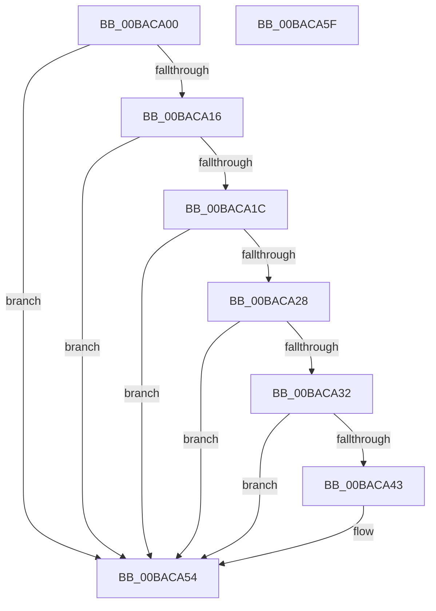

# ViWdBeforeCallDriver

- RVA: `0x00BACA00`–`0x00BACA60` (길이 `96` bytes)
- VA: `0x0000000140BACA00`
- 실행 섹션: `PAGEVRFY`
- PDB 이름 있음: `예`; PDB Function 태그: `아니요`
- unwind 정보 RVA: `0x0005CAAC`
- 디코드: `30`개 명령, `96/96` bytes 표시
- 미해석 바이트: `0` (있으면 어셈블리에 `.byte`로 보존)

> 이 문서는 커널 이미지의 기계어와 PDB 기호를 분석해 생성했습니다. 4번과 5번은 함수 원형과 자료형을 바이너리 사용 방식에서 추정한 C 해석이며 원본 소스 복구 결과는 아닙니다.

## 1. Dependencies

- 직접 호출 지점: **2**; 고유 호출 대상: **2**
- 직접 호출자로 확인된 함수: **1**
- RIP 상대 이미지 참조: **2**

### Outgoing calls
- `0x00BACA1F` → [VfTargetDriversIsEnabled](../BB/VfTargetDriversIsEnabled_function_00BB7F20.md) (function, `0x00BB7F20`)
- `0x00BACA39` → [ExAllocateFromNPagedLookasideList](../../text/38/ExAllocateFromNPagedLookasideList_function_0038E6C0.md) (function, `0x0038E6C0`)

### Direct callers
- [IovpCallDriver1](../B9/IovpCallDriver1_function_00B9CCA4.md) at `0x00B9D22D`

### Static image references
- `0x00BACA28` → RVA `0x00FFDAE0` (`PAGEVRFD`; read)
- `0x00BACA32` → RVA `0x00FFF480` (`PAGEVRFD`; read)

## 2. Other-region calls and transfers

- 다른 실행 섹션으로 향하는 call: **1**
  - `0x00BACA39` → [ExAllocateFromNPagedLookasideList](../../text/38/ExAllocateFromNPagedLookasideList_function_0038E6C0.md) (`PAGEVRFY` → `.text`)
- 별도 외부 분기/꼬리 이동을 확인하지 못했습니다.

## 3. Assembly (complete function range)

```asm
00BACA00  48 89 5C 24 08                  mov qword ptr [rsp + 8], rbx
00BACA05  57                              push rdi
00BACA06  48 83 EC 20                     sub rsp, 0x20
00BACA0A  49 83 38 00                     cmp qword ptr [r8], 0
00BACA0E  49 8B F8                        mov rdi, r8
00BACA11  48 8B D9                        mov rbx, rcx
00BACA14  75 3E                           jne 0x140baca54
00BACA16  80 79 40 01                     cmp byte ptr [rcx + 0x40], 1
00BACA1A  75 38                           jne 0x140baca54
00BACA1C  48 8B CA                        mov rcx, rdx
00BACA1F  E8 FC B4 00 00                  call 0x140bb7f20
00BACA24  85 C0                           test eax, eax
00BACA26  74 2C                           je 0x140baca54
00BACA28  8B 05 B2 10 45 00               mov eax, dword ptr [rip + 0x4510b2]
00BACA2E  85 C0                           test eax, eax
00BACA30  74 22                           je 0x140baca54
00BACA32  48 8D 0D 47 2A 45 00            lea rcx, [rip + 0x452a47]
00BACA39  E8 82 1C 7E FF                  call 0x14038e6c0
00BACA3E  48 85 C0                        test rax, rax
00BACA41  74 11                           je 0x140baca54
00BACA43  48 89 58 10                     mov qword ptr [rax + 0x10], rbx
00BACA47  8A 4B 43                        mov cl, byte ptr [rbx + 0x43]
00BACA4A  88 48 1D                        mov byte ptr [rax + 0x1d], cl
00BACA4D  C6 40 1C 00                     mov byte ptr [rax + 0x1c], 0
00BACA51  48 89 07                        mov qword ptr [rdi], rax
00BACA54  48 8B 5C 24 30                  mov rbx, qword ptr [rsp + 0x30]
00BACA59  48 83 C4 20                     add rsp, 0x20
00BACA5D  5F                              pop rdi
00BACA5E  C3                              ret
00BACA5F  CC                              int3
```

## 4. C-style interpretation (structured pseudocode)

```c
__int64 __fastcall ViWdBeforeCallDriver(__int64 a1, __int64 a2, __int64 a3)
{
    __int64 result;
    __int64 v_rsp;
    unsigned __int64 v_stack_p8;

    v_stack_p8 = v_rbx;
    v_rsp = (v_rsp) - (32);
    if ((*(unsigned __int64 *)(a3)) != 0) goto loc_00BACA54;
    if ((*(unsigned __int8 *)(a1 + 64)) != 1) goto loc_00BACA54;
    result = VfTargetDriversIsEnabled(a2, a2, a3, a4);
    if ((unsigned int)(result) == 0) goto loc_00BACA54;
    if ((unsigned int)((unsigned int)(*(unsigned int *)(v_rip + 4526258))) == 0) goto loc_00BACA54;
    result = ExAllocateFromNPagedLookasideList(v_rip + 4532807, a2, a3, a4);
    if (result != 0) {
        *(unsigned __int64 *)(result + 16) = a1;
        a1 = *(unsigned __int8 *)(a1 + 67);
        *(unsigned __int8 *)(result + 29) = (unsigned __int8)(a1);
        *(unsigned __int8 *)(result + 28) = 0;
        *(unsigned __int64 *)(a3) = result;
    }
    v_rsp = (v_rsp) + (32);
    return result;
}
```

## 5. (Beta) C Style

```c
int64_t ViWdBeforeCallDriver(void *Arg1, int64_t Arg2, void *Arg3)
{
    uint8_t *arg1 = (uint8_t *)Arg1;
    uint8_t *arg3 = (uint8_t *)Arg3;

    int64_t result;
    int64_t local_rsp;
    uint64_t v_stack_p8;

    v_stack_p8 = local_rbx;
    local_rsp = (local_rsp) - (32);
    if ((*(uint64_t *)(arg3)) != 0) goto loc_00BACA54;
    if ((*(uint8_t *)(arg1 + 0x40)) != 1) goto loc_00BACA54;
    result = VfTargetDriversIsEnabled(Arg2, Arg2, Arg3, a4);
    if ((uint32_t)(result) == 0) goto loc_00BACA54;
    if ((uint32_t)((uint32_t)(*(uint32_t *)(v_rip + 0x4510B2))) == 0) goto loc_00BACA54;
    result = ExAllocateFromNPagedLookasideList(v_rip + 4532807, Arg2, Arg3, a4);
    if (result != 0) {
        *(void **)(result + 0x10) = Arg1;
        Arg1 = *(uint8_t *)(arg1 + 0x43);
        *(uint8_t *)(result + 0x1D) = (uint8_t)(Arg1);
        *(uint8_t *)(result + 0x1C) = 0;
        *(uint64_t *)(arg3) = result;
    }
    local_rsp = (local_rsp) + (32);
    return result;
}
```

### 관측된 메모리 오프셋

구조체 형식이 확인되지 않은 접근은 인자 기준의 오프셋으로만 기록했습니다.

| 기준 인자 | 오프셋 표현 | 폭 (bit) | 접근 |
|---|---:|---:|---|
| `Arg1` | `+ 0x40` | `8` | `R` |
| `Arg1` | `+ 0x43` | `8` | `R` |
| `Arg3` | `+ 0x0` | `64` | `R` |
| `Arg3` | `+ 0x0` | `64` | `W` |

## 6. Execution-region graph

[열기: 2D/3D 그래프와 함수 탐색 컨트롤 패널](../../../control-panel.html?section=pagevrfy&rva=0x00BACA00&view=graph)

- 2D 그래프는 위에서 아래로 흐르고, 3D 그래프는 빈 공간을 드래그해 회전합니다. Shift+드래그는 이동, 휠은 확대·축소, 함수 노드 선택은 대상 보고서 이동입니다.

### Static fallback


