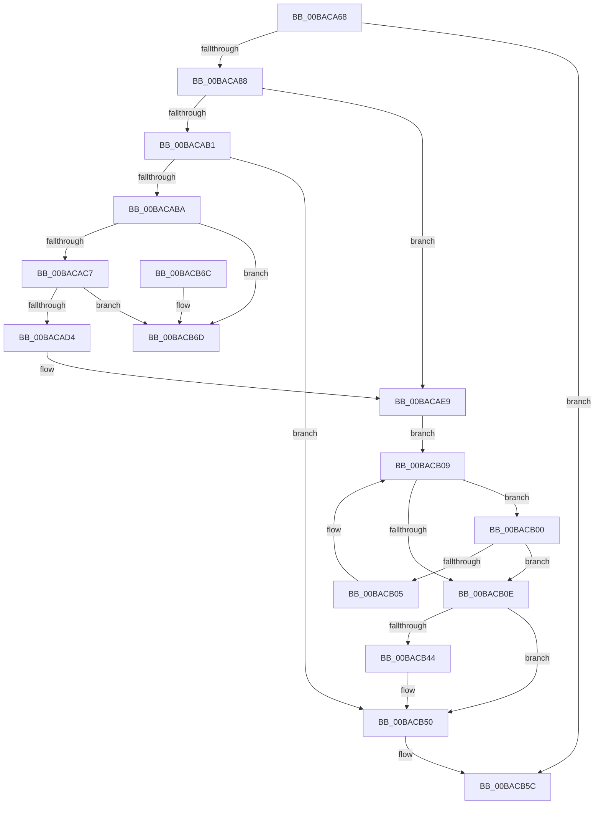

# ViWdBeforeCancelIrp

- RVA: `0x00BACA68`–`0x00BACB74` (길이 `268` bytes)
- VA: `0x0000000140BACA68`
- 실행 섹션: `PAGEVRFY`
- PDB 이름 있음: `예`; PDB Function 태그: `아니요`
- unwind 정보 RVA: `0x0006383C`
- 디코드: `67`개 명령, `268/268` bytes 표시
- 미해석 바이트: `0` (있으면 어셈블리에 `.byte`로 보존)

> 이 문서는 커널 이미지의 기계어와 PDB 기호를 분석해 생성했습니다. 4번과 5번은 함수 원형과 자료형을 바이너리 사용 방식에서 추정한 C 해석이며 원본 소스 복구 결과는 아닙니다.

## 1. Dependencies

- 직접 호출 지점: **2**; 고유 호출 대상: **2**
- 직접 호출자로 확인된 함수: **1**
- RIP 상대 이미지 참조: **11**

### Outgoing calls
- `0x00BACAA5` → [KeAcquireSpinLockAtDpcLevel](../../text/20/KeAcquireSpinLockAtDpcLevel_function_00208430.md) (function, `0x00208430`)
- `0x00BACB57` → [KxReleaseSpinLock](../../text/20/KxReleaseSpinLock_function_00206670.md) (function, `0x00206670`)

### Direct callers
- [IovCancelIrp](../B9/IovCancelIrp_function_00B926E0.md) at `0x00B9270A`

### Static image references
- `0x00BACA77` → RVA `0x00F04950` (`.data`; read)
- `0x00BACA88` → RVA `0x00FFDD00` (`PAGEVRFD`; read)
- `0x00BACA8E` → RVA `0x00FFDC58` (`PAGEVRFD`; read)
- `0x00BACA95` → RVA `0x00FFDA5C` (`PAGEVRFD`; read)
- `0x00BACA9D` → RVA `0x00FFDD00` (`PAGEVRFD`; write)
- `0x00BACADB` → RVA `0x00FFDA1C` (`PAGEVRFD`; read)
- `0x00BACAE3` → RVA `0x00FFDA1C` (`PAGEVRFD`; write)
- `0x00BACAEC` → RVA `0x00FFDBE0` (`PAGEVRFD`; read)
- `0x00BACAF7` → RVA `0x00FFDBE8` (`PAGEVRFD`; read)
- `0x00BACB34` → RVA `0x00FFDB0C` (`PAGEVRFD`; read)
- `0x00BACB4A` → RVA `0x00FFDB0C` (`PAGEVRFD`; write)

## 2. Other-region calls and transfers

- 다른 실행 섹션으로 향하는 call: **2**
  - `0x00BACAA5` → [KeAcquireSpinLockAtDpcLevel](../../text/20/KeAcquireSpinLockAtDpcLevel_function_00208430.md) (`PAGEVRFY` → `.text`)
  - `0x00BACB57` → [KxReleaseSpinLock](../../text/20/KxReleaseSpinLock_function_00206670.md) (`PAGEVRFY` → `.text`)
- 별도 외부 분기/꼬리 이동을 확인하지 못했습니다.

## 3. Assembly (complete function range)

```asm
00BACA68  48 89 5C 24 08                  mov qword ptr [rsp + 8], rbx
00BACA6D  48 89 74 24 10                  mov qword ptr [rsp + 0x10], rsi
00BACA72  57                              push rdi
00BACA73  48 83 EC 20                     sub rsp, 0x20
00BACA77  8B 3D D3 7E 35 00               mov edi, dword ptr [rip + 0x357ed3]
00BACA7D  48 8B D9                        mov rbx, rcx
00BACA80  85 FF                           test edi, edi
00BACA82  0F 84 D4 00 00 00               je 0x140bacb5c
00BACA88  8B 05 72 12 45 00               mov eax, dword ptr [rip + 0x451272]
00BACA8E  48 8D 0D C3 11 45 00            lea rcx, [rip + 0x4511c3]
00BACA95  8B 35 C1 0F 45 00               mov esi, dword ptr [rip + 0x450fc1]
00BACA9B  FF C0                           inc eax
00BACA9D  89 05 5D 12 45 00               mov dword ptr [rip + 0x45125d], eax
00BACAA3  03 F7                           add esi, edi
00BACAA5  E8 86 B9 65 FF                  call 0x140208430
00BACAAA  8A 43 1C                        mov al, byte ptr [rbx + 0x1c]
00BACAAD  84 C0                           test al, al
00BACAAF  74 38                           je 0x140bacae9
00BACAB1  39 73 18                        cmp dword ptr [rbx + 0x18], esi
00BACAB4  0F 86 96 00 00 00               jbe 0x140bacb50
00BACABA  48 8B 03                        mov rax, qword ptr [rbx]
00BACABD  48 39 58 08                     cmp qword ptr [rax + 8], rbx
00BACAC1  0F 85 A6 00 00 00               jne 0x140bacb6d
00BACAC7  48 8B 53 08                     mov rdx, qword ptr [rbx + 8]
00BACACB  48 39 1A                        cmp qword ptr [rdx], rbx
00BACACE  0F 85 99 00 00 00               jne 0x140bacb6d
00BACAD4  48 89 02                        mov qword ptr [rdx], rax
00BACAD7  48 89 50 08                     mov qword ptr [rax + 8], rdx
00BACADB  8B 05 3B 0F 45 00               mov eax, dword ptr [rip + 0x450f3b]
00BACAE1  FF C8                           dec eax
00BACAE3  89 05 33 0F 45 00               mov dword ptr [rip + 0x450f33], eax
00BACAE9  89 73 18                        mov dword ptr [rbx + 0x18], esi
00BACAEC  48 8D 05 ED 10 45 00            lea rax, [rip + 0x4510ed]
00BACAF3  66 89 7B 1E                     mov word ptr [rbx + 0x1e], di
00BACAF7  48 8B 0D EA 10 45 00            mov rcx, qword ptr [rip + 0x4510ea]
00BACAFE  EB 09                           jmp 0x140bacb09
00BACB00  39 71 18                        cmp dword ptr [rcx + 0x18], esi
00BACB03  76 09                           jbe 0x140bacb0e
00BACB05  48 8B 49 08                     mov rcx, qword ptr [rcx + 8]
00BACB09  48 3B C8                        cmp rcx, rax
00BACB0C  75 F2                           jne 0x140bacb00
00BACB0E  48 89 4B 08                     mov qword ptr [rbx + 8], rcx
00BACB12  48 8B 01                        mov rax, qword ptr [rcx]
00BACB15  48 89 03                        mov qword ptr [rbx], rax
00BACB18  48 8B 01                        mov rax, qword ptr [rcx]
00BACB1B  48 89 58 08                     mov qword ptr [rax + 8], rbx
00BACB1F  48 89 19                        mov qword ptr [rcx], rbx
00BACB22  C6 43 1C 01                     mov byte ptr [rbx + 0x1c], 1
00BACB26  8B 05 F0 0E 45 00               mov eax, dword ptr [rip + 0x450ef0]
00BACB2C  FF C0                           inc eax
00BACB2E  89 05 E8 0E 45 00               mov dword ptr [rip + 0x450ee8], eax
00BACB34  8B 0D D2 0F 45 00               mov ecx, dword ptr [rip + 0x450fd2]
00BACB3A  8B 05 DC 0E 45 00               mov eax, dword ptr [rip + 0x450edc]
00BACB40  3B C1                           cmp eax, ecx
00BACB42  7E 0C                           jle 0x140bacb50
00BACB44  8B 05 D2 0E 45 00               mov eax, dword ptr [rip + 0x450ed2]
00BACB4A  89 05 BC 0F 45 00               mov dword ptr [rip + 0x450fbc], eax
00BACB50  48 8D 0D 01 11 45 00            lea rcx, [rip + 0x451101]
00BACB57  E8 14 9B 65 FF                  call 0x140206670
00BACB5C  48 8B 5C 24 30                  mov rbx, qword ptr [rsp + 0x30]
00BACB61  48 8B 74 24 38                  mov rsi, qword ptr [rsp + 0x38]
00BACB66  48 83 C4 20                     add rsp, 0x20
00BACB6A  5F                              pop rdi
00BACB6B  C3                              ret
00BACB6C  CC                              int3
00BACB6D  B9 03 00 00 00                  mov ecx, 3
00BACB72  CD 29                           int 0x29
```

## 4. C-style interpretation (structured pseudocode)

```c
__int64 __fastcall ViWdBeforeCancelIrp(__int64 a1)
{
    __int64 result;
    __int64 v_rsi;
    __int64 v_rsp;
    unsigned __int64 v_stack_p10;
    unsigned __int64 v_stack_p8;

    v_stack_p8 = v_rbx;
    v_stack_p10 = v_rsi;
    v_rsp = (v_rsp) - (32);
    if ((unsigned int)((unsigned int)(*(unsigned int *)(v_rip + 3505875))) == 0) goto loc_00BACB5C;
    result = (unsigned int)(((unsigned int)(*(unsigned int *)(v_rip + 4526706))) + 1);
    *(unsigned int *)(v_rip + 4526685) = (unsigned int)(result);
    v_rsi = (unsigned int)(((unsigned int)(*(unsigned int *)(v_rip + 4526017))) + ((unsigned int)((unsigned int)(*(unsigned int *)(v_rip + 3505875)))));
    result = KeAcquireSpinLockAtDpcLevel(v_rip + 4526531, a2, a3, a4);
    if ((unsigned __int8)(*(unsigned __int8 *)(a1 + 28)) == 0) goto loc_00BACAE9;
    if ((*(unsigned int *)(a1 + 24)) <= ((unsigned int)(v_rsi))) goto loc_00BACB50;
    if ((*(unsigned __int64 *)(*(unsigned __int64 *)(a1) + 8)) != a1) goto loc_00BACB6D;
    if ((*(unsigned __int64 *)(*(unsigned __int64 *)(a1 + 8))) != a1) goto loc_00BACB6D;
    *(unsigned __int64 *)(*(unsigned __int64 *)(a1 + 8)) = *(unsigned __int64 *)(a1);
    *(unsigned __int64 *)(*(unsigned __int64 *)(a1) + 8) = *(unsigned __int64 *)(a1 + 8);
    result = (unsigned int)(((unsigned int)(*(unsigned int *)(v_rip + 4525883))) - 1);
    *(unsigned int *)(v_rip + 4525875) = (unsigned int)(result);
loc_00BACAE9:
    *(unsigned int *)(a1 + 24) = (unsigned int)(v_rsi);
    *(unsigned __int16 *)(a1 + 30) = (unsigned __int16)((unsigned int)(*(unsigned int *)(v_rip + 3505875)));
    goto loc_00BACB09;
loc_00BACB00:
    if ((*(unsigned int *)(*(unsigned __int64 *)(v_rip + 4526314) + 24)) <= ((unsigned int)(v_rsi))) goto loc_00BACB0E;
loc_00BACB09:
    if ((*(unsigned __int64 *)(*(unsigned __int64 *)(v_rip + 4526314) + 8)) != (v_rip + 4526317)) goto loc_00BACB00;
loc_00BACB0E:
    *(unsigned __int64 *)(a1 + 8) = *(unsigned __int64 *)(*(unsigned __int64 *)(v_rip + 4526314) + 8);
    *(unsigned __int64 *)(a1) = *(unsigned __int64 *)(*(unsigned __int64 *)(*(unsigned __int64 *)(v_rip + 4526314) + 8));
    *(unsigned __int64 *)(*(unsigned __int64 *)(*(unsigned __int64 *)(*(unsigned __int64 *)(v_rip + 4526314) + 8)) + 8) = a1;
    *(unsigned __int64 *)(*(unsigned __int64 *)(*(unsigned __int64 *)(v_rip + 4526314) + 8)) = a1;
    *(unsigned __int8 *)(a1 + 28) = 1;
    result = (unsigned int)(((unsigned int)(*(unsigned int *)(v_rip + 4525808))) + 1);
    *(unsigned int *)(v_rip + 4525800) = (unsigned int)(result);
    result = (unsigned int)(*(unsigned int *)(v_rip + 4525788));
    if (((unsigned int)((unsigned int)(*(unsigned int *)(v_rip + 4525788)))) >= = ((unsigned int)((unsigned int)(*(unsigned int *)(v_rip + 4526034))))) {
        result = *(unsigned int *)(v_rip + 4525778);
        *(unsigned int *)(v_rip + 4526012) = (unsigned int)(result);
    }
    result = KxReleaseSpinLock(v_rip + 4526337, *(unsigned __int64 *)(a1 + 8), a3, a4);
loc_00BACB5C:
    v_rsp = (v_rsp) + (32);
    return result;
loc_00BACB6D:
    return result;
}
```

## 5. (Beta) C Style

```c
int64_t ViWdBeforeCancelIrp(void *Arg1)
{
    uint8_t *arg1 = (uint8_t *)Arg1;

    int64_t result;
    int64_t local_rsi;
    int64_t local_rsp;
    uint64_t v_stack_p10;
    uint64_t v_stack_p8;

    v_stack_p8 = local_rbx;
    v_stack_p10 = local_rsi;
    local_rsp = (local_rsp) - (32);
    if ((uint32_t)((uint32_t)(*(uint32_t *)(v_rip + 0x357ED3))) == 0) goto loc_00BACB5C;
    result = (uint32_t)(((uint32_t)(*(uint32_t *)(v_rip + 0x451272))) + 1);
    *(uint32_t *)(v_rip + 0x45125D) = (uint32_t)(result);
    local_rsi = (uint32_t)(((uint32_t)(*(uint32_t *)(v_rip + 0x450FC1))) + ((uint32_t)((uint32_t)(*(uint32_t *)(v_rip + 0x357ED3)))));
    result = KeAcquireSpinLockAtDpcLevel(v_rip + 4526531, a2, a3, a4);
    if ((uint8_t)(*(uint8_t *)(arg1 + 0x1C)) == 0) goto loc_00BACAE9;
    if ((*(uint32_t *)(arg1 + 0x18)) <= ((uint32_t)(local_rsi))) goto loc_00BACB50;
    if ((*(uint64_t *)(*(uint64_t *)(arg1) + 0x8)) != Arg1) goto loc_00BACB6D;
    if ((*(uint64_t *)(*(uint64_t *)(arg1 + 0x8))) != Arg1) goto loc_00BACB6D;
    *(uint64_t *)(*(uint64_t *)(arg1 + 0x8)) = *(uint64_t *)(arg1);
    *(uint64_t *)(*(uint64_t *)(arg1) + 0x8) = *(uint64_t *)(arg1 + 0x8);
    result = (uint32_t)(((uint32_t)(*(uint32_t *)(v_rip + 0x450F3B))) - 1);
    *(uint32_t *)(v_rip + 0x450F33) = (uint32_t)(result);
loc_00BACAE9:
    *(uint32_t *)(arg1 + 0x18) = (uint32_t)(local_rsi);
    *(uint16_t *)(arg1 + 0x1E) = (uint16_t)((uint32_t)(*(uint32_t *)(v_rip + 0x357ED3)));
    goto loc_00BACB09;
loc_00BACB00:
    if ((*(uint32_t *)(*(uint64_t *)(v_rip + 0x4510EA) + 0x18)) <= ((uint32_t)(local_rsi))) goto loc_00BACB0E;
loc_00BACB09:
    if ((*(uint64_t *)(*(uint64_t *)(v_rip + 0x4510EA) + 0x8)) != (v_rip + 4526317)) goto loc_00BACB00;
loc_00BACB0E:
    *(uint64_t *)(arg1 + 0x8) = *(uint64_t *)(*(uint64_t *)(v_rip + 0x4510EA) + 0x8);
    *(uint64_t *)(arg1) = *(uint64_t *)(*(uint64_t *)(*(uint64_t *)(v_rip + 0x4510EA) + 0x8));
    *(void **)(*(uint64_t *)(*(uint64_t *)(*(uint64_t *)(v_rip + 0x4510EA) + 0x8)) + 0x8) = Arg1;
    *(void **)(*(uint64_t *)(*(uint64_t *)(v_rip + 0x4510EA) + 0x8)) = Arg1;
    *(uint8_t *)(arg1 + 0x1C) = 1;
    result = (uint32_t)(((uint32_t)(*(uint32_t *)(v_rip + 0x450EF0))) + 1);
    *(uint32_t *)(v_rip + 0x450EE8) = (uint32_t)(result);
    result = (uint32_t)(*(uint32_t *)(v_rip + 0x450EDC));
    if (((uint32_t)((uint32_t)(*(uint32_t *)(v_rip + 0x450EDC)))) >= = ((uint32_t)((uint32_t)(*(uint32_t *)(v_rip + 0x450FD2))))) {
        result = *(uint32_t *)(v_rip + 0x450ED2);
        *(uint32_t *)(v_rip + 0x450FBC) = (uint32_t)(result);
    }
    result = KxReleaseSpinLock(v_rip + 4526337, *(uint64_t *)(arg1 + 0x8), a3, a4);
loc_00BACB5C:
    local_rsp = (local_rsp) + (32);
    return result;
loc_00BACB6D:
    return result;
}
```

### 관측된 메모리 오프셋

구조체 형식이 확인되지 않은 접근은 인자 기준의 오프셋으로만 기록했습니다.

| 기준 인자 | 오프셋 표현 | 폭 (bit) | 접근 |
|---|---:|---:|---|
| `Arg1` | `+ 0x0` | `64` | `R` |
| `Arg1` | `+ 0x0` | `64` | `W` |
| `Arg1` | `+ 0x8` | `64` | `R` |
| `Arg1` | `+ 0x8` | `64` | `W` |
| `Arg1` | `+ 0x18` | `32` | `R` |
| `Arg1` | `+ 0x18` | `32` | `W` |
| `Arg1` | `+ 0x1C` | `8` | `R` |
| `Arg1` | `+ 0x1C` | `8` | `W` |
| `Arg1` | `+ 0x1E` | `16` | `W` |

## 6. Execution-region graph

[열기: 2D/3D 그래프와 함수 탐색 컨트롤 패널](../../../control-panel.html?section=pagevrfy&rva=0x00BACA68&view=graph)

- 2D 그래프는 위에서 아래로 흐르고, 3D 그래프는 빈 공간을 드래그해 회전합니다. Shift+드래그는 이동, 휠은 확대·축소, 함수 노드 선택은 대상 보고서 이동입니다.

### Static fallback


