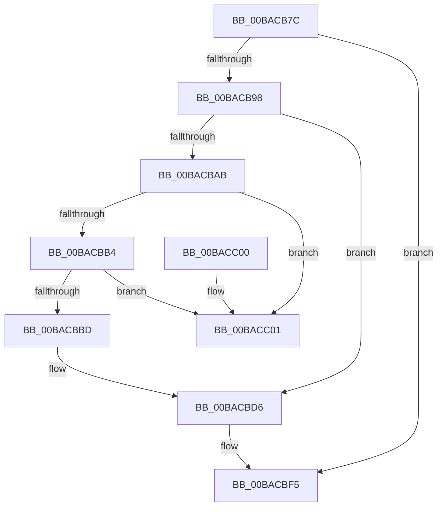

# ViWdIrpBeforeCompletionRoutine

- RVA: `0x00BACB7C`–`0x00BACC08` (길이 `140` bytes)
- VA: `0x0000000140BACB7C`
- 실행 섹션: `PAGEVRFY`
- PDB 이름 있음: `예`; PDB Function 태그: `아니요`
- unwind 정보 RVA: `0x0006CF28`
- 디코드: `39`개 명령, `140/140` bytes 표시
- 미해석 바이트: `0` (있으면 어셈블리에 `.byte`로 보존)

> 이 문서는 커널 이미지의 기계어와 PDB 기호를 분석해 생성했습니다. 4번과 5번은 함수 원형과 자료형을 바이너리 사용 방식에서 추정한 C 해석이며 원본 소스 복구 결과는 아닙니다.

## 1. Dependencies

- 직접 호출 지점: **3**; 고유 호출 대상: **3**
- 직접 호출자로 확인된 함수: **1**
- RIP 상대 이미지 참조: **4**

### Outgoing calls
- `0x00BACB9F` → [KeAcquireSpinLockAtDpcLevel](../../text/20/KeAcquireSpinLockAtDpcLevel_function_00208430.md) (function, `0x00208430`)
- `0x00BACBDD` → [KxReleaseSpinLock](../../text/20/KxReleaseSpinLock_function_00206670.md) (function, `0x00206670`)
- `0x00BACBEC` → [ExFreeToNPagedLookasideList](../../text/38/ExFreeToNPagedLookasideList_function_0038D9D0.md) (function, `0x0038D9D0`)

### Direct callers
- [IovpCompleteRequest2](../BB/IovpCompleteRequest2_function_00BB6DD4.md) at `0x00BB6E2D`

### Static image references
- `0x00BACB98` → RVA `0x00FFDC58` (`PAGEVRFD`; read)
- `0x00BACBC8` → RVA `0x00FFDA1C` (`PAGEVRFD`; read)
- `0x00BACBD0` → RVA `0x00FFDA1C` (`PAGEVRFD`; write)
- `0x00BACBE5` → RVA `0x00FFF480` (`PAGEVRFD`; read)

## 2. Other-region calls and transfers

- 다른 실행 섹션으로 향하는 call: **3**
  - `0x00BACB9F` → [KeAcquireSpinLockAtDpcLevel](../../text/20/KeAcquireSpinLockAtDpcLevel_function_00208430.md) (`PAGEVRFY` → `.text`)
  - `0x00BACBDD` → [KxReleaseSpinLock](../../text/20/KxReleaseSpinLock_function_00206670.md) (`PAGEVRFY` → `.text`)
  - `0x00BACBEC` → [ExFreeToNPagedLookasideList](../../text/38/ExFreeToNPagedLookasideList_function_0038D9D0.md) (`PAGEVRFY` → `.text`)
- 별도 외부 분기/꼬리 이동을 확인하지 못했습니다.

## 3. Assembly (complete function range)

```asm
00BACB7C  48 89 5C 24 08                  mov qword ptr [rsp + 8], rbx
00BACB81  57                              push rdi
00BACB82  48 83 EC 20                     sub rsp, 0x20
00BACB86  48 8B 19                        mov rbx, qword ptr [rcx]
00BACB89  48 8B F9                        mov rdi, rcx
00BACB8C  48 8B 53 10                     mov rdx, qword ptr [rbx + 0x10]
00BACB90  8A 43 1D                        mov al, byte ptr [rbx + 0x1d]
00BACB93  38 42 43                        cmp byte ptr [rdx + 0x43], al
00BACB96  7C 5D                           jl 0x140bacbf5
00BACB98  48 8D 0D B9 10 45 00            lea rcx, [rip + 0x4510b9]
00BACB9F  E8 8C B8 65 FF                  call 0x140208430
00BACBA4  8A 43 1C                        mov al, byte ptr [rbx + 0x1c]
00BACBA7  84 C0                           test al, al
00BACBA9  74 2B                           je 0x140bacbd6
00BACBAB  48 8B 0B                        mov rcx, qword ptr [rbx]
00BACBAE  48 39 59 08                     cmp qword ptr [rcx + 8], rbx
00BACBB2  75 4D                           jne 0x140bacc01
00BACBB4  48 8B 43 08                     mov rax, qword ptr [rbx + 8]
00BACBB8  48 39 18                        cmp qword ptr [rax], rbx
00BACBBB  75 44                           jne 0x140bacc01
00BACBBD  48 89 08                        mov qword ptr [rax], rcx
00BACBC0  48 89 41 08                     mov qword ptr [rcx + 8], rax
00BACBC4  C6 43 1C 00                     mov byte ptr [rbx + 0x1c], 0
00BACBC8  8B 05 4E 0E 45 00               mov eax, dword ptr [rip + 0x450e4e]
00BACBCE  FF C8                           dec eax
00BACBD0  89 05 46 0E 45 00               mov dword ptr [rip + 0x450e46], eax
00BACBD6  48 8D 0D 7B 10 45 00            lea rcx, [rip + 0x45107b]
00BACBDD  E8 8E 9A 65 FF                  call 0x140206670
00BACBE2  48 8B D3                        mov rdx, rbx
00BACBE5  48 8D 0D 94 28 45 00            lea rcx, [rip + 0x452894]
00BACBEC  E8 DF 0D 7E FF                  call 0x14038d9d0
00BACBF1  48 83 27 00                     and qword ptr [rdi], 0
00BACBF5  48 8B 5C 24 30                  mov rbx, qword ptr [rsp + 0x30]
00BACBFA  48 83 C4 20                     add rsp, 0x20
00BACBFE  5F                              pop rdi
00BACBFF  C3                              ret
00BACC00  CC                              int3
00BACC01  B9 03 00 00 00                  mov ecx, 3
00BACC06  CD 29                           int 0x29
```

## 4. C-style interpretation (structured pseudocode)

```c
__int64 __fastcall ViWdIrpBeforeCompletionRoutine(__int64 a1)
{
    __int64 result;
    __int64 v_rsp;
    unsigned __int64 v_stack_p8;

    v_stack_p8 = v_rbx;
    v_rsp = (v_rsp) - (32);
    if ((*(unsigned __int8 *)(*(unsigned __int64 *)(*(unsigned __int64 *)(a1) + 16) + 67)) < ((unsigned __int8)(*(unsigned __int8 *)(*(unsigned __int64 *)(a1) + 29)))) goto loc_00BACBF5;
    result = KeAcquireSpinLockAtDpcLevel(v_rip + 4526265, *(unsigned __int64 *)(*(unsigned __int64 *)(a1) + 16), a3, a4);
    if ((unsigned __int8)(*(unsigned __int8 *)(*(unsigned __int64 *)(a1) + 28)) == 0) goto loc_00BACBD6;
    if ((*(unsigned __int64 *)(*(unsigned __int64 *)(*(unsigned __int64 *)(a1)) + 8)) != (*(unsigned __int64 *)(a1))) goto loc_00BACC01;
    if ((*(unsigned __int64 *)(*(unsigned __int64 *)(*(unsigned __int64 *)(a1) + 8))) != (*(unsigned __int64 *)(a1))) goto loc_00BACC01;
    *(unsigned __int64 *)(*(unsigned __int64 *)(*(unsigned __int64 *)(a1) + 8)) = *(unsigned __int64 *)(*(unsigned __int64 *)(a1));
    *(unsigned __int64 *)(*(unsigned __int64 *)(*(unsigned __int64 *)(a1)) + 8) = *(unsigned __int64 *)(*(unsigned __int64 *)(a1) + 8);
    *(unsigned __int8 *)(*(unsigned __int64 *)(a1) + 28) = 0;
    result = (unsigned int)(((unsigned int)(*(unsigned int *)(v_rip + 4525646))) - 1);
    *(unsigned int *)(v_rip + 4525638) = (unsigned int)(result);
loc_00BACBD6:
    result = KxReleaseSpinLock(v_rip + 4526203, *(unsigned __int64 *)(*(unsigned __int64 *)(a1) + 16), a3, a4);
    result = ExFreeToNPagedLookasideList(v_rip + 4532372, *(unsigned __int64 *)(a1), a3, a4);
loc_00BACBF5:
    v_rsp = (v_rsp) + (32);
    return result;
loc_00BACC01:
    return result;
}
```

## 5. (Beta) C Style

```c
int64_t ViWdIrpBeforeCompletionRoutine(void *Arg1)
{
    uint8_t *arg1 = (uint8_t *)Arg1;

    int64_t result;
    int64_t local_rsp;
    uint64_t v_stack_p8;

    v_stack_p8 = local_rbx;
    local_rsp = (local_rsp) - (32);
    if ((*(uint8_t *)(*(uint64_t *)(*(uint64_t *)(arg1) + 0x10) + 0x43)) < ((uint8_t)(*(uint8_t *)(*(uint64_t *)(arg1) + 0x1D)))) goto loc_00BACBF5;
    result = KeAcquireSpinLockAtDpcLevel(v_rip + 4526265, *(uint64_t *)(*(uint64_t *)(arg1) + 0x10), a3, a4);
    if ((uint8_t)(*(uint8_t *)(*(uint64_t *)(arg1) + 0x1C)) == 0) goto loc_00BACBD6;
    if ((*(uint64_t *)(*(uint64_t *)(*(uint64_t *)(arg1)) + 0x8)) != (*(uint64_t *)(arg1))) goto loc_00BACC01;
    if ((*(uint64_t *)(*(uint64_t *)(*(uint64_t *)(arg1) + 0x8))) != (*(uint64_t *)(arg1))) goto loc_00BACC01;
    *(uint64_t *)(*(uint64_t *)(*(uint64_t *)(arg1) + 0x8)) = *(uint64_t *)(*(uint64_t *)(arg1));
    *(uint64_t *)(*(uint64_t *)(*(uint64_t *)(arg1)) + 0x8) = *(uint64_t *)(*(uint64_t *)(arg1) + 0x8);
    *(uint8_t *)(*(uint64_t *)(arg1) + 0x1C) = 0;
    result = (uint32_t)(((uint32_t)(*(uint32_t *)(v_rip + 0x450E4E))) - 1);
    *(uint32_t *)(v_rip + 0x450E46) = (uint32_t)(result);
loc_00BACBD6:
    result = KxReleaseSpinLock(v_rip + 4526203, *(uint64_t *)(*(uint64_t *)(arg1) + 0x10), a3, a4);
    result = ExFreeToNPagedLookasideList(v_rip + 4532372, *(uint64_t *)(arg1), a3, a4);
loc_00BACBF5:
    local_rsp = (local_rsp) + (32);
    return result;
loc_00BACC01:
    return result;
}
```

### 관측된 메모리 오프셋

구조체 형식이 확인되지 않은 접근은 인자 기준의 오프셋으로만 기록했습니다.

| 기준 인자 | 오프셋 표현 | 폭 (bit) | 접근 |
|---|---:|---:|---|
| `Arg1` | `+ 0x0` | `64` | `R` |
| `Arg1` | `+ 0x0` | `64` | `R/W` |

## 6. Execution-region graph

[열기: 2D/3D 그래프와 함수 탐색 컨트롤 패널](../../../control-panel.html?section=pagevrfy&rva=0x00BACB7C&view=graph)

- 2D 그래프는 위에서 아래로 흐르고, 3D 그래프는 빈 공간을 드래그해 회전합니다. Shift+드래그는 이동, 휠은 확대·축소, 함수 노드 선택은 대상 보고서 이동입니다.

### Static fallback


