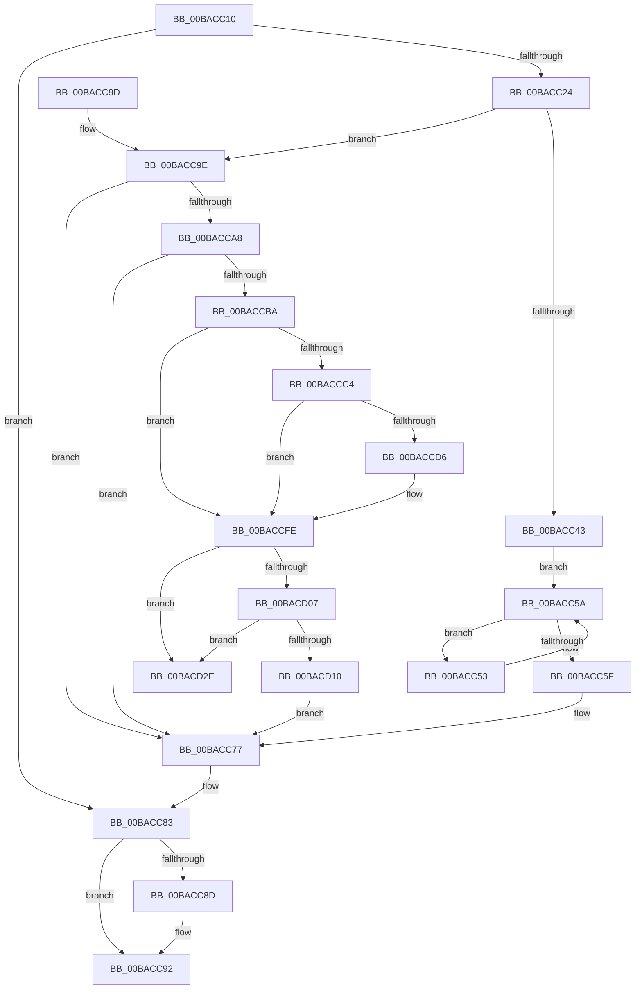

# ViWdIrpTimerDpcRoutine

- RVA: `0x00BACC10`–`0x00BACD35` (길이 `293` bytes)
- VA: `0x0000000140BACC10`
- 실행 섹션: `PAGEVRFY`
- PDB 이름 있음: `예`; PDB Function 태그: `아니요`
- unwind 정보 RVA: `0x000D2820`
- 디코드: `71`개 명령, `293/293` bytes 표시
- 미해석 바이트: `0` (있으면 어셈블리에 `.byte`로 보존)

> 이 문서는 커널 이미지의 기계어와 PDB 기호를 분석해 생성했습니다. 4번과 5번은 함수 원형과 자료형을 바이너리 사용 방식에서 추정한 C 해석이며 원본 소스 복구 결과는 아닙니다.

## 1. Dependencies

- 직접 호출 지점: **4**; 고유 호출 대상: **4**
- 직접 호출자로 확인된 함수: **0**
- RIP 상대 이미지 참조: **11**

### Outgoing calls
- `0x00BACC3A` → [KeAcquireSpinLockAtDpcLevel](../../text/20/KeAcquireSpinLockAtDpcLevel_function_00208430.md) (function, `0x00208430`)
- `0x00BACC7E` → [KxReleaseSpinLock](../../text/20/KxReleaseSpinLock_function_00206670.md) (function, `0x00206670`)
- `0x00BACC8D` → [ViWdStartTimer](ViWdStartTimer_function_00BACD3C.md) (function, `0x00BACD3C`)
- `0x00BACCF9` → [CarReportRuleViolationFromNt](../B9/CarReportRuleViolationFromNt_function_00B9D904.md) (function, `0x00B9D904`)

### Direct callers
- 이 함수 시작 RVA로 연결되는 직접 call은 확인되지 않았습니다. 간접 호출은 완전히 역산할 수 없습니다.

### Static image references
- `0x00BACC1A` → RVA `0x00FFDA1C` (`PAGEVRFD`; read)
- `0x00BACC24` → RVA `0x00FFDA5C` (`PAGEVRFD`; read)
- `0x00BACC2A` → RVA `0x00FFDC58` (`PAGEVRFD`; read)
- `0x00BACC34` → RVA `0x00FFDA5C` (`PAGEVRFD`; write)
- `0x00BACC43` → RVA `0x00FFDBE0` (`PAGEVRFD`; read)
- `0x00BACC5F` → RVA `0x00FFDBE8` (`PAGEVRFD`; write)
- `0x00BACC66` → RVA `0x00FFDBE0` (`PAGEVRFD`; write)
- `0x00BACC6D` → RVA `0x00FFDA1C` (`PAGEVRFD`; write)
- `0x00BACC83` → RVA `0x00FFDAE4` (`PAGEVRFD`; read)
- `0x00BACCBA` → RVA `0x00FF4084` (`PAGEVRFD`; read)
- `0x00BACCC4` → RVA `0x00F04A20` (`.data`; read)

## 2. Other-region calls and transfers

- 다른 실행 섹션으로 향하는 call: **2**
  - `0x00BACC3A` → [KeAcquireSpinLockAtDpcLevel](../../text/20/KeAcquireSpinLockAtDpcLevel_function_00208430.md) (`PAGEVRFY` → `.text`)
  - `0x00BACC7E` → [KxReleaseSpinLock](../../text/20/KxReleaseSpinLock_function_00206670.md) (`PAGEVRFY` → `.text`)
- 별도 외부 분기/꼬리 이동을 확인하지 못했습니다.

## 3. Assembly (complete function range)

```asm
00BACC10  48 89 5C 24 08                  mov qword ptr [rsp + 8], rbx
00BACC15  57                              push rdi
00BACC16  48 83 EC 40                     sub rsp, 0x40
00BACC1A  8B 05 FC 0D 45 00               mov eax, dword ptr [rip + 0x450dfc]
00BACC20  85 C0                           test eax, eax
00BACC22  74 5F                           je 0x140bacc83
00BACC24  8B 3D 32 0E 45 00               mov edi, dword ptr [rip + 0x450e32]
00BACC2A  48 8D 0D 27 10 45 00            lea rcx, [rip + 0x451027]
00BACC31  8D 5F 01                        lea ebx, [rdi + 1]
00BACC34  89 1D 22 0E 45 00               mov dword ptr [rip + 0x450e22], ebx
00BACC3A  E8 F1 B7 65 FF                  call 0x140208430
00BACC3F  3B DF                           cmp ebx, edi
00BACC41  73 5B                           jae 0x140bacc9e
00BACC43  48 8B 05 96 0F 45 00            mov rax, qword ptr [rip + 0x450f96]
00BACC4A  48 8D 0D 8F 0F 45 00            lea rcx, [rip + 0x450f8f]
00BACC51  EB 07                           jmp 0x140bacc5a
00BACC53  C6 40 1C 00                     mov byte ptr [rax + 0x1c], 0
00BACC57  48 8B 00                        mov rax, qword ptr [rax]
00BACC5A  48 3B C1                        cmp rax, rcx
00BACC5D  75 F4                           jne 0x140bacc53
00BACC5F  48 89 0D 82 0F 45 00            mov qword ptr [rip + 0x450f82], rcx
00BACC66  48 89 0D 73 0F 45 00            mov qword ptr [rip + 0x450f73], rcx
00BACC6D  C7 05 A5 0D 45 00 00 00 00 00   mov dword ptr [rip + 0x450da5], 0
00BACC77  48 8D 0D DA 0F 45 00            lea rcx, [rip + 0x450fda]
00BACC7E  E8 ED 99 65 FF                  call 0x140206670
00BACC83  8B 05 5B 0E 45 00               mov eax, dword ptr [rip + 0x450e5b]
00BACC89  85 C0                           test eax, eax
00BACC8B  75 05                           jne 0x140bacc92
00BACC8D  E8 AA 00 00 00                  call 0x140bacd3c
00BACC92  48 8B 5C 24 50                  mov rbx, qword ptr [rsp + 0x50]
00BACC97  48 83 C4 40                     add rsp, 0x40
00BACC9B  5F                              pop rdi
00BACC9C  C3                              ret
00BACC9D  CC                              int3
00BACC9E  8B 05 78 0D 45 00               mov eax, dword ptr [rip + 0x450d78]
00BACCA4  85 C0                           test eax, eax
00BACCA6  74 CF                           je 0x140bacc77
00BACCA8  48 8B 1D 31 0F 45 00            mov rbx, qword ptr [rip + 0x450f31]
00BACCAF  8B 05 A7 0D 45 00               mov eax, dword ptr [rip + 0x450da7]
00BACCB5  39 43 18                        cmp dword ptr [rbx + 0x18], eax
00BACCB8  73 BD                           jae 0x140bacc77
00BACCBA  8B 05 C4 73 44 00               mov eax, dword ptr [rip + 0x4473c4]
00BACCC0  85 C0                           test eax, eax
00BACCC2  74 3A                           je 0x140baccfe
00BACCC4  8B 05 56 7D 35 00               mov eax, dword ptr [rip + 0x357d56]
00BACCCA  4C 8B 43 10                     mov r8, qword ptr [rbx + 0x10]
00BACCCE  0F B7 4B 1E                     movzx ecx, word ptr [rbx + 0x1e]
00BACCD2  A8 10                           test al, 0x10
00BACCD4  74 28                           je 0x140baccfe
00BACCD6  48 83 64 24 30 00               and qword ptr [rsp + 0x30], 0
00BACCDC  BA 35 01 00 00                  mov edx, 0x135
00BACCE1  4C 69 C9 E8 03 00 00            imul r9, rcx, 0x3e8
00BACCE8  C7 44 24 28 04 00 00 00         mov dword ptr [rsp + 0x28], 4
00BACCF0  8D 4A 8F                        lea ecx, [rdx - 0x71]
00BACCF3  48 83 64 24 20 00               and qword ptr [rsp + 0x20], 0
00BACCF9  E8 06 0C FF FF                  call 0x140b9d904
00BACCFE  48 8B 0B                        mov rcx, qword ptr [rbx]
00BACD01  48 39 59 08                     cmp qword ptr [rcx + 8], rbx
00BACD05  75 27                           jne 0x140bacd2e
00BACD07  48 8B 43 08                     mov rax, qword ptr [rbx + 8]
00BACD0B  48 39 18                        cmp qword ptr [rax], rbx
00BACD0E  75 1E                           jne 0x140bacd2e
00BACD10  48 89 08                        mov qword ptr [rax], rcx
00BACD13  48 89 41 08                     mov qword ptr [rcx + 8], rax
00BACD17  C6 43 1C 00                     mov byte ptr [rbx + 0x1c], 0
00BACD1B  8B 05 FB 0C 45 00               mov eax, dword ptr [rip + 0x450cfb]
00BACD21  FF C8                           dec eax
00BACD23  89 05 F3 0C 45 00               mov dword ptr [rip + 0x450cf3], eax
00BACD29  E9 49 FF FF FF                  jmp 0x140bacc77
00BACD2E  B9 03 00 00 00                  mov ecx, 3
00BACD33  CD 29                           int 0x29
```

## 4. C-style interpretation (structured pseudocode)

```c
__int64 __fastcall ViWdIrpTimerDpcRoutine(void)
{
    __int64 result;
    __int64 v_rsp;
    unsigned __int64 v_stack_p20;
    unsigned int v_stack_p28;
    unsigned __int64 v_stack_p30;
    unsigned __int64 v_stack_p8;

    v_stack_p8 = v_rbx;
    v_rsp = (v_rsp) - (64);
    if ((unsigned int)((unsigned int)(*(unsigned int *)(v_rip + 4525564))) == 0) goto loc_00BACC83;
    *(unsigned int *)(v_rip + 4525602) = (unsigned int)((unsigned int)(*(unsigned int *)(v_rip + 4525618)) + 1);
    result = KeAcquireSpinLockAtDpcLevel(v_rip + 4526119, a2, a3, a4);
    if (((unsigned int)((unsigned int)(*(unsigned int *)(v_rip + 4525618)) + 1)) >= ((unsigned int)((unsigned int)(*(unsigned int *)(v_rip + 4525618))))) goto loc_00BACC9E;
    goto loc_00BACC5A;
loc_00BACC53:
    *(unsigned __int8 *)(*(unsigned __int64 *)(v_rip + 4525974) + 28) = 0;
loc_00BACC5A:
    if ((*(unsigned __int64 *)(*(unsigned __int64 *)(v_rip + 4525974))) != (v_rip + 4525967)) goto loc_00BACC53;
    *(unsigned __int64 *)(v_rip + 4525954) = v_rip + 4525967;
    *(unsigned __int64 *)(v_rip + 4525939) = v_rip + 4525967;
    *(unsigned int *)(v_rip + 4525477) = 0;
loc_00BACC77:
    result = KxReleaseSpinLock(v_rip + 4526042, a2, a3, a4);
loc_00BACC83:
    result = (unsigned int)(*(unsigned int *)(v_rip + 4525659));
    if ((unsigned int)((unsigned int)(*(unsigned int *)(v_rip + 4525659))) == 0) {
        result = ViWdStartTimer(v_rip + 4526042, a2, a3, a4);
    }
    v_rsp = (v_rsp) + (64);
    return result;
loc_00BACC9E:
    if ((unsigned int)((unsigned int)(*(unsigned int *)(v_rip + 4525432))) == 0) goto loc_00BACC77;
    if ((*(unsigned int *)(*(unsigned __int64 *)(v_rip + 4525873) + 24)) >= ((unsigned int)((unsigned int)(*(unsigned int *)(v_rip + 4525479))))) goto loc_00BACC77;
    if ((unsigned int)((unsigned int)(*(unsigned int *)(v_rip + 4486084))) == 0) goto loc_00BACCFE;
    result = (unsigned int)(*(unsigned int *)(v_rip + 3505494));
    if ((((unsigned __int8)((unsigned int)(*(unsigned int *)(v_rip + 3505494)))) & (16)) != 0) {
        a2 = 309;
        a4 = (a4) * (*(unsigned __int16 *)(*(unsigned __int64 *)(v_rip + 4525873) + 30));
        v_stack_p28 = 4;
        a1 = a2 - 113;
        result = CarReportRuleViolationFromNt(a1, a2, *(unsigned __int64 *)(*(unsigned __int64 *)(v_rip + 4525873) + 16), a4);
    }
    if ((*(unsigned __int64 *)(*(unsigned __int64 *)(*(unsigned __int64 *)(v_rip + 4525873)) + 8)) != (*(unsigned __int64 *)(v_rip + 4525873))) goto loc_00BACD2E;
    if ((*(unsigned __int64 *)(*(unsigned __int64 *)(*(unsigned __int64 *)(v_rip + 4525873) + 8))) != (*(unsigned __int64 *)(v_rip + 4525873))) goto loc_00BACD2E;
    *(unsigned __int64 *)(*(unsigned __int64 *)(*(unsigned __int64 *)(v_rip + 4525873) + 8)) = *(unsigned __int64 *)(*(unsigned __int64 *)(v_rip + 4525873));
    *(unsigned __int64 *)(*(unsigned __int64 *)(*(unsigned __int64 *)(v_rip + 4525873)) + 8) = *(unsigned __int64 *)(*(unsigned __int64 *)(v_rip + 4525873) + 8);
    *(unsigned __int8 *)(*(unsigned __int64 *)(v_rip + 4525873) + 28) = 0;
    result = (unsigned int)(((unsigned int)(*(unsigned int *)(v_rip + 4525307))) - 1);
    *(unsigned int *)(v_rip + 4525299) = (unsigned int)(result);
    goto loc_00BACC77;
loc_00BACD2E:
    return result;
}
```

## 5. (Beta) C Style

```c
void ViWdIrpTimerDpcRoutine(void)
{
    int64_t result;
    int64_t local_rsp;
    uint64_t v_stack_p20;
    uint32_t v_stack_p28;
    uint64_t v_stack_p30;
    uint64_t v_stack_p8;

    v_stack_p8 = local_rbx;
    local_rsp = (local_rsp) - (64);
    if ((uint32_t)((uint32_t)(*(uint32_t *)(v_rip + 0x450DFC))) == 0) goto loc_00BACC83;
    *(uint32_t *)(v_rip + 0x450E22) = (uint32_t)((uint32_t)(*(uint32_t *)(v_rip + 0x450E32)) + 1);
    result = KeAcquireSpinLockAtDpcLevel(v_rip + 4526119, a2, a3, a4);
    if (((uint32_t)((uint32_t)(*(uint32_t *)(v_rip + 0x450E32)) + 1)) >= ((uint32_t)((uint32_t)(*(uint32_t *)(v_rip + 0x450E32))))) goto loc_00BACC9E;
    goto loc_00BACC5A;
loc_00BACC53:
    *(uint8_t *)(*(uint64_t *)(v_rip + 0x450F96) + 0x1C) = 0;
loc_00BACC5A:
    if ((*(uint64_t *)(*(uint64_t *)(v_rip + 0x450F96))) != (v_rip + 4525967)) goto loc_00BACC53;
    *(uint64_t *)(v_rip + 0x450F82) = v_rip + 4525967;
    *(uint64_t *)(v_rip + 0x450F73) = v_rip + 4525967;
    *(uint32_t *)(v_rip + 0x450DA5) = 0;
loc_00BACC77:
    result = KxReleaseSpinLock(v_rip + 4526042, a2, a3, a4);
loc_00BACC83:
    result = (uint32_t)(*(uint32_t *)(v_rip + 0x450E5B));
    if ((uint32_t)((uint32_t)(*(uint32_t *)(v_rip + 0x450E5B))) == 0) {
        result = ViWdStartTimer(v_rip + 4526042, a2, a3, a4);
    }
    local_rsp = (local_rsp) + (64);
    return result;
loc_00BACC9E:
    if ((uint32_t)((uint32_t)(*(uint32_t *)(v_rip + 0x450D78))) == 0) goto loc_00BACC77;
    if ((*(uint32_t *)(*(uint64_t *)(v_rip + 0x450F31) + 0x18)) >= ((uint32_t)((uint32_t)(*(uint32_t *)(v_rip + 0x450DA7))))) goto loc_00BACC77;
    if ((uint32_t)((uint32_t)(*(uint32_t *)(v_rip + 0x4473C4))) == 0) goto loc_00BACCFE;
    result = (uint32_t)(*(uint32_t *)(v_rip + 0x357D56));
    if ((((uint8_t)((uint32_t)(*(uint32_t *)(v_rip + 0x357D56)))) & (16)) != 0) {
        a2 = 309;
        a4 = (a4) * (*(uint16_t *)(*(uint64_t *)(v_rip + 0x450F31) + 0x1E));
        v_stack_p28 = 4;
        a1 = a2 - 113;
        result = CarReportRuleViolationFromNt(a1, a2, *(uint64_t *)(*(uint64_t *)(v_rip + 0x450F31) + 0x10), a4);
    }
    if ((*(uint64_t *)(*(uint64_t *)(*(uint64_t *)(v_rip + 0x450F31)) + 0x8)) != (*(uint64_t *)(v_rip + 0x450F31))) goto loc_00BACD2E;
    if ((*(uint64_t *)(*(uint64_t *)(*(uint64_t *)(v_rip + 0x450F31) + 0x8))) != (*(uint64_t *)(v_rip + 0x450F31))) goto loc_00BACD2E;
    *(uint64_t *)(*(uint64_t *)(*(uint64_t *)(v_rip + 0x450F31) + 0x8)) = *(uint64_t *)(*(uint64_t *)(v_rip + 0x450F31));
    *(uint64_t *)(*(uint64_t *)(*(uint64_t *)(v_rip + 0x450F31)) + 0x8) = *(uint64_t *)(*(uint64_t *)(v_rip + 0x450F31) + 0x8);
    *(uint8_t *)(*(uint64_t *)(v_rip + 0x450F31) + 0x1C) = 0;
    result = (uint32_t)(((uint32_t)(*(uint32_t *)(v_rip + 0x450CFB))) - 1);
    *(uint32_t *)(v_rip + 0x450CF3) = (uint32_t)(result);
    goto loc_00BACC77;
loc_00BACD2E:
    return result;
}
```

## 6. Execution-region graph

[열기: 2D/3D 그래프와 함수 탐색 컨트롤 패널](../../../control-panel.html?section=pagevrfy&rva=0x00BACC10&view=graph)

- 2D 그래프는 위에서 아래로 흐르고, 3D 그래프는 빈 공간을 드래그해 회전합니다. Shift+드래그는 이동, 휠은 확대·축소, 함수 노드 선택은 대상 보고서 이동입니다.

### Static fallback


