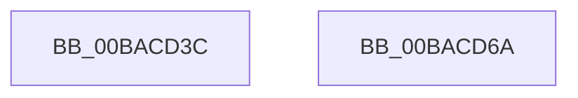

# ViWdStartTimer

- RVA: `0x00BACD3C`–`0x00BACD6B` (길이 `47` bytes)
- VA: `0x0000000140BACD3C`
- 실행 섹션: `PAGEVRFY`
- PDB 이름 있음: `예`; PDB Function 태그: `아니요`
- unwind 정보 RVA: `0x0005D2F4`
- 디코드: `11`개 명령, `47/47` bytes 표시
- 미해석 바이트: `0` (있으면 어셈블리에 `.byte`로 보존)

> 이 문서는 커널 이미지의 기계어와 PDB 기호를 분석해 생성했습니다. 4번과 5번은 함수 원형과 자료형을 바이너리 사용 방식에서 추정한 C 해석이며 원본 소스 복구 결과는 아닙니다.

## 1. Dependencies

- 직접 호출 지점: **1**; 고유 호출 대상: **1**
- 직접 호출자로 확인된 함수: **2**
- RIP 상대 이미지 참조: **2**

### Outgoing calls
- `0x00BACD60` → [KiSetTimerEx](../../text/23/KiSetTimerEx_function_00232CB0.md) (function, `0x00232CB0`)

### Direct callers
- [VfWdCheckForSettingsChange](VfWdCheckForSettingsChange_function_00BAC888.md) at `0x00BAC8D5`
- [ViWdIrpTimerDpcRoutine](ViWdIrpTimerDpcRoutine_function_00BACC10.md) at `0x00BACC8D`

### Static image references
- `0x00BACD40` → RVA `0x00FFF240` (`PAGEVRFD`; read)
- `0x00BACD59` → RVA `0x00FFF200` (`PAGEVRFD`; read)

## 2. Other-region calls and transfers

- 다른 실행 섹션으로 향하는 call: **1**
  - `0x00BACD60` → [KiSetTimerEx](../../text/23/KiSetTimerEx_function_00232CB0.md) (`PAGEVRFY` → `.text`)
- 별도 외부 분기/꼬리 이동을 확인하지 못했습니다.

## 3. Assembly (complete function range)

```asm
00BACD3C  48 83 EC 38                     sub rsp, 0x38
00BACD40  48 8D 05 F9 24 45 00            lea rax, [rip + 0x4524f9]
00BACD47  45 33 C9                        xor r9d, r9d
00BACD4A  45 33 C0                        xor r8d, r8d
00BACD4D  48 89 44 24 20                  mov qword ptr [rsp + 0x20], rax
00BACD52  48 C7 C2 80 69 67 FF            mov rdx, 0xffffffffff676980
00BACD59  48 8D 0D A0 24 45 00            lea rcx, [rip + 0x4524a0]
00BACD60  E8 4B 5F 68 FF                  call 0x140232cb0
00BACD65  48 83 C4 38                     add rsp, 0x38
00BACD69  C3                              ret
00BACD6A  CC                              int3
```

## 4. C-style interpretation (structured pseudocode)

```c
__int64 __fastcall ViWdStartTimer(__int64 a1, __int64 a2, int a3, int a4)
{
    __int64 result;
    __int64 v_rsp;
    unsigned __int64 v_stack_m18;

    v_rsp = (v_rsp) - (56);
    a4 = 0;
    a3 = 0;
    v_stack_m18 = v_rip + 4531449;
    result = KiSetTimerEx(v_rip + 4531360, 0xFFFFFFFFFF676980ULL, a3, a4);
    v_rsp = (v_rsp) + (56);
    return result;
}
```

## 5. (Beta) C Style

```c
int64_t ViWdStartTimer(int64_t Arg1, int64_t Arg2, int32_t Arg3, int32_t Arg4)
{
    int64_t result;
    int64_t local_rsp;
    uint64_t v_stack_m18;

    local_rsp = (local_rsp) - (56);
    Arg4 = 0;
    Arg3 = 0;
    v_stack_m18 = v_rip + 4531449;
    result = KiSetTimerEx(v_rip + 4531360, 0xFFFFFFFFFF676980ULL, Arg3, Arg4);
    local_rsp = (local_rsp) + (56);
    return result;
}
```

## 6. Execution-region graph

[열기: 2D/3D 그래프와 함수 탐색 컨트롤 패널](../../../control-panel.html?section=pagevrfy&rva=0x00BACD3C&view=graph)

- 2D 그래프는 위에서 아래로 흐르고, 3D 그래프는 빈 공간을 드래그해 회전합니다. Shift+드래그는 이동, 휠은 확대·축소, 함수 노드 선택은 대상 보고서 이동입니다.

### Static fallback


