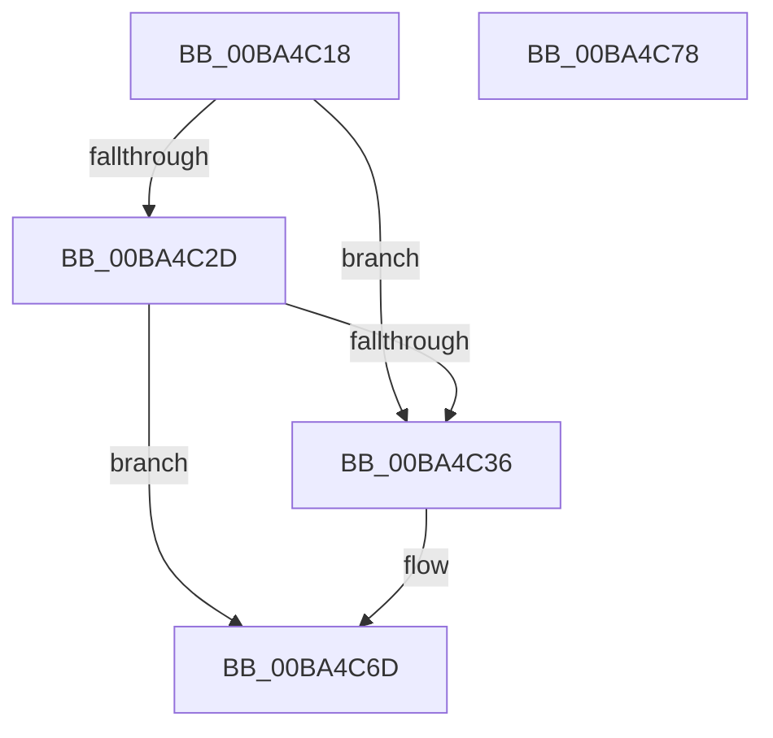

# ViZwCheckApcRequirement

- RVA: `0x00BA4C18`–`0x00BA4C79` (길이 `97` bytes)
- VA: `0x0000000140BA4C18`
- 실행 섹션: `PAGEVRFY`
- PDB 이름 있음: `예`; PDB Function 태그: `아니요`
- unwind 정보 RVA: `0x00065960`
- 디코드: `25`개 명령, `97/97` bytes 표시
- 미해석 바이트: `0` (있으면 어셈블리에 `.byte`로 보존)

> 이 문서는 커널 이미지의 기계어와 PDB 기호를 분석해 생성했습니다. 4번과 5번은 함수 원형과 자료형을 바이너리 사용 방식에서 추정한 C 해석이며 원본 소스 복구 결과는 아닙니다.

## 1. Dependencies

- 직접 호출 지점: **2**; 고유 호출 대상: **2**
- 직접 호출자로 확인된 함수: **4**
- RIP 상대 이미지 참조: **0**

### Outgoing calls
- `0x00BA4C2D` → [KeAreAllApcsDisabled](../../text/2F/KeAreAllApcsDisabled_function_002F7AC0.md) (function, `0x002F7AC0`)
- `0x00BA4C68` → [CarReportRuleViolationFromNt](../B9/CarReportRuleViolationFromNt_function_00B9D904.md) (function, `0x00B9D904`)

### Direct callers
- [VfZwDeviceIoControlFile_Entry](VfZwDeviceIoControlFile_Entry_function_00BA43F0.md) at `0x00BA4441`
- [VfZwQueryDirectoryFileEx_Entry](VfZwQueryDirectoryFileEx_Entry_function_00BA4840.md) at `0x00BA4891`
- [VfZwQueryDirectoryFile_Entry](VfZwQueryDirectoryFile_Entry_function_00BA48B0.md) at `0x00BA4901`
- [VfZwReadFile_Entry](VfZwReadFile_Entry_function_00BA4A90.md) at `0x00BA4AED`

### Static image references
- 디코드된 RIP-relative 메모리 참조가 없습니다.

## 2. Other-region calls and transfers

- 다른 실행 섹션으로 향하는 call: **1**
  - `0x00BA4C2D` → [KeAreAllApcsDisabled](../../text/2F/KeAreAllApcsDisabled_function_002F7AC0.md) (`PAGEVRFY` → `.text`)
- 별도 외부 분기/꼬리 이동을 확인하지 못했습니다.

## 3. Assembly (complete function range)

```asm
00BA4C18  48 89 5C 24 08                  mov qword ptr [rsp + 8], rbx
00BA4C1D  57                              push rdi
00BA4C1E  48 83 EC 40                     sub rsp, 0x40
00BA4C22  48 8B F9                        mov rdi, rcx
00BA4C25  44 0F 20 C3                     mov rbx, cr8
00BA4C29  84 DB                           test bl, bl
00BA4C2B  75 09                           jne 0x140ba4c36
00BA4C2D  E8 8E 2E 75 FF                  call 0x1402f7ac0
00BA4C32  84 C0                           test al, al
00BA4C34  74 37                           je 0x140ba4c6d
00BA4C36  65 48 8B 04 25 88 01 00 00      mov rax, qword ptr gs:[0x188]
00BA4C3F  BA E6 00 00 00                  mov edx, 0xe6
00BA4C44  48 89 7C 24 30                  mov qword ptr [rsp + 0x30], rdi
00BA4C49  4C 8B C7                        mov r8, rdi
00BA4C4C  C7 44 24 28 08 00 00 00         mov dword ptr [rsp + 0x28], 8
00BA4C54  44 0F B6 CB                     movzx r9d, bl
00BA4C58  48 0F BF 88 E6 01 00 00         movsx rcx, word ptr [rax + 0x1e6]
00BA4C60  48 89 4C 24 20                  mov qword ptr [rsp + 0x20], rcx
00BA4C65  8D 4A DE                        lea ecx, [rdx - 0x22]
00BA4C68  E8 97 8C FF FF                  call 0x140b9d904
00BA4C6D  48 8B 5C 24 50                  mov rbx, qword ptr [rsp + 0x50]
00BA4C72  48 83 C4 40                     add rsp, 0x40
00BA4C76  5F                              pop rdi
00BA4C77  C3                              ret
00BA4C78  CC                              int3
```

## 4. C-style interpretation (structured pseudocode)

```c
__int64 __fastcall ViZwCheckApcRequirement(__int64 a1)
{
    __int64 result;
    __int64 v_rsp;
    unsigned __int64 v_stack_m18;
    unsigned int v_stack_m20;
    unsigned __int64 v_stack_m28;
    unsigned __int64 v_stack_p8;

    v_stack_p8 = v_rbx;
    v_rsp = (v_rsp) - (64);
    if ((unsigned __int8)(v_cr8) != 0) goto loc_00BA4C36;
    result = KeAreAllApcsDisabled(a1, a2, a3, a4);
    if ((unsigned __int8)(result) != 0) {
        result = *(unsigned __int64 *)(gs_base + (0 + 392));
        a2 = 230;
        v_stack_m18 = a1;
        a3 = a1;
        v_stack_m20 = 8;
        a4 = (unsigned __int8)(v_cr8);
        a1 = (__int16)(*(unsigned __int16 *)(result + 486));
        v_stack_m28 = a1;
        a1 = a2 - 34;
        result = CarReportRuleViolationFromNt(a1, a2, a3, a4);
    }
    v_rsp = (v_rsp) + (64);
    return result;
}
```

## 5. (Beta) C Style

```c
int64_t ViZwCheckApcRequirement(int64_t Arg1)
{
    int64_t result;
    int64_t local_rsp;
    uint64_t v_stack_m18;
    uint32_t v_stack_m20;
    uint64_t v_stack_m28;
    uint64_t v_stack_p8;

    v_stack_p8 = local_rbx;
    local_rsp = (local_rsp) - (64);
    if ((uint8_t)(v_cr8) != 0) goto loc_00BA4C36;
    result = KeAreAllApcsDisabled(Arg1, a2, a3, a4);
    if ((uint8_t)(result) != 0) {
        result = *(uint64_t *)(gs_base + (0 + 0x188));
        a2 = 230;
        v_stack_m18 = Arg1;
        a3 = Arg1;
        v_stack_m20 = 8;
        a4 = (uint8_t)(v_cr8);
        Arg1 = (int16_t)(*(uint16_t *)(result + 0x1E6));
        v_stack_m28 = Arg1;
        Arg1 = a2 - 34;
        result = CarReportRuleViolationFromNt(Arg1, a2, a3, a4);
    }
    local_rsp = (local_rsp) + (64);
    return result;
}
```

## 6. Execution-region graph

[열기: 2D/3D 그래프와 함수 탐색 컨트롤 패널](../../../control-panel.html?section=pagevrfy&rva=0x00BA4C18&view=graph)

- 2D 그래프는 위에서 아래로 흐르고, 3D 그래프는 빈 공간을 드래그해 회전합니다. Shift+드래그는 이동, 휠은 확대·축소, 함수 노드 선택은 대상 보고서 이동입니다.

### Static fallback


