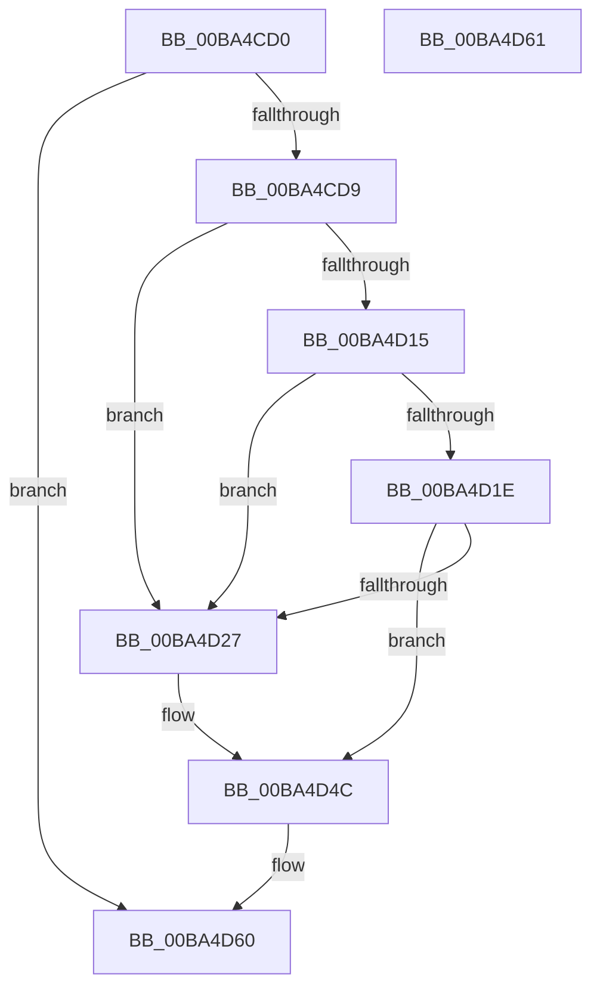

# ViZwCheckUnicodeString

- RVA: `0x00BA4CD0`–`0x00BA4D62` (길이 `146` bytes)
- VA: `0x0000000140BA4CD0`
- 실행 섹션: `PAGEVRFY`
- PDB 이름 있음: `예`; PDB Function 태그: `아니요`
- unwind 정보 RVA: `0x000C58E4`
- 디코드: `40`개 명령, `146/146` bytes 표시
- 미해석 바이트: `0` (있으면 어셈블리에 `.byte`로 보존)

> 이 문서는 커널 이미지의 기계어와 PDB 기호를 분석해 생성했습니다. 4번과 5번은 함수 원형과 자료형을 바이너리 사용 방식에서 추정한 C 해석이며 원본 소스 복구 결과는 아닙니다.

## 1. Dependencies

- 직접 호출 지점: **3**; 고유 호출 대상: **2**
- 직접 호출자로 확인된 함수: **17**
- RIP 상대 이미지 참조: **0**

### Outgoing calls
- `0x00BA4CF5` → [ViZwCheckVirtualAddress](ViZwCheckVirtualAddress_function_00BA4D68.md) (function, `0x00BA4D68`)
- `0x00BA4D04` → [ViZwCheckVirtualAddress](ViZwCheckVirtualAddress_function_00BA4D68.md) (function, `0x00BA4D68`)
- `0x00BA4D47` → [CarReportRuleViolationFromNt](../B9/CarReportRuleViolationFromNt_function_00B9D904.md) (function, `0x00B9D904`)

### Direct callers
- [VfZwAccessCheckAndAuditAlarm_Entry](VfZwAccessCheckAndAuditAlarm_Entry_function_00BA3C40.md) at `0x00BA3C59`
- [VfZwAccessCheckAndAuditAlarm_Entry](VfZwAccessCheckAndAuditAlarm_Entry_function_00BA3C40.md) at `0x00BA3C65`
- [VfZwAccessCheckAndAuditAlarm_Entry](VfZwAccessCheckAndAuditAlarm_Entry_function_00BA3C40.md) at `0x00BA3C71`
- [VfZwAlpcConnectPort_Entry](VfZwAlpcConnectPort_Entry_function_00BA3DF0.md) at `0x00BA3E75`
- [VfZwCloseObjectAuditAlarm_Entry](VfZwCloseObjectAuditAlarm_Entry_function_00BA3FF0.md) at `0x00BA4007`
- [VfZwConnectPort_Entry](VfZwConnectPort_Entry_function_00BA4020.md) at `0x00BA4045`
- [VfZwCreateKey_Entry](VfZwCreateKey_Entry_function_00BA41C0.md) at `0x00BA41F1`
- [VfZwCreateSymbolicLinkObject_Entry](VfZwCreateSymbolicLinkObject_Entry_function_00BA4260.md) at `0x00BA4291`
- [VfZwCreateTransactionManager_Entry](VfZwCreateTransactionManager_Entry_function_00BA42B0.md) at `0x00BA42E1`
- [VfZwCreateTransaction_Entry](VfZwCreateTransaction_Entry_function_00BA4300.md) at `0x00BA4349`
- [VfZwDeleteValueKey_Entry](VfZwDeleteValueKey_Entry_function_00BA43C0.md) at `0x00BA43D7`
- [VfZwOpenTransactionManager_Entry](VfZwOpenTransactionManager_Entry_function_00BA4750.md) at `0x00BA4781`
- [VfZwQueryDirectoryFileEx_Entry](VfZwQueryDirectoryFileEx_Entry_function_00BA4840.md) at `0x00BA4889`
- [VfZwQueryDirectoryFile_Entry](VfZwQueryDirectoryFile_Entry_function_00BA48B0.md) at `0x00BA48F9`
- [VfZwQueryLicenseValue_Entry](VfZwQueryLicenseValue_Entry_function_00BA49B0.md) at `0x00BA49ED`
- [VfZwQuerySymbolicLinkObject_Entry](VfZwQuerySymbolicLinkObject_Entry_function_00BA4A00.md) at `0x00BA4A19`
- [VfZwQueryValueKey_Entry](VfZwQueryValueKey_Entry_function_00BA4A40.md) at `0x00BA4A59`
- [VfZwSetValueKey_Entry](VfZwSetValueKey_Entry_function_00BA4BE0.md) at `0x00BA4BF9`
- [ViZwCheckObjectAttributes](ViZwCheckObjectAttributes_function_00BA4C80.md) at `0x00BA4CA1`

### Static image references
- 디코드된 RIP-relative 메모리 참조가 없습니다.

## 2. Other-region calls and transfers

- 다른 실행 섹션으로 향하는 call: **0**
- 별도 외부 분기/꼬리 이동을 확인하지 못했습니다.

## 3. Assembly (complete function range)

```asm
00BA4CD0  48 85 C9                        test rcx, rcx
00BA4CD3  0F 84 87 00 00 00               je 0x140ba4d60
00BA4CD9  48 89 5C 24 08                  mov qword ptr [rsp + 8], rbx
00BA4CDE  48 89 6C 24 10                  mov qword ptr [rsp + 0x10], rbp
00BA4CE3  48 89 74 24 18                  mov qword ptr [rsp + 0x18], rsi
00BA4CE8  57                              push rdi
00BA4CE9  48 83 EC 40                     sub rsp, 0x40
00BA4CED  48 8B F2                        mov rsi, rdx
00BA4CF0  48 8B F9                        mov rdi, rcx
00BA4CF3  33 ED                           xor ebp, ebp
00BA4CF5  E8 6E 00 00 00                  call 0x140ba4d68
00BA4CFA  48 8B 5F 08                     mov rbx, qword ptr [rdi + 8]
00BA4CFE  48 8B D6                        mov rdx, rsi
00BA4D01  48 8B CB                        mov rcx, rbx
00BA4D04  E8 5F 00 00 00                  call 0x140ba4d68
00BA4D09  0F B7 0F                        movzx ecx, word ptr [rdi]
00BA4D0C  48 8D 04 0B                     lea rax, [rbx + rcx]
00BA4D10  48 3B C3                        cmp rax, rbx
00BA4D13  72 12                           jb 0x140ba4d27
00BA4D15  0F B7 47 02                     movzx eax, word ptr [rdi + 2]
00BA4D19  66 3B C1                        cmp ax, cx
00BA4D1C  72 09                           jb 0x140ba4d27
00BA4D1E  66 0B C1                        or ax, cx
00BA4D21  66 0F A3 E8                     bt ax, bp
00BA4D25  73 25                           jae 0x140ba4d4c
00BA4D27  BA E4 00 00 00                  mov edx, 0xe4
00BA4D2C  48 89 74 24 30                  mov qword ptr [rsp + 0x30], rsi
00BA4D31  C7 44 24 28 08 00 00 00         mov dword ptr [rsp + 0x28], 8
00BA4D39  4C 8B CF                        mov r9, rdi
00BA4D3C  4C 8B C6                        mov r8, rsi
00BA4D3F  48 89 6C 24 20                  mov qword ptr [rsp + 0x20], rbp
00BA4D44  8D 4A E0                        lea ecx, [rdx - 0x20]
00BA4D47  E8 B8 8B FF FF                  call 0x140b9d904
00BA4D4C  48 8B 5C 24 50                  mov rbx, qword ptr [rsp + 0x50]
00BA4D51  48 8B 6C 24 58                  mov rbp, qword ptr [rsp + 0x58]
00BA4D56  48 8B 74 24 60                  mov rsi, qword ptr [rsp + 0x60]
00BA4D5B  48 83 C4 40                     add rsp, 0x40
00BA4D5F  5F                              pop rdi
00BA4D60  C3                              ret
00BA4D61  CC                              int3
```

## 4. C-style interpretation (structured pseudocode)

```c
__int64 __fastcall ViZwCheckUnicodeString(__int64 a1, __int64 a2)
{
    __int64 result;
    __int64 v_rbp;
    __int64 v_rsp;
    unsigned __int64 v_stack_m18;
    unsigned int v_stack_m20;
    unsigned __int64 v_stack_m28;
    unsigned __int64 v_stack_p10;
    unsigned __int64 v_stack_p18;
    unsigned __int64 v_stack_p8;

    if (a1 == 0) goto loc_00BA4D60;
    v_stack_p8 = v_rbx;
    v_stack_p10 = v_rbp;
    v_stack_p18 = v_rsi;
    v_rsp = (v_rsp) - (64);
    v_rbp = 0;
    result = ViZwCheckVirtualAddress(a1, a2, a3, a4);
    result = ViZwCheckVirtualAddress(*(unsigned __int64 *)(a1 + 8), a2, a3, a4);
    if ((*(unsigned __int64 *)(a1 + 8) + *(unsigned __int16 *)(a1) * 1) < (*(unsigned __int64 *)(a1 + 8))) goto loc_00BA4D27;
    if (((unsigned __int16)(*(unsigned __int16 *)(a1 + 2))) < ((unsigned __int16)(*(unsigned __int16 *)(a1)))) goto loc_00BA4D27;
    result = (unsigned __int16)((*(unsigned __int16 *)(a1 + 2)) | ((unsigned __int16)(*(unsigned __int16 *)(a1))));
    if (!(condition_is_above_or_equal)) {
        a2 = 228;
        v_stack_m18 = a2;
        v_stack_m20 = 8;
        a4 = a1;
        a3 = a2;
        v_stack_m28 = 0;
        a1 = a2 - 32;
        result = CarReportRuleViolationFromNt(a1, a2, a3, a4);
    }
    v_rsp = (v_rsp) + (64);
loc_00BA4D60:
    return result;
}
```

## 5. (Beta) C Style

```c
int64_t ViZwCheckUnicodeString(int64_t Arg1, int64_t Arg2)
{
    int64_t result;
    int64_t local_rbp;
    int64_t local_rsp;
    uint64_t v_stack_m18;
    uint32_t v_stack_m20;
    uint64_t v_stack_m28;
    uint64_t v_stack_p10;
    uint64_t v_stack_p18;
    uint64_t v_stack_p8;

    if (Arg1 == 0) goto loc_00BA4D60;
    v_stack_p8 = local_rbx;
    v_stack_p10 = local_rbp;
    v_stack_p18 = local_rsi;
    local_rsp = (local_rsp) - (64);
    local_rbp = 0;
    result = ViZwCheckVirtualAddress(Arg1, Arg2, a3, a4);
    result = ViZwCheckVirtualAddress(*(uint64_t *)(Arg1 + 0x8), Arg2, a3, a4);
    if ((*(uint64_t *)(Arg1 + 0x8) + *(uint16_t *)(Arg1) * 1) < (*(uint64_t *)(Arg1 + 0x8))) goto loc_00BA4D27;
    if (((uint16_t)(*(uint16_t *)(Arg1 + 0x2))) < ((uint16_t)(*(uint16_t *)(Arg1)))) goto loc_00BA4D27;
    result = (uint16_t)((*(uint16_t *)(Arg1 + 0x2)) | ((uint16_t)(*(uint16_t *)(Arg1))));
    if (!(condition_is_above_or_equal)) {
        Arg2 = 228;
        v_stack_m18 = Arg2;
        v_stack_m20 = 8;
        a4 = Arg1;
        a3 = Arg2;
        v_stack_m28 = 0;
        Arg1 = Arg2 - 32;
        result = CarReportRuleViolationFromNt(Arg1, Arg2, a3, a4);
    }
    local_rsp = (local_rsp) + (64);
loc_00BA4D60:
    return result;
}
```

## 6. Execution-region graph

[열기: 2D/3D 그래프와 함수 탐색 컨트롤 패널](../../../control-panel.html?section=pagevrfy&rva=0x00BA4CD0&view=graph)

- 2D 그래프는 위에서 아래로 흐르고, 3D 그래프는 빈 공간을 드래그해 회전합니다. Shift+드래그는 이동, 휠은 확대·축소, 함수 노드 선택은 대상 보고서 이동입니다.

### Static fallback


