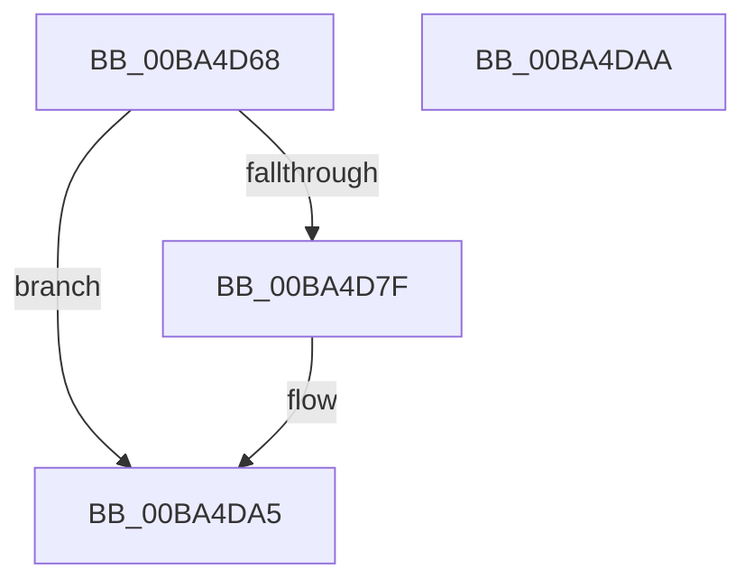

# ViZwCheckVirtualAddress

- RVA: `0x00BA4D68`–`0x00BA4DAB` (길이 `67` bytes)
- VA: `0x0000000140BA4D68`
- 실행 섹션: `PAGEVRFY`
- PDB 이름 있음: `예`; PDB Function 태그: `아니요`
- unwind 정보 RVA: `0x00063458`
- 디코드: `16`개 명령, `67/67` bytes 표시
- 미해석 바이트: `0` (있으면 어셈블리에 `.byte`로 보존)

> 이 문서는 커널 이미지의 기계어와 PDB 기호를 분석해 생성했습니다. 4번과 5번은 함수 원형과 자료형을 바이너리 사용 방식에서 추정한 C 해석이며 원본 소스 복구 결과는 아닙니다.

## 1. Dependencies

- 직접 호출 지점: **1**; 고유 호출 대상: **1**
- 직접 호출자로 확인된 함수: **48**
- RIP 상대 이미지 참조: **0**

### Outgoing calls
- `0x00BA4DA0` → [CarReportRuleViolationFromNt](../B9/CarReportRuleViolationFromNt_function_00B9D904.md) (function, `0x00B9D904`)

### Direct callers
- [VfZwAccessCheckAndAuditAlarm_Entry](VfZwAccessCheckAndAuditAlarm_Entry_function_00BA3C40.md) at `0x00BA3C7D`
- [VfZwAccessCheckAndAuditAlarm_Entry](VfZwAccessCheckAndAuditAlarm_Entry_function_00BA3C40.md) at `0x00BA3C89`
- [VfZwAccessCheckAndAuditAlarm_Entry](VfZwAccessCheckAndAuditAlarm_Entry_function_00BA3C40.md) at `0x00BA3C95`
- [VfZwAccessCheckAndAuditAlarm_Entry](VfZwAccessCheckAndAuditAlarm_Entry_function_00BA3C40.md) at `0x00BA3CA1`
- [VfZwAddBootEntry_Entry](VfZwAddBootEntry_Entry_function_00BA3CC0.md) at `0x00BA3CD9`
- [VfZwAddBootEntry_Entry](VfZwAddBootEntry_Entry_function_00BA3CC0.md) at `0x00BA3CE5`
- [VfZwAdjustPrivilegesToken_Entry](VfZwAdjustPrivilegesToken_Entry_function_00BA3D00.md) at `0x00BA3D19`
- [VfZwAdjustPrivilegesToken_Entry](VfZwAdjustPrivilegesToken_Entry_function_00BA3D00.md) at `0x00BA3D25`
- [VfZwAdjustPrivilegesToken_Entry](VfZwAdjustPrivilegesToken_Entry_function_00BA3D00.md) at `0x00BA3D31`
- [VfZwAllocateVirtualMemory_Entry](VfZwAllocateVirtualMemory_Entry_function_00BA3D50.md) at `0x00BA3D69`
- [VfZwAllocateVirtualMemory_Entry](VfZwAllocateVirtualMemory_Entry_function_00BA3D50.md) at `0x00BA3D75`
- [VfZwAlpcAcceptConnectPort_Entry](VfZwAlpcAcceptConnectPort_Entry_function_00BA3D90.md) at `0x00BA3DA9`
- [VfZwAlpcAcceptConnectPort_Entry](VfZwAlpcAcceptConnectPort_Entry_function_00BA3D90.md) at `0x00BA3DB5`
- [VfZwAlpcAcceptConnectPort_Entry](VfZwAlpcAcceptConnectPort_Entry_function_00BA3D90.md) at `0x00BA3DC1`
- [VfZwAlpcAcceptConnectPort_Entry](VfZwAlpcAcceptConnectPort_Entry_function_00BA3D90.md) at `0x00BA3DCD`
- [VfZwAlpcConnectPort_Entry](VfZwAlpcConnectPort_Entry_function_00BA3DF0.md) at `0x00BA3E09`
- [VfZwAlpcConnectPort_Entry](VfZwAlpcConnectPort_Entry_function_00BA3DF0.md) at `0x00BA3E15`
- [VfZwAlpcConnectPort_Entry](VfZwAlpcConnectPort_Entry_function_00BA3DF0.md) at `0x00BA3E21`
- [VfZwAlpcConnectPort_Entry](VfZwAlpcConnectPort_Entry_function_00BA3DF0.md) at `0x00BA3E2D`
- [VfZwAlpcConnectPort_Entry](VfZwAlpcConnectPort_Entry_function_00BA3DF0.md) at `0x00BA3E39`
- [VfZwAlpcConnectPort_Entry](VfZwAlpcConnectPort_Entry_function_00BA3DF0.md) at `0x00BA3E45`
- [VfZwAlpcConnectPort_Entry](VfZwAlpcConnectPort_Entry_function_00BA3DF0.md) at `0x00BA3E51`
- [VfZwAlpcConnectPort_Entry](VfZwAlpcConnectPort_Entry_function_00BA3DF0.md) at `0x00BA3E5D`
- [VfZwAlpcCreatePort_Entry](VfZwAlpcCreatePort_Entry_function_00BA3E90.md) at `0x00BA3EA9`
- [VfZwAlpcCreatePort_Entry](VfZwAlpcCreatePort_Entry_function_00BA3E90.md) at `0x00BA3EB5`
- [VfZwAlpcCreateResourceReserve_Entry](VfZwAlpcCreateResourceReserve_Entry_function_00BA3EE0.md) at `0x00BA3EF7`
- [VfZwAlpcQueryInformation_Entry](VfZwAlpcQueryInformation_Entry_function_00BA3F10.md) at `0x00BA3F29`
- [VfZwAlpcQueryInformation_Entry](VfZwAlpcQueryInformation_Entry_function_00BA3F10.md) at `0x00BA3F35`
- [VfZwAlpcSendWaitReceivePort_Entry](VfZwAlpcSendWaitReceivePort_Entry_function_00BA3F50.md) at `0x00BA3F69`
- [VfZwAlpcSendWaitReceivePort_Entry](VfZwAlpcSendWaitReceivePort_Entry_function_00BA3F50.md) at `0x00BA3F75`
- [VfZwAlpcSendWaitReceivePort_Entry](VfZwAlpcSendWaitReceivePort_Entry_function_00BA3F50.md) at `0x00BA3F81`
- [VfZwAlpcSendWaitReceivePort_Entry](VfZwAlpcSendWaitReceivePort_Entry_function_00BA3F50.md) at `0x00BA3F8D`
- [VfZwAlpcSendWaitReceivePort_Entry](VfZwAlpcSendWaitReceivePort_Entry_function_00BA3F50.md) at `0x00BA3F99`
- [VfZwAlpcSendWaitReceivePort_Entry](VfZwAlpcSendWaitReceivePort_Entry_function_00BA3F50.md) at `0x00BA3FA5`
- [VfZwAlpcSetInformation_Entry](VfZwAlpcSetInformation_Entry_function_00BA3FC0.md) at `0x00BA3FD7`
- [VfZwConnectPort_Entry](VfZwConnectPort_Entry_function_00BA4020.md) at `0x00BA4039`
- [VfZwConnectPort_Entry](VfZwConnectPort_Entry_function_00BA4020.md) at `0x00BA4051`
- [VfZwConnectPort_Entry](VfZwConnectPort_Entry_function_00BA4020.md) at `0x00BA405D`
- [VfZwConnectPort_Entry](VfZwConnectPort_Entry_function_00BA4020.md) at `0x00BA4069`
- [VfZwConnectPort_Entry](VfZwConnectPort_Entry_function_00BA4020.md) at `0x00BA4075`
- [VfZwConnectPort_Entry](VfZwConnectPort_Entry_function_00BA4020.md) at `0x00BA4081`
- [VfZwConnectPort_Entry](VfZwConnectPort_Entry_function_00BA4020.md) at `0x00BA408D`
- [VfZwCreateDirectoryObject_Entry](VfZwCreateDirectoryObject_Entry_function_00BA40A0.md) at `0x00BA40B9`
- [VfZwCreateEnlistment_Entry](VfZwCreateEnlistment_Entry_function_00BA40E0.md) at `0x00BA40F9`
- [VfZwCreateEvent_Entry](VfZwCreateEvent_Entry_function_00BA4120.md) at `0x00BA4139`
- [VfZwCreateFile_Entry](VfZwCreateFile_Entry_function_00BA4160.md) at `0x00BA4179`
- [VfZwCreateFile_Entry](VfZwCreateFile_Entry_function_00BA4160.md) at `0x00BA4191`
- [VfZwCreateFile_Entry](VfZwCreateFile_Entry_function_00BA4160.md) at `0x00BA419D`
- [VfZwCreateFile_Entry](VfZwCreateFile_Entry_function_00BA4160.md) at `0x00BA41A9`
- [VfZwCreateKey_Entry](VfZwCreateKey_Entry_function_00BA41C0.md) at `0x00BA41D9`
- [VfZwCreateKey_Entry](VfZwCreateKey_Entry_function_00BA41C0.md) at `0x00BA41FD`
- [VfZwCreateSection_Entry](VfZwCreateSection_Entry_function_00BA4210.md) at `0x00BA4229`
- [VfZwCreateSection_Entry](VfZwCreateSection_Entry_function_00BA4210.md) at `0x00BA4241`
- [VfZwCreateSymbolicLinkObject_Entry](VfZwCreateSymbolicLinkObject_Entry_function_00BA4260.md) at `0x00BA4279`
- [VfZwCreateTransactionManager_Entry](VfZwCreateTransactionManager_Entry_function_00BA42B0.md) at `0x00BA42C9`
- [VfZwCreateTransaction_Entry](VfZwCreateTransaction_Entry_function_00BA4300.md) at `0x00BA4319`
- [VfZwCreateTransaction_Entry](VfZwCreateTransaction_Entry_function_00BA4300.md) at `0x00BA4325`
- [VfZwCreateTransaction_Entry](VfZwCreateTransaction_Entry_function_00BA4300.md) at `0x00BA4331`
- [VfZwDeleteBootEntry_Entry](VfZwDeleteBootEntry_Entry_function_00BA4360.md) at `0x00BA4375`
- [VfZwDeviceIoControlFile_Entry](VfZwDeviceIoControlFile_Entry_function_00BA43F0.md) at `0x00BA4409`
- [VfZwDeviceIoControlFile_Entry](VfZwDeviceIoControlFile_Entry_function_00BA43F0.md) at `0x00BA4415`
- [VfZwDeviceIoControlFile_Entry](VfZwDeviceIoControlFile_Entry_function_00BA43F0.md) at `0x00BA4421`
- [VfZwDeviceIoControlFile_Entry](VfZwDeviceIoControlFile_Entry_function_00BA43F0.md) at `0x00BA442D`
- [VfZwDeviceIoControlFile_Entry](VfZwDeviceIoControlFile_Entry_function_00BA43F0.md) at `0x00BA4439`
- [VfZwDuplicateObject_Entry](VfZwDuplicateObject_Entry_function_00BA4460.md) at `0x00BA4477`
- [VfZwDuplicateToken_Entry](VfZwDuplicateToken_Entry_function_00BA4490.md) at `0x00BA44B5`
- [VfZwFlushVirtualMemory_Entry](VfZwFlushVirtualMemory_Entry_function_00BA44D0.md) at `0x00BA44E9`
- [VfZwFlushVirtualMemory_Entry](VfZwFlushVirtualMemory_Entry_function_00BA44D0.md) at `0x00BA44F5`
- [VfZwFlushVirtualMemory_Entry](VfZwFlushVirtualMemory_Entry_function_00BA44D0.md) at `0x00BA4501`
- [VfZwFreeVirtualMemory_Entry](VfZwFreeVirtualMemory_Entry_function_00BA4520.md) at `0x00BA4539`
- [VfZwFreeVirtualMemory_Entry](VfZwFreeVirtualMemory_Entry_function_00BA4520.md) at `0x00BA4545`
- [VfZwMapViewOfSection_Entry](VfZwMapViewOfSection_Entry_function_00BA45A0.md) at `0x00BA45B9`
- [VfZwMapViewOfSection_Entry](VfZwMapViewOfSection_Entry_function_00BA45A0.md) at `0x00BA45C5`
- [VfZwMapViewOfSection_Entry](VfZwMapViewOfSection_Entry_function_00BA45A0.md) at `0x00BA45D1`
- [VfZwNotifyChangeKey_Entry](VfZwNotifyChangeKey_Entry_function_00BA45F0.md) at `0x00BA460E`
- [VfZwNotifyChangeKey_Entry](VfZwNotifyChangeKey_Entry_function_00BA45F0.md) at `0x00BA4651`
- [VfZwNotifyChangeKey_Entry](VfZwNotifyChangeKey_Entry_function_00BA45F0.md) at `0x00BA465D`
- [VfZwOpenEnlistment_Entry](VfZwOpenEnlistment_Entry_function_00BA4670.md) at `0x00BA4689`
- [VfZwOpenFile_Entry](VfZwOpenFile_Entry_function_00BA46B0.md) at `0x00BA46C9`
- [VfZwOpenFile_Entry](VfZwOpenFile_Entry_function_00BA46B0.md) at `0x00BA46E1`
- [VfZwOpenProcess_Entry](VfZwOpenProcess_Entry_function_00BA4700.md) at `0x00BA4719`
- [VfZwOpenProcess_Entry](VfZwOpenProcess_Entry_function_00BA4700.md) at `0x00BA4731`
- [VfZwOpenTransactionManager_Entry](VfZwOpenTransactionManager_Entry_function_00BA4750.md) at `0x00BA4769`
- [VfZwOpenTransactionManager_Entry](VfZwOpenTransactionManager_Entry_function_00BA4750.md) at `0x00BA478D`
- [VfZwOpenTransaction_Entry](VfZwOpenTransaction_Entry_function_00BA47A0.md) at `0x00BA47B9`
- [VfZwOpenTransaction_Entry](VfZwOpenTransaction_Entry_function_00BA47A0.md) at `0x00BA47C5`
- [VfZwProtectVirtualMemory_Entry](VfZwProtectVirtualMemory_Entry_function_00BA47F0.md) at `0x00BA4809`
- [VfZwProtectVirtualMemory_Entry](VfZwProtectVirtualMemory_Entry_function_00BA47F0.md) at `0x00BA4815`
- [VfZwProtectVirtualMemory_Entry](VfZwProtectVirtualMemory_Entry_function_00BA47F0.md) at `0x00BA4821`
- [VfZwQueryDirectoryFileEx_Entry](VfZwQueryDirectoryFileEx_Entry_function_00BA4840.md) at `0x00BA4859`
- [VfZwQueryDirectoryFileEx_Entry](VfZwQueryDirectoryFileEx_Entry_function_00BA4840.md) at `0x00BA4865`
- [VfZwQueryDirectoryFileEx_Entry](VfZwQueryDirectoryFileEx_Entry_function_00BA4840.md) at `0x00BA4871`
- [VfZwQueryDirectoryFileEx_Entry](VfZwQueryDirectoryFileEx_Entry_function_00BA4840.md) at `0x00BA487D`
- [VfZwQueryDirectoryFile_Entry](VfZwQueryDirectoryFile_Entry_function_00BA48B0.md) at `0x00BA48C9`
- [VfZwQueryDirectoryFile_Entry](VfZwQueryDirectoryFile_Entry_function_00BA48B0.md) at `0x00BA48D5`
- [VfZwQueryDirectoryFile_Entry](VfZwQueryDirectoryFile_Entry_function_00BA48B0.md) at `0x00BA48E1`
- [VfZwQueryDirectoryFile_Entry](VfZwQueryDirectoryFile_Entry_function_00BA48B0.md) at `0x00BA48ED`
- [VfZwQueryEaFile_Entry](VfZwQueryEaFile_Entry_function_00BA4920.md) at `0x00BA4939`
- [VfZwQueryEaFile_Entry](VfZwQueryEaFile_Entry_function_00BA4920.md) at `0x00BA4945`
- [VfZwQueryEaFile_Entry](VfZwQueryEaFile_Entry_function_00BA4920.md) at `0x00BA4951`
- [VfZwQueryFullAttributesFile_Entry](VfZwQueryFullAttributesFile_Entry_function_00BA4970.md) at `0x00BA4995`
- [VfZwQueryLicenseValue_Entry](VfZwQueryLicenseValue_Entry_function_00BA49B0.md) at `0x00BA49C9`
- [VfZwQueryLicenseValue_Entry](VfZwQueryLicenseValue_Entry_function_00BA49B0.md) at `0x00BA49D5`
- [VfZwQueryLicenseValue_Entry](VfZwQueryLicenseValue_Entry_function_00BA49B0.md) at `0x00BA49E1`
- [VfZwQuerySymbolicLinkObject_Entry](VfZwQuerySymbolicLinkObject_Entry_function_00BA4A00.md) at `0x00BA4A25`
- [VfZwQueryValueKey_Entry](VfZwQueryValueKey_Entry_function_00BA4A40.md) at `0x00BA4A65`
- [VfZwQueryValueKey_Entry](VfZwQueryValueKey_Entry_function_00BA4A40.md) at `0x00BA4A71`
- [VfZwReadFile_Entry](VfZwReadFile_Entry_function_00BA4A90.md) at `0x00BA4AA9`
- [VfZwReadFile_Entry](VfZwReadFile_Entry_function_00BA4A90.md) at `0x00BA4AB5`
- [VfZwReadFile_Entry](VfZwReadFile_Entry_function_00BA4A90.md) at `0x00BA4AC1`
- [VfZwReadFile_Entry](VfZwReadFile_Entry_function_00BA4A90.md) at `0x00BA4ACD`
- [VfZwReadFile_Entry](VfZwReadFile_Entry_function_00BA4A90.md) at `0x00BA4AD9`
- [VfZwReadFile_Entry](VfZwReadFile_Entry_function_00BA4A90.md) at `0x00BA4AE5`
- [VfZwRemoveIoCompletionEx_Entry](VfZwRemoveIoCompletionEx_Entry_function_00BA4B00.md) at `0x00BA4B19`
- [VfZwRemoveIoCompletionEx_Entry](VfZwRemoveIoCompletionEx_Entry_function_00BA4B00.md) at `0x00BA4B25`
- [VfZwRemoveIoCompletionEx_Entry](VfZwRemoveIoCompletionEx_Entry_function_00BA4B00.md) at `0x00BA4B31`
- [VfZwSetTimer_Entry](VfZwSetTimer_Entry_function_00BA4B90.md) at `0x00BA4BA9`
- [VfZwSetTimer_Entry](VfZwSetTimer_Entry_function_00BA4B90.md) at `0x00BA4BB5`
- [VfZwSetTimer_Entry](VfZwSetTimer_Entry_function_00BA4B90.md) at `0x00BA4BC1`
- [VfZwSetTimer_Entry](VfZwSetTimer_Entry_function_00BA4B90.md) at `0x00BA4BCD`
- [VfZwSetValueKey_Entry](VfZwSetValueKey_Entry_function_00BA4BE0.md) at `0x00BA4C05`
- [ViZwCheckObjectAttributes](ViZwCheckObjectAttributes_function_00BA4C80.md) at `0x00BA4C95`
- [ViZwCheckObjectAttributes](ViZwCheckObjectAttributes_function_00BA4C80.md) at `0x00BA4CAD`
- [ViZwCheckObjectAttributes](ViZwCheckObjectAttributes_function_00BA4C80.md) at `0x00BA4CB9`
- [ViZwCheckUnicodeString](ViZwCheckUnicodeString_function_00BA4CD0.md) at `0x00BA4CF5`
- [ViZwCheckUnicodeString](ViZwCheckUnicodeString_function_00BA4CD0.md) at `0x00BA4D04`

### Static image references
- 디코드된 RIP-relative 메모리 참조가 없습니다.

## 2. Other-region calls and transfers

- 다른 실행 섹션으로 향하는 call: **0**
- 별도 외부 분기/꼬리 이동을 확인하지 못했습니다.

## 3. Assembly (complete function range)

```asm
00BA4D68  48 83 EC 48                     sub rsp, 0x48
00BA4D6C  48 8D 41 FF                     lea rax, [rcx - 1]
00BA4D70  49 B8 FE FF FE FF FF 7F 00 00   movabs r8, 0x7ffffffefffe
00BA4D7A  49 3B C0                        cmp rax, r8
00BA4D7D  77 26                           ja 0x140ba4da5
00BA4D7F  48 89 54 24 30                  mov qword ptr [rsp + 0x30], rdx
00BA4D84  4C 8B C2                        mov r8, rdx
00BA4D87  BA E3 00 00 00                  mov edx, 0xe3
00BA4D8C  C7 44 24 28 08 00 00 00         mov dword ptr [rsp + 0x28], 8
00BA4D94  48 83 64 24 20 00               and qword ptr [rsp + 0x20], 0
00BA4D9A  4C 8B C9                        mov r9, rcx
00BA4D9D  8D 4A E1                        lea ecx, [rdx - 0x1f]
00BA4DA0  E8 5F 8B FF FF                  call 0x140b9d904
00BA4DA5  48 83 C4 48                     add rsp, 0x48
00BA4DA9  C3                              ret
00BA4DAA  CC                              int3
```

## 4. C-style interpretation (structured pseudocode)

```c
__int64 __fastcall ViZwCheckVirtualAddress(__int64 a1, __int64 a2)
{
    __int64 result;
    __int64 v_rsp;
    unsigned __int64 v_stack_m18;
    unsigned int v_stack_m20;
    unsigned __int64 v_stack_m28;

    v_rsp = (v_rsp) - (72);
    result = a1 - 1;
    if ((a1 - 1) <= a3) {
        v_stack_m18 = a2;
        a3 = a2;
        a2 = 227;
        v_stack_m20 = 8;
        a4 = a1;
        a1 = a2 - 31;
        result = CarReportRuleViolationFromNt(a1, a2, a3, a4);
    }
    v_rsp = (v_rsp) + (72);
    return result;
}
```

## 5. (Beta) C Style

```c
int64_t ViZwCheckVirtualAddress(void *Arg1, int64_t Arg2)
{
    uint8_t *arg1 = (uint8_t *)Arg1;

    int64_t result;
    int64_t local_rsp;
    uint64_t v_stack_m18;
    uint32_t v_stack_m20;
    uint64_t v_stack_m28;

    local_rsp = (local_rsp) - (72);
    result = Arg1 - 1;
    if ((Arg1 - 1) <= a3) {
        v_stack_m18 = Arg2;
        a3 = Arg2;
        Arg2 = 227;
        v_stack_m20 = 8;
        a4 = Arg1;
        Arg1 = Arg2 - 31;
        result = CarReportRuleViolationFromNt(Arg1, Arg2, a3, a4);
    }
    local_rsp = (local_rsp) + (72);
    return result;
}
```

### 관측된 메모리 오프셋

구조체 형식이 확인되지 않은 접근은 인자 기준의 오프셋으로만 기록했습니다.

| 기준 인자 | 오프셋 표현 | 폭 (bit) | 접근 |
|---|---:|---:|---|
| `Arg1` | `- 0x1` | `64` | `R` |

## 6. Execution-region graph

[열기: 2D/3D 그래프와 함수 탐색 컨트롤 패널](../../../control-panel.html?section=pagevrfy&rva=0x00BA4D68&view=graph)

- 2D 그래프는 위에서 아래로 흐르고, 3D 그래프는 빈 공간을 드래그해 회전합니다. Shift+드래그는 이동, 휠은 확대·축소, 함수 노드 선택은 대상 보고서 이동입니다.

### Static fallback


