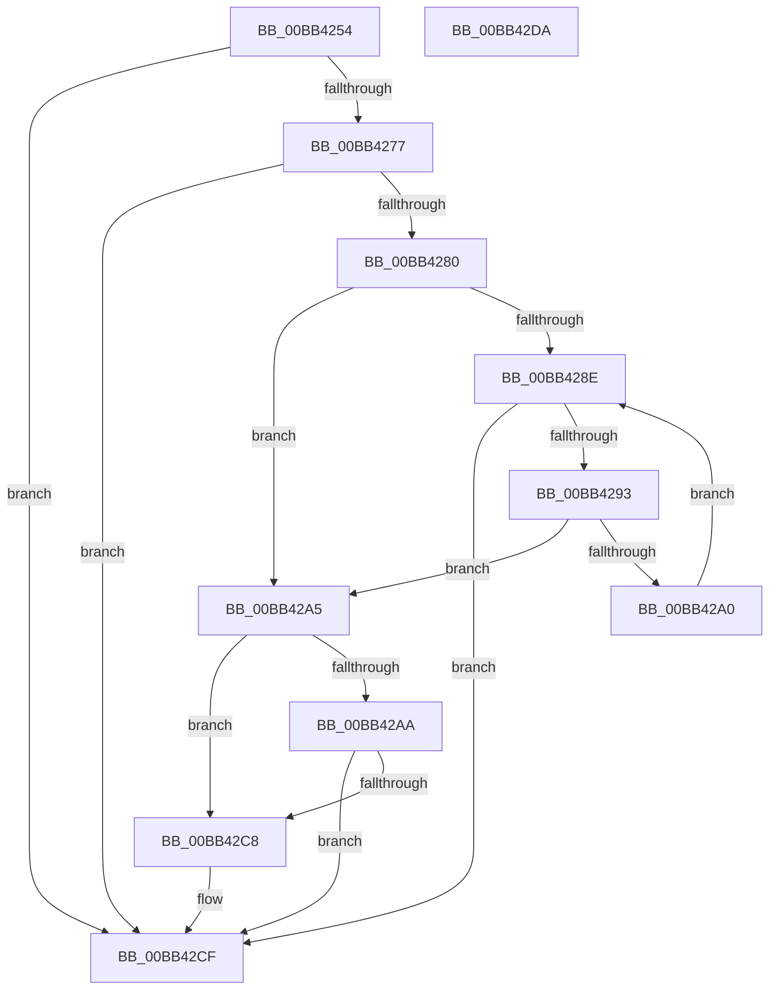

# DifpLwSPProcessPrePoolAlloc

- RVA: `0x00BB4254`–`0x00BB42DB` (길이 `135` bytes)
- VA: `0x0000000140BB4254`
- 실행 섹션: `PAGEVRFY`
- PDB 이름 있음: `예`; PDB Function 태그: `아니요`
- unwind 정보 RVA: `0x0005CAAC`
- 디코드: `38`개 명령, `135/135` bytes 표시
- 미해석 바이트: `0` (있으면 어셈블리에 `.byte`로 보존)

> 이 문서는 커널 이미지의 기계어와 PDB 기호를 분석해 생성했습니다. 4번과 5번은 함수 원형과 자료형을 바이너리 사용 방식에서 추정한 C 해석이며 원본 소스 복구 결과는 아닙니다.

## 1. Dependencies

- 직접 호출 지점: **2**; 고유 호출 대상: **1**
- 직접 호출자로 확인된 함수: **1**
- RIP 상대 이미지 참조: **6**

### Outgoing calls
- `0x00BB42B1` → [VfRandomGetNumber](../B9/VfRandomGetNumber_function_00B930CC.md) (function, `0x00B930CC`)
- `0x00BB42BF` → [VfRandomGetNumber](../B9/VfRandomGetNumber_function_00B930CC.md) (function, `0x00B930CC`)

### Direct callers
- [DifpExAllocatePool2_LwSP_Enter](DifpExAllocatePool2_LwSP_Enter_function_00BB41B0.md) at `0x00BB41BB`

### Static image references
- `0x00BB425E` → RVA `0x00F03DC0` (`.data`; read)
- `0x00BB4268` → RVA `0x00F02468` (`.data`; read)
- `0x00BB426F` → RVA `0x00F03DBC` (`.data`; read)
- `0x00BB4280` → RVA `0x00E0EA70` (`.data`; read)
- `0x00BB4293` → RVA `0x00E681D8` (`.data`; read)
- `0x00BB42C8` → RVA `0x00F03EA0` (`.data`; write)

## 2. Other-region calls and transfers

- 다른 실행 섹션으로 향하는 call: **0**
- 별도 외부 분기/꼬리 이동을 확인하지 못했습니다.

## 3. Assembly (complete function range)

```asm
00BB4254  48 89 5C 24 08                  mov qword ptr [rsp + 8], rbx
00BB4259  57                              push rdi
00BB425A  48 83 EC 20                     sub rsp, 0x20
00BB425E  48 8B 05 5B FB 34 00            mov rax, qword ptr [rip + 0x34fb5b]
00BB4265  45 33 C0                        xor r8d, r8d
00BB4268  48 39 05 F9 E1 34 00            cmp qword ptr [rip + 0x34e1f9], rax
00BB426F  8B 3D 47 FB 34 00               mov edi, dword ptr [rip + 0x34fb47]
00BB4275  73 58                           jae 0x140bb42cf
00BB4277  48 81 FA E0 0F 00 00            cmp rdx, 0xfe0
00BB427E  77 4F                           ja 0x140bb42cf
00BB4280  8B 15 EA A7 25 00               mov edx, dword ptr [rip + 0x25a7ea]
00BB4286  8D 42 FF                        lea eax, [rdx - 1]
00BB4289  83 F8 09                        cmp eax, 9
00BB428C  77 17                           ja 0x140bb42a5
00BB428E  44 3B C2                        cmp r8d, edx
00BB4291  73 3C                           jae 0x140bb42cf
00BB4293  4C 8D 0D 3E 3F 2B 00            lea r9, [rip + 0x2b3f3e]
00BB429A  43 39 0C 81                     cmp dword ptr [r9 + r8*4], ecx
00BB429E  74 05                           je 0x140bb42a5
00BB42A0  41 FF C0                        inc r8d
00BB42A3  EB E9                           jmp 0x140bb428e
00BB42A5  83 FF 01                        cmp edi, 1
00BB42A8  74 1E                           je 0x140bb42c8
00BB42AA  8B D7                           mov edx, edi
00BB42AC  B9 01 00 00 00                  mov ecx, 1
00BB42B1  E8 16 EE FD FF                  call 0x140b930cc
00BB42B6  8B D7                           mov edx, edi
00BB42B8  B9 01 00 00 00                  mov ecx, 1
00BB42BD  8B D8                           mov ebx, eax
00BB42BF  E8 08 EE FD FF                  call 0x140b930cc
00BB42C4  3B D8                           cmp ebx, eax
00BB42C6  75 07                           jne 0x140bb42cf
00BB42C8  C6 05 D1 FB 34 00 01            mov byte ptr [rip + 0x34fbd1], 1
00BB42CF  48 8B 5C 24 30                  mov rbx, qword ptr [rsp + 0x30]
00BB42D4  48 83 C4 20                     add rsp, 0x20
00BB42D8  5F                              pop rdi
00BB42D9  C3                              ret
00BB42DA  CC                              int3
```

## 4. C-style interpretation (structured pseudocode)

```c
__int64 __fastcall DifpLwSPProcessPrePoolAlloc(int a1, __int64 a2, int a3)
{
    __int64 result;
    __int64 v_rsp;
    unsigned __int64 v_stack_p8;

    v_stack_p8 = v_rbx;
    v_rsp = (v_rsp) - (32);
    a3 = 0;
    if ((*(unsigned __int64 *)(v_rip + 3465721)) >= (*(unsigned __int64 *)(v_rip + 3472219))) goto loc_00BB42CF;
    if (a2 > 0xFE0ULL) goto loc_00BB42CF;
    if (((unsigned int)((unsigned int)(*(unsigned int *)(v_rip + 2467818)) - 1)) > 9) goto loc_00BB42A5;
loc_00BB428E:
    if (0 >= ((unsigned int)((unsigned int)(*(unsigned int *)(v_rip + 2467818))))) goto loc_00BB42CF;
    if ((*(unsigned int *)(v_rip + 2834238 + a3 * 4)) == a1) goto loc_00BB42A5;
    a3 = (unsigned int)((a3) + 1);
    goto loc_00BB428E;
loc_00BB42A5:
    if (((unsigned int)((unsigned int)(*(unsigned int *)(v_rip + 3472199)))) == 1) goto loc_00BB42C8;
    result = VfRandomGetNumber(1, (unsigned int)((unsigned int)((unsigned int)(*(unsigned int *)(v_rip + 3472199)))), a3, v_rip + 2834238);
    result = VfRandomGetNumber(1, (unsigned int)((unsigned int)((unsigned int)(*(unsigned int *)(v_rip + 3472199)))), a3, v_rip + 2834238);
    if (((unsigned int)((unsigned int)((unsigned int)(result)))) == ((unsigned int)(result))) {
        *(unsigned __int8 *)(v_rip + 3472337) = 1;
    }
    v_rsp = (v_rsp) + (32);
    return result;
}
```

## 5. (Beta) C Style

```c
int64_t DifpLwSPProcessPrePoolAlloc(int32_t Arg1, int64_t Arg2, int32_t Arg3)
{
    int64_t result;
    int64_t local_rsp;
    uint64_t v_stack_p8;

    v_stack_p8 = local_rbx;
    local_rsp = (local_rsp) - (32);
    Arg3 = 0;
    if ((*(uint64_t *)(v_rip + 0x34E1F9)) >= (*(uint64_t *)(v_rip + 0x34FB5B))) goto loc_00BB42CF;
    if (Arg2 > 0xFE0ULL) goto loc_00BB42CF;
    if (((uint32_t)((uint32_t)(*(uint32_t *)(v_rip + 0x25A7EA)) - 1)) > 9) goto loc_00BB42A5;
loc_00BB428E:
    if (0 >= ((uint32_t)((uint32_t)(*(uint32_t *)(v_rip + 0x25A7EA))))) goto loc_00BB42CF;
    if ((*(uint32_t *)(v_rip + 0x2B3F3E + Arg3 * 4)) == Arg1) goto loc_00BB42A5;
    Arg3 = (uint32_t)((Arg3) + 1);
    goto loc_00BB428E;
loc_00BB42A5:
    if (((uint32_t)((uint32_t)(*(uint32_t *)(v_rip + 0x34FB47)))) == 1) goto loc_00BB42C8;
    result = VfRandomGetNumber(1, (uint32_t)((uint32_t)((uint32_t)(*(uint32_t *)(v_rip + 0x34FB47)))), Arg3, v_rip + 2834238);
    result = VfRandomGetNumber(1, (uint32_t)((uint32_t)((uint32_t)(*(uint32_t *)(v_rip + 0x34FB47)))), Arg3, v_rip + 2834238);
    if (((uint32_t)((uint32_t)((uint32_t)(result)))) == ((uint32_t)(result))) {
        *(uint8_t *)(v_rip + 0x34FBD1) = 1;
    }
    local_rsp = (local_rsp) + (32);
    return result;
}
```

## 6. Execution-region graph

[열기: 2D/3D 그래프와 함수 탐색 컨트롤 패널](../../../control-panel.html?section=pagevrfy&rva=0x00BB4254&view=graph)

- 2D 그래프는 위에서 아래로 흐르고, 3D 그래프는 빈 공간을 드래그해 회전합니다. Shift+드래그는 이동, 휠은 확대·축소, 함수 노드 선택은 대상 보고서 이동입니다.

### Static fallback


