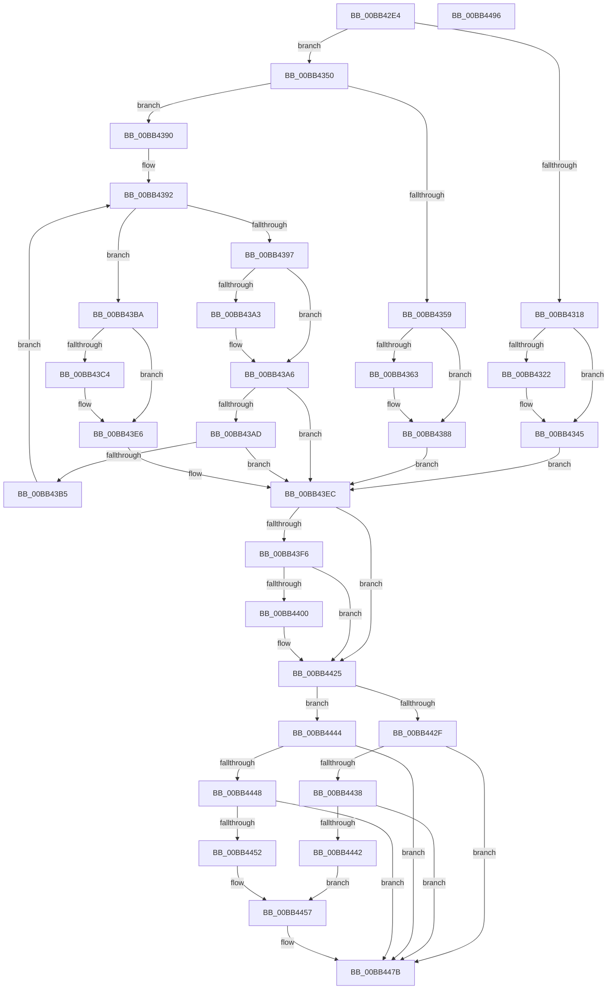

# ExAllocatePoolSanityChecks

- RVA: `0x00BB42E4`–`0x00BB4497` (길이 `435` bytes)
- VA: `0x0000000140BB42E4`
- 실행 섹션: `PAGEVRFY`
- PDB 이름 있음: `예`; PDB Function 태그: `아니요`
- unwind 정보 RVA: `0x000D4D94`
- 디코드: `123`개 명령, `435/435` bytes 표시
- 미해석 바이트: `0` (있으면 어셈블리에 `.byte`로 보존)

> 이 문서는 커널 이미지의 기계어와 PDB 기호를 분석해 생성했습니다. 4번과 5번은 함수 원형과 자료형을 바이너리 사용 방식에서 추정한 C 해석이며 원본 소스 복구 결과는 아닙니다.

## 1. Dependencies

- 직접 호출 지점: **5**; 고유 호출 대상: **1**
- 직접 호출자로 확인된 함수: **1**
- RIP 상대 이미지 참조: **1**

### Outgoing calls
- `0x00BB4340` → [CarReportRuleViolationFromNt](../B9/CarReportRuleViolationFromNt_function_00B9D904.md) (function, `0x00B9D904`)
- `0x00BB4383` → [CarReportRuleViolationFromNt](../B9/CarReportRuleViolationFromNt_function_00B9D904.md) (function, `0x00B9D904`)
- `0x00BB43E1` → [CarReportRuleViolationFromNt](../B9/CarReportRuleViolationFromNt_function_00B9D904.md) (function, `0x00B9D904`)
- `0x00BB4420` → [CarReportRuleViolationFromNt](../B9/CarReportRuleViolationFromNt_function_00B9D904.md) (function, `0x00B9D904`)
- `0x00BB4476` → [CarReportRuleViolationFromNt](../B9/CarReportRuleViolationFromNt_function_00B9D904.md) (function, `0x00B9D904`)

### Direct callers
- [VfHandlePoolAlloc](VfHandlePoolAlloc_function_00BB8A90.md) at `0x00BB8B8D`

### Static image references
- `0x00BB4318` → RVA `0x00F04A20` (`.data`; read)

## 2. Other-region calls and transfers

- 다른 실행 섹션으로 향하는 call: **0**
- 별도 외부 분기/꼬리 이동을 확인하지 못했습니다.

## 3. Assembly (complete function range)

```asm
00BB42E4  4C 8B DC                        mov r11, rsp
00BB42E7  49 89 5B 08                     mov qword ptr [r11 + 8], rbx
00BB42EB  49 89 6B 10                     mov qword ptr [r11 + 0x10], rbp
00BB42EF  49 89 73 18                     mov qword ptr [r11 + 0x18], rsi
00BB42F3  49 89 7B 20                     mov qword ptr [r11 + 0x20], rdi
00BB42F7  41 54                           push r12
00BB42F9  48 83 EC 40                     sub rsp, 0x40
00BB42FD  49 8B F0                        mov rsi, r8
00BB4300  48 63 F9                        movsxd rdi, ecx
00BB4303  45 8B 00                        mov r8d, dword ptr [r8]
00BB4306  49 8B D9                        mov rbx, r9
00BB4309  48 8B EA                        mov rbp, rdx
00BB430C  49 C7 C4 7F FF FF FF            mov r12, 0xffffffffffffff7f
00BB4313  45 85 C0                        test r8d, r8d
00BB4316  75 38                           jne 0x140bb4350
00BB4318  8B 05 02 07 35 00               mov eax, dword ptr [rip + 0x350702]
00BB431E  A8 01                           test al, 1
00BB4320  74 23                           je 0x140bb4345
00BB4322  49 89 5B E8                     mov qword ptr [r11 - 0x18], rbx
00BB4326  4C 8B CA                        mov r9, rdx
00BB4329  83 64 24 28 00                  and dword ptr [rsp + 0x28], 0
00BB432E  BA 9B 00 00 00                  mov edx, 0x9b
00BB4333  4C 8B C7                        mov r8, rdi
00BB4336  49 89 5B D8                     mov qword ptr [r11 - 0x28], rbx
00BB433A  4D 23 C4                        and r8, r12
00BB433D  8D 4A 27                        lea ecx, [rdx + 0x27]
00BB4340  E8 BF 95 FE FF                  call 0x140b9d904
00BB4345  C7 06 42 61 64 30               mov dword ptr [rsi], 0x30646142
00BB434B  E9 9C 00 00 00                  jmp 0x140bb43ec
00BB4350  41 81 F8 42 49 47 20            cmp r8d, 0x20474942
00BB4357  75 37                           jne 0x140bb4390
00BB4359  8B 05 C1 06 35 00               mov eax, dword ptr [rip + 0x3506c1]
00BB435F  A8 01                           test al, 1
00BB4361  74 25                           je 0x140bb4388
00BB4363  BA 9C 00 00 00                  mov edx, 0x9c
00BB4368  48 89 5C 24 30                  mov qword ptr [rsp + 0x30], rbx
00BB436D  83 64 24 28 00                  and dword ptr [rsp + 0x28], 0
00BB4372  4C 8B C7                        mov r8, rdi
00BB4375  4D 23 C4                        and r8, r12
00BB4378  48 89 5C 24 20                  mov qword ptr [rsp + 0x20], rbx
00BB437D  4C 8B CD                        mov r9, rbp
00BB4380  8D 4A 26                        lea ecx, [rdx + 0x26]
00BB4383  E8 7C 95 FE FF                  call 0x140b9d904
00BB4388  C7 06 42 61 64 31               mov dword ptr [rsi], 0x31646142
00BB438E  EB 5C                           jmp 0x140bb43ec
00BB4390  33 C9                           xor ecx, ecx
00BB4392  83 F9 20                        cmp ecx, 0x20
00BB4395  73 23                           jae 0x140bb43ba
00BB4397  41 8B D0                        mov edx, r8d
00BB439A  D3 EA                           shr edx, cl
00BB439C  8D 42 9F                        lea eax, [rdx - 0x61]
00BB439F  3C 19                           cmp al, 0x19
00BB43A1  77 03                           ja 0x140bb43a6
00BB43A3  80 EA 20                        sub dl, 0x20
00BB43A6  8D 42 D0                        lea eax, [rdx - 0x30]
00BB43A9  3C 09                           cmp al, 9
00BB43AB  76 3F                           jbe 0x140bb43ec
00BB43AD  80 EA 41                        sub dl, 0x41
00BB43B0  80 FA 19                        cmp dl, 0x19
00BB43B3  76 37                           jbe 0x140bb43ec
00BB43B5  83 C1 08                        add ecx, 8
00BB43B8  EB D8                           jmp 0x140bb4392
00BB43BA  8B 05 60 06 35 00               mov eax, dword ptr [rip + 0x350660]
00BB43C0  A8 01                           test al, 1
00BB43C2  74 22                           je 0x140bb43e6
00BB43C4  BA 9D 00 00 00                  mov edx, 0x9d
00BB43C9  48 89 5C 24 30                  mov qword ptr [rsp + 0x30], rbx
00BB43CE  83 64 24 28 00                  and dword ptr [rsp + 0x28], 0
00BB43D3  4C 8B CF                        mov r9, rdi
00BB43D6  4D 23 CC                        and r9, r12
00BB43D9  48 89 5C 24 20                  mov qword ptr [rsp + 0x20], rbx
00BB43DE  8D 4A 25                        lea ecx, [rdx + 0x25]
00BB43E1  E8 1E 95 FE FF                  call 0x140b9d904
00BB43E6  C7 06 42 61 64 32               mov dword ptr [rsi], 0x32646142
00BB43EC  BE C4 00 00 00                  mov esi, 0xc4
00BB43F1  48 85 ED                        test rbp, rbp
00BB43F4  75 2F                           jne 0x140bb4425
00BB43F6  8B 05 24 06 35 00               mov eax, dword ptr [rip + 0x350624]
00BB43FC  A8 01                           test al, 1
00BB43FE  74 25                           je 0x140bb4425
00BB4400  44 0F 20 C0                     mov rax, cr8
00BB4404  48 89 5C 24 30                  mov qword ptr [rsp + 0x30], rbx
00BB4409  4C 8B CF                        mov r9, rdi
00BB440C  21 6C 24 28                     and dword ptr [rsp + 0x28], ebp
00BB4410  4D 23 CC                        and r9, r12
00BB4413  48 21 6C 24 20                  and qword ptr [rsp + 0x20], rbp
00BB4418  33 D2                           xor edx, edx
00BB441A  44 0F B6 C0                     movzx r8d, al
00BB441E  8B CE                           mov ecx, esi
00BB4420  E8 DF 94 FE FF                  call 0x140b9d904
00BB4425  44 0F 20 C0                     mov rax, cr8
00BB4429  40 F6 C7 01                     test dil, 1
00BB442D  75 15                           jne 0x140bb4444
00BB442F  BA 02 00 00 00                  mov edx, 2
00BB4434  3A C2                           cmp al, dl
00BB4436  76 43                           jbe 0x140bb447b
00BB4438  8B 05 E2 05 35 00               mov eax, dword ptr [rip + 0x3505e2]
00BB443E  A8 01                           test al, 1
00BB4440  74 39                           je 0x140bb447b
00BB4442  EB 13                           jmp 0x140bb4457
00BB4444  3C 01                           cmp al, 1
00BB4446  76 33                           jbe 0x140bb447b
00BB4448  8B 05 D2 05 35 00               mov eax, dword ptr [rip + 0x3505d2]
00BB444E  A8 01                           test al, 1
00BB4450  74 29                           je 0x140bb447b
00BB4452  BA 01 00 00 00                  mov edx, 1
00BB4457  48 89 5C 24 30                  mov qword ptr [rsp + 0x30], rbx
00BB445C  4C 8B CF                        mov r9, rdi
00BB445F  83 64 24 28 00                  and dword ptr [rsp + 0x28], 0
00BB4464  44 0F 20 C0                     mov rax, cr8
00BB4468  4D 23 CC                        and r9, r12
00BB446B  44 0F B6 C0                     movzx r8d, al
00BB446F  8B CE                           mov ecx, esi
00BB4471  48 89 6C 24 20                  mov qword ptr [rsp + 0x20], rbp
00BB4476  E8 89 94 FE FF                  call 0x140b9d904
00BB447B  48 8B 5C 24 50                  mov rbx, qword ptr [rsp + 0x50]
00BB4480  48 8B 6C 24 58                  mov rbp, qword ptr [rsp + 0x58]
00BB4485  48 8B 74 24 60                  mov rsi, qword ptr [rsp + 0x60]
00BB448A  48 8B 7C 24 68                  mov rdi, qword ptr [rsp + 0x68]
00BB448F  48 83 C4 40                     add rsp, 0x40
00BB4493  41 5C                           pop r12
00BB4495  C3                              ret
00BB4496  CC                              int3
```

## 4. C-style interpretation (structured pseudocode)

```c
__int64 __fastcall ExAllocatePoolSanityChecks(int a1, __int64 a2, __int64 a3, __int64 a4)
{
    __int64 result;
    __int64 v_rsp;
    unsigned __int64 v_stack_m18;
    unsigned int v_stack_m20;
    unsigned __int64 v_stack_m28;
    unsigned __int64 v_stack_p10;
    unsigned __int64 v_stack_p18;
    unsigned __int64 v_stack_p20;
    unsigned __int64 v_stack_p8;

    *(unsigned __int64 *)(v_rsp + 8) = v_rbx;
    *(unsigned __int64 *)(v_rsp + 16) = v_rbp;
    *(unsigned __int64 *)(v_rsp + 24) = v_rsi;
    *(unsigned __int64 *)(v_rsp + 32) = v_rdi;
    v_rsp = (v_rsp) - (64);
    if ((unsigned int)((unsigned int)(*(unsigned int *)(a3))) != 0) goto loc_00BB4350;
    result = (unsigned int)(*(unsigned int *)(v_rip + 3475202));
    if ((((unsigned __int8)((unsigned int)(*(unsigned int *)(v_rip + 3475202)))) & (1)) != 0) {
        *(unsigned __int64 *)(v_rsp - 24) = a4;
        a4 = a2;
        a2 = 155;
        a3 = (int)(a1);
        *(unsigned __int64 *)(v_rsp - 40) = a4;
        a3 = (a3) & (-129);
        a1 = a2 + 39;
        result = CarReportRuleViolationFromNt(a1, a2, a3, a4);
    }
    *(unsigned int *)(a3) = 0x30646142ULL;
    goto loc_00BB43EC;
loc_00BB4350:
    if (((unsigned int)(a3)) != 0x20474942ULL) goto loc_00BB4390;
    result = (unsigned int)(*(unsigned int *)(v_rip + 3475137));
    if ((((unsigned __int8)((unsigned int)(*(unsigned int *)(v_rip + 3475137)))) & (1)) != 0) {
        a2 = 156;
        v_stack_m18 = a4;
        a3 = (int)(a1);
        a3 = (a3) & (-129);
        v_stack_m28 = a4;
        a4 = a2;
        a1 = a2 + 38;
        result = CarReportRuleViolationFromNt(a1, a2, a3, a4);
    }
    *(unsigned int *)(a3) = 0x31646142ULL;
    goto loc_00BB43EC;
loc_00BB4390:
    a1 = 0;
loc_00BB4392:
    if (0 >= 32) goto loc_00BB43BA;
    a2 = (unsigned int)(((unsigned int)((unsigned int)(a3))) >> (0));
    if (((unsigned __int8)(a2 - 97)) <= 25) {
        a2 = (unsigned __int8)((a2) - (32));
    }
    if (((unsigned __int8)(a2 - 48)) <= 9) goto loc_00BB43EC;
    a2 = (unsigned __int8)((a2) - (65));
    if (((unsigned __int8)(a2)) <= 25) goto loc_00BB43EC;
    a1 = (unsigned int)((a1) + (8));
    goto loc_00BB4392;
loc_00BB43BA:
    result = (unsigned int)(*(unsigned int *)(v_rip + 3475040));
    if ((((unsigned __int8)((unsigned int)(*(unsigned int *)(v_rip + 3475040)))) & (1)) != 0) {
        a2 = 157;
        v_stack_m18 = a4;
        a4 = (int)(a1);
        a4 = (a4) & (-129);
        v_stack_m28 = a4;
        a1 = a2 + 37;
        result = CarReportRuleViolationFromNt(a1, a2, a3, a4);
    }
    *(unsigned int *)(a3) = 0x32646142ULL;
loc_00BB43EC:
    if (a2 != 0) goto loc_00BB4425;
    result = (unsigned int)(*(unsigned int *)(v_rip + 3474980));
    if ((((unsigned __int8)((unsigned int)(*(unsigned int *)(v_rip + 3474980)))) & (1)) != 0) {
        result = v_cr8;
        v_stack_m18 = a4;
        a4 = (int)(a1);
        a4 = (a4) & (-129);
        a2 = 0;
        a3 = (unsigned __int8)(result);
        a1 = 196;
        result = CarReportRuleViolationFromNt(a1, a2, a3, a4);
    }
    if ((((unsigned __int8)((int)(a1))) & (1)) != 0) goto loc_00BB4444;
    if (((unsigned __int8)(v_cr8)) <= 2) goto loc_00BB447B;
    if ((((unsigned __int8)((unsigned int)(*(unsigned int *)(v_rip + 3474914)))) & (1)) == 0) goto loc_00BB447B;
    goto loc_00BB4457;
loc_00BB4444:
    if (((unsigned __int8)((unsigned int)(*(unsigned int *)(v_rip + 3474914)))) <= 1) goto loc_00BB447B;
    if ((((unsigned __int8)((unsigned int)(*(unsigned int *)(v_rip + 3474898)))) & (1)) == 0) goto loc_00BB447B;
loc_00BB4457:
    v_stack_m18 = a4;
    a4 = ((int)(a1)) & (-129);
    v_stack_m28 = 0;
    result = CarReportRuleViolationFromNt(196, 1, (unsigned __int8)(v_cr8), a4);
loc_00BB447B:
    v_rsp = (v_rsp) + (64);
    return result;
}
```

## 5. (Beta) C Style

```c
int64_t ExAllocatePoolSanityChecks(int32_t Arg1, int64_t Arg2, void *Arg3, int64_t Arg4)
{
    uint8_t *arg3 = (uint8_t *)Arg3;

    int64_t result;
    int64_t local_rsp;
    uint64_t v_stack_m18;
    uint32_t v_stack_m20;
    uint64_t v_stack_m28;
    uint64_t v_stack_p10;
    uint64_t v_stack_p18;
    uint64_t v_stack_p20;
    uint64_t v_stack_p8;

    *(uint64_t *)(local_rsp + 0x8) = local_rbx;
    *(uint64_t *)(local_rsp + 0x10) = local_rbp;
    *(uint64_t *)(local_rsp + 0x18) = local_rsi;
    *(uint64_t *)(local_rsp + 0x20) = local_rdi;
    local_rsp = (local_rsp) - (64);
    if ((uint32_t)((uint32_t)(*(uint32_t *)(arg3))) != 0) goto loc_00BB4350;
    result = (uint32_t)(*(uint32_t *)(v_rip + 0x350702));
    if ((((uint8_t)((uint32_t)(*(uint32_t *)(v_rip + 0x350702)))) & (1)) != 0) {
        *(uint64_t *)(local_rsp - 0x18) = Arg4;
        Arg4 = Arg2;
        Arg2 = 155;
        Arg3 = (int32_t)(Arg1);
        *(uint64_t *)(local_rsp - 0x28) = Arg4;
        Arg3 = (Arg3) & (-129);
        Arg1 = Arg2 + 39;
        result = CarReportRuleViolationFromNt(Arg1, Arg2, Arg3, Arg4);
    }
    *(uint32_t *)(arg3) = 0x30646142ULL;
    goto loc_00BB43EC;
loc_00BB4350:
    if (((uint32_t)(Arg3)) != 0x20474942ULL) goto loc_00BB4390;
    result = (uint32_t)(*(uint32_t *)(v_rip + 0x3506C1));
    if ((((uint8_t)((uint32_t)(*(uint32_t *)(v_rip + 0x3506C1)))) & (1)) != 0) {
        Arg2 = 156;
        v_stack_m18 = Arg4;
        Arg3 = (int32_t)(Arg1);
        Arg3 = (Arg3) & (-129);
        v_stack_m28 = Arg4;
        Arg4 = Arg2;
        Arg1 = Arg2 + 38;
        result = CarReportRuleViolationFromNt(Arg1, Arg2, Arg3, Arg4);
    }
    *(uint32_t *)(arg3) = 0x31646142ULL;
    goto loc_00BB43EC;
loc_00BB4390:
    Arg1 = 0;
loc_00BB4392:
    if (0 >= 32) goto loc_00BB43BA;
    Arg2 = (uint32_t)(((uint32_t)((uint32_t)(Arg3))) >> (0));
    if (((uint8_t)(Arg2 - 97)) <= 25) {
        Arg2 = (uint8_t)((Arg2) - (32));
    }
    if (((uint8_t)(Arg2 - 48)) <= 9) goto loc_00BB43EC;
    Arg2 = (uint8_t)((Arg2) - (65));
    if (((uint8_t)(Arg2)) <= 25) goto loc_00BB43EC;
    Arg1 = (uint32_t)((Arg1) + (8));
    goto loc_00BB4392;
loc_00BB43BA:
    result = (uint32_t)(*(uint32_t *)(v_rip + 0x350660));
    if ((((uint8_t)((uint32_t)(*(uint32_t *)(v_rip + 0x350660)))) & (1)) != 0) {
        Arg2 = 157;
        v_stack_m18 = Arg4;
        Arg4 = (int32_t)(Arg1);
        Arg4 = (Arg4) & (-129);
        v_stack_m28 = Arg4;
        Arg1 = Arg2 + 37;
        result = CarReportRuleViolationFromNt(Arg1, Arg2, Arg3, Arg4);
    }
    *(uint32_t *)(arg3) = 0x32646142ULL;
loc_00BB43EC:
    if (Arg2 != 0) goto loc_00BB4425;
    result = (uint32_t)(*(uint32_t *)(v_rip + 0x350624));
    if ((((uint8_t)((uint32_t)(*(uint32_t *)(v_rip + 0x350624)))) & (1)) != 0) {
        result = v_cr8;
        v_stack_m18 = Arg4;
        Arg4 = (int32_t)(Arg1);
        Arg4 = (Arg4) & (-129);
        Arg2 = 0;
        Arg3 = (uint8_t)(result);
        Arg1 = 196;
        result = CarReportRuleViolationFromNt(Arg1, Arg2, Arg3, Arg4);
    }
    if ((((uint8_t)((int32_t)(Arg1))) & (1)) != 0) goto loc_00BB4444;
    if (((uint8_t)(v_cr8)) <= 2) goto loc_00BB447B;
    if ((((uint8_t)((uint32_t)(*(uint32_t *)(v_rip + 0x3505E2)))) & (1)) == 0) goto loc_00BB447B;
    goto loc_00BB4457;
loc_00BB4444:
    if (((uint8_t)((uint32_t)(*(uint32_t *)(v_rip + 0x3505E2)))) <= 1) goto loc_00BB447B;
    if ((((uint8_t)((uint32_t)(*(uint32_t *)(v_rip + 0x3505D2)))) & (1)) == 0) goto loc_00BB447B;
loc_00BB4457:
    v_stack_m18 = Arg4;
    Arg4 = ((int32_t)(Arg1)) & (-129);
    v_stack_m28 = 0;
    result = CarReportRuleViolationFromNt(196, 1, (uint8_t)(v_cr8), Arg4);
loc_00BB447B:
    local_rsp = (local_rsp) + (64);
    return result;
}
```

### 관측된 메모리 오프셋

구조체 형식이 확인되지 않은 접근은 인자 기준의 오프셋으로만 기록했습니다.

| 기준 인자 | 오프셋 표현 | 폭 (bit) | 접근 |
|---|---:|---:|---|
| `Arg3` | `+ 0x0` | `32` | `R` |
| `Arg3` | `+ 0x0` | `32` | `W` |

## 6. Execution-region graph

[열기: 2D/3D 그래프와 함수 탐색 컨트롤 패널](../../../control-panel.html?section=pagevrfy&rva=0x00BB42E4&view=graph)

- 2D 그래프는 위에서 아래로 흐르고, 3D 그래프는 빈 공간을 드래그해 회전합니다. Shift+드래그는 이동, 휠은 확대·축소, 함수 노드 선택은 대상 보고서 이동입니다.

### Static fallback


