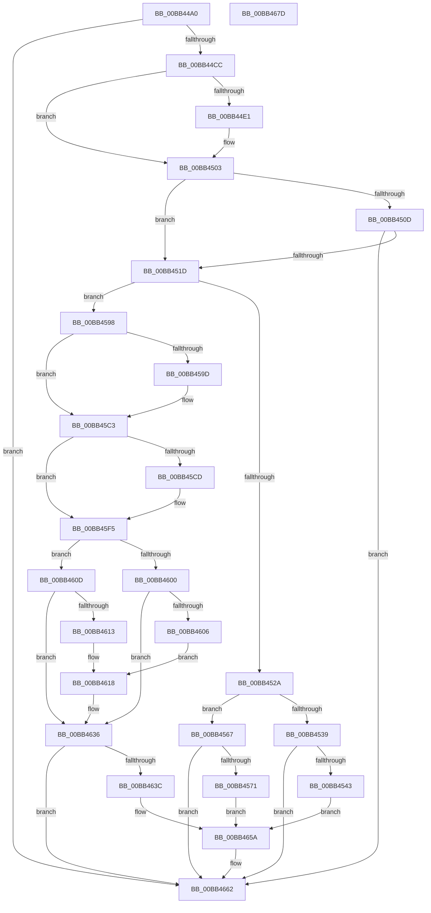

# ExFreePoolSanityChecks

- RVA: `0x00BB44A0`–`0x00BB467E` (길이 `478` bytes)
- VA: `0x0000000140BB44A0`
- 실행 섹션: `PAGEVRFY`
- PDB 이름 있음: `예`; PDB Function 태그: `아니요`
- unwind 정보 RVA: `0x000BE230`
- 디코드: `118`개 명령, `478/478` bytes 표시
- 미해석 바이트: `0` (있으면 어셈블리에 `.byte`로 보존)

> 이 문서는 커널 이미지의 기계어와 PDB 기호를 분석해 생성했습니다. 4번과 5번은 함수 원형과 자료형을 바이너리 사용 방식에서 추정한 C 해석이며 원본 소스 복구 결과는 아닙니다.

## 1. Dependencies

- 직접 호출 지점: **8**; 고유 호출 대상: **4**
- 직접 호출자로 확인된 함수: **2**
- RIP 상대 이미지 참조: **1**

### Outgoing calls
- `0x00BB44BF` → [KevSkipVerification](../../text/6A/KevSkipVerification_function_006A887C.md) (function, `0x006A887C`)
- `0x00BB44FE` → [CarReportRuleViolationFromNt](../B9/CarReportRuleViolationFromNt_function_00B9D904.md) (function, `0x00B9D904`)
- `0x00BB4510` → [ExIsSpecialPoolAddress](../../text/49/ExIsSpecialPoolAddress_function_0049C410.md) (function, `0x0049C410`)
- `0x00BB452D` → [MmDeterminePoolType](../../text/35/MmDeterminePoolType_function_0035F5B0.md) (function, `0x0035F5B0`)
- `0x00BB45BE` → [CarReportRuleViolationFromNt](../B9/CarReportRuleViolationFromNt_function_00B9D904.md) (function, `0x00B9D904`)
- `0x00BB45F0` → [CarReportRuleViolationFromNt](../B9/CarReportRuleViolationFromNt_function_00B9D904.md) (function, `0x00B9D904`)
- `0x00BB4631` → [CarReportRuleViolationFromNt](../B9/CarReportRuleViolationFromNt_function_00B9D904.md) (function, `0x00B9D904`)
- `0x00BB465D` → [CarReportRuleViolationFromNt](../B9/CarReportRuleViolationFromNt_function_00B9D904.md) (function, `0x00B9D904`)

### Direct callers
- [VerifierExFreePool](../BA/VerifierExFreePool_function_00BA1800.md) at `0x00BA1830`
- [VerifierExFreePoolWithTag](../BA/VerifierExFreePoolWithTag_function_00BA1880.md) at `0x00BA18B6`

### Static image references
- `0x00BB4503` → RVA `0x00EFED20` (`.data`; read)

## 2. Other-region calls and transfers

- 다른 실행 섹션으로 향하는 call: **3**
  - `0x00BB44BF` → [KevSkipVerification](../../text/6A/KevSkipVerification_function_006A887C.md) (`PAGEVRFY` → `.text`)
  - `0x00BB4510` → [ExIsSpecialPoolAddress](../../text/49/ExIsSpecialPoolAddress_function_0049C410.md) (`PAGEVRFY` → `.text`)
  - `0x00BB452D` → [MmDeterminePoolType](../../text/35/MmDeterminePoolType_function_0035F5B0.md) (`PAGEVRFY` → `.text`)
- 별도 외부 분기/꼬리 이동을 확인하지 못했습니다.

## 3. Assembly (complete function range)

```asm
00BB44A0  48 8B C4                        mov rax, rsp
00BB44A3  48 89 58 08                     mov qword ptr [rax + 8], rbx
00BB44A7  48 89 68 10                     mov qword ptr [rax + 0x10], rbp
00BB44AB  48 89 70 18                     mov qword ptr [rax + 0x18], rsi
00BB44AF  48 89 78 20                     mov qword ptr [rax + 0x20], rdi
00BB44B3  41 57                           push r15
00BB44B5  48 83 EC 40                     sub rsp, 0x40
00BB44B9  48 8B F2                        mov rsi, rdx
00BB44BC  48 8B D9                        mov rbx, rcx
00BB44BF  E8 B8 43 AF FF                  call 0x1406a887c
00BB44C4  85 C0                           test eax, eax
00BB44C6  0F 85 96 01 00 00               jne 0x140bb4662
00BB44CC  48 B8 FF FF FE FF FF 7F 00 00   movabs rax, 0x7ffffffeffff
00BB44D6  41 BF C4 00 00 00               mov r15d, 0xc4
00BB44DC  48 3B D8                        cmp rbx, rax
00BB44DF  77 22                           ja 0x140bb4503
00BB44E1  45 33 C9                        xor r9d, r9d
00BB44E4  48 89 74 24 30                  mov qword ptr [rsp + 0x30], rsi
00BB44E9  83 64 24 28 00                  and dword ptr [rsp + 0x28], 0
00BB44EE  4C 8B C3                        mov r8, rbx
00BB44F1  48 83 64 24 20 00               and qword ptr [rsp + 0x20], 0
00BB44F7  41 8B CF                        mov ecx, r15d
00BB44FA  41 8D 51 10                     lea edx, [r9 + 0x10]
00BB44FE  E8 01 94 FE FF                  call 0x140b9d904
00BB4503  8B 05 17 A8 34 00               mov eax, dword ptr [rip + 0x34a817]
00BB4509  85 C0                           test eax, eax
00BB450B  74 10                           je 0x140bb451d
00BB450D  48 8B CB                        mov rcx, rbx
00BB4510  E8 FB 7E 8E FF                  call 0x14049c410
00BB4515  85 C0                           test eax, eax
00BB4517  0F 85 45 01 00 00               jne 0x140bb4662
00BB451D  44 0F 20 C7                     mov rdi, cr8
00BB4521  48 F7 C3 FF 0F 00 00            test rbx, 0xfff
00BB4528  75 6E                           jne 0x140bb4598
00BB452A  48 8B CB                        mov rcx, rbx
00BB452D  E8 7E B0 7A FF                  call 0x14035f5b0
00BB4532  25 00 01 00 00                  and eax, 0x100
00BB4537  75 2E                           jne 0x140bb4567
00BB4539  40 80 FF 02                     cmp dil, 2
00BB453D  0F 86 1F 01 00 00               jbe 0x140bb4662
00BB4543  45 33 C9                        xor r9d, r9d
00BB4546  48 89 74 24 30                  mov qword ptr [rsp + 0x30], rsi
00BB454B  48 85 C0                        test rax, rax
00BB454E  44 0F B6 C7                     movzx r8d, dil
00BB4552  8D 50 12                        lea edx, [rax + 0x12]
00BB4555  41 0F 95 C1                     setne r9b
00BB4559  21 44 24 28                     and dword ptr [rsp + 0x28], eax
00BB455D  48 89 5C 24 20                  mov qword ptr [rsp + 0x20], rbx
00BB4562  E9 F3 00 00 00                  jmp 0x140bb465a
00BB4567  40 80 FF 01                     cmp dil, 1
00BB456B  0F 86 F1 00 00 00               jbe 0x140bb4662
00BB4571  45 33 C9                        xor r9d, r9d
00BB4574  48 89 74 24 30                  mov qword ptr [rsp + 0x30], rsi
00BB4579  48 85 C0                        test rax, rax
00BB457C  44 0F B6 C7                     movzx r8d, dil
00BB4580  BA 11 00 00 00                  mov edx, 0x11
00BB4585  41 0F 95 C1                     setne r9b
00BB4589  83 64 24 28 00                  and dword ptr [rsp + 0x28], 0
00BB458E  48 89 5C 24 20                  mov qword ptr [rsp + 0x20], rbx
00BB4593  E9 C2 00 00 00                  jmp 0x140bb465a
00BB4598  F6 C3 0F                        test bl, 0xf
00BB459B  74 26                           je 0x140bb45c3
00BB459D  48 89 74 24 30                  mov qword ptr [rsp + 0x30], rsi
00BB45A2  4C 8B CB                        mov r9, rbx
00BB45A5  83 64 24 28 00                  and dword ptr [rsp + 0x28], 0
00BB45AA  BA 16 00 00 00                  mov edx, 0x16
00BB45AF  48 83 64 24 20 00               and qword ptr [rsp + 0x20], 0
00BB45B5  41 B8 76 21 00 00               mov r8d, 0x2176
00BB45BB  41 8B CF                        mov ecx, r15d
00BB45BE  E8 41 93 FE FF                  call 0x140b9d904
00BB45C3  F6 43 F3 03                     test byte ptr [rbx - 0xd], 3
00BB45C7  48 8D 6B F0                     lea rbp, [rbx - 0x10]
00BB45CB  75 28                           jne 0x140bb45f5
00BB45CD  8B 45 00                        mov eax, dword ptr [rbp]
00BB45D0  4C 8B CD                        mov r9, rbp
00BB45D3  48 89 74 24 30                  mov qword ptr [rsp + 0x30], rsi
00BB45D8  BA 13 00 00 00                  mov edx, 0x13
00BB45DD  83 64 24 28 00                  and dword ptr [rsp + 0x28], 0
00BB45E2  41 B8 84 21 00 00               mov r8d, 0x2184
00BB45E8  41 8B CF                        mov ecx, r15d
00BB45EB  48 89 44 24 20                  mov qword ptr [rsp + 0x20], rax
00BB45F0  E8 0F 93 FE FF                  call 0x140b9d904
00BB45F5  0F B6 43 F3                     movzx eax, byte ptr [rbx - 0xd]
00BB45F9  83 E0 03                        and eax, 3
00BB45FC  A8 01                           test al, 1
00BB45FE  74 0D                           je 0x140bb460d
00BB4600  40 80 FF 01                     cmp dil, 1
00BB4604  76 30                           jbe 0x140bb4636
00BB4606  BA 11 00 00 00                  mov edx, 0x11
00BB460B  EB 0B                           jmp 0x140bb4618
00BB460D  40 80 FF 02                     cmp dil, 2
00BB4611  76 23                           jbe 0x140bb4636
00BB4613  BA 12 00 00 00                  mov edx, 0x12
00BB4618  48 89 74 24 30                  mov qword ptr [rsp + 0x30], rsi
00BB461D  41 8B CF                        mov ecx, r15d
00BB4620  83 64 24 28 00                  and dword ptr [rsp + 0x28], 0
00BB4625  44 8B C8                        mov r9d, eax
00BB4628  44 0F B6 C7                     movzx r8d, dil
00BB462C  48 89 5C 24 20                  mov qword ptr [rsp + 0x20], rbx
00BB4631  E8 CE 92 FE FF                  call 0x140b9d904
00BB4636  F6 43 F3 02                     test byte ptr [rbx - 0xd], 2
00BB463A  75 26                           jne 0x140bb4662
00BB463C  48 89 74 24 30                  mov qword ptr [rsp + 0x30], rsi
00BB4641  4C 8B CD                        mov r9, rbp
00BB4644  83 64 24 28 00                  and dword ptr [rsp + 0x28], 0
00BB4649  BA 14 00 00 00                  mov edx, 0x14
00BB464E  48 83 64 24 20 00               and qword ptr [rsp + 0x20], 0
00BB4654  41 B8 A7 21 00 00               mov r8d, 0x21a7
00BB465A  41 8B CF                        mov ecx, r15d
00BB465D  E8 A2 92 FE FF                  call 0x140b9d904
00BB4662  48 8B 5C 24 50                  mov rbx, qword ptr [rsp + 0x50]
00BB4667  48 8B 6C 24 58                  mov rbp, qword ptr [rsp + 0x58]
00BB466C  48 8B 74 24 60                  mov rsi, qword ptr [rsp + 0x60]
00BB4671  48 8B 7C 24 68                  mov rdi, qword ptr [rsp + 0x68]
00BB4676  48 83 C4 40                     add rsp, 0x40
00BB467A  41 5F                           pop r15
00BB467C  C3                              ret
00BB467D  CC                              int3
```

## 4. C-style interpretation (structured pseudocode)

```c
__int64 __fastcall ExFreePoolSanityChecks(__int64 a1, __int64 a2, __int64 a3, int a4)
{
    __int64 result;
    __int64 v_rsp;
    unsigned __int64 v_stack_m18;
    unsigned int v_stack_m20;
    unsigned __int64 v_stack_m28;
    unsigned __int64 v_stack_p10;
    unsigned __int64 v_stack_p18;
    unsigned __int64 v_stack_p20;
    unsigned __int64 v_stack_p8;

    *(unsigned __int64 *)(v_rsp + 8) = v_rbx;
    *(unsigned __int64 *)(v_rsp + 16) = v_rbp;
    *(unsigned __int64 *)(v_rsp + 24) = v_rsi;
    *(unsigned __int64 *)(v_rsp + 32) = v_rdi;
    v_rsp = (v_rsp) - (64);
    result = KevSkipVerification(a1, a2, a3, a4);
    if ((unsigned int)(result) != 0) goto loc_00BB4662;
    if (a1 <= result) {
        a4 = 0;
        v_stack_m18 = a2;
        a3 = a1;
        a1 = 196;
        a2 = a4 + 16;
        result = CarReportRuleViolationFromNt(a1, a2, a3, a4);
    }
    if ((unsigned int)((unsigned int)(*(unsigned int *)(v_rip + 3450903))) == 0) goto loc_00BB451D;
    result = ExIsSpecialPoolAddress(a1, a2, a3, a4);
    if ((unsigned int)(result) != 0) goto loc_00BB4662;
loc_00BB451D:
    if (((a1) & (0xFFFULL)) != 0) goto loc_00BB4598;
    result = MmDeterminePoolType(a1, a2, a3, a4);
    result = (unsigned int)((result) & (256));
    if (condition_is_not_equal) goto loc_00BB4567;
    if (((unsigned __int8)(v_cr8)) <= 2) goto loc_00BB4662;
    a4 = 0;
    v_stack_m18 = a2;
    a4 = (result != 0) ? 1 : 0;
    v_stack_m28 = a1;
    goto loc_00BB465A;
loc_00BB4567:
    if (((unsigned __int8)(v_cr8)) <= 1) goto loc_00BB4662;
    a4 = 0;
    v_stack_m18 = a2;
    a4 = (result != 0) ? 1 : 0;
    v_stack_m28 = a1;
    goto loc_00BB465A;
loc_00BB4598:
    if ((((unsigned __int8)(a1)) & (15)) != 0) {
        v_stack_m18 = a2;
        a4 = a1;
        a2 = 22;
        a3 = 0x2176ULL;
        a1 = 196;
        result = CarReportRuleViolationFromNt(a1, a2, a3, a4);
    }
    if (((*(unsigned __int8 *)(a1 - 13)) & (3)) == 0) {
        result = *(unsigned int *)(a1 - 16);
        a4 = a1 - 16;
        v_stack_m18 = a2;
        a2 = 19;
        a3 = 0x2184ULL;
        a1 = 196;
        v_stack_m28 = result;
        result = CarReportRuleViolationFromNt(a1, a2, a3, a4);
    }
    result = (unsigned int)((*(unsigned __int8 *)(a1 - 13)) & (3));
    if ((((unsigned __int8)(result)) & (1)) == 0) goto loc_00BB460D;
    if (((unsigned __int8)(v_cr8)) <= 1) goto loc_00BB4636;
    goto loc_00BB4618;
loc_00BB460D:
    if (((unsigned __int8)(v_cr8)) <= 2) goto loc_00BB4636;
loc_00BB4618:
    v_stack_m18 = a2;
    v_stack_m28 = a1;
    result = CarReportRuleViolationFromNt(196, 18, (unsigned __int8)(v_cr8), (unsigned int)((unsigned int)(result)));
loc_00BB4636:
    if (((*(unsigned __int8 *)(a1 - 13)) & (2)) != 0) goto loc_00BB4662;
    v_stack_m18 = a2;
loc_00BB465A:
    result = CarReportRuleViolationFromNt(196, 20, (unsigned int)(0x21A7ULL), a1 - 16);
loc_00BB4662:
    v_rsp = (v_rsp) + (64);
    return result;
}
```

## 5. (Beta) C Style

```c
int64_t ExFreePoolSanityChecks(int64_t Arg1, int64_t Arg2, int64_t Arg3, int32_t Arg4)
{
    int64_t result;
    int64_t local_rsp;
    uint64_t v_stack_m18;
    uint32_t v_stack_m20;
    uint64_t v_stack_m28;
    uint64_t v_stack_p10;
    uint64_t v_stack_p18;
    uint64_t v_stack_p20;
    uint64_t v_stack_p8;

    *(uint64_t *)(local_rsp + 0x8) = local_rbx;
    *(uint64_t *)(local_rsp + 0x10) = local_rbp;
    *(uint64_t *)(local_rsp + 0x18) = local_rsi;
    *(uint64_t *)(local_rsp + 0x20) = local_rdi;
    local_rsp = (local_rsp) - (64);
    result = KevSkipVerification(Arg1, Arg2, Arg3, Arg4);
    if ((uint32_t)(result) != 0) goto loc_00BB4662;
    if (Arg1 <= result) {
        Arg4 = 0;
        v_stack_m18 = Arg2;
        Arg3 = Arg1;
        Arg1 = 196;
        Arg2 = Arg4 + 16;
        result = CarReportRuleViolationFromNt(Arg1, Arg2, Arg3, Arg4);
    }
    if ((uint32_t)((uint32_t)(*(uint32_t *)(v_rip + 0x34A817))) == 0) goto loc_00BB451D;
    result = ExIsSpecialPoolAddress(Arg1, Arg2, Arg3, Arg4);
    if ((uint32_t)(result) != 0) goto loc_00BB4662;
loc_00BB451D:
    if (((Arg1) & (0xFFFULL)) != 0) goto loc_00BB4598;
    result = MmDeterminePoolType(Arg1, Arg2, Arg3, Arg4);
    result = (uint32_t)((result) & (256));
    if (condition_is_not_equal) goto loc_00BB4567;
    if (((uint8_t)(v_cr8)) <= 2) goto loc_00BB4662;
    Arg4 = 0;
    v_stack_m18 = Arg2;
    Arg4 = (result != 0) ? 1 : 0;
    v_stack_m28 = Arg1;
    goto loc_00BB465A;
loc_00BB4567:
    if (((uint8_t)(v_cr8)) <= 1) goto loc_00BB4662;
    Arg4 = 0;
    v_stack_m18 = Arg2;
    Arg4 = (result != 0) ? 1 : 0;
    v_stack_m28 = Arg1;
    goto loc_00BB465A;
loc_00BB4598:
    if ((((uint8_t)(Arg1)) & (15)) != 0) {
        v_stack_m18 = Arg2;
        Arg4 = Arg1;
        Arg2 = 22;
        Arg3 = 0x2176ULL;
        Arg1 = 196;
        result = CarReportRuleViolationFromNt(Arg1, Arg2, Arg3, Arg4);
    }
    if (((*(uint8_t *)(Arg1 - 0xD)) & (3)) == 0) {
        result = *(uint32_t *)(Arg1 - 0x10);
        Arg4 = Arg1 - 16;
        v_stack_m18 = Arg2;
        Arg2 = 19;
        Arg3 = 0x2184ULL;
        Arg1 = 196;
        v_stack_m28 = result;
        result = CarReportRuleViolationFromNt(Arg1, Arg2, Arg3, Arg4);
    }
    result = (uint32_t)((*(uint8_t *)(Arg1 - 0xD)) & (3));
    if ((((uint8_t)(result)) & (1)) == 0) goto loc_00BB460D;
    if (((uint8_t)(v_cr8)) <= 1) goto loc_00BB4636;
    goto loc_00BB4618;
loc_00BB460D:
    if (((uint8_t)(v_cr8)) <= 2) goto loc_00BB4636;
loc_00BB4618:
    v_stack_m18 = Arg2;
    v_stack_m28 = Arg1;
    result = CarReportRuleViolationFromNt(196, 18, (uint8_t)(v_cr8), (uint32_t)((uint32_t)(result)));
loc_00BB4636:
    if (((*(uint8_t *)(Arg1 - 0xD)) & (2)) != 0) goto loc_00BB4662;
    v_stack_m18 = Arg2;
loc_00BB465A:
    result = CarReportRuleViolationFromNt(196, 20, (uint32_t)(0x21A7ULL), Arg1 - 16);
loc_00BB4662:
    local_rsp = (local_rsp) + (64);
    return result;
}
```

## 6. Execution-region graph

[열기: 2D/3D 그래프와 함수 탐색 컨트롤 패널](../../../control-panel.html?section=pagevrfy&rva=0x00BB44A0&view=graph)

- 2D 그래프는 위에서 아래로 흐르고, 3D 그래프는 빈 공간을 드래그해 회전합니다. Shift+드래그는 이동, 휠은 확대·축소, 함수 노드 선택은 대상 보고서 이동입니다.

### Static fallback


