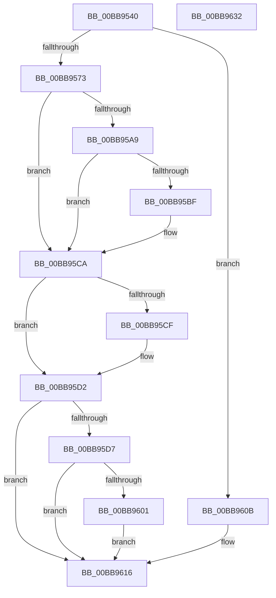

# IovAllocateIrp

- RVA: `0x00BB9540`–`0x00BB9633` (길이 `243` bytes)
- VA: `0x0000000140BB9540`
- 실행 섹션: `PAGEVRFY`
- PDB 이름 있음: `예`; PDB Function 태그: `아니요`
- unwind 정보 RVA: `0x00084C9C`
- 디코드: `70`개 명령, `243/243` bytes 표시
- 미해석 바이트: `0` (있으면 어셈블리에 `.byte`로 보존)

> 이 문서는 커널 이미지의 기계어와 PDB 기호를 분석해 생성했습니다. 4번과 5번은 함수 원형과 자료형을 바이너리 사용 방식에서 추정한 C 해석이며 원본 소스 복구 결과는 아닙니다.

## 1. Dependencies

- 직접 호출 지점: **7**; 고유 호출 대상: **6**
- 직접 호출자로 확인된 함수: **3**
- RIP 상대 이미지 참조: **1**

### Outgoing calls
- `0x00BB9575` → [IovpLogStackTrace](IovpLogStackTrace_function_00BB6A5C.md) (function, `0x00BB6A5C`)
- `0x00BB959C` → [VfIoAllocateIrp1](../B9/VfIoAllocateIrp1_function_00B9DD94.md) (function, `0x00B9DD94`)
- `0x00BB95B2` → [IopAllocateIrpPrivate](../../text/20/IopAllocateIrpPrivate_function_00207770.md) (function, `0x00207770`)
- `0x00BB95C5` → [VfIoAllocateIrp2](../B9/VfIoAllocateIrp2_function_00B9DE0C.md) (function, `0x00B9DE0C`)
- `0x00BB95F8` → [IoIsActivityTracingEnabled](../../text/29/IoIsActivityTracingEnabled_function_0029DBC0.md) (function, `0x0029DBC0`)
- `0x00BB9604` → [IopInitActivityIdIrp](../../text/45/IopInitActivityIdIrp_function_0045B014.md) (function, `0x0045B014`)
- `0x00BB960E` → [IopAllocateIrpPrivate](../../text/20/IopAllocateIrpPrivate_function_00207770.md) (function, `0x00207770`)

### Direct callers
- [IoAllocateIrp](../../text/20/IoAllocateIrp_function_002065D0.md) at `0x0020661C`
- [IoAllocateIrpEx](../../text/20/IoAllocateIrpEx_function_00207510.md) at `0x0020755C`
- [IoAllocateIrpEx](../../text/20/IoAllocateIrpEx_function_00207510.md) at `0x00207597`
- [IopAllocateIrpExReturn](../../text/20/IopAllocateIrpExReturn_function_00207720.md) at `0x0020774C`

### Static image references
- `0x00BB9558` → RVA `0x00E681A0` (`.data`; read)

## 2. Other-region calls and transfers

- 다른 실행 섹션으로 향하는 call: **4**
  - `0x00BB95B2` → [IopAllocateIrpPrivate](../../text/20/IopAllocateIrpPrivate_function_00207770.md) (`PAGEVRFY` → `.text`)
  - `0x00BB95F8` → [IoIsActivityTracingEnabled](../../text/29/IoIsActivityTracingEnabled_function_0029DBC0.md) (`PAGEVRFY` → `.text`)
  - `0x00BB9604` → [IopInitActivityIdIrp](../../text/45/IopInitActivityIdIrp_function_0045B014.md) (`PAGEVRFY` → `.text`)
  - `0x00BB960E` → [IopAllocateIrpPrivate](../../text/20/IopAllocateIrpPrivate_function_00207770.md) (`PAGEVRFY` → `.text`)
- 별도 외부 분기/꼬리 이동을 확인하지 못했습니다.

## 3. Assembly (complete function range)

```asm
00BB9540  48 89 5C 24 08                  mov qword ptr [rsp + 8], rbx
00BB9545  48 89 6C 24 10                  mov qword ptr [rsp + 0x10], rbp
00BB954A  48 89 74 24 18                  mov qword ptr [rsp + 0x18], rsi
00BB954F  57                              push rdi
00BB9550  41 56                           push r14
00BB9552  41 57                           push r15
00BB9554  48 83 EC 30                     sub rsp, 0x30
00BB9558  8B 05 42 EC 2A 00               mov eax, dword ptr [rip + 0x2aec42]
00BB955E  49 8B D9                        mov rbx, r9
00BB9561  41 0F B6 E8                     movzx ebp, r8b
00BB9565  40 8A FA                        mov dil, dl
00BB9568  4C 8B F1                        mov r14, rcx
00BB956B  A8 10                           test al, 0x10
00BB956D  0F 84 98 00 00 00               je 0x140bb960b
00BB9573  33 C9                           xor ecx, ecx
00BB9575  E8 E2 D4 FF FF                  call 0x140bb6a5c
00BB957A  4C 8B D0                        mov r10, rax
00BB957D  8B D5                           mov edx, ebp
00BB957F  49 F7 DA                        neg r10
00BB9582  4C 8B C3                        mov r8, rbx
00BB9585  48 8B F0                        mov rsi, rax
00BB9588  4D 1B FF                        sbb r15, r15
00BB958B  4C 8D 58 18                     lea r11, [rax + 0x18]
00BB958F  4D 23 FB                        and r15, r11
00BB9592  40 80 C7 02                     add dil, 2
00BB9596  4D 8B CF                        mov r9, r15
00BB9599  40 8A CF                        mov cl, dil
00BB959C  E8 F3 47 FE FF                  call 0x140b9dd94
00BB95A1  48 8B D8                        mov rbx, rax
00BB95A4  48 85 C0                        test rax, rax
00BB95A7  75 21                           jne 0x140bb95ca
00BB95A9  44 8A C5                        mov r8b, bpl
00BB95AC  40 8A D7                        mov dl, dil
00BB95AF  49 8B CE                        mov rcx, r14
00BB95B2  E8 B9 E1 64 FF                  call 0x140207770
00BB95B7  48 8B D8                        mov rbx, rax
00BB95BA  48 85 C0                        test rax, rax
00BB95BD  74 0B                           je 0x140bb95ca
00BB95BF  49 8B D7                        mov rdx, r15
00BB95C2  48 8B C8                        mov rcx, rax
00BB95C5  E8 42 48 FE FF                  call 0x140b9de0c
00BB95CA  48 85 F6                        test rsi, rsi
00BB95CD  74 03                           je 0x140bb95d2
00BB95CF  48 89 1E                        mov qword ptr [rsi], rbx
00BB95D2  48 85 DB                        test rbx, rbx
00BB95D5  74 3F                           je 0x140bb9616
00BB95D7  48 81 83 B8 00 00 00 70 FF FF FF  add qword ptr [rbx + 0xb8], -0x90
00BB95E2  48 8B 83 B8 00 00 00            mov rax, qword ptr [rbx + 0xb8]
00BB95E9  80 43 43 FE                     add byte ptr [rbx + 0x43], 0xfe
00BB95ED  80 43 42 FE                     add byte ptr [rbx + 0x42], 0xfe
00BB95F1  48 89 83 C8 00 00 00            mov qword ptr [rbx + 0xc8], rax
00BB95F8  E8 C3 45 6E FF                  call 0x14029dbc0
00BB95FD  84 C0                           test al, al
00BB95FF  74 15                           je 0x140bb9616
00BB9601  48 8B CB                        mov rcx, rbx
00BB9604  E8 0B 1A 8A FF                  call 0x14045b014
00BB9609  EB 0B                           jmp 0x140bb9616
00BB960B  44 8A C5                        mov r8b, bpl
00BB960E  E8 5D E1 64 FF                  call 0x140207770
00BB9613  48 8B D8                        mov rbx, rax
00BB9616  48 8B 6C 24 58                  mov rbp, qword ptr [rsp + 0x58]
00BB961B  48 8B C3                        mov rax, rbx
00BB961E  48 8B 5C 24 50                  mov rbx, qword ptr [rsp + 0x50]
00BB9623  48 8B 74 24 60                  mov rsi, qword ptr [rsp + 0x60]
00BB9628  48 83 C4 30                     add rsp, 0x30
00BB962C  41 5F                           pop r15
00BB962E  41 5E                           pop r14
00BB9630  5F                              pop rdi
00BB9631  C3                              ret
00BB9632  CC                              int3
```

## 4. C-style interpretation (structured pseudocode)

```c
__int64 __fastcall IovAllocateIrp(__int64 a1, unsigned __int8 a2, unsigned __int8 a3, __int64 a4)
{
    __int64 result;
    __int64 v_r10;
    __int64 v_r15;
    __int64 v_rdi;
    __int64 v_rsp;
    unsigned __int64 v_stack_p10;
    unsigned __int64 v_stack_p18;
    unsigned __int64 v_stack_p8;

    v_stack_p8 = v_rbx;
    v_stack_p10 = v_rbp;
    v_stack_p18 = v_rsi;
    v_rsp = (v_rsp) - (48);
    if ((((unsigned __int8)((unsigned int)(*(unsigned int *)(v_rip + 2812994)))) & (16)) == 0) goto loc_00BB960B;
    a1 = 0;
    result = IovpLogStackTrace(a1, a2, a3, a4);
    v_r10 = -(result);
    v_r15 = (v_r15) & (result + 24);
    v_rdi = (unsigned __int8)((a2) + (2));
    result = VfIoAllocateIrp1((unsigned __int8)(v_rdi), (unsigned int)(a3), a4, v_r15);
    if (result != 0) goto loc_00BB95CA;
    result = IopAllocateIrpPrivate(0, (unsigned __int8)(v_rdi), a3, v_r15);
    if (result != 0) {
        a2 = v_r15;
        a1 = result;
        result = VfIoAllocateIrp2(a1, a2, a3, v_r15);
    }
    if (result != 0) {
        *(unsigned __int64 *)(result) = result;
    }
    if (result == 0) goto loc_00BB9616;
    *(unsigned __int64 *)(result + 200) = *(unsigned __int64 *)(result + 184);
    result = IoIsActivityTracingEnabled(a1, a2, a3, v_r15);
    if ((unsigned __int8)(result) == 0) goto loc_00BB9616;
    result = IopInitActivityIdIrp(result, a2, a3, v_r15);
    goto loc_00BB9616;
loc_00BB960B:
    result = IopAllocateIrpPrivate(result, a2, a3, v_r15);
loc_00BB9616:
    v_rsp = (v_rsp) + (48);
    return result;
}
```

## 5. (Beta) C Style

```c
int64_t IovAllocateIrp(int64_t Arg1, uint8_t Arg2, uint8_t Arg3, int64_t Arg4)
{
    int64_t result;
    int64_t local_r10;
    int64_t local_r15;
    int64_t local_rdi;
    int64_t local_rsp;
    uint64_t v_stack_p10;
    uint64_t v_stack_p18;
    uint64_t v_stack_p8;

    v_stack_p8 = local_rbx;
    v_stack_p10 = local_rbp;
    v_stack_p18 = local_rsi;
    local_rsp = (local_rsp) - (48);
    if ((((uint8_t)((uint32_t)(*(uint32_t *)(v_rip + 0x2AEC42)))) & (16)) == 0) goto loc_00BB960B;
    Arg1 = 0;
    result = IovpLogStackTrace(Arg1, Arg2, Arg3, Arg4);
    local_r10 = -(result);
    local_r15 = (local_r15) & (result + 24);
    local_rdi = (uint8_t)((Arg2) + (2));
    result = VfIoAllocateIrp1((uint8_t)(local_rdi), (uint32_t)(Arg3), Arg4, local_r15);
    if (result != 0) goto loc_00BB95CA;
    result = IopAllocateIrpPrivate(0, (uint8_t)(local_rdi), Arg3, local_r15);
    if (result != 0) {
        Arg2 = local_r15;
        Arg1 = result;
        result = VfIoAllocateIrp2(Arg1, Arg2, Arg3, local_r15);
    }
    if (result != 0) {
        *(uint64_t *)(result) = result;
    }
    if (result == 0) goto loc_00BB9616;
    *(uint64_t *)(result + 0xC8) = *(uint64_t *)(result + 0xB8);
    result = IoIsActivityTracingEnabled(Arg1, Arg2, Arg3, local_r15);
    if ((uint8_t)(result) == 0) goto loc_00BB9616;
    result = IopInitActivityIdIrp(result, Arg2, Arg3, local_r15);
    goto loc_00BB9616;
loc_00BB960B:
    result = IopAllocateIrpPrivate(result, Arg2, Arg3, local_r15);
loc_00BB9616:
    local_rsp = (local_rsp) + (48);
    return result;
}
```

## 6. Execution-region graph

[열기: 2D/3D 그래프와 함수 탐색 컨트롤 패널](../../../control-panel.html?section=pagevrfy&rva=0x00BB9540&view=graph)

- 2D 그래프는 위에서 아래로 흐르고, 3D 그래프는 빈 공간을 드래그해 회전합니다. Shift+드래그는 이동, 휠은 확대·축소, 함수 노드 선택은 대상 보고서 이동입니다.

### Static fallback


