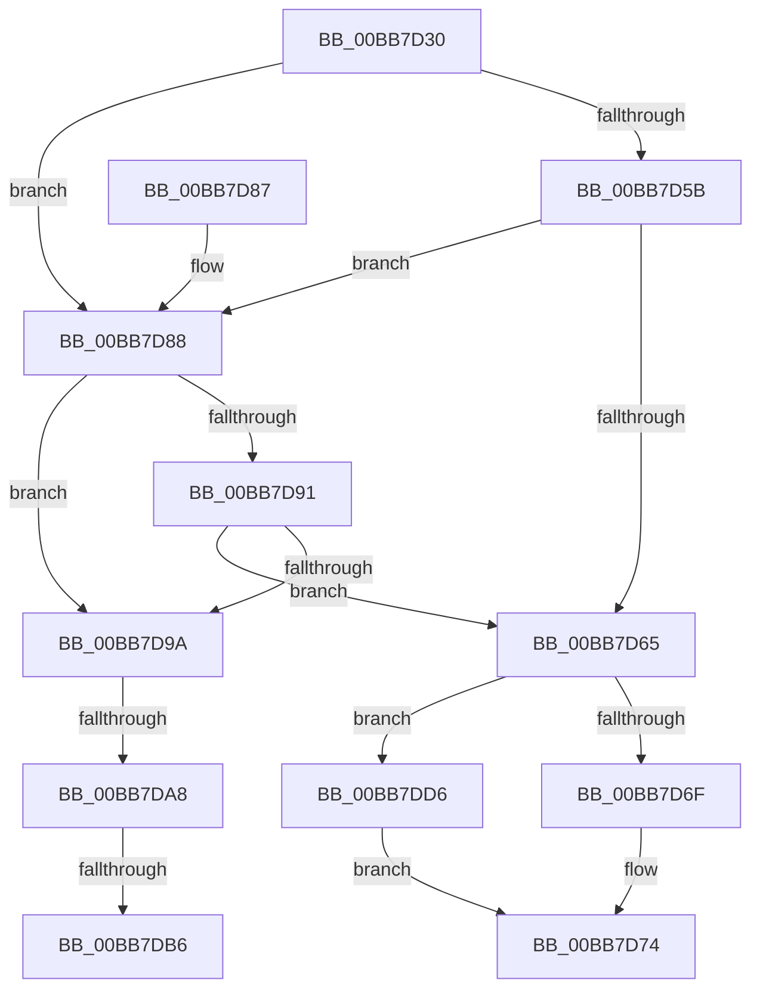

# IovCallDriver

- RVA: `0x00BB7D30`–`0x00BB7DDD` (길이 `173` bytes)
- VA: `0x0000000140BB7D30`
- 실행 섹션: `PAGEVRFY`
- PDB 이름 있음: `예`; PDB Function 태그: `예`
- unwind 정보 RVA: `0x000B6AD0`
- 디코드: `44`개 명령, `173/173` bytes 표시
- 미해석 바이트: `0` (있으면 어셈블리에 `.byte`로 보존)

> 이 문서는 커널 이미지의 기계어와 PDB 기호를 분석해 생성했습니다. 4번과 5번은 함수 원형과 자료형을 바이너리 사용 방식에서 추정한 C 해석이며 원본 소스 복구 결과는 아닙니다.

## 1. Dependencies

- 직접 호출 지점: **3**; 고유 호출 대상: **3**
- 직접 호출자로 확인된 함수: **2**
- RIP 상대 이미지 참조: **7**

### Outgoing calls
- `0x00BB7D6F` → [IopfCallDriver](../../text/29/IopfCallDriver_function_0029C474.md) (function, `0x0029C474`)
- `0x00BB7DBD` → [KeAcquireSpinLockRaiseToDpc](../../text/20/KeAcquireSpinLockRaiseToDpc_function_00208470.md) (function, `0x00208470`)
- `0x00BB7DD6` → [IopPerfCallDriver](../../text/4A/IopPerfCallDriver_function_004A9680.md) (function, `0x004A9680`)

### Direct callers
- [IofCallDriver](../../text/29/IofCallDriver_function_0029B4B0.md) at `0x0029B558`
- [sub_006F9E34](../../text/6F/Unknown_function_006F9E34.md) at `0x006F9E34`

### Static image references
- `0x00BB7D4B` → RVA `0x00E66220` (`.data`; read)
- `0x00BB7D5B` → RVA `0x00F04A20` (`.data`; read)
- `0x00BB7D65` → RVA `0x00E66114` (`.data`; read)
- `0x00BB7D88` → RVA `0x00F04A04` (`.data`; read)
- `0x00BB7DA8` → RVA `0x00E681A0` (`.data`; read)
- `0x00BB7DB6` → RVA `0x00FFDA70` (`PAGEVRFD`; read)
- `0x00BB7DC6` → RVA `0x00FFDA38` (`PAGEVRFD`; write)

## 2. Other-region calls and transfers

- 다른 실행 섹션으로 향하는 call: **3**
  - `0x00BB7D6F` → [IopfCallDriver](../../text/29/IopfCallDriver_function_0029C474.md) (`PAGEVRFY` → `.text`)
  - `0x00BB7DBD` → [KeAcquireSpinLockRaiseToDpc](../../text/20/KeAcquireSpinLockRaiseToDpc_function_00208470.md) (`PAGEVRFY` → `.text`)
  - `0x00BB7DD6` → [IopPerfCallDriver](../../text/4A/IopPerfCallDriver_function_004A9680.md) (`PAGEVRFY` → `.text`)
- call이 아닌 외부 분기/꼬리 이동: **3**
  - `0x00BB7DA2` → [sub_00BBC34E](Unknown_function_00BBC34E.md) (`tail-transfer`)
  - `0x00BB7DB0` → [sub_00BBC34E](Unknown_function_00BBC34E.md) (`tail-transfer`)
  - `0x00BB7DD1` → [sub_00BBC34E + 0xCC](Unknown_function_00BBC34E.md) (`tail-transfer`)

## 3. Assembly (complete function range)

```asm
00BB7D30  48 89 5C 24 08                  mov qword ptr [rsp + 8], rbx
00BB7D35  48 89 6C 24 10                  mov qword ptr [rsp + 0x10], rbp
00BB7D3A  56                              push rsi
00BB7D3B  57                              push rdi
00BB7D3C  41 56                           push r14
00BB7D3E  48 83 EC 20                     sub rsp, 0x20
00BB7D42  48 83 64 24 58 00               and qword ptr [rsp + 0x58], 0
00BB7D48  49 8B E8                        mov rbp, r8
00BB7D4B  8B 05 CF E4 2A 00               mov eax, dword ptr [rip + 0x2ae4cf]
00BB7D51  48 8B DA                        mov rbx, rdx
00BB7D54  48 8B F1                        mov rsi, rcx
00BB7D57  85 C0                           test eax, eax
00BB7D59  75 2D                           jne 0x140bb7d88
00BB7D5B  8B 05 BF CC 34 00               mov eax, dword ptr [rip + 0x34ccbf]
00BB7D61  A8 20                           test al, 0x20
00BB7D63  75 23                           jne 0x140bb7d88
00BB7D65  8B 05 A9 E3 2A 00               mov eax, dword ptr [rip + 0x2ae3a9]
00BB7D6B  A8 02                           test al, 2
00BB7D6D  75 67                           jne 0x140bb7dd6
00BB7D6F  E8 00 47 6E FF                  call 0x14029c474
00BB7D74  48 8B 5C 24 40                  mov rbx, qword ptr [rsp + 0x40]
00BB7D79  48 8B 6C 24 48                  mov rbp, qword ptr [rsp + 0x48]
00BB7D7E  48 83 C4 20                     add rsp, 0x20
00BB7D82  41 5E                           pop r14
00BB7D84  5F                              pop rdi
00BB7D85  5E                              pop rsi
00BB7D86  C3                              ret
00BB7D87  CC                              int3
00BB7D88  83 3D 75 CC 34 00 01            cmp dword ptr [rip + 0x34cc75], 1
00BB7D8F  74 09                           je 0x140bb7d9a
00BB7D91  F7 42 10 00 00 00 40            test dword ptr [rdx + 0x10], 0x40000000
00BB7D98  74 CB                           je 0x140bb7d65
00BB7D9A  44 0F 20 C7                     mov rdi, cr8
00BB7D9E  40 80 FF 02                     cmp dil, 2
00BB7DA2  0F 86 A6 45 00 00               jbe 0x140bbc34e
00BB7DA8  0F BA 25 F0 03 2B 00 16         bt dword ptr [rip + 0x2b03f0], 0x16
00BB7DB0  0F 82 98 45 00 00               jb 0x140bbc34e
00BB7DB6  48 8D 0D B3 5C 44 00            lea rcx, [rip + 0x445cb3]
00BB7DBD  E8 AE 06 65 FF                  call 0x140208470
00BB7DC2  40 0F B6 C7                     movzx eax, dil
00BB7DC6  48 C7 05 67 5C 44 00 10 00 00 00  mov qword ptr [rip + 0x445c67], 0x10
00BB7DD1  E9 44 46 00 00                  jmp 0x140bbc41a
00BB7DD6  E8 A5 18 8F FF                  call 0x1404a9680
00BB7DDB  EB 97                           jmp 0x140bb7d74
```

## 4. C-style interpretation (structured pseudocode)

```c
__int64 __fastcall IovCallDriver(__int64 a1, __int64 a2, __int64 a3)
{
    __int64 result;
    __int64 v_rsp;
    unsigned __int64 v_stack_p10;
    unsigned __int64 v_stack_p20;
    unsigned __int64 v_stack_p8;

    v_stack_p8 = v_rbx;
    v_stack_p10 = v_rbp;
    v_rsp = (v_rsp) - (32);
    if ((unsigned int)((unsigned int)(*(unsigned int *)(v_rip + 2811087))) != 0) goto loc_00BB7D88;
    if ((((unsigned __int8)((unsigned int)(*(unsigned int *)(v_rip + 3460287)))) & (32)) != 0) goto loc_00BB7D88;
loc_00BB7D65:
    if ((((unsigned __int8)((unsigned int)(*(unsigned int *)(v_rip + 2810793)))) & (2)) != 0) goto loc_00BB7DD6;
    result = IopfCallDriver(a1, a2, a3, a4);
loc_00BB7D74:
    v_rsp = (v_rsp) + (32);
    return result;
loc_00BB7D88:
    if ((*(unsigned int *)(v_rip + 3460213)) == 1) goto loc_00BB7D9A;
    if (((*(unsigned int *)(a2 + 16)) & (0x40000000ULL)) == 0) goto loc_00BB7D65;
loc_00BB7D9A:
    result = KeAcquireSpinLockRaiseToDpc(v_rip + 4480179, a2, a3, a4);
    *(unsigned __int64 *)(v_rip + 4480103) = 16;
loc_00BB7DD6:
    result = IopPerfCallDriver(v_rip + 4480179, a2, a3, a4);
    goto loc_00BB7D74;
}
```

## 5. (Beta) C Style

```c
int64_t IovCallDriver(int64_t Arg1, void *Arg2, int64_t Arg3)
{
    uint8_t *arg2 = (uint8_t *)Arg2;

    int64_t result;
    int64_t local_rsp;
    uint64_t v_stack_p10;
    uint64_t v_stack_p20;
    uint64_t v_stack_p8;

    v_stack_p8 = local_rbx;
    v_stack_p10 = local_rbp;
    local_rsp = (local_rsp) - (32);
    if ((uint32_t)((uint32_t)(*(uint32_t *)(v_rip + 0x2AE4CF))) != 0) goto loc_00BB7D88;
    if ((((uint8_t)((uint32_t)(*(uint32_t *)(v_rip + 0x34CCBF)))) & (32)) != 0) goto loc_00BB7D88;
loc_00BB7D65:
    if ((((uint8_t)((uint32_t)(*(uint32_t *)(v_rip + 0x2AE3A9)))) & (2)) != 0) goto loc_00BB7DD6;
    result = IopfCallDriver(Arg1, Arg2, Arg3, a4);
loc_00BB7D74:
    local_rsp = (local_rsp) + (32);
    return result;
loc_00BB7D88:
    if ((*(uint32_t *)(v_rip + 0x34CC75)) == 1) goto loc_00BB7D9A;
    if (((*(uint32_t *)(arg2 + 0x10)) & (0x40000000ULL)) == 0) goto loc_00BB7D65;
loc_00BB7D9A:
    result = KeAcquireSpinLockRaiseToDpc(v_rip + 4480179, Arg2, Arg3, a4);
    *(uint64_t *)(v_rip + 0x445C67) = 16;
loc_00BB7DD6:
    result = IopPerfCallDriver(v_rip + 4480179, Arg2, Arg3, a4);
    goto loc_00BB7D74;
}
```

### 관측된 메모리 오프셋

구조체 형식이 확인되지 않은 접근은 인자 기준의 오프셋으로만 기록했습니다.

| 기준 인자 | 오프셋 표현 | 폭 (bit) | 접근 |
|---|---:|---:|---|
| `Arg2` | `+ 0x10` | `32` | `R` |

## 6. Execution-region graph

[열기: 2D/3D 그래프와 함수 탐색 컨트롤 패널](../../../control-panel.html?section=pagevrfy&rva=0x00BB7D30&view=graph)

- 2D 그래프는 위에서 아래로 흐르고, 3D 그래프는 빈 공간을 드래그해 회전합니다. Shift+드래그는 이동, 휠은 확대·축소, 함수 노드 선택은 대상 보고서 이동입니다.

### Static fallback


