# IovCompleteRequest

- RVA: `0x00BB6758`–`0x00BB69D2` (길이 `634` bytes)
- VA: `0x0000000140BB6758`
- 실행 섹션: `PAGEVRFY`
- PDB 이름 있음: `예`; PDB Function 태그: `아니요`
- unwind 정보 RVA: `0x000B07AC`
- 디코드: `156`개 명령, `634/634` bytes 표시
- 미해석 바이트: `0` (있으면 어셈블리에 `.byte`로 보존)

> 이 문서는 커널 이미지의 기계어와 PDB 기호를 분석해 생성했습니다. 4번과 5번은 함수 원형과 자료형을 바이너리 사용 방식에서 추정한 C 해석이며 원본 소스 복구 결과는 아닙니다.

## 1. Dependencies

- 직접 호출 지점: **10**; 고유 호출 대상: **7**
- 직접 호출자로 확인된 함수: **1**
- RIP 상대 이미지 참조: **5**

### Outgoing calls
- `0x00BB6790` → [memset](../../text/6C/memset_function_006C6C40.md) (function, `0x006C6C40`)
- `0x00BB67AA` → [IovpLogStackTrace](IovpLogStackTrace_function_00BB6A5C.md) (function, `0x00BB6A5C`)
- `0x00BB6822` → [IovpCompleteRequest1](IovpCompleteRequest1_function_00BB69D8.md) (function, `0x00BB69D8`)
- `0x00BB684D` → [IopPerfCompleteRequest](../../text/4A/IopPerfCompleteRequest_function_004A69B8.md) (function, `0x004A69B8`)
- `0x00BB6859` → [_security_check_cookie](../../text/6A/_security_check_cookie_function_006AC640.md) (function, `0x006AC640`)
- `0x00BB6877` → [IopfCompleteRequest](../../text/29/IopfCompleteRequest_function_0029B5F8.md) (function, `0x0029B5F8`)
- `0x00BB6937` → [CarReportRuleViolationFromNt](../B9/CarReportRuleViolationFromNt_function_00B9D904.md) (function, `0x00B9D904`)
- `0x00BB6960` → [CarReportRuleViolationFromNt](../B9/CarReportRuleViolationFromNt_function_00B9D904.md) (function, `0x00B9D904`)
- `0x00BB698A` → [CarReportRuleViolationFromNt](../B9/CarReportRuleViolationFromNt_function_00B9D904.md) (function, `0x00B9D904`)
- `0x00BB69BB` → [CarReportRuleViolationFromNt](../B9/CarReportRuleViolationFromNt_function_00B9D904.md) (function, `0x00B9D904`)

### Direct callers
- [IofCompleteRequest](../../text/29/IofCompleteRequest_function_0029B5C0.md) at `0x0029B5DE`

### Static image references
- `0x00BB6772` → RVA `0x00E0A740` (`.data`; read)
- `0x00BB67AF` → RVA `0x00F04A20` (`.data`; read)
- `0x00BB67B9` → RVA `0x00E6621C` (`.data`; read)
- `0x00BB683D` → RVA `0x00E66114` (`.data`; read)
- `0x00BB68E0` → RVA `0x00BB6B60` (`IovpLocalCompletionRoutine`; read)

## 2. Other-region calls and transfers

- 다른 실행 섹션으로 향하는 call: **4**
  - `0x00BB6790` → [memset](../../text/6C/memset_function_006C6C40.md) (`PAGEVRFY` → `.text`)
  - `0x00BB684D` → [IopPerfCompleteRequest](../../text/4A/IopPerfCompleteRequest_function_004A69B8.md) (`PAGEVRFY` → `.text`)
  - `0x00BB6859` → [_security_check_cookie](../../text/6A/_security_check_cookie_function_006AC640.md) (`PAGEVRFY` → `.text`)
  - `0x00BB6877` → [IopfCompleteRequest](../../text/29/IopfCompleteRequest_function_0029B5F8.md) (`PAGEVRFY` → `.text`)
- 별도 외부 분기/꼬리 이동을 확인하지 못했습니다.

## 3. Assembly (complete function range)

```asm
00BB6758  48 89 5C 24 18                  mov qword ptr [rsp + 0x18], rbx
00BB675D  48 89 74 24 20                  mov qword ptr [rsp + 0x20], rsi
00BB6762  55                              push rbp
00BB6763  57                              push rdi
00BB6764  41 54                           push r12
00BB6766  48 8D 6C 24 B9                  lea rbp, [rsp - 0x47]
00BB676B  48 81 EC E0 00 00 00            sub rsp, 0xe0
00BB6772  48 8B 05 C7 3F 25 00            mov rax, qword ptr [rip + 0x253fc7]
00BB6779  48 33 C4                        xor rax, rsp
00BB677C  48 89 45 37                     mov qword ptr [rbp + 0x37], rax
00BB6780  40 8A FA                        mov dil, dl
00BB6783  48 8B D9                        mov rbx, rcx
00BB6786  33 D2                           xor edx, edx
00BB6788  48 8D 4D CF                     lea rcx, [rbp - 0x31]
00BB678C  44 8D 42 68                     lea r8d, [rdx + 0x68]
00BB6790  E8 AB 04 B1 FF                  call 0x1406c6c40
00BB6795  0F 57 C0                        xorps xmm0, xmm0
00BB6798  33 F6                           xor esi, esi
00BB679A  48 8B CB                        mov rcx, rbx
00BB679D  48 89 75 A7                     mov qword ptr [rbp - 0x59], rsi
00BB67A1  F3 0F 7F 45 AF                  movdqu xmmword ptr [rbp - 0x51], xmm0
00BB67A6  48 89 75 BF                     mov qword ptr [rbp - 0x41], rsi
00BB67AA  E8 AD 02 00 00                  call 0x140bb6a5c
00BB67AF  8B 05 6B E2 34 00               mov eax, dword ptr [rip + 0x34e26b]
00BB67B5  A8 10                           test al, 0x10
00BB67B7  74 57                           je 0x140bb6810
00BB67B9  8B 05 5D FA 2A 00               mov eax, dword ptr [rip + 0x2afa5d]
00BB67BF  85 C0                           test eax, eax
00BB67C1  75 4D                           jne 0x140bb6810
00BB67C3  8A 43 42                        mov al, byte ptr [rbx + 0x42]
00BB67C6  44 8D 66 06                     lea r12d, [rsi + 6]
00BB67CA  FE C0                           inc al
00BB67CC  38 43 43                        cmp byte ptr [rbx + 0x43], al
00BB67CF  0F 8F 40 01 00 00               jg 0x140bb6915
00BB67D5  66 44 39 23                     cmp word ptr [rbx], r12w
00BB67D9  0F 85 36 01 00 00               jne 0x140bb6915
00BB67DF  4C 8B 43 68                     mov r8, qword ptr [rbx + 0x68]
00BB67E3  4D 85 C0                        test r8, r8
00BB67E6  0F 85 55 01 00 00               jne 0x140bb6941
00BB67EC  48 63 43 30                     movsxd rax, dword ptr [rbx + 0x30]
00BB67F0  3D 03 01 00 00                  cmp eax, 0x103
00BB67F5  0F 84 6F 01 00 00               je 0x140bb696a
00BB67FB  83 F8 FF                        cmp eax, -1
00BB67FE  0F 84 66 01 00 00               je 0x140bb696a
00BB6804  44 0F 20 C0                     mov rax, cr8
00BB6808  3C 02                           cmp al, 2
00BB680A  0F 87 84 01 00 00               ja 0x140bb6994
00BB6810  48 8B 45 5F                     mov rax, qword ptr [rbp + 0x5f]
00BB6814  4C 8D 45 A7                     lea r8, [rbp - 0x59]
00BB6818  40 8A D7                        mov dl, dil
00BB681B  48 89 45 C7                     mov qword ptr [rbp - 0x39], rax
00BB681F  48 8B CB                        mov rcx, rbx
00BB6822  E8 B1 01 00 00                  call 0x140bb69d8
00BB6827  8B 05 EF F9 2A 00               mov eax, dword ptr [rip + 0x2af9ef]
00BB682D  85 C0                           test eax, eax
00BB682F  0F 85 C3 00 00 00               jne 0x140bb68f8
00BB6835  8A 43 42                        mov al, byte ptr [rbx + 0x42]
00BB6838  38 43 43                        cmp byte ptr [rbx + 0x43], al
00BB683B  7E 41                           jle 0x140bb687e
00BB683D  8B 05 D1 F8 2A 00               mov eax, dword ptr [rip + 0x2af8d1]
00BB6843  40 8A D7                        mov dl, dil
00BB6846  48 8B CB                        mov rcx, rbx
00BB6849  A8 02                           test al, 2
00BB684B  74 2A                           je 0x140bb6877
00BB684D  E8 66 01 8F FF                  call 0x1404a69b8
00BB6852  48 8B 4D 37                     mov rcx, qword ptr [rbp + 0x37]
00BB6856  48 33 CC                        xor rcx, rsp
00BB6859  E8 E2 5D AF FF                  call 0x1406ac640
00BB685E  4C 8D 9C 24 E0 00 00 00         lea r11, [rsp + 0xe0]
00BB6866  49 8B 5B 30                     mov rbx, qword ptr [r11 + 0x30]
00BB686A  49 8B 73 38                     mov rsi, qword ptr [r11 + 0x38]
00BB686E  49 8B E3                        mov rsp, r11
00BB6871  41 5C                           pop r12
00BB6873  5F                              pop rdi
00BB6874  5D                              pop rbp
00BB6875  C3                              ret
00BB6876  CC                              int3
00BB6877  E8 7C 4D 6E FF                  call 0x14029b5f8
00BB687C  EB D4                           jmp 0x140bb6852
00BB687E  48 8D 45 A7                     lea rax, [rbp - 0x59]
00BB6882  48 8B 8B B8 00 00 00            mov rcx, qword ptr [rbx + 0xb8]
00BB6889  48 89 45 DF                     mov qword ptr [rbp - 0x21], rax
00BB688D  48 8B 41 40                     mov rax, qword ptr [rcx + 0x40]
00BB6891  48 89 45 D7                     mov qword ptr [rbp - 0x29], rax
00BB6895  48 89 4D CF                     mov qword ptr [rbp - 0x31], rcx
00BB6899  0F 10 01                        movups xmm0, xmmword ptr [rcx]
00BB689C  0F 11 45 EF                     movups xmmword ptr [rbp - 0x11], xmm0
00BB68A0  0F 10 49 10                     movups xmm1, xmmword ptr [rcx + 0x10]
00BB68A4  0F 11 4D FF                     movups xmmword ptr [rbp - 1], xmm1
00BB68A8  0F 10 41 20                     movups xmm0, xmmword ptr [rcx + 0x20]
00BB68AC  0F 11 45 0F                     movups xmmword ptr [rbp + 0xf], xmm0
00BB68B0  0F 10 49 30                     movups xmm1, xmmword ptr [rcx + 0x30]
00BB68B4  0F 11 4D 1F                     movups xmmword ptr [rbp + 0x1f], xmm1
00BB68B8  F2 0F 10 41 40                  movsd xmm0, qword ptr [rcx + 0x40]
00BB68BD  F2 0F 11 45 2F                  movsd qword ptr [rbp + 0x2f], xmm0
00BB68C2  8A 41 03                        mov al, byte ptr [rcx + 3]
00BB68C5  39 73 30                        cmp dword ptr [rbx + 0x30], esi
00BB68C8  7D 3D                           jge 0x140bb6907
00BB68CA  84 C0                           test al, al
00BB68CC  78 3D                           js 0x140bb690b
00BB68CE  40 38 73 44                     cmp byte ptr [rbx + 0x44], sil
00BB68D2  0F 85 ED 00 00 00               jne 0x140bb69c5
00BB68D8  48 89 75 E7                     mov qword ptr [rbp - 0x19], rsi
00BB68DC  80 49 03 E0                     or byte ptr [rcx + 3], 0xe0
00BB68E0  48 8D 05 79 02 00 00            lea rax, [rip + 0x279]
00BB68E7  48 89 41 38                     mov qword ptr [rcx + 0x38], rax
00BB68EB  48 8D 45 CF                     lea rax, [rbp - 0x31]
00BB68EF  48 89 41 40                     mov qword ptr [rcx + 0x40], rax
00BB68F3  E9 45 FF FF FF                  jmp 0x140bb683d
00BB68F8  48 39 75 A7                     cmp qword ptr [rbp - 0x59], rsi
00BB68FC  0F 84 3B FF FF FF               je 0x140bb683d
00BB6902  E9 2E FF FF FF                  jmp 0x140bb6835
00BB6907  A8 40                           test al, 0x40
00BB6909  74 C3                           je 0x140bb68ce
00BB690B  48 8B 41 38                     mov rax, qword ptr [rcx + 0x38]
00BB690F  48 89 45 E7                     mov qword ptr [rbp - 0x19], rax
00BB6913  EB CB                           jmp 0x140bb68e0
00BB6915  45 33 C9                        xor r9d, r9d
00BB6918  48 89 74 24 30                  mov qword ptr [rsp + 0x30], rsi
00BB691D  C7 44 24 28 04 00 00 00         mov dword ptr [rsp + 0x28], 4
00BB6925  41 B8 7A 04 00 00               mov r8d, 0x47a
00BB692B  48 8B D3                        mov rdx, rbx
00BB692E  48 89 74 24 20                  mov qword ptr [rsp + 0x20], rsi
00BB6933  41 8D 49 44                     lea ecx, [r9 + 0x44]
00BB6937  E8 C8 6F FE FF                  call 0x140b9d904
00BB693C  E9 9E FE FF FF                  jmp 0x140bb67df
00BB6941  48 89 74 24 30                  mov qword ptr [rsp + 0x30], rsi
00BB6946  4C 8B CB                        mov r9, rbx
00BB6949  C7 44 24 28 04 00 00 00         mov dword ptr [rsp + 0x28], 4
00BB6951  BA 07 00 00 00                  mov edx, 7
00BB6956  B9 C9 00 00 00                  mov ecx, 0xc9
00BB695B  48 89 74 24 20                  mov qword ptr [rsp + 0x20], rsi
00BB6960  E8 9F 6F FE FF                  call 0x140b9d904
00BB6965  E9 82 FE FF FF                  jmp 0x140bb67ec
00BB696A  48 89 74 24 30                  mov qword ptr [rsp + 0x30], rsi
00BB696F  4C 8B C0                        mov r8, rax
00BB6972  C7 44 24 28 04 00 00 00         mov dword ptr [rsp + 0x28], 4
00BB697A  4C 8B CB                        mov r9, rbx
00BB697D  49 8B D4                        mov rdx, r12
00BB6980  48 89 74 24 20                  mov qword ptr [rsp + 0x20], rsi
00BB6985  B9 C9 00 00 00                  mov ecx, 0xc9
00BB698A  E8 75 6F FE FF                  call 0x140b9d904
00BB698F  E9 70 FE FF FF                  jmp 0x140bb6804
00BB6994  44 0F 20 C0                     mov rax, cr8
00BB6998  48 89 74 24 30                  mov qword ptr [rsp + 0x30], rsi
00BB699D  4C 8B CB                        mov r9, rbx
00BB69A0  C7 44 24 28 04 00 00 00         mov dword ptr [rsp + 0x28], 4
00BB69A8  BA 0E 00 00 00                  mov edx, 0xe
00BB69AD  44 0F B6 C0                     movzx r8d, al
00BB69B1  B9 C9 00 00 00                  mov ecx, 0xc9
00BB69B6  48 89 74 24 20                  mov qword ptr [rsp + 0x20], rsi
00BB69BB  E8 44 6F FE FF                  call 0x140b9d904
00BB69C0  E9 4B FE FF FF                  jmp 0x140bb6810
00BB69C5  A8 20                           test al, 0x20
00BB69C7  0F 85 3E FF FF FF               jne 0x140bb690b
00BB69CD  E9 06 FF FF FF                  jmp 0x140bb68d8
```

## 4. C-style interpretation (structured pseudocode)

```c
__int64 __fastcall IovCompleteRequest(__int64 a1, int a2, __int64 a3, int a4)
{
    __int64 result;
    __int64 v_rsi;
    __int64 v_rsp;
    unsigned __int64 v_stack_m18;
    unsigned __int64 v_stack_m28;
    unsigned __int64 v_stack_m30;
    unsigned __int64 v_stack_m40;
    unsigned __int64 v_stack_m50;
    unsigned __int64 v_stack_m5F;
    unsigned __int64 v_stack_m60;
    unsigned __int64 v_stack_m70;
    unsigned __int64 v_stack_m78;
    unsigned __int64 v_stack_m80;
    unsigned __int64 v_stack_m88;
    unsigned __int64 v_stack_m90;
    unsigned __int64 v_stack_m98;
    unsigned __int64 v_stack_mA0;
    unsigned __int64 v_stack_mB0;
    unsigned __int64 v_stack_mB8;
    unsigned __int64 v_stack_mC0;
    unsigned __int64 v_stack_p0;
    unsigned __int64 v_stack_p18;
    unsigned __int64 v_stack_p20;

    v_stack_p18 = v_rbx;
    v_stack_p20 = v_rsi;
    v_rsp = (v_rsp) - (224);
    result = (*(unsigned __int64 *)(v_rip + 2441159)) ^ (v_rsp);
    v_stack_m28 = result;
    a2 = 0;
    result = memset(v_stack_m90, a2, a2 + 104, a4);
    v_rsi = 0;
    v_stack_mB8 = 0;
    v_stack_mB0 = v_xmm0;
    v_stack_mA0 = 0;
    result = IovpLogStackTrace(a1, a2, a2 + 104, a4);
    if ((((unsigned __int8)((unsigned int)(*(unsigned int *)(v_rip + 3465835)))) & (16)) == 0) goto loc_00BB6810;
    if ((unsigned int)((unsigned int)(*(unsigned int *)(v_rip + 2816605))) != 0) goto loc_00BB6810;
    result = (unsigned __int8)((*(unsigned __int8 *)(a1 + 66)) + 1);
    if ((*(unsigned __int8 *)(a1 + 67)) > ((unsigned __int8)(result))) goto loc_00BB6915;
    if ((*(unsigned __int16 *)(a1)) != ((unsigned __int16)(v_rsi + 6))) goto loc_00BB6915;
loc_00BB67DF:
    if (*(unsigned __int64 *)(a1 + 104) != 0) goto loc_00BB6941;
loc_00BB67EC:
    if (((unsigned int)((int)(*(unsigned int *)(a1 + 48)))) == 259) goto loc_00BB696A;
    if (((unsigned int)((int)(*(unsigned int *)(a1 + 48)))) == -1) goto loc_00BB696A;
loc_00BB6804:
    if (((unsigned __int8)(v_cr8)) > 2) goto loc_00BB6994;
loc_00BB6810:
    v_stack_m98 = v_stack_p0;
    result = IovpCompleteRequest1(a1, (unsigned __int8)((unsigned __int8)(a2)), v_stack_mB8, a4);
    if ((unsigned int)((unsigned int)(*(unsigned int *)(v_rip + 2816495))) != 0) goto loc_00BB68F8;
loc_00BB6835:
    if ((*(unsigned __int8 *)(a1 + 67)) <= ((unsigned __int8)(*(unsigned __int8 *)(a1 + 66)))) goto loc_00BB687E;
loc_00BB683D:
    if ((((unsigned __int8)((unsigned int)(*(unsigned int *)(v_rip + 2816209)))) & (2)) == 0) goto loc_00BB6877;
    result = IopPerfCompleteRequest(a1, (unsigned __int8)((unsigned __int8)(a2)), v_stack_mB8, a4);
loc_00BB6852:
    a1 = (v_stack_m28) ^ (v_rsp);
    result = _security_check_cookie(a1, (unsigned __int8)((unsigned __int8)(a2)), v_stack_mB8, a4);
    return result;
loc_00BB6877:
    result = IopfCompleteRequest(a1, (unsigned __int8)((unsigned __int8)(a2)), v_stack_mB8, a4);
    goto loc_00BB6852;
loc_00BB687E:
    v_stack_m80 = v_stack_mB8;
    v_stack_m88 = *(unsigned __int64 *)(*(unsigned __int64 *)(*(unsigned __int64 *)(v_stack_m18 + 48) + 184) + 64);
    v_stack_m90 = *(unsigned __int64 *)(*(unsigned __int64 *)(v_stack_m18 + 48) + 184);
    v_stack_m70 = v_xmm0;
    v_stack_m60 = v_xmm1;
    v_stack_m50 = v_xmm0;
    v_stack_m40 = v_xmm1;
    v_stack_m30 = v_xmm0;
    if ((*(unsigned int *)(*(unsigned __int64 *)(v_stack_m18 + 48) + 48)) >= ((unsigned int)(*(unsigned __int64 *)(v_stack_m18 + 56)))) goto loc_00BB6907;
    if (sign_flag) goto loc_00BB690B;
loc_00BB68CE:
    if ((*(unsigned __int8 *)(*(unsigned __int64 *)(v_stack_m18 + 48) + 68)) != ((unsigned __int8)(*(unsigned __int64 *)(v_stack_m18 + 56)))) goto loc_00BB69C5;
loc_00BB68D8:
    v_stack_m78 = *(unsigned __int64 *)(v_stack_m18 + 56);
loc_00BB68E0:
    *(unsigned __int64 *)(*(unsigned __int64 *)(*(unsigned __int64 *)(v_stack_m18 + 48) + 184) + 56) = v_rip + 633;
    *(unsigned __int64 *)(*(unsigned __int64 *)(*(unsigned __int64 *)(v_stack_m18 + 48) + 184) + 64) = v_stack_m90;
    goto loc_00BB683D;
loc_00BB68F8:
    if (v_stack_mB8 == (*(unsigned __int64 *)(v_stack_m18 + 56))) goto loc_00BB683D;
    goto loc_00BB6835;
loc_00BB6907:
    if ((((unsigned __int8)(v_stack_m90)) & (64)) == 0) goto loc_00BB68CE;
loc_00BB690B:
    v_stack_m78 = *(unsigned __int64 *)(*(unsigned __int64 *)(*(unsigned __int64 *)(v_stack_m18 + 48) + 184) + 56);
    goto loc_00BB68E0;
loc_00BB6915:
    a4 = 0;
    v_stack_mB0 = *(unsigned __int64 *)(v_stack_m18 + 56);
    v_stack_mB8 = 4;
    v_stack_mC0 = *(unsigned __int64 *)(v_stack_m18 + 56);
    result = CarReportRuleViolationFromNt(a4 + 68, *(unsigned __int64 *)(v_stack_m18 + 48), (unsigned int)(0x47AULL), a4);
    goto loc_00BB67DF;
loc_00BB6941:
    v_stack_mB0 = *(unsigned __int64 *)(v_stack_m18 + 56);
    v_stack_mB8 = 4;
    v_stack_mC0 = *(unsigned __int64 *)(v_stack_m18 + 56);
    result = CarReportRuleViolationFromNt(201, 7, (unsigned int)(0x47AULL), *(unsigned __int64 *)(v_stack_m18 + 48));
    goto loc_00BB67EC;
loc_00BB696A:
    v_stack_mB0 = *(unsigned __int64 *)(v_stack_m18 + 56);
    v_stack_mB8 = 4;
    v_stack_mC0 = *(unsigned __int64 *)(v_stack_m18 + 56);
    result = CarReportRuleViolationFromNt(201, v_rsi + 6, result, *(unsigned __int64 *)(v_stack_m18 + 48));
    goto loc_00BB6804;
loc_00BB6994:
    v_stack_mB0 = *(unsigned __int64 *)(v_stack_m18 + 56);
    v_stack_mB8 = 4;
    v_stack_mC0 = *(unsigned __int64 *)(v_stack_m18 + 56);
    result = CarReportRuleViolationFromNt(201, 14, (unsigned __int8)(v_cr8), *(unsigned __int64 *)(v_stack_m18 + 48));
    goto loc_00BB6810;
loc_00BB69C5:
    if ((((unsigned __int8)(result)) & (32)) != 0) goto loc_00BB690B;
    goto loc_00BB68D8;
}
```

## 5. (Beta) C Style

```c
int64_t IovCompleteRequest(void *Arg1, int32_t Arg2, int64_t Arg3, int32_t Arg4)
{
    uint8_t *arg1 = (uint8_t *)Arg1;

    int64_t result;
    int64_t local_rsi;
    int64_t local_rsp;
    uint64_t v_stack_m18;
    uint64_t v_stack_m28;
    uint64_t v_stack_m30;
    uint64_t v_stack_m40;
    uint64_t v_stack_m50;
    uint64_t v_stack_m5F;
    uint64_t v_stack_m60;
    uint64_t v_stack_m70;
    uint64_t v_stack_m78;
    uint64_t v_stack_m80;
    uint64_t v_stack_m88;
    uint64_t v_stack_m90;
    uint64_t v_stack_m98;
    uint64_t v_stack_mA0;
    uint64_t v_stack_mB0;
    uint64_t v_stack_mB8;
    uint64_t v_stack_mC0;
    uint64_t v_stack_p0;
    uint64_t v_stack_p18;
    uint64_t v_stack_p20;

    v_stack_p18 = local_rbx;
    v_stack_p20 = local_rsi;
    local_rsp = (local_rsp) - (224);
    result = (*(uint64_t *)(v_rip + 0x253FC7)) ^ (local_rsp);
    v_stack_m28 = result;
    Arg2 = 0;
    result = memset(v_stack_m90, Arg2, Arg2 + 104, Arg4);
    local_rsi = 0;
    v_stack_mB8 = 0;
    v_stack_mB0 = v_xmm0;
    v_stack_mA0 = 0;
    result = IovpLogStackTrace(Arg1, Arg2, Arg2 + 104, Arg4);
    if ((((uint8_t)((uint32_t)(*(uint32_t *)(v_rip + 0x34E26B)))) & (16)) == 0) goto loc_00BB6810;
    if ((uint32_t)((uint32_t)(*(uint32_t *)(v_rip + 0x2AFA5D))) != 0) goto loc_00BB6810;
    result = (uint8_t)((*(uint8_t *)(arg1 + 0x42)) + 1);
    if ((*(uint8_t *)(arg1 + 0x43)) > ((uint8_t)(result))) goto loc_00BB6915;
    if ((*(uint16_t *)(arg1)) != ((uint16_t)(local_rsi + 6))) goto loc_00BB6915;
loc_00BB67DF:
    if (*(uint64_t *)(arg1 + 0x68) != 0) goto loc_00BB6941;
loc_00BB67EC:
    if (((uint32_t)((int32_t)(*(uint32_t *)(arg1 + 0x30)))) == 259) goto loc_00BB696A;
    if (((uint32_t)((int32_t)(*(uint32_t *)(arg1 + 0x30)))) == -1) goto loc_00BB696A;
loc_00BB6804:
    if (((uint8_t)(v_cr8)) > 2) goto loc_00BB6994;
loc_00BB6810:
    v_stack_m98 = v_stack_p0;
    result = IovpCompleteRequest1(Arg1, (uint8_t)((uint8_t)(Arg2)), v_stack_mB8, Arg4);
    if ((uint32_t)((uint32_t)(*(uint32_t *)(v_rip + 0x2AF9EF))) != 0) goto loc_00BB68F8;
loc_00BB6835:
    if ((*(uint8_t *)(arg1 + 0x43)) <= ((uint8_t)(*(uint8_t *)(arg1 + 0x42)))) goto loc_00BB687E;
loc_00BB683D:
    if ((((uint8_t)((uint32_t)(*(uint32_t *)(v_rip + 0x2AF8D1)))) & (2)) == 0) goto loc_00BB6877;
    result = IopPerfCompleteRequest(Arg1, (uint8_t)((uint8_t)(Arg2)), v_stack_mB8, Arg4);
loc_00BB6852:
    Arg1 = (v_stack_m28) ^ (local_rsp);
    result = _security_check_cookie(Arg1, (uint8_t)((uint8_t)(Arg2)), v_stack_mB8, Arg4);
    return result;
loc_00BB6877:
    result = IopfCompleteRequest(Arg1, (uint8_t)((uint8_t)(Arg2)), v_stack_mB8, Arg4);
    goto loc_00BB6852;
loc_00BB687E:
    v_stack_m80 = v_stack_mB8;
    v_stack_m88 = *(uint64_t *)(*(uint64_t *)(*(uint64_t *)(v_stack_m18 + 0x30) + 0xB8) + 0x40);
    v_stack_m90 = *(uint64_t *)(*(uint64_t *)(v_stack_m18 + 0x30) + 0xB8);
    v_stack_m70 = v_xmm0;
    v_stack_m60 = v_xmm1;
    v_stack_m50 = v_xmm0;
    v_stack_m40 = v_xmm1;
    v_stack_m30 = v_xmm0;
    if ((*(uint32_t *)(*(uint64_t *)(v_stack_m18 + 0x30) + 0x30)) >= ((uint32_t)(*(uint64_t *)(v_stack_m18 + 0x38)))) goto loc_00BB6907;
    if (sign_flag) goto loc_00BB690B;
loc_00BB68CE:
    if ((*(uint8_t *)(*(uint64_t *)(v_stack_m18 + 0x30) + 0x44)) != ((uint8_t)(*(uint64_t *)(v_stack_m18 + 0x38)))) goto loc_00BB69C5;
loc_00BB68D8:
    v_stack_m78 = *(uint64_t *)(v_stack_m18 + 0x38);
loc_00BB68E0:
    *(uint64_t *)(*(uint64_t *)(*(uint64_t *)(v_stack_m18 + 0x30) + 0xB8) + 0x38) = v_rip + 633;
    *(uint64_t *)(*(uint64_t *)(*(uint64_t *)(v_stack_m18 + 0x30) + 0xB8) + 0x40) = v_stack_m90;
    goto loc_00BB683D;
loc_00BB68F8:
    if (v_stack_mB8 == (*(uint64_t *)(v_stack_m18 + 0x38))) goto loc_00BB683D;
    goto loc_00BB6835;
loc_00BB6907:
    if ((((uint8_t)(v_stack_m90)) & (64)) == 0) goto loc_00BB68CE;
loc_00BB690B:
    v_stack_m78 = *(uint64_t *)(*(uint64_t *)(*(uint64_t *)(v_stack_m18 + 0x30) + 0xB8) + 0x38);
    goto loc_00BB68E0;
loc_00BB6915:
    Arg4 = 0;
    v_stack_mB0 = *(uint64_t *)(v_stack_m18 + 0x38);
    v_stack_mB8 = 4;
    v_stack_mC0 = *(uint64_t *)(v_stack_m18 + 0x38);
    result = CarReportRuleViolationFromNt(Arg4 + 68, *(uint64_t *)(v_stack_m18 + 0x30), (uint32_t)(0x47AULL), Arg4);
    goto loc_00BB67DF;
loc_00BB6941:
    v_stack_mB0 = *(uint64_t *)(v_stack_m18 + 0x38);
    v_stack_mB8 = 4;
    v_stack_mC0 = *(uint64_t *)(v_stack_m18 + 0x38);
    result = CarReportRuleViolationFromNt(201, 7, (uint32_t)(0x47AULL), *(uint64_t *)(v_stack_m18 + 0x30));
    goto loc_00BB67EC;
loc_00BB696A:
    v_stack_mB0 = *(uint64_t *)(v_stack_m18 + 0x38);
    v_stack_mB8 = 4;
    v_stack_mC0 = *(uint64_t *)(v_stack_m18 + 0x38);
    result = CarReportRuleViolationFromNt(201, local_rsi + 6, result, *(uint64_t *)(v_stack_m18 + 0x30));
    goto loc_00BB6804;
loc_00BB6994:
    v_stack_mB0 = *(uint64_t *)(v_stack_m18 + 0x38);
    v_stack_mB8 = 4;
    v_stack_mC0 = *(uint64_t *)(v_stack_m18 + 0x38);
    result = CarReportRuleViolationFromNt(201, 14, (uint8_t)(v_cr8), *(uint64_t *)(v_stack_m18 + 0x30));
    goto loc_00BB6810;
loc_00BB69C5:
    if ((((uint8_t)(result)) & (32)) != 0) goto loc_00BB690B;
    goto loc_00BB68D8;
}
```

### 관측된 메모리 오프셋

구조체 형식이 확인되지 않은 접근은 인자 기준의 오프셋으로만 기록했습니다.

| 기준 인자 | 오프셋 표현 | 폭 (bit) | 접근 |
|---|---:|---:|---|
| `Arg1` | `+ 0x0` | `16` | `R` |
| `Arg1` | `+ 0x30` | `32` | `R` |
| `Arg1` | `+ 0x42` | `8` | `R` |
| `Arg1` | `+ 0x43` | `8` | `R` |
| `Arg1` | `+ 0x44` | `8` | `R` |
| `Arg1` | `+ 0x68` | `64` | `R` |
| `Arg1` | `+ 0xB8` | `64` | `R` |

## 6. Execution-region graph

[열기: 2D/3D 그래프와 함수 탐색 컨트롤 패널](../../../control-panel.html?section=pagevrfy&rva=0x00BB6758&view=graph)

- 2D 그래프는 위에서 아래로 흐르고, 3D 그래프는 빈 공간을 드래그해 회전합니다. Shift+드래그는 이동, 휠은 확대·축소, 함수 노드 선택은 대상 보고서 이동입니다.

### Static fallback

```mermaid
flowchart TD
  bb_00BB6758[BB_00BB6758]
  bb_00BB67B9[BB_00BB67B9]
  bb_00BB67C3[BB_00BB67C3]
  bb_00BB67D5[BB_00BB67D5]
  bb_00BB67DF[BB_00BB67DF]
  bb_00BB67EC[BB_00BB67EC]
  bb_00BB67FB[BB_00BB67FB]
  bb_00BB6804[BB_00BB6804]
  bb_00BB6810[BB_00BB6810]
  bb_00BB6835[BB_00BB6835]
  bb_00BB683D[BB_00BB683D]
  bb_00BB684D[BB_00BB684D]
  bb_00BB6852[BB_00BB6852]
  bb_00BB6876[BB_00BB6876]
  bb_00BB6877[BB_00BB6877]
  bb_00BB687E[BB_00BB687E]
  bb_00BB68CA[BB_00BB68CA]
  bb_00BB68CE[BB_00BB68CE]
  bb_00BB68D8[BB_00BB68D8]
  bb_00BB68E0[BB_00BB68E0]
  bb_00BB68F8[BB_00BB68F8]
  bb_00BB6902[BB_00BB6902]
  bb_00BB6907[BB_00BB6907]
  bb_00BB690B[BB_00BB690B]
  bb_00BB6915[BB_00BB6915]
  bb_00BB6941[BB_00BB6941]
  bb_00BB696A[BB_00BB696A]
  bb_00BB6994[BB_00BB6994]
  bb_00BB69C5[BB_00BB69C5]
  bb_00BB69CD[BB_00BB69CD]
  bb_00BB6758 -->|branch| bb_00BB6810
  bb_00BB6758 -->|fallthrough| bb_00BB67B9
  bb_00BB67B9 -->|branch| bb_00BB6810
  bb_00BB67B9 -->|fallthrough| bb_00BB67C3
  bb_00BB67C3 -->|branch| bb_00BB6915
  bb_00BB67C3 -->|fallthrough| bb_00BB67D5
  bb_00BB67D5 -->|branch| bb_00BB6915
  bb_00BB67D5 -->|fallthrough| bb_00BB67DF
  bb_00BB67DF -->|branch| bb_00BB6941
  bb_00BB67DF -->|fallthrough| bb_00BB67EC
  bb_00BB67EC -->|branch| bb_00BB696A
  bb_00BB67EC -->|fallthrough| bb_00BB67FB
  bb_00BB67FB -->|branch| bb_00BB696A
  bb_00BB67FB -->|fallthrough| bb_00BB6804
  bb_00BB6804 -->|branch| bb_00BB6994
  bb_00BB6804 -->|fallthrough| bb_00BB6810
  bb_00BB6810 -->|branch| bb_00BB68F8
  bb_00BB6810 -->|fallthrough| bb_00BB6835
  bb_00BB6835 -->|branch| bb_00BB687E
  bb_00BB6835 -->|fallthrough| bb_00BB683D
  bb_00BB683D -->|branch| bb_00BB6877
  bb_00BB683D -->|fallthrough| bb_00BB684D
  bb_00BB684D -->|flow| bb_00BB6852
  bb_00BB6876 -->|flow| bb_00BB6877
  bb_00BB6877 -->|branch| bb_00BB6852
  bb_00BB687E -->|branch| bb_00BB6907
  bb_00BB687E -->|fallthrough| bb_00BB68CA
  bb_00BB68CA -->|branch| bb_00BB690B
  bb_00BB68CA -->|fallthrough| bb_00BB68CE
  bb_00BB68CE -->|branch| bb_00BB69C5
  bb_00BB68CE -->|fallthrough| bb_00BB68D8
  bb_00BB68D8 -->|flow| bb_00BB68E0
  bb_00BB68E0 -->|branch| bb_00BB683D
  bb_00BB68F8 -->|branch| bb_00BB683D
  bb_00BB68F8 -->|fallthrough| bb_00BB6902
  bb_00BB6902 -->|branch| bb_00BB6835
  bb_00BB6907 -->|branch| bb_00BB68CE
  bb_00BB6907 -->|fallthrough| bb_00BB690B
  bb_00BB690B -->|branch| bb_00BB68E0
  bb_00BB6915 -->|branch| bb_00BB67DF
  bb_00BB6941 -->|branch| bb_00BB67EC
  bb_00BB696A -->|branch| bb_00BB6804
  bb_00BB6994 -->|branch| bb_00BB6810
  bb_00BB69C5 -->|branch| bb_00BB690B
  bb_00BB69C5 -->|fallthrough| bb_00BB69CD
  bb_00BB69CD -->|branch| bb_00BB68D8
```


