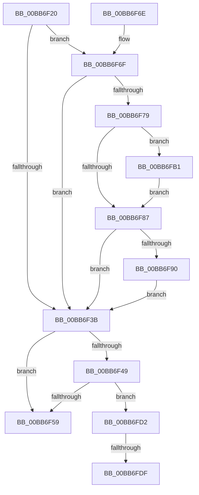

# IovFreeIrpPrivate

- RVA: `0x00BB6F20`–`0x00BB6FE9` (길이 `201` bytes)
- VA: `0x0000000140BB6F20`
- 실행 섹션: `PAGEVRFY`
- PDB 이름 있음: `예`; PDB Function 태그: `예`
- unwind 정보 RVA: `0x000B0870`
- 디코드: `62`개 명령, `201/201` bytes 표시
- 미해석 바이트: `0` (있으면 어셈블리에 `.byte`로 보존)

> 이 문서는 커널 이미지의 기계어와 PDB 기호를 분석해 생성했습니다. 4번과 5번은 함수 원형과 자료형을 바이너리 사용 방식에서 추정한 C 해석이며 원본 소스 복구 결과는 아닙니다.

## 1. Dependencies

- 직접 호출 지점: **4**; 고유 호출 대상: **3**
- 직접 호출자로 확인된 함수: **1**
- RIP 상대 이미지 참조: **2**

### Outgoing calls
- `0x00BB6F4C` → [VfIrpDatabaseEntryFindAndLock](VfIrpDatabaseEntryFindAndLock_function_00BB7074.md) (function, `0x00BB7074`)
- `0x00BB6F5C` → [IopFreeIrp](../../text/24/IopFreeIrp_function_0024E6A0.md) (function, `0x0024E6A0`)
- `0x00BB6FAA` → [CarReportRuleViolationFromNt](../B9/CarReportRuleViolationFromNt_function_00B9D904.md) (function, `0x00B9D904`)
- `0x00BB6FCB` → [CarReportRuleViolationFromNt](../B9/CarReportRuleViolationFromNt_function_00B9D904.md) (function, `0x00B9D904`)

### Direct callers
- [sub_0024E5B0](../../text/24/Unknown_function_0024E5B0.md) at `0x0024E5B0`

### Static image references
- `0x00BB6F2C` → RVA `0x00F04A20` (`.data`; read)
- `0x00BB6F6F` → RVA `0x00E6621C` (`.data`; read)

## 2. Other-region calls and transfers

- 다른 실행 섹션으로 향하는 call: **1**
  - `0x00BB6F5C` → [IopFreeIrp](../../text/24/IopFreeIrp_function_0024E6A0.md) (`PAGEVRFY` → `.text`)
- call이 아닌 외부 분기/꼬리 이동: **2**
  - `0x00BB6FD9` → [sub_00BBC0C8 + 0x1E](Unknown_function_00BBC0C8.md) (`tail-transfer`)
  - `0x00BB6FE4` → [sub_00BBC0C8 + 0x5](Unknown_function_00BBC0C8.md) (`tail-transfer`)

## 3. Assembly (complete function range)

```asm
00BB6F20  48 89 5C 24 18                  mov qword ptr [rsp + 0x18], rbx
00BB6F25  55                              push rbp
00BB6F26  56                              push rsi
00BB6F27  57                              push rdi
00BB6F28  48 83 EC 40                     sub rsp, 0x40
00BB6F2C  8B 05 EE DA 34 00               mov eax, dword ptr [rip + 0x34daee]
00BB6F32  33 ED                           xor ebp, ebp
00BB6F34  48 8B F1                        mov rsi, rcx
00BB6F37  A8 10                           test al, 0x10
00BB6F39  75 34                           jne 0x140bb6f6f
00BB6F3B  8A 46 47                        mov al, byte ptr [rsi + 0x47]
00BB6F3E  48 8B 5C 24 58                  mov rbx, qword ptr [rsp + 0x58]
00BB6F43  24 21                           and al, 0x21
00BB6F45  3C 21                           cmp al, 0x21
00BB6F47  74 10                           je 0x140bb6f59
00BB6F49  48 8B CE                        mov rcx, rsi
00BB6F4C  E8 23 01 00 00                  call 0x140bb7074
00BB6F51  48 8B F8                        mov rdi, rax
00BB6F54  48 85 C0                        test rax, rax
00BB6F57  75 79                           jne 0x140bb6fd2
00BB6F59  48 8B CE                        mov rcx, rsi
00BB6F5C  E8 3F 77 69 FF                  call 0x14024e6a0
00BB6F61  48 8B 5C 24 70                  mov rbx, qword ptr [rsp + 0x70]
00BB6F66  48 83 C4 40                     add rsp, 0x40
00BB6F6A  5F                              pop rdi
00BB6F6B  5E                              pop rsi
00BB6F6C  5D                              pop rbp
00BB6F6D  C3                              ret
00BB6F6E  CC                              int3
00BB6F6F  8B 05 A7 F2 2A 00               mov eax, dword ptr [rip + 0x2af2a7]
00BB6F75  85 C0                           test eax, eax
00BB6F77  75 C2                           jne 0x140bb6f3b
00BB6F79  66 83 39 06                     cmp word ptr [rcx], 6
00BB6F7D  8D 58 04                        lea ebx, [rax + 4]
00BB6F80  BF C9 00 00 00                  mov edi, 0xc9
00BB6F85  75 2A                           jne 0x140bb6fb1
00BB6F87  48 8D 46 20                     lea rax, [rsi + 0x20]
00BB6F8B  48 39 00                        cmp qword ptr [rax], rax
00BB6F8E  74 AB                           je 0x140bb6f3b
00BB6F90  45 33 C9                        xor r9d, r9d
00BB6F93  48 89 6C 24 30                  mov qword ptr [rsp + 0x30], rbp
00BB6F98  89 5C 24 28                     mov dword ptr [rsp + 0x28], ebx
00BB6F9C  4C 8B C6                        mov r8, rsi
00BB6F9F  8B CF                           mov ecx, edi
00BB6FA1  48 89 6C 24 20                  mov qword ptr [rsp + 0x20], rbp
00BB6FA6  41 8D 51 02                     lea edx, [r9 + 2]
00BB6FAA  E8 55 69 FE FF                  call 0x140b9d904
00BB6FAF  EB 8A                           jmp 0x140bb6f3b
00BB6FB1  45 33 C9                        xor r9d, r9d
00BB6FB4  48 89 6C 24 30                  mov qword ptr [rsp + 0x30], rbp
00BB6FB9  89 5C 24 28                     mov dword ptr [rsp + 0x28], ebx
00BB6FBD  4C 8B C6                        mov r8, rsi
00BB6FC0  8B CF                           mov ecx, edi
00BB6FC2  48 89 6C 24 20                  mov qword ptr [rsp + 0x20], rbp
00BB6FC7  41 8D 51 01                     lea edx, [r9 + 1]
00BB6FCB  E8 34 69 FE FF                  call 0x140b9d904
00BB6FD0  EB B5                           jmp 0x140bb6f87
00BB6FD2  48 8D 4E 20                     lea rcx, [rsi + 0x20]
00BB6FD6  48 39 09                        cmp qword ptr [rcx], rcx
00BB6FD9  0F 84 07 51 00 00               je 0x140bbc0e6
00BB6FDF  B9 0C 02 00 00                  mov ecx, 0x20c
00BB6FE4  E9 E4 50 00 00                  jmp 0x140bbc0cd
```

## 4. C-style interpretation (structured pseudocode)

```c
__int64 __fastcall IovFreeIrpPrivate(__int64 a1, __int64 a2, __int64 a3, int a4)
{
    __int64 result;
    __int64 v_rbp;
    __int64 v_rsp;
    unsigned __int64 v_stack_p0;
    unsigned __int64 v_stack_p18;
    unsigned __int64 v_stack_p20;
    unsigned int v_stack_p28;
    unsigned __int64 v_stack_p30;

    v_stack_p18 = v_rbx;
    v_rsp = (v_rsp) - (64);
    v_rbp = 0;
    if ((((unsigned __int8)((unsigned int)(*(unsigned int *)(v_rip + 3463918)))) & (16)) != 0) goto loc_00BB6F6F;
loc_00BB6F3B:
    result = (unsigned __int8)((*(unsigned __int8 *)(a1 + 71)) & (33));
    if (((unsigned __int8)(result)) == 33) goto loc_00BB6F59;
    result = VfIrpDatabaseEntryFindAndLock(a1, a2, a3, a4);
    if (result != 0) goto loc_00BB6FD2;
loc_00BB6F59:
    result = IopFreeIrp(a1, a2, a3, a4);
    v_rsp = (v_rsp) + (64);
    return result;
loc_00BB6F6F:
    if ((unsigned int)((unsigned int)(*(unsigned int *)(v_rip + 2814631))) != 0) goto loc_00BB6F3B;
    if ((*(unsigned __int16 *)(a1)) != 6) goto loc_00BB6FB1;
loc_00BB6F87:
    if ((*(unsigned __int64 *)(a1 + 32)) == (a1 + 32)) goto loc_00BB6F3B;
    a4 = 0;
    v_stack_p30 = 0;
    v_stack_p28 = (unsigned int)((unsigned int)(*(unsigned int *)(v_rip + 2814631)) + 4);
    v_stack_p20 = 0;
    result = CarReportRuleViolationFromNt(201, a4 + 2, a1, a4);
    goto loc_00BB6F3B;
loc_00BB6FB1:
    a4 = 0;
    v_stack_p30 = 0;
    v_stack_p28 = (unsigned int)((unsigned int)(*(unsigned int *)(v_rip + 2814631)) + 4);
    v_stack_p20 = 0;
    result = CarReportRuleViolationFromNt(201, a4 + 1, a1, a4);
    goto loc_00BB6F87;
loc_00BB6FD2:
}
```

## 5. (Beta) C Style

```c
int64_t IovFreeIrpPrivate(void *Arg1, int64_t Arg2, int64_t Arg3, int32_t Arg4)
{
    uint8_t *arg1 = (uint8_t *)Arg1;

    int64_t result;
    int64_t local_rbp;
    int64_t local_rsp;
    uint64_t v_stack_p0;
    uint64_t v_stack_p18;
    uint64_t v_stack_p20;
    uint32_t v_stack_p28;
    uint64_t v_stack_p30;

    v_stack_p18 = local_rbx;
    local_rsp = (local_rsp) - (64);
    local_rbp = 0;
    if ((((uint8_t)((uint32_t)(*(uint32_t *)(v_rip + 0x34DAEE)))) & (16)) != 0) goto loc_00BB6F6F;
loc_00BB6F3B:
    result = (uint8_t)((*(uint8_t *)(arg1 + 0x47)) & (33));
    if (((uint8_t)(result)) == 33) goto loc_00BB6F59;
    result = VfIrpDatabaseEntryFindAndLock(Arg1, Arg2, Arg3, Arg4);
    if (result != 0) goto loc_00BB6FD2;
loc_00BB6F59:
    result = IopFreeIrp(Arg1, Arg2, Arg3, Arg4);
    local_rsp = (local_rsp) + (64);
    return result;
loc_00BB6F6F:
    if ((uint32_t)((uint32_t)(*(uint32_t *)(v_rip + 0x2AF2A7))) != 0) goto loc_00BB6F3B;
    if ((*(uint16_t *)(arg1)) != 6) goto loc_00BB6FB1;
loc_00BB6F87:
    if ((*(uint64_t *)(arg1 + 0x20)) == (Arg1 + 32)) goto loc_00BB6F3B;
    Arg4 = 0;
    v_stack_p30 = 0;
    v_stack_p28 = (uint32_t)((uint32_t)(*(uint32_t *)(v_rip + 0x2AF2A7)) + 4);
    v_stack_p20 = 0;
    result = CarReportRuleViolationFromNt(201, Arg4 + 2, Arg1, Arg4);
    goto loc_00BB6F3B;
loc_00BB6FB1:
    Arg4 = 0;
    v_stack_p30 = 0;
    v_stack_p28 = (uint32_t)((uint32_t)(*(uint32_t *)(v_rip + 0x2AF2A7)) + 4);
    v_stack_p20 = 0;
    result = CarReportRuleViolationFromNt(201, Arg4 + 1, Arg1, Arg4);
    goto loc_00BB6F87;
loc_00BB6FD2:
}
```

### 관측된 메모리 오프셋

구조체 형식이 확인되지 않은 접근은 인자 기준의 오프셋으로만 기록했습니다.

| 기준 인자 | 오프셋 표현 | 폭 (bit) | 접근 |
|---|---:|---:|---|
| `Arg1` | `+ 0x0` | `16` | `R` |
| `Arg1` | `+ 0x0` | `64` | `R` |
| `Arg1` | `+ 0x20` | `64` | `R` |
| `Arg1` | `+ 0x47` | `8` | `R` |

## 6. Execution-region graph

[열기: 2D/3D 그래프와 함수 탐색 컨트롤 패널](../../../control-panel.html?section=pagevrfy&rva=0x00BB6F20&view=graph)

- 2D 그래프는 위에서 아래로 흐르고, 3D 그래프는 빈 공간을 드래그해 회전합니다. Shift+드래그는 이동, 휠은 확대·축소, 함수 노드 선택은 대상 보고서 이동입니다.

### Static fallback


