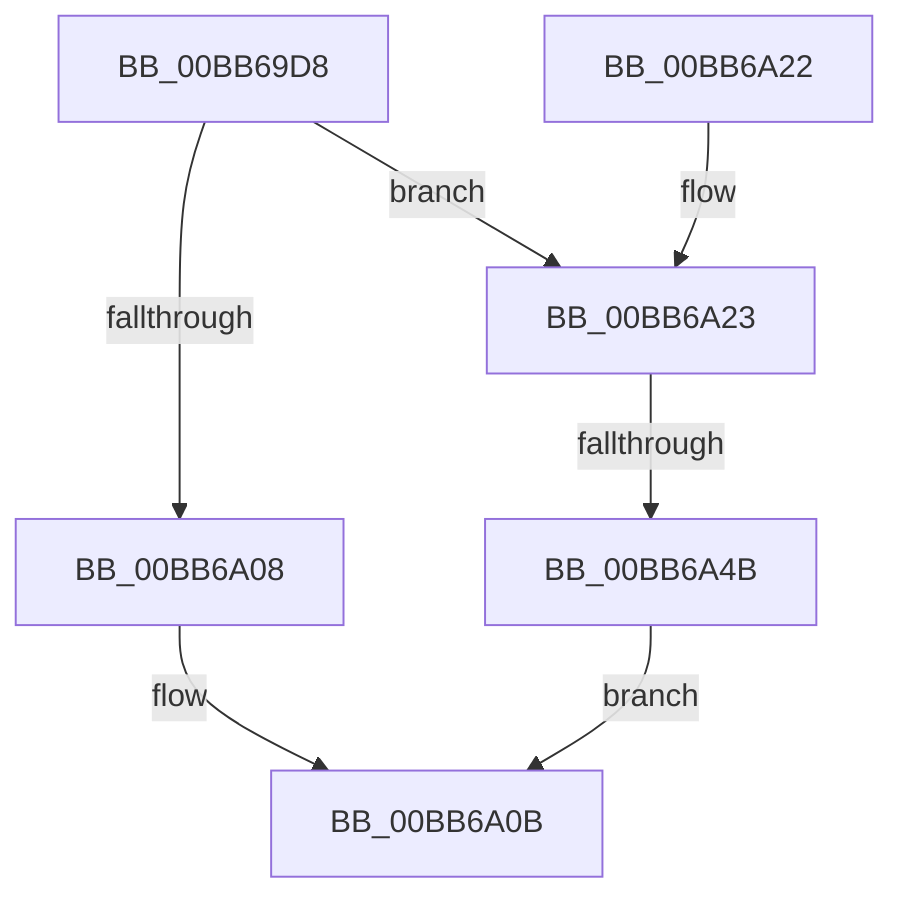

# IovpCompleteRequest1

- RVA: `0x00BB69D8`–`0x00BB6A55` (길이 `125` bytes)
- VA: `0x0000000140BB69D8`
- 실행 섹션: `PAGEVRFY`
- PDB 이름 있음: `예`; PDB Function 태그: `예`
- unwind 정보 RVA: `0x000B07D0`
- 디코드: `39`개 명령, `125/125` bytes 표시
- 미해석 바이트: `0` (있으면 어셈블리에 `.byte`로 보존)

> 이 문서는 커널 이미지의 기계어와 PDB 기호를 분석해 생성했습니다. 4번과 5번은 함수 원형과 자료형을 바이너리 사용 방식에서 추정한 C 해석이며 원본 소스 복구 결과는 아닙니다.

## 1. Dependencies

- 직접 호출 지점: **2**; 고유 호출 대상: **2**
- 직접 호출자로 확인된 함수: **1**
- RIP 상대 이미지 참조: **0**

### Outgoing calls
- `0x00BB69FB` → [VfIrpDatabaseEntryFindAndLock](VfIrpDatabaseEntryFindAndLock_function_00BB7074.md) (function, `0x00BB7074`)
- `0x00BB6A4E` → [VfIrpDatabaseEntryReleaseLock](VfIrpDatabaseEntryReleaseLock_function_00BB3FD4.md) (function, `0x00BB3FD4`)

### Direct callers
- [IovCompleteRequest](IovCompleteRequest_function_00BB6758.md) at `0x00BB6822`

### Static image references
- 디코드된 RIP-relative 메모리 참조가 없습니다.

## 2. Other-region calls and transfers

- 다른 실행 섹션으로 향하는 call: **0**
- call이 아닌 외부 분기/꼬리 이동: **1**
  - `0x00BB6A45` → [sub_00BBBCB2](Unknown_function_00BBBCB2.md) (`tail-transfer`)

## 3. Assembly (complete function range)

```asm
00BB69D8  48 89 5C 24 08                  mov qword ptr [rsp + 8], rbx
00BB69DD  48 89 6C 24 10                  mov qword ptr [rsp + 0x10], rbp
00BB69E2  56                              push rsi
00BB69E3  57                              push rdi
00BB69E4  41 54                           push r12
00BB69E6  41 56                           push r14
00BB69E8  41 57                           push r15
00BB69EA  48 83 EC 40                     sub rsp, 0x40
00BB69EE  49 8B F0                        mov rsi, r8
00BB69F1  44 8A FA                        mov r15b, dl
00BB69F4  48 8B F9                        mov rdi, rcx
00BB69F7  45 0F 20 C6                     mov r14, cr8
00BB69FB  E8 74 06 00 00                  call 0x140bb7074
00BB6A00  48 8B D8                        mov rbx, rax
00BB6A03  48 85 C0                        test rax, rax
00BB6A06  75 1B                           jne 0x140bb6a23
00BB6A08  48 21 06                        and qword ptr [rsi], rax
00BB6A0B  48 8B 5C 24 70                  mov rbx, qword ptr [rsp + 0x70]
00BB6A10  48 8B 6C 24 78                  mov rbp, qword ptr [rsp + 0x78]
00BB6A15  48 83 C4 40                     add rsp, 0x40
00BB6A19  41 5F                           pop r15
00BB6A1B  41 5E                           pop r14
00BB6A1D  41 5C                           pop r12
00BB6A1F  5F                              pop rdi
00BB6A20  5E                              pop rsi
00BB6A21  C3                              ret
00BB6A22  CC                              int3
00BB6A23  44 88 70 3D                     mov byte ptr [rax + 0x3d], r14b
00BB6A27  33 ED                           xor ebp, ebp
00BB6A29  44 88 70 3C                     mov byte ptr [rax + 0x3c], r14b
00BB6A2D  4C 8B B0 F0 00 00 00            mov r14, qword ptr [rax + 0xf0]
00BB6A34  4C 89 36                        mov qword ptr [rsi], r14
00BB6A37  48 89 5E 08                     mov qword ptr [rsi + 8], rbx
00BB6A3B  4C 8B A7 B8 00 00 00            mov r12, qword ptr [rdi + 0xb8]
00BB6A42  4D 85 F6                        test r14, r14
00BB6A45  0F 85 67 52 00 00               jne 0x140bbbcb2
00BB6A4B  48 8B CB                        mov rcx, rbx
00BB6A4E  E8 81 D5 FF FF                  call 0x140bb3fd4
00BB6A53  EB B6                           jmp 0x140bb6a0b
```

## 4. C-style interpretation (structured pseudocode)

```c
__int64 __fastcall IovpCompleteRequest1(__int64 a1, unsigned __int8 a2, __int64 a3)
{
    __int64 result;
    __int64 v_rbp;
    __int64 v_rsp;
    unsigned __int64 v_stack_p10;
    unsigned __int64 v_stack_p8;

    v_stack_p8 = v_rbx;
    v_stack_p10 = v_rbp;
    v_rsp = (v_rsp) - (64);
    result = VfIrpDatabaseEntryFindAndLock(a1, a2, a3, a4);
    if (result != 0) goto loc_00BB6A23;
loc_00BB6A0B:
    v_rsp = (v_rsp) + (64);
    return result;
loc_00BB6A23:
    *(unsigned __int8 *)(result + 61) = (unsigned __int8)(v_cr8);
    v_rbp = 0;
    *(unsigned __int8 *)(result + 60) = (unsigned __int8)(v_cr8);
    *(unsigned __int64 *)(a3) = *(unsigned __int64 *)(result + 240);
    *(unsigned __int64 *)(a3 + 8) = v_stack_p8;
    result = VfIrpDatabaseEntryReleaseLock(v_stack_p8, a2, a3, a4);
    goto loc_00BB6A0B;
}
```

## 5. (Beta) C Style

```c
int64_t IovpCompleteRequest1(void *Arg1, uint8_t Arg2, void *Arg3)
{
    uint8_t *arg1 = (uint8_t *)Arg1;
    uint8_t *arg3 = (uint8_t *)Arg3;

    int64_t result;
    int64_t local_rbp;
    int64_t local_rsp;
    uint64_t v_stack_p10;
    uint64_t v_stack_p8;

    v_stack_p8 = local_rbx;
    v_stack_p10 = local_rbp;
    local_rsp = (local_rsp) - (64);
    result = VfIrpDatabaseEntryFindAndLock(Arg1, Arg2, Arg3, a4);
    if (result != 0) goto loc_00BB6A23;
loc_00BB6A0B:
    local_rsp = (local_rsp) + (64);
    return result;
loc_00BB6A23:
    *(uint8_t *)(result + 0x3D) = (uint8_t)(v_cr8);
    local_rbp = 0;
    *(uint8_t *)(result + 0x3C) = (uint8_t)(v_cr8);
    *(uint64_t *)(arg3) = *(uint64_t *)(result + 0xF0);
    *(uint64_t *)(arg3 + 0x8) = v_stack_p8;
    result = VfIrpDatabaseEntryReleaseLock(v_stack_p8, Arg2, Arg3, a4);
    goto loc_00BB6A0B;
}
```

### 관측된 메모리 오프셋

구조체 형식이 확인되지 않은 접근은 인자 기준의 오프셋으로만 기록했습니다.

| 기준 인자 | 오프셋 표현 | 폭 (bit) | 접근 |
|---|---:|---:|---|
| `Arg1` | `+ 0xB8` | `64` | `R` |
| `Arg3` | `+ 0x0` | `64` | `R/W` |
| `Arg3` | `+ 0x0` | `64` | `W` |
| `Arg3` | `+ 0x8` | `64` | `W` |

## 6. Execution-region graph

[열기: 2D/3D 그래프와 함수 탐색 컨트롤 패널](../../../control-panel.html?section=pagevrfy&rva=0x00BB69D8&view=graph)

- 2D 그래프는 위에서 아래로 흐르고, 3D 그래프는 빈 공간을 드래그해 회전합니다. Shift+드래그는 이동, 휠은 확대·축소, 함수 노드 선택은 대상 보고서 이동입니다.

### Static fallback


