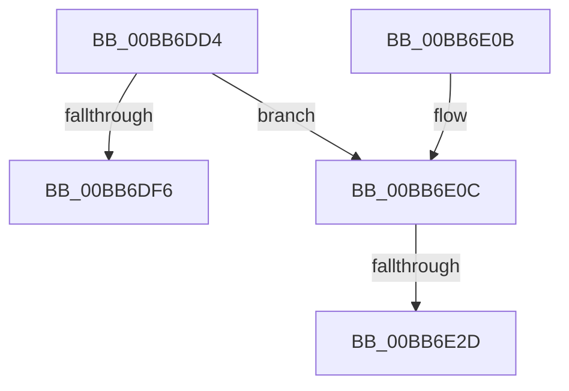

# IovpCompleteRequest2

- RVA: `0x00BB6DD4`–`0x00BB6E38` (길이 `100` bytes)
- VA: `0x0000000140BB6DD4`
- 실행 섹션: `PAGEVRFY`
- PDB 이름 있음: `예`; PDB Function 태그: `예`
- unwind 정보 RVA: `0x000B0834`
- 디코드: `35`개 명령, `100/100` bytes 표시
- 미해석 바이트: `0` (있으면 어셈블리에 `.byte`로 보존)

> 이 문서는 커널 이미지의 기계어와 PDB 기호를 분석해 생성했습니다. 4번과 5번은 함수 원형과 자료형을 바이너리 사용 방식에서 추정한 C 해석이며 원본 소스 복구 결과는 아닙니다.

## 1. Dependencies

- 직접 호출 지점: **2**; 고유 호출 대상: **2**
- 직접 호출자로 확인된 함수: **1**
- RIP 상대 이미지 참조: **0**

### Outgoing calls
- `0x00BB6E14` → [KeAcquireSpinLockRaiseToDpc](../../text/20/KeAcquireSpinLockRaiseToDpc_function_00208470.md) (function, `0x00208470`)
- `0x00BB6E2D` → [ViWdIrpBeforeCompletionRoutine](../BA/ViWdIrpBeforeCompletionRoutine_function_00BACB7C.md) (function, `0x00BACB7C`)

### Direct callers
- [IovpLocalCompletionRoutine](IovpLocalCompletionRoutine_function_00BB6B60.md) at `0x00BB6BF0`

### Static image references
- 디코드된 RIP-relative 메모리 참조가 없습니다.

## 2. Other-region calls and transfers

- 다른 실행 섹션으로 향하는 call: **1**
  - `0x00BB6E14` → [KeAcquireSpinLockRaiseToDpc](../../text/20/KeAcquireSpinLockRaiseToDpc_function_00208470.md) (`PAGEVRFY` → `.text`)
- call이 아닌 외부 분기/꼬리 이동: **2**
  - `0x00BB6E27` → [sub_00BBBE00](Unknown_function_00BBBE00.md) (`tail-transfer`)
  - `0x00BB6E33` → [sub_00BBBE00](Unknown_function_00BBBE00.md) (`tail-transfer`)

## 3. Assembly (complete function range)

```asm
00BB6DD4  48 89 5C 24 08                  mov qword ptr [rsp + 8], rbx
00BB6DD9  55                              push rbp
00BB6DDA  56                              push rsi
00BB6DDB  57                              push rdi
00BB6DDC  41 54                           push r12
00BB6DDE  41 55                           push r13
00BB6DE0  41 56                           push r14
00BB6DE2  41 57                           push r15
00BB6DE4  48 83 EC 30                     sub rsp, 0x30
00BB6DE8  4C 8B 32                        mov r14, qword ptr [rdx]
00BB6DEB  4C 8B FA                        mov r15, rdx
00BB6DEE  48 8B D9                        mov rbx, rcx
00BB6DF1  4D 85 F6                        test r14, r14
00BB6DF4  75 16                           jne 0x140bb6e0c
00BB6DF6  48 8B 5C 24 70                  mov rbx, qword ptr [rsp + 0x70]
00BB6DFB  48 83 C4 30                     add rsp, 0x30
00BB6DFF  41 5F                           pop r15
00BB6E01  41 5E                           pop r14
00BB6E03  41 5D                           pop r13
00BB6E05  41 5C                           pop r12
00BB6E07  5F                              pop rdi
00BB6E08  5E                              pop rsi
00BB6E09  5D                              pop rbp
00BB6E0A  C3                              ret
00BB6E0B  CC                              int3
00BB6E0C  48 8B 7A 08                     mov rdi, qword ptr [rdx + 8]
00BB6E10  48 8D 4F 08                     lea rcx, [rdi + 8]
00BB6E14  E8 57 16 65 FF                  call 0x140208470
00BB6E19  48 8D 8F F8 00 00 00            lea rcx, [rdi + 0xf8]
00BB6E20  88 47 10                        mov byte ptr [rdi + 0x10], al
00BB6E23  48 83 39 00                     cmp qword ptr [rcx], 0
00BB6E27  0F 84 D3 4F 00 00               je 0x140bbbe00
00BB6E2D  E8 4A 5D FF FF                  call 0x140bacb7c
00BB6E32  90                              nop
00BB6E33  E9 C8 4F 00 00                  jmp 0x140bbbe00
```

## 4. C-style interpretation (structured pseudocode)

```c
__int64 __fastcall IovpCompleteRequest2(__int64 a1, __int64 a2)
{
    __int64 result;
    __int64 v_rsp;
    unsigned __int64 v_stack_p8;

    v_stack_p8 = v_rbx;
    v_rsp = (v_rsp) - (48);
    if (*(unsigned __int64 *)(a2) != 0) goto loc_00BB6E0C;
    v_rsp = (v_rsp) + (48);
    return result;
loc_00BB6E0C:
    result = KeAcquireSpinLockRaiseToDpc(*(unsigned __int64 *)(a2 + 8) + 8, a2, a3, a4);
    *(unsigned __int8 *)(*(unsigned __int64 *)(a2 + 8) + 16) = (unsigned __int8)(result);
    result = ViWdIrpBeforeCompletionRoutine(*(unsigned __int64 *)(a2 + 8) + 248, a2, a3, a4);
}
```

## 5. (Beta) C Style

```c
int64_t IovpCompleteRequest2(int64_t Arg1, void *Arg2)
{
    uint8_t *arg2 = (uint8_t *)Arg2;

    int64_t result;
    int64_t local_rsp;
    uint64_t v_stack_p8;

    v_stack_p8 = local_rbx;
    local_rsp = (local_rsp) - (48);
    if (*(uint64_t *)(arg2) != 0) goto loc_00BB6E0C;
    local_rsp = (local_rsp) + (48);
    return result;
loc_00BB6E0C:
    result = KeAcquireSpinLockRaiseToDpc(*(uint64_t *)(arg2 + 0x8) + 8, Arg2, a3, a4);
    *(uint8_t *)(*(uint64_t *)(arg2 + 0x8) + 0x10) = (uint8_t)(result);
    result = ViWdIrpBeforeCompletionRoutine(*(uint64_t *)(arg2 + 0x8) + 248, Arg2, a3, a4);
}
```

### 관측된 메모리 오프셋

구조체 형식이 확인되지 않은 접근은 인자 기준의 오프셋으로만 기록했습니다.

| 기준 인자 | 오프셋 표현 | 폭 (bit) | 접근 |
|---|---:|---:|---|
| `Arg2` | `+ 0x0` | `64` | `R` |
| `Arg2` | `+ 0x8` | `64` | `R` |

## 6. Execution-region graph

[열기: 2D/3D 그래프와 함수 탐색 컨트롤 패널](../../../control-panel.html?section=pagevrfy&rva=0x00BB6DD4&view=graph)

- 2D 그래프는 위에서 아래로 흐르고, 3D 그래프는 빈 공간을 드래그해 회전합니다. Shift+드래그는 이동, 휠은 확대·축소, 함수 노드 선택은 대상 보고서 이동입니다.

### Static fallback


