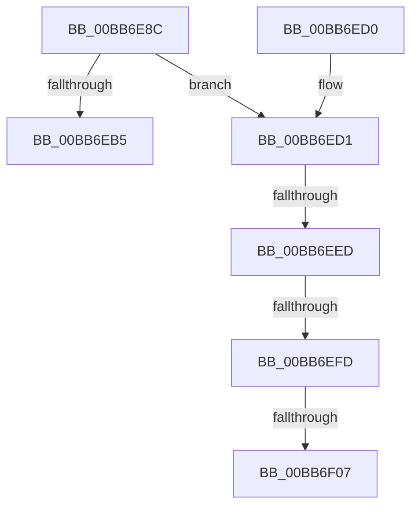

# IovpCompleteRequest3

- RVA: `0x00BB6E8C`–`0x00BB6F0F` (길이 `131` bytes)
- VA: `0x0000000140BB6E8C`
- 실행 섹션: `PAGEVRFY`
- PDB 이름 있음: `예`; PDB Function 태그: `예`
- unwind 정보 RVA: `0x0006F600`
- 디코드: `35`개 명령, `131/131` bytes 표시
- 미해석 바이트: `0` (있으면 어셈블리에 `.byte`로 보존)

> 이 문서는 커널 이미지의 기계어와 PDB 기호를 분석해 생성했습니다. 4번과 5번은 함수 원형과 자료형을 바이너리 사용 방식에서 추정한 C 해석이며 원본 소스 복구 결과는 아닙니다.

## 1. Dependencies

- 직접 호출 지점: **1**; 고유 호출 대상: **1**
- 직접 호출자로 확인된 함수: **1**
- RIP 상대 이미지 참조: **0**

### Outgoing calls
- `0x00BB6ED9` → [KeAcquireSpinLockRaiseToDpc](../../text/20/KeAcquireSpinLockRaiseToDpc_function_00208470.md) (function, `0x00208470`)

### Direct callers
- [IovpLocalCompletionRoutine](IovpLocalCompletionRoutine_function_00BB6B60.md) at `0x00BB6C87`

### Static image references
- 디코드된 RIP-relative 메모리 참조가 없습니다.

## 2. Other-region calls and transfers

- 다른 실행 섹션으로 향하는 call: **1**
  - `0x00BB6ED9` → [KeAcquireSpinLockRaiseToDpc](../../text/20/KeAcquireSpinLockRaiseToDpc_function_00208470.md) (`PAGEVRFY` → `.text`)
- call이 아닌 외부 분기/꼬리 이동: **4**
  - `0x00BB6EE7` → [sub_00BBC0B2](Unknown_function_00BBC0B2.md) (`tail-transfer`)
  - `0x00BB6EF7` → [sub_00BBC0B2](Unknown_function_00BBC0B2.md) (`tail-transfer`)
  - `0x00BB6F01` → [sub_00BBC0B2](Unknown_function_00BBC0B2.md) (`tail-transfer`)
  - `0x00BB6F0A` → [sub_00BBC0B2](Unknown_function_00BBC0B2.md) (`tail-transfer`)

## 3. Assembly (complete function range)

```asm
00BB6E8C  48 8B C4                        mov rax, rsp
00BB6E8F  48 89 58 08                     mov qword ptr [rax + 8], rbx
00BB6E93  48 89 68 10                     mov qword ptr [rax + 0x10], rbp
00BB6E97  48 89 70 18                     mov qword ptr [rax + 0x18], rsi
00BB6E9B  48 89 78 20                     mov qword ptr [rax + 0x20], rdi
00BB6E9F  41 56                           push r14
00BB6EA1  48 83 EC 20                     sub rsp, 0x20
00BB6EA5  33 FF                           xor edi, edi
00BB6EA7  49 8B D8                        mov rbx, r8
00BB6EAA  4C 8B F2                        mov r14, rdx
00BB6EAD  48 8B F1                        mov rsi, rcx
00BB6EB0  49 39 38                        cmp qword ptr [r8], rdi
00BB6EB3  75 1C                           jne 0x140bb6ed1
00BB6EB5  48 8B 5C 24 30                  mov rbx, qword ptr [rsp + 0x30]
00BB6EBA  48 8B 6C 24 38                  mov rbp, qword ptr [rsp + 0x38]
00BB6EBF  48 8B 74 24 40                  mov rsi, qword ptr [rsp + 0x40]
00BB6EC4  48 8B 7C 24 48                  mov rdi, qword ptr [rsp + 0x48]
00BB6EC9  48 83 C4 20                     add rsp, 0x20
00BB6ECD  41 5E                           pop r14
00BB6ECF  C3                              ret
00BB6ED0  CC                              int3
00BB6ED1  49 8B 68 08                     mov rbp, qword ptr [r8 + 8]
00BB6ED5  48 8D 4D 08                     lea rcx, [rbp + 8]
00BB6ED9  E8 92 15 65 FF                  call 0x140208470
00BB6EDE  88 45 10                        mov byte ptr [rbp + 0x10], al
00BB6EE1  8A 46 42                        mov al, byte ptr [rsi + 0x42]
00BB6EE4  38 46 43                        cmp byte ptr [rsi + 0x43], al
00BB6EE7  0F 8F C5 51 00 00               jg 0x140bbc0b2
00BB6EED  48 8B 86 B8 00 00 00            mov rax, qword ptr [rsi + 0xb8]
00BB6EF4  80 38 1B                        cmp byte ptr [rax], 0x1b
00BB6EF7  0F 85 B5 51 00 00               jne 0x140bbc0b2
00BB6EFD  80 78 01 02                     cmp byte ptr [rax + 1], 2
00BB6F01  0F 85 AB 51 00 00               jne 0x140bbc0b2
00BB6F07  40 B7 01                        mov dil, 1
00BB6F0A  E9 A3 51 00 00                  jmp 0x140bbc0b2
```

## 4. C-style interpretation (structured pseudocode)

```c
__int64 __fastcall IovpCompleteRequest3(__int64 a1, __int64 a2, __int64 a3)
{
    __int64 result;
    __int64 v_rdi;
    __int64 v_rsp;
    unsigned __int64 v_stack_p10;
    unsigned __int64 v_stack_p18;
    unsigned __int64 v_stack_p20;
    unsigned __int64 v_stack_p8;

    *(unsigned __int64 *)(v_rsp + 8) = v_rbx;
    *(unsigned __int64 *)(v_rsp + 16) = v_rbp;
    *(unsigned __int64 *)(v_rsp + 24) = v_rsi;
    *(unsigned __int64 *)(v_rsp + 32) = v_rdi;
    v_rsp = (v_rsp) - (32);
    v_rdi = 0;
    if ((*(unsigned __int64 *)(a3)) != 0) goto loc_00BB6ED1;
    v_rsp = (v_rsp) + (32);
    return v_rsp;
loc_00BB6ED1:
    result = KeAcquireSpinLockRaiseToDpc(*(unsigned __int64 *)(a3 + 8) + 8, a2, a3, a4);
    *(unsigned __int8 *)(*(unsigned __int64 *)(a3 + 8) + 16) = (unsigned __int8)(result);
}
```

## 5. (Beta) C Style

```c
int64_t IovpCompleteRequest3(void *Arg1, int64_t Arg2, void *Arg3)
{
    uint8_t *arg1 = (uint8_t *)Arg1;
    uint8_t *arg3 = (uint8_t *)Arg3;

    int64_t result;
    int64_t local_rdi;
    int64_t local_rsp;
    uint64_t v_stack_p10;
    uint64_t v_stack_p18;
    uint64_t v_stack_p20;
    uint64_t v_stack_p8;

    *(uint64_t *)(local_rsp + 0x8) = local_rbx;
    *(uint64_t *)(local_rsp + 0x10) = local_rbp;
    *(uint64_t *)(local_rsp + 0x18) = local_rsi;
    *(uint64_t *)(local_rsp + 0x20) = local_rdi;
    local_rsp = (local_rsp) - (32);
    local_rdi = 0;
    if ((*(uint64_t *)(arg3)) != 0) goto loc_00BB6ED1;
    local_rsp = (local_rsp) + (32);
    return local_rsp;
loc_00BB6ED1:
    result = KeAcquireSpinLockRaiseToDpc(*(uint64_t *)(arg3 + 0x8) + 8, Arg2, Arg3, a4);
    *(uint8_t *)(*(uint64_t *)(arg3 + 0x8) + 0x10) = (uint8_t)(result);
}
```

### 관측된 메모리 오프셋

구조체 형식이 확인되지 않은 접근은 인자 기준의 오프셋으로만 기록했습니다.

| 기준 인자 | 오프셋 표현 | 폭 (bit) | 접근 |
|---|---:|---:|---|
| `Arg1` | `+ 0x42` | `8` | `R` |
| `Arg1` | `+ 0x43` | `8` | `R` |
| `Arg1` | `+ 0xB8` | `64` | `R` |
| `Arg3` | `+ 0x0` | `64` | `R` |
| `Arg3` | `+ 0x8` | `64` | `R` |

## 6. Execution-region graph

[열기: 2D/3D 그래프와 함수 탐색 컨트롤 패널](../../../control-panel.html?section=pagevrfy&rva=0x00BB6E8C&view=graph)

- 2D 그래프는 위에서 아래로 흐르고, 3D 그래프는 빈 공간을 드래그해 회전합니다. Shift+드래그는 이동, 휠은 확대·축소, 함수 노드 선택은 대상 보고서 이동입니다.

### Static fallback


