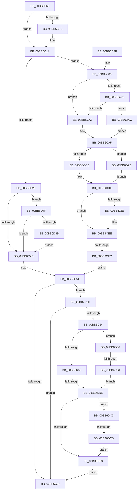

# IovpLocalCompletionRoutine

- RVA: `0x00BB6B60`–`0x00BB6DCD` (길이 `621` bytes)
- VA: `0x0000000140BB6B60`
- 실행 섹션: `PAGEVRFY`
- PDB 이름 있음: `예`; PDB Function 태그: `예`
- unwind 정보 RVA: `0x000B0808`
- 디코드: `168`개 명령, `621/621` bytes 표시
- 미해석 바이트: `0` (있으면 어셈블리에 `.byte`로 보존)

> 이 문서는 커널 이미지의 기계어와 PDB 기호를 분석해 생성했습니다. 4번과 5번은 함수 원형과 자료형을 바이너리 사용 방식에서 추정한 C 해석이며 원본 소스 복구 결과는 아닙니다.

## 1. Dependencies

- 직접 호출 지점: **8**; 고유 호출 대상: **7**
- 직접 호출자로 확인된 함수: **0**
- RIP 상대 이미지 참조: **4**

### Outgoing calls
- `0x00BB6BF0` → [IovpCompleteRequest2](IovpCompleteRequest2_function_00BB6DD4.md) (function, `0x00BB6DD4`)
- `0x00BB6C42` → [VfPendingMoreProcessingRequired](VfPendingMoreProcessingRequired_function_00BB6FF0.md) (function, `0x00BB6FF0`)
- `0x00BB6C55` → [IovpCompleteRequest5](IovpCompleteRequest5_function_00BB6E40.md) (function, `0x00BB6E40`)
- `0x00BB6C87` → [IovpCompleteRequest3](IovpCompleteRequest3_function_00BB6E8C.md) (function, `0x00BB6E8C`)
- `0x00BB6CBE` → [VfPendingMoreProcessingRequired](VfPendingMoreProcessingRequired_function_00BB6FF0.md) (function, `0x00BB6FF0`)
- `0x00BB6CD7` → [guard_dispatch_icall](../../text/6B/guard_dispatch_icall_function_006BAAD0.md) (function, `0x006BAAD0`)
- `0x00BB6CE9` → [VfIoCompletionCheckState](VfIoCompletionCheckState_function_00BB70FC.md) (function, `0x00BB70FC`)
- `0x00BB6DAC` → [ViIoCallbackSnapState](ViIoCallbackSnapState_function_00BB7EE4.md) (function, `0x00BB7EE4`)

### Direct callers
- 이 함수 시작 RVA로 연결되는 직접 call은 확인되지 않았습니다. 간접 호출은 완전히 역산할 수 없습니다.

### Static image references
- `0x00BB6C8C` → RVA `0x00F04A20` (`.data`; read)
- `0x00BB6C96` → RVA `0x00FFDAB8` (`PAGEVRFD`; read)
- `0x00BB6D6B` → RVA `0x00BB6B60` (`IovpLocalCompletionRoutine`; read)
- `0x00BB6DA0` → RVA `0x00BB6FF0` (`VfPendingMoreProcessingRequired`; read)

## 2. Other-region calls and transfers

- 다른 실행 섹션으로 향하는 call: **1**
  - `0x00BB6CD7` → [guard_dispatch_icall](../../text/6B/guard_dispatch_icall_function_006BAAD0.md) (`PAGEVRFY` → `.text`)
- call이 아닌 외부 분기/꼬리 이동: **4**
  - `0x00BB6CF6` → [sub_00BBBD62](Unknown_function_00BBBD62.md) (`tail-transfer`)
  - `0x00BB6D58` → [sub_00BBBD62 + 0x91](Unknown_function_00BBBD62.md) (`tail-transfer`)
  - `0x00BB6DBB` → [sub_00BBBD62 + 0x91](Unknown_function_00BBBD62.md) (`tail-transfer`)
  - `0x00BB6DC5` → [sub_00BBBD62 + 0x91](Unknown_function_00BBBD62.md) (`tail-transfer`)

## 3. Assembly (complete function range)

```asm
00BB6B60  48 89 5C 24 08                  mov qword ptr [rsp + 8], rbx
00BB6B65  48 89 6C 24 20                  mov qword ptr [rsp + 0x20], rbp
00BB6B6A  56                              push rsi
00BB6B6B  57                              push rdi
00BB6B6C  41 54                           push r12
00BB6B6E  41 55                           push r13
00BB6B70  41 56                           push r14
00BB6B72  48 83 EC 30                     sub rsp, 0x30
00BB6B76  41 8A 40 21                     mov al, byte ptr [r8 + 0x21]
00BB6B7A  48 8B FA                        mov rdi, rdx
00BB6B7D  49 8B 18                        mov rbx, qword ptr [r8]
00BB6B80  4C 8B E9                        mov r13, rcx
00BB6B83  48 8B CF                        mov rcx, rdi
00BB6B86  49 8B F0                        mov rsi, r8
00BB6B89  88 43 01                        mov byte ptr [rbx + 1], al
00BB6B8C  41 8A 40 22                     mov al, byte ptr [r8 + 0x22]
00BB6B90  88 43 02                        mov byte ptr [rbx + 2], al
00BB6B93  8A 43 03                        mov al, byte ptr [rbx + 3]
00BB6B96  24 02                           and al, 2
00BB6B98  41 0A 40 23                     or al, byte ptr [r8 + 0x23]
00BB6B9C  88 43 03                        mov byte ptr [rbx + 3], al
00BB6B9F  49 8B 40 28                     mov rax, qword ptr [r8 + 0x28]
00BB6BA3  48 89 43 08                     mov qword ptr [rbx + 8], rax
00BB6BA7  49 8B 40 30                     mov rax, qword ptr [r8 + 0x30]
00BB6BAB  48 89 43 10                     mov qword ptr [rbx + 0x10], rax
00BB6BAF  49 8B 40 38                     mov rax, qword ptr [r8 + 0x38]
00BB6BB3  48 89 43 18                     mov qword ptr [rbx + 0x18], rax
00BB6BB7  49 8B 40 40                     mov rax, qword ptr [r8 + 0x40]
00BB6BBB  48 89 43 20                     mov qword ptr [rbx + 0x20], rax
00BB6BBF  49 8B 40 50                     mov rax, qword ptr [r8 + 0x50]
00BB6BC3  48 89 43 30                     mov qword ptr [rbx + 0x30], rax
00BB6BC7  49 8B 40 18                     mov rax, qword ptr [r8 + 0x18]
00BB6BCB  48 89 43 38                     mov qword ptr [rbx + 0x38], rax
00BB6BCF  49 8B 40 08                     mov rax, qword ptr [r8 + 8]
00BB6BD3  48 89 43 40                     mov qword ptr [rbx + 0x40], rax
00BB6BD7  44 8A 72 42                     mov r14b, byte ptr [rdx + 0x42]
00BB6BDB  44 8A 62 43                     mov r12b, byte ptr [rdx + 0x43]
00BB6BDF  41 FE C6                        inc r14b
00BB6BE2  49 8B 50 10                     mov rdx, qword ptr [r8 + 0x10]
00BB6BE6  44 88 74 24 68                  mov byte ptr [rsp + 0x68], r14b
00BB6BEB  44 88 64 24 70                  mov byte ptr [rsp + 0x70], r12b
00BB6BF0  E8 DF 01 00 00                  call 0x140bb6dd4
00BB6BF5  33 ED                           xor ebp, ebp
00BB6BF7  80 3B 16                        cmp byte ptr [rbx], 0x16
00BB6BFA  74 1E                           je 0x140bb6c1a
00BB6BFC  8A 43 03                        mov al, byte ptr [rbx + 3]
00BB6BFF  24 02                           and al, 2
00BB6C01  66 89 6B 01                     mov word ptr [rbx + 1], bp
00BB6C05  0C 10                           or al, 0x10
00BB6C07  48 89 6B 08                     mov qword ptr [rbx + 8], rbp
00BB6C0B  88 43 03                        mov byte ptr [rbx + 3], al
00BB6C0E  48 89 6B 10                     mov qword ptr [rbx + 0x10], rbp
00BB6C12  48 89 6B 18                     mov qword ptr [rbx + 0x18], rbp
00BB6C16  48 89 6B 30                     mov qword ptr [rbx + 0x30], rbp
00BB6C1A  48 8B 53 38                     mov rdx, qword ptr [rbx + 0x38]
00BB6C1E  48 85 D2                        test rdx, rdx
00BB6C21  75 5D                           jne 0x140bb6c80
00BB6C23  40 38 6F 41                     cmp byte ptr [rdi + 0x41], bpl
00BB6C27  0F 85 52 01 00 00               jne 0x140bb6d7f
00BB6C2D  48 8B 43 40                     mov rax, qword ptr [rbx + 0x40]
00BB6C31  45 33 C9                        xor r9d, r9d
00BB6C34  4C 8B C3                        mov r8, rbx
00BB6C37  48 89 44 24 20                  mov qword ptr [rsp + 0x20], rax
00BB6C3C  48 8B D7                        mov rdx, rdi
00BB6C3F  49 8B CD                        mov rcx, r13
00BB6C42  E8 A9 03 00 00                  call 0x140bb6ff0
00BB6C47  F7 D8                           neg eax
00BB6C49  1B ED                           sbb ebp, ebp
00BB6C4B  81 E5 16 00 00 C0               and ebp, 0xc0000016
00BB6C51  48 8B 4E 10                     mov rcx, qword ptr [rsi + 0x10]
00BB6C55  E8 E6 01 00 00                  call 0x140bb6e40
00BB6C5A  81 FD 16 00 00 C0               cmp ebp, 0xc0000016
00BB6C60  0F 85 A5 00 00 00               jne 0x140bb6d0b
00BB6C66  48 8B 5C 24 60                  mov rbx, qword ptr [rsp + 0x60]
00BB6C6B  8B C5                           mov eax, ebp
00BB6C6D  48 8B 6C 24 78                  mov rbp, qword ptr [rsp + 0x78]
00BB6C72  48 83 C4 30                     add rsp, 0x30
00BB6C76  41 5E                           pop r14
00BB6C78  41 5D                           pop r13
00BB6C7A  41 5C                           pop r12
00BB6C7C  5F                              pop rdi
00BB6C7D  5E                              pop rsi
00BB6C7E  C3                              ret
00BB6C7F  CC                              int3
00BB6C80  4C 8B 46 10                     mov r8, qword ptr [rsi + 0x10]
00BB6C84  48 8B CF                        mov rcx, rdi
00BB6C87  E8 00 02 00 00                  call 0x140bb6e8c
00BB6C8C  8B 05 8E DD 34 00               mov eax, dword ptr [rip + 0x34dd8e]
00BB6C92  A8 10                           test al, 0x10
00BB6C94  74 0C                           je 0x140bb6ca2
00BB6C96  39 2D 1C 6E 44 00               cmp dword ptr [rip + 0x446e1c], ebp
00BB6C9C  0F 85 0A 01 00 00               jne 0x140bb6dac
00BB6CA2  4C 8B F5                        mov r14, rbp
00BB6CA5  4C 8B 63 38                     mov r12, qword ptr [rbx + 0x38]
00BB6CA9  4C 8B C3                        mov r8, rbx
00BB6CAC  48 8B 6B 40                     mov rbp, qword ptr [rbx + 0x40]
00BB6CB0  4D 8B CC                        mov r9, r12
00BB6CB3  48 8B D7                        mov rdx, rdi
00BB6CB6  48 89 6C 24 20                  mov qword ptr [rsp + 0x20], rbp
00BB6CBB  49 8B CD                        mov rcx, r13
00BB6CBE  E8 2D 03 00 00                  call 0x140bb6ff0
00BB6CC3  85 C0                           test eax, eax
00BB6CC5  0F 85 D0 00 00 00               jne 0x140bb6d9b
00BB6CCB  4C 8B C5                        mov r8, rbp
00BB6CCE  48 8B D7                        mov rdx, rdi
00BB6CD1  49 8B CD                        mov rcx, r13
00BB6CD4  49 8B C4                        mov rax, r12
00BB6CD7  E8 F4 3D B0 FF                  call 0x1406baad0
00BB6CDC  8B E8                           mov ebp, eax
00BB6CDE  4D 85 F6                        test r14, r14
00BB6CE1  74 0B                           je 0x140bb6cee
00BB6CE3  49 8B D4                        mov rdx, r12
00BB6CE6  49 8B CE                        mov rcx, r14
00BB6CE9  E8 0E 04 00 00                  call 0x140bb70fc
00BB6CEE  4C 8B 76 10                     mov r14, qword ptr [rsi + 0x10]
00BB6CF2  49 83 3E 00                     cmp qword ptr [r14], 0
00BB6CF6  0F 85 66 50 00 00               jne 0x140bbbd62
00BB6CFC  44 8A 64 24 70                  mov r12b, byte ptr [rsp + 0x70]
00BB6D01  44 8A 74 24 68                  mov r14b, byte ptr [rsp + 0x68]
00BB6D06  E9 46 FF FF FF                  jmp 0x140bb6c51
00BB6D0B  45 3A E6                        cmp r12b, r14b
00BB6D0E  0F 84 52 FF FF FF               je 0x140bb6c66
00BB6D14  48 83 C3 48                     add rbx, 0x48
00BB6D18  33 C9                           xor ecx, ecx
00BB6D1A  48 89 1E                        mov qword ptr [rsi], rbx
00BB6D1D  48 8B 43 40                     mov rax, qword ptr [rbx + 0x40]
00BB6D21  48 89 46 08                     mov qword ptr [rsi + 8], rax
00BB6D25  0F 10 03                        movups xmm0, xmmword ptr [rbx]
00BB6D28  0F 11 46 20                     movups xmmword ptr [rsi + 0x20], xmm0
00BB6D2C  0F 10 4B 10                     movups xmm1, xmmword ptr [rbx + 0x10]
00BB6D30  0F 11 4E 30                     movups xmmword ptr [rsi + 0x30], xmm1
00BB6D34  0F 10 43 20                     movups xmm0, xmmword ptr [rbx + 0x20]
00BB6D38  0F 11 46 40                     movups xmmword ptr [rsi + 0x40], xmm0
00BB6D3C  0F 10 4B 30                     movups xmm1, xmmword ptr [rbx + 0x30]
00BB6D40  0F 11 4E 50                     movups xmmword ptr [rsi + 0x50], xmm1
00BB6D44  F2 0F 10 43 40                  movsd xmm0, qword ptr [rbx + 0x40]
00BB6D49  F2 0F 11 46 60                  movsd qword ptr [rsi + 0x60], xmm0
00BB6D4E  8A 43 03                        mov al, byte ptr [rbx + 3]
00BB6D51  39 4F 30                        cmp dword ptr [rdi + 0x30], ecx
00BB6D54  7D 63                           jge 0x140bb6db9
00BB6D56  84 C0                           test al, al
00BB6D58  0F 88 95 50 00 00               js 0x140bbbdf3
00BB6D5E  38 4F 44                        cmp byte ptr [rdi + 0x44], cl
00BB6D61  75 60                           jne 0x140bb6dc3
00BB6D63  48 89 4E 18                     mov qword ptr [rsi + 0x18], rcx
00BB6D67  80 4B 03 E0                     or byte ptr [rbx + 3], 0xe0
00BB6D6B  48 8D 05 EE FD FF FF            lea rax, [rip - 0x212]
00BB6D72  48 89 73 40                     mov qword ptr [rbx + 0x40], rsi
00BB6D76  48 89 43 38                     mov qword ptr [rbx + 0x38], rax
00BB6D7A  E9 E7 FE FF FF                  jmp 0x140bb6c66
00BB6D7F  8A 47 42                        mov al, byte ptr [rdi + 0x42]
00BB6D82  38 47 43                        cmp byte ptr [rdi + 0x43], al
00BB6D85  0F 8F A2 FE FF FF               jg 0x140bb6c2d
00BB6D8B  48 8B 87 B8 00 00 00            mov rax, qword ptr [rdi + 0xb8]
00BB6D92  80 48 03 01                     or byte ptr [rax + 3], 1
00BB6D96  E9 92 FE FF FF                  jmp 0x140bb6c2d
00BB6D9B  BD 16 00 00 C0                  mov ebp, 0xc0000016
00BB6DA0  4C 8D 25 49 02 00 00            lea r12, [rip + 0x249]
00BB6DA7  E9 32 FF FF FF                  jmp 0x140bb6cde
00BB6DAC  E8 33 11 00 00                  call 0x140bb7ee4
00BB6DB1  4C 8B F0                        mov r14, rax
00BB6DB4  E9 EC FE FF FF                  jmp 0x140bb6ca5
00BB6DB9  A8 40                           test al, 0x40
00BB6DBB  0F 85 32 50 00 00               jne 0x140bbbdf3
00BB6DC1  EB 9B                           jmp 0x140bb6d5e
00BB6DC3  A8 20                           test al, 0x20
00BB6DC5  0F 85 28 50 00 00               jne 0x140bbbdf3
00BB6DCB  EB 96                           jmp 0x140bb6d63
```

## 4. C-style interpretation (structured pseudocode)

```c
__int64 __fastcall IovpLocalCompletionRoutine(__int64 a1, __int64 a2, __int64 a3, int a4)
{
    __int64 result;
    __int64 v_r14;
    __int64 v_rbp;
    __int64 v_rbx;
    __int64 v_rsp;
    unsigned __int64 v_stack_m38;
    unsigned __int8 v_stack_p10;
    unsigned __int8 v_stack_p18;
    unsigned __int64 v_stack_p20;
    unsigned __int8 v_stack_p68;
    unsigned __int8 v_stack_p70;
    unsigned __int64 v_stack_p8;

    v_stack_p8 = v_rbx;
    v_stack_p20 = v_rbp;
    v_rsp = (v_rsp) - (48);
    *(unsigned __int8 *)(*(unsigned __int64 *)(a3) + 1) = (unsigned __int8)(*(unsigned __int8 *)(a3 + 33));
    *(unsigned __int8 *)(*(unsigned __int64 *)(a3) + 2) = (unsigned __int8)(*(unsigned __int8 *)(a3 + 34));
    result = (unsigned __int8)((*(unsigned __int8 *)(*(unsigned __int64 *)(a3) + 3)) & (2));
    result = (unsigned __int8)((result) | (*(unsigned __int8 *)(a3 + 35)));
    *(unsigned __int8 *)(*(unsigned __int64 *)(a3) + 3) = (unsigned __int8)(result);
    *(unsigned __int64 *)(*(unsigned __int64 *)(a3) + 8) = *(unsigned __int64 *)(a3 + 40);
    *(unsigned __int64 *)(*(unsigned __int64 *)(a3) + 16) = *(unsigned __int64 *)(a3 + 48);
    *(unsigned __int64 *)(*(unsigned __int64 *)(a3) + 24) = *(unsigned __int64 *)(a3 + 56);
    *(unsigned __int64 *)(*(unsigned __int64 *)(a3) + 32) = *(unsigned __int64 *)(a3 + 64);
    *(unsigned __int64 *)(*(unsigned __int64 *)(a3) + 48) = *(unsigned __int64 *)(a3 + 80);
    *(unsigned __int64 *)(*(unsigned __int64 *)(a3) + 56) = *(unsigned __int64 *)(a3 + 24);
    *(unsigned __int64 *)(*(unsigned __int64 *)(a3) + 64) = *(unsigned __int64 *)(a3 + 8);
    v_r14 = (unsigned __int8)((*(unsigned __int8 *)(a2 + 66)) + 1);
    v_stack_p10 = (unsigned __int8)(v_r14);
    v_stack_p18 = (unsigned __int8)(*(unsigned __int8 *)(a2 + 67));
    result = IovpCompleteRequest2(a2, *(unsigned __int64 *)(a3 + 16), a3, a4);
    v_rbp = 0;
    if ((*(unsigned __int8 *)(*(unsigned __int64 *)(a3))) != 22) {
        result = *(unsigned __int8 *)(*(unsigned __int64 *)(a3) + 3);
        result = (unsigned __int8)((result) & (2));
        *(unsigned __int16 *)(*(unsigned __int64 *)(a3) + 1) = 0;
        result = (unsigned __int8)((result) | (16));
        *(unsigned __int64 *)(*(unsigned __int64 *)(a3) + 8) = 0;
        *(unsigned __int8 *)(*(unsigned __int64 *)(a3) + 3) = (unsigned __int8)(result);
        *(unsigned __int64 *)(*(unsigned __int64 *)(a3) + 16) = 0;
        *(unsigned __int64 *)(*(unsigned __int64 *)(a3) + 24) = 0;
        *(unsigned __int64 *)(*(unsigned __int64 *)(a3) + 48) = 0;
    }
    if (*(unsigned __int64 *)(*(unsigned __int64 *)(a3) + 56) != 0) goto loc_00BB6C80;
    if ((*(unsigned __int8 *)(a2 + 65)) != 0) goto loc_00BB6D7F;
loc_00BB6C2D:
    a4 = 0;
    v_stack_m38 = *(unsigned __int64 *)(*(unsigned __int64 *)(a3) + 64);
    result = VfPendingMoreProcessingRequired(a1, a2, *(unsigned __int64 *)(a3), a4);
    result = (unsigned int)(-(result));
    v_rbp = (unsigned int)((v_rbp) & (0xC0000016ULL));
loc_00BB6C51:
    result = IovpCompleteRequest5(*(unsigned __int64 *)(a3 + 16), a2, *(unsigned __int64 *)(a3), a4);
    if (((unsigned int)(v_rbp)) != 0xC0000016ULL) goto loc_00BB6D0B;
loc_00BB6C66:
    v_rsp = (v_rsp) + (48);
    return (unsigned int)((unsigned int)(v_rbp));
loc_00BB6C80:
    result = IovpCompleteRequest3(a2, a2, *(unsigned __int64 *)(a3 + 16), a4);
    if ((((unsigned __int8)((unsigned int)(*(unsigned int *)(v_rip + 3464590)))) & (16)) == 0) goto loc_00BB6CA2;
    if ((*(unsigned int *)(v_rip + 4484636)) != ((unsigned int)(v_stack_p20))) goto loc_00BB6DAC;
loc_00BB6CA2:
loc_00BB6CA5:
    v_stack_p20 = *(unsigned __int64 *)(v_stack_p8 + 64);
    result = VfPendingMoreProcessingRequired(a1, a2, v_stack_p8, *(unsigned __int64 *)(v_stack_p8 + 56));
    if ((unsigned int)(result) != 0) goto loc_00BB6D9B;
    result = guard_dispatch_icall(a1, a2, *(unsigned __int64 *)(v_stack_p8 + 64), *(unsigned __int64 *)(v_stack_p8 + 56));
loc_00BB6CDE:
    if (v_stack_p20 != 0) {
        a2 = *(unsigned __int64 *)(v_stack_p8 + 56);
        a1 = v_stack_p20;
        result = VfIoCompletionCheckState(a1, a2, *(unsigned __int64 *)(v_stack_p8 + 64), *(unsigned __int64 *)(v_stack_p8 + 56));
    }
    goto loc_00BB6C51;
loc_00BB6D0B:
    if (((unsigned __int8)(v_stack_p70)) == ((unsigned __int8)(v_stack_p68))) goto loc_00BB6C66;
    v_rbx = (v_stack_p8) + (72);
    a1 = 0;
    *(unsigned __int64 *)(a3) = v_rbx;
    *(unsigned __int64 *)(a3 + 8) = *(unsigned __int64 *)(v_rbx + 64);
    *(unsigned __int64 *)(a3 + 32) = v_xmm0;
    *(unsigned __int64 *)(a3 + 48) = v_xmm1;
    *(unsigned __int64 *)(a3 + 64) = v_xmm0;
    *(unsigned __int64 *)(a3 + 80) = v_xmm1;
    *(unsigned __int64 *)(a3 + 96) = v_xmm0;
    if ((*(unsigned int *)(a2 + 48)) >= 0) goto loc_00BB6DB9;
loc_00BB6D5E:
    if ((*(unsigned __int8 *)(a2 + 68)) != 0) goto loc_00BB6DC3;
loc_00BB6D63:
    *(unsigned __int64 *)(a3 + 24) = 0;
    *(unsigned __int64 *)(v_rbx + 64) = a3;
    *(unsigned __int64 *)(v_rbx + 56) = v_rip - 530;
    goto loc_00BB6C66;
loc_00BB6D7F:
    if ((*(unsigned __int8 *)(a2 + 67)) > ((unsigned __int8)(*(unsigned __int8 *)(a2 + 66)))) goto loc_00BB6C2D;
    goto loc_00BB6C2D;
loc_00BB6D9B:
    goto loc_00BB6CDE;
loc_00BB6DAC:
    result = ViIoCallbackSnapState(a1, a2, *(unsigned __int64 *)(v_stack_p8 + 64), *(unsigned __int64 *)(v_stack_p8 + 56));
    goto loc_00BB6CA5;
loc_00BB6DB9:
    goto loc_00BB6D5E;
loc_00BB6DC3:
    goto loc_00BB6D63;
}
```

## 5. (Beta) C Style

```c
int64_t IovpLocalCompletionRoutine(int64_t Arg1, void *Arg2, void *Arg3, int32_t Arg4)
{
    uint8_t *arg2 = (uint8_t *)Arg2;
    uint8_t *arg3 = (uint8_t *)Arg3;

    int64_t result;
    int64_t local_r14;
    int64_t local_rbp;
    int64_t local_rbx;
    int64_t local_rsp;
    uint64_t v_stack_m38;
    uint8_t v_stack_p10;
    uint8_t v_stack_p18;
    uint64_t v_stack_p20;
    uint8_t v_stack_p68;
    uint8_t v_stack_p70;
    uint64_t v_stack_p8;

    v_stack_p8 = local_rbx;
    v_stack_p20 = local_rbp;
    local_rsp = (local_rsp) - (48);
    *(uint8_t *)(*(uint64_t *)(arg3) + 0x1) = (uint8_t)(*(uint8_t *)(arg3 + 0x21));
    *(uint8_t *)(*(uint64_t *)(arg3) + 0x2) = (uint8_t)(*(uint8_t *)(arg3 + 0x22));
    result = (uint8_t)((*(uint8_t *)(*(uint64_t *)(arg3) + 0x3)) & (2));
    result = (uint8_t)((result) | (*(uint8_t *)(arg3 + 0x23)));
    *(uint8_t *)(*(uint64_t *)(arg3) + 0x3) = (uint8_t)(result);
    *(uint64_t *)(*(uint64_t *)(arg3) + 0x8) = *(uint64_t *)(arg3 + 0x28);
    *(uint64_t *)(*(uint64_t *)(arg3) + 0x10) = *(uint64_t *)(arg3 + 0x30);
    *(uint64_t *)(*(uint64_t *)(arg3) + 0x18) = *(uint64_t *)(arg3 + 0x38);
    *(uint64_t *)(*(uint64_t *)(arg3) + 0x20) = *(uint64_t *)(arg3 + 0x40);
    *(uint64_t *)(*(uint64_t *)(arg3) + 0x30) = *(uint64_t *)(arg3 + 0x50);
    *(uint64_t *)(*(uint64_t *)(arg3) + 0x38) = *(uint64_t *)(arg3 + 0x18);
    *(uint64_t *)(*(uint64_t *)(arg3) + 0x40) = *(uint64_t *)(arg3 + 0x8);
    local_r14 = (uint8_t)((*(uint8_t *)(arg2 + 0x42)) + 1);
    v_stack_p10 = (uint8_t)(local_r14);
    v_stack_p18 = (uint8_t)(*(uint8_t *)(arg2 + 0x43));
    result = IovpCompleteRequest2(Arg2, *(uint64_t *)(arg3 + 0x10), Arg3, Arg4);
    local_rbp = 0;
    if ((*(uint8_t *)(*(uint64_t *)(arg3))) != 22) {
        result = *(uint8_t *)(*(uint64_t *)(arg3) + 0x3);
        result = (uint8_t)((result) & (2));
        *(uint16_t *)(*(uint64_t *)(arg3) + 0x1) = 0;
        result = (uint8_t)((result) | (16));
        *(uint64_t *)(*(uint64_t *)(arg3) + 0x8) = 0;
        *(uint8_t *)(*(uint64_t *)(arg3) + 0x3) = (uint8_t)(result);
        *(uint64_t *)(*(uint64_t *)(arg3) + 0x10) = 0;
        *(uint64_t *)(*(uint64_t *)(arg3) + 0x18) = 0;
        *(uint64_t *)(*(uint64_t *)(arg3) + 0x30) = 0;
    }
    if (*(uint64_t *)(*(uint64_t *)(arg3) + 0x38) != 0) goto loc_00BB6C80;
    if ((*(uint8_t *)(arg2 + 0x41)) != 0) goto loc_00BB6D7F;
loc_00BB6C2D:
    Arg4 = 0;
    v_stack_m38 = *(uint64_t *)(*(uint64_t *)(arg3) + 0x40);
    result = VfPendingMoreProcessingRequired(Arg1, Arg2, *(uint64_t *)(arg3), Arg4);
    result = (uint32_t)(-(result));
    local_rbp = (uint32_t)((local_rbp) & (0xC0000016ULL));
loc_00BB6C51:
    result = IovpCompleteRequest5(*(uint64_t *)(arg3 + 0x10), Arg2, *(uint64_t *)(arg3), Arg4);
    if (((uint32_t)(local_rbp)) != 0xC0000016ULL) goto loc_00BB6D0B;
loc_00BB6C66:
    local_rsp = (local_rsp) + (48);
    return (uint32_t)((uint32_t)(local_rbp));
loc_00BB6C80:
    result = IovpCompleteRequest3(Arg2, Arg2, *(uint64_t *)(arg3 + 0x10), Arg4);
    if ((((uint8_t)((uint32_t)(*(uint32_t *)(v_rip + 0x34DD8E)))) & (16)) == 0) goto loc_00BB6CA2;
    if ((*(uint32_t *)(v_rip + 0x446E1C)) != ((uint32_t)(v_stack_p20))) goto loc_00BB6DAC;
loc_00BB6CA2:
loc_00BB6CA5:
    v_stack_p20 = *(uint64_t *)(v_stack_p8 + 0x40);
    result = VfPendingMoreProcessingRequired(Arg1, Arg2, v_stack_p8, *(uint64_t *)(v_stack_p8 + 0x38));
    if ((uint32_t)(result) != 0) goto loc_00BB6D9B;
    result = guard_dispatch_icall(Arg1, Arg2, *(uint64_t *)(v_stack_p8 + 0x40), *(uint64_t *)(v_stack_p8 + 0x38));
loc_00BB6CDE:
    if (v_stack_p20 != 0) {
        Arg2 = *(uint64_t *)(v_stack_p8 + 0x38);
        Arg1 = v_stack_p20;
        result = VfIoCompletionCheckState(Arg1, Arg2, *(uint64_t *)(v_stack_p8 + 0x40), *(uint64_t *)(v_stack_p8 + 0x38));
    }
    goto loc_00BB6C51;
loc_00BB6D0B:
    if (((uint8_t)(v_stack_p70)) == ((uint8_t)(v_stack_p68))) goto loc_00BB6C66;
    local_rbx = (v_stack_p8) + (72);
    Arg1 = 0;
    *(uint64_t *)(arg3) = local_rbx;
    *(uint64_t *)(arg3 + 0x8) = *(uint64_t *)(local_rbx + 0x40);
    *(uint64_t *)(arg3 + 0x20) = v_xmm0;
    *(uint64_t *)(arg3 + 0x30) = v_xmm1;
    *(uint64_t *)(arg3 + 0x40) = v_xmm0;
    *(uint64_t *)(arg3 + 0x50) = v_xmm1;
    *(uint64_t *)(arg3 + 0x60) = v_xmm0;
    if ((*(uint32_t *)(arg2 + 0x30)) >= 0) goto loc_00BB6DB9;
loc_00BB6D5E:
    if ((*(uint8_t *)(arg2 + 0x44)) != 0) goto loc_00BB6DC3;
loc_00BB6D63:
    *(uint64_t *)(arg3 + 0x18) = 0;
    *(void **)(local_rbx + 0x40) = Arg3;
    *(uint64_t *)(local_rbx + 0x38) = v_rip - 530;
    goto loc_00BB6C66;
loc_00BB6D7F:
    if ((*(uint8_t *)(arg2 + 0x43)) > ((uint8_t)(*(uint8_t *)(arg2 + 0x42)))) goto loc_00BB6C2D;
    goto loc_00BB6C2D;
loc_00BB6D9B:
    goto loc_00BB6CDE;
loc_00BB6DAC:
    result = ViIoCallbackSnapState(Arg1, Arg2, *(uint64_t *)(v_stack_p8 + 0x40), *(uint64_t *)(v_stack_p8 + 0x38));
    goto loc_00BB6CA5;
loc_00BB6DB9:
    goto loc_00BB6D5E;
loc_00BB6DC3:
    goto loc_00BB6D63;
}
```

### 관측된 메모리 오프셋

구조체 형식이 확인되지 않은 접근은 인자 기준의 오프셋으로만 기록했습니다.

| 기준 인자 | 오프셋 표현 | 폭 (bit) | 접근 |
|---|---:|---:|---|
| `Arg2` | `+ 0x30` | `32` | `R` |
| `Arg2` | `+ 0x41` | `8` | `R` |
| `Arg2` | `+ 0x42` | `8` | `R` |
| `Arg2` | `+ 0x43` | `8` | `R` |
| `Arg2` | `+ 0x44` | `8` | `R` |
| `Arg2` | `+ 0xB8` | `64` | `R` |
| `Arg3` | `+ 0x0` | `64` | `R` |
| `Arg3` | `+ 0x0` | `64` | `W` |
| `Arg3` | `+ 0x8` | `64` | `R` |
| `Arg3` | `+ 0x8` | `64` | `W` |
| `Arg3` | `+ 0x10` | `64` | `R` |
| `Arg3` | `+ 0x18` | `64` | `R` |
| `Arg3` | `+ 0x18` | `64` | `W` |
| `Arg3` | `+ 0x20` | `128` | `R` |
| `Arg3` | `+ 0x21` | `8` | `R` |
| `Arg3` | `+ 0x22` | `8` | `R` |
| `Arg3` | `+ 0x23` | `8` | `R` |
| `Arg3` | `+ 0x28` | `64` | `R` |
| `Arg3` | `+ 0x30` | `64` | `R` |
| `Arg3` | `+ 0x30` | `128` | `R` |
| `Arg3` | `+ 0x38` | `64` | `R` |
| `Arg3` | `+ 0x40` | `64` | `R` |
| `Arg3` | `+ 0x40` | `128` | `R` |
| `Arg3` | `+ 0x50` | `64` | `R` |
| `Arg3` | `+ 0x50` | `128` | `R` |
| `Arg3` | `+ 0x60` | `64` | `W` |

## 6. Execution-region graph

[열기: 2D/3D 그래프와 함수 탐색 컨트롤 패널](../../../control-panel.html?section=pagevrfy&rva=0x00BB6B60&view=graph)

- 2D 그래프는 위에서 아래로 흐르고, 3D 그래프는 빈 공간을 드래그해 회전합니다. Shift+드래그는 이동, 휠은 확대·축소, 함수 노드 선택은 대상 보고서 이동입니다.

### Static fallback


