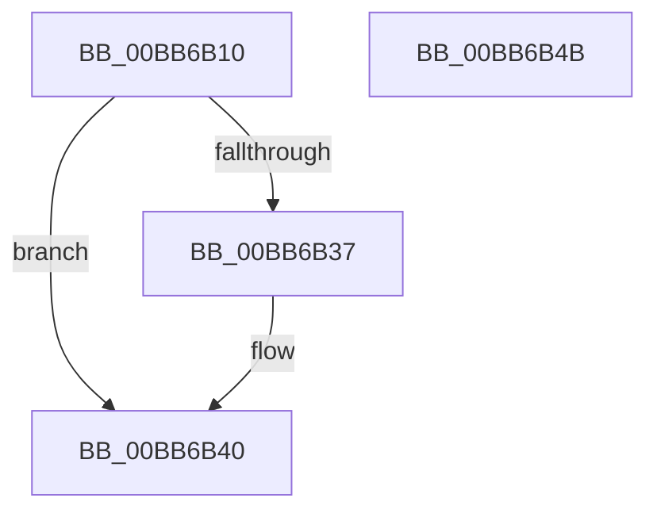

# IovpLogStackCallout

- RVA: `0x00BB6B10`–`0x00BB6B4C` (길이 `60` bytes)
- VA: `0x0000000140BB6B10`
- 실행 섹션: `PAGEVRFY`
- PDB 이름 있음: `예`; PDB Function 태그: `아니요`
- unwind 정보 RVA: `0x0005CAAC`
- 디코드: `19`개 명령, `60/60` bytes 표시
- 미해석 바이트: `0` (있으면 어셈블리에 `.byte`로 보존)

> 이 문서는 커널 이미지의 기계어와 PDB 기호를 분석해 생성했습니다. 4번과 5번은 함수 원형과 자료형을 바이너리 사용 방식에서 추정한 C 해석이며 원본 소스 복구 결과는 아닙니다.

## 1. Dependencies

- 직접 호출 지점: **1**; 고유 호출 대상: **1**
- 직접 호출자로 확인된 함수: **1**
- RIP 상대 이미지 참조: **0**

### Outgoing calls
- `0x00BB6B2D` → [RtlCaptureStackBackTrace](../../text/2F/RtlCaptureStackBackTrace_function_002F9FF0.md) (function, `0x002F9FF0`)

### Direct callers
- [IovpLogStackTrace](IovpLogStackTrace_function_00BB6A5C.md) at `0x00BB6ACD`

### Static image references
- 디코드된 RIP-relative 메모리 참조가 없습니다.

## 2. Other-region calls and transfers

- 다른 실행 섹션으로 향하는 call: **1**
  - `0x00BB6B2D` → [RtlCaptureStackBackTrace](../../text/2F/RtlCaptureStackBackTrace_function_002F9FF0.md) (`PAGEVRFY` → `.text`)
- 별도 외부 분기/꼬리 이동을 확인하지 못했습니다.

## 3. Assembly (complete function range)

```asm
00BB6B10  48 89 5C 24 08                  mov qword ptr [rsp + 8], rbx
00BB6B15  57                              push rdi
00BB6B16  48 83 EC 20                     sub rsp, 0x20
00BB6B1A  45 33 C9                        xor r9d, r9d
00BB6B1D  4C 8D 41 18                     lea r8, [rcx + 0x18]
00BB6B21  48 8B D9                        mov rbx, rcx
00BB6B24  41 8D 79 0D                     lea edi, [r9 + 0xd]
00BB6B28  8B D7                           mov edx, edi
00BB6B2A  8D 4F F5                        lea ecx, [rdi - 0xb]
00BB6B2D  E8 BE 34 74 FF                  call 0x1402f9ff0
00BB6B32  66 3B C7                        cmp ax, di
00BB6B35  73 09                           jae 0x140bb6b40
00BB6B37  0F B7 C0                        movzx eax, ax
00BB6B3A  48 83 64 C3 18 00               and qword ptr [rbx + rax*8 + 0x18], 0
00BB6B40  48 8B 5C 24 30                  mov rbx, qword ptr [rsp + 0x30]
00BB6B45  48 83 C4 20                     add rsp, 0x20
00BB6B49  5F                              pop rdi
00BB6B4A  C3                              ret
00BB6B4B  CC                              int3
```

## 4. C-style interpretation (structured pseudocode)

```c
__int64 __fastcall IovpLogStackCallout(__int64 a1, __int64 a2, __int64 a3, int a4)
{
    __int64 result;
    __int64 v_rsp;
    unsigned __int64 v_stack_p8;

    v_stack_p8 = v_rbx;
    v_rsp = (v_rsp) - (32);
    a4 = 0;
    result = RtlCaptureStackBackTrace(a4 + 13 - 11, (unsigned int)((unsigned int)(a4 + 13)), a1 + 24, a4);
    if (((unsigned __int16)(result)) < ((unsigned __int16)(a4 + 13))) {
        result = (unsigned __int16)(result);
    }
    v_rsp = (v_rsp) + (32);
    return result;
}
```

## 5. (Beta) C Style

```c
int64_t IovpLogStackCallout(void *Arg1, int64_t Arg2, int64_t Arg3, int32_t Arg4)
{
    uint8_t *arg1 = (uint8_t *)Arg1;

    int64_t result;
    int64_t local_rsp;
    uint64_t v_stack_p8;

    v_stack_p8 = local_rbx;
    local_rsp = (local_rsp) - (32);
    Arg4 = 0;
    result = RtlCaptureStackBackTrace(Arg4 + 13 - 11, (uint32_t)((uint32_t)(Arg4 + 13)), Arg1 + 24, Arg4);
    if (((uint16_t)(result)) < ((uint16_t)(Arg4 + 13))) {
        result = (uint16_t)(result);
    }
    local_rsp = (local_rsp) + (32);
    return result;
}
```

### 관측된 메모리 오프셋

구조체 형식이 확인되지 않은 접근은 인자 기준의 오프셋으로만 기록했습니다.

| 기준 인자 | 오프셋 표현 | 폭 (bit) | 접근 |
|---|---:|---:|---|
| `Arg1` | `+ 0x18` | `64` | `R` |
| `Arg1` | `+ 0x18 + rax*8` | `64` | `R/W` |

## 6. Execution-region graph

[열기: 2D/3D 그래프와 함수 탐색 컨트롤 패널](../../../control-panel.html?section=pagevrfy&rva=0x00BB6B10&view=graph)

- 2D 그래프는 위에서 아래로 흐르고, 3D 그래프는 빈 공간을 드래그해 회전합니다. Shift+드래그는 이동, 휠은 확대·축소, 함수 노드 선택은 대상 보고서 이동입니다.

### Static fallback


