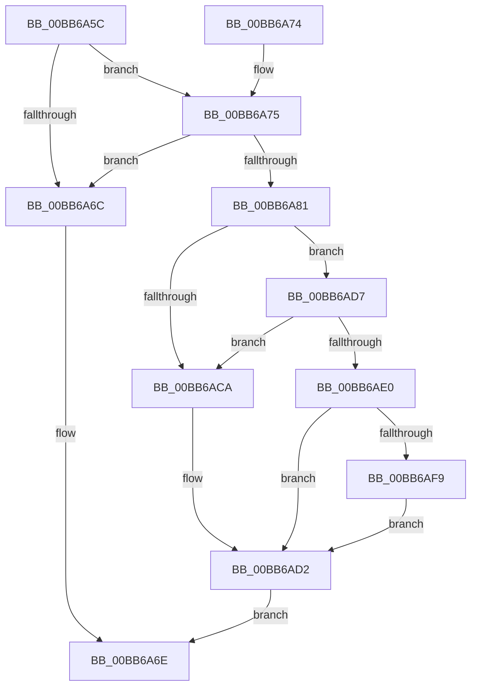

# IovpLogStackTrace

- RVA: `0x00BB6A5C`–`0x00BB6B00` (길이 `164` bytes)
- VA: `0x0000000140BB6A5C`
- 실행 섹션: `PAGEVRFY`
- PDB 이름 있음: `예`; PDB Function 태그: `아니요`
- unwind 정보 RVA: `0x000B07FC`
- 디코드: `43`개 명령, `164/164` bytes 표시
- 미해석 바이트: `0` (있으면 어셈블리에 `.byte`로 보존)

> 이 문서는 커널 이미지의 기계어와 PDB 기호를 분석해 생성했습니다. 4번과 5번은 함수 원형과 자료형을 바이너리 사용 방식에서 추정한 C 해석이며 원본 소스 복구 결과는 아닙니다.

## 1. Dependencies

- 직접 호출 지점: **3**; 고유 호출 대상: **3**
- 직접 호출자로 확인된 함수: **4**
- RIP 상대 이미지 참조: **5**

### Outgoing calls
- `0x00BB6ACD` → [IovpLogStackCallout](IovpLogStackCallout_function_00BB6B10.md) (function, `0x00BB6B10`)
- `0x00BB6AD7` → [RtlEnoughStackSpaceForStackCapture](../../text/43/RtlEnoughStackSpaceForStackCapture_function_004341D0.md) (function, `0x004341D0`)
- `0x00BB6AF0` → [KeExpandKernelStackAndCallout](../../text/46/KeExpandKernelStackAndCallout_function_004675F0.md) (function, `0x004675F0`)

### Direct callers
- [IoReuseIrp](../../text/24/IoReuseIrp_function_0024DD70.md) at `0x0024DDC9`
- [IovCancelIrp](../B9/IovCancelIrp_function_00B926E0.md) at `0x00B926E9`
- [IovCompleteRequest](IovCompleteRequest_function_00BB6758.md) at `0x00BB67AA`
- [IovAllocateIrp](IovAllocateIrp_function_00BB9540.md) at `0x00BB9575`

### Static image references
- `0x00BB6A62` → RVA `0x00F049F8` (`.data`; read)
- `0x00BB6A75` → RVA `0x00E681A0` (`.data`; read)
- `0x00BB6A86` → RVA `0x00F04A00` (`.data`; read/write)
- `0x00BB6A8E` → RVA `0x00E0E930` (`.data`; read)
- `0x00BB6AE6` → RVA `0x00BB6B10` (`IovpLogStackCallout`; read)

## 2. Other-region calls and transfers

- 다른 실행 섹션으로 향하는 call: **2**
  - `0x00BB6AD7` → [RtlEnoughStackSpaceForStackCapture](../../text/43/RtlEnoughStackSpaceForStackCapture_function_004341D0.md) (`PAGEVRFY` → `.text`)
  - `0x00BB6AF0` → [KeExpandKernelStackAndCallout](../../text/46/KeExpandKernelStackAndCallout_function_004675F0.md) (`PAGEVRFY` → `.text`)
- 별도 외부 분기/꼬리 이동을 확인하지 못했습니다.

## 3. Assembly (complete function range)

```asm
00BB6A5C  40 53                           push rbx
00BB6A5E  48 83 EC 20                     sub rsp, 0x20
00BB6A62  48 83 3D 8E DF 34 00 00         cmp qword ptr [rip + 0x34df8e], 0
00BB6A6A  75 09                           jne 0x140bb6a75
00BB6A6C  33 C0                           xor eax, eax
00BB6A6E  48 83 C4 20                     add rsp, 0x20
00BB6A72  5B                              pop rbx
00BB6A73  C3                              ret
00BB6A74  CC                              int3
00BB6A75  F7 05 21 17 2B 00 00 00 40 00   test dword ptr [rip + 0x2b1721], 0x400000
00BB6A7F  75 EB                           jne 0x140bb6a6c
00BB6A81  B8 01 00 00 00                  mov eax, 1
00BB6A86  F0 0F C1 05 72 DF 34 00         lock xadd dword ptr [rip + 0x34df72], eax
00BB6A8E  8B 1D 9C 7E 25 00               mov ebx, dword ptr [rip + 0x257e9c]
00BB6A94  FF C0                           inc eax
00BB6A96  FF CB                           dec ebx
00BB6A98  48 23 D8                        and rbx, rax
00BB6A9B  48 C1 E3 07                     shl rbx, 7
00BB6A9F  48 03 1D 52 DF 34 00            add rbx, qword ptr [rip + 0x34df52]
00BB6AA6  48 89 0B                        mov qword ptr [rbx], rcx
00BB6AA9  65 48 8B 04 25 88 01 00 00      mov rax, qword ptr gs:[0x188]
00BB6AB2  48 89 43 08                     mov qword ptr [rbx + 8], rax
00BB6AB6  8B 80 E4 01 00 00               mov eax, dword ptr [rax + 0x1e4]
00BB6ABC  89 43 10                        mov dword ptr [rbx + 0x10], eax
00BB6ABF  44 0F 20 C0                     mov rax, cr8
00BB6AC3  88 43 14                        mov byte ptr [rbx + 0x14], al
00BB6AC6  3C 01                           cmp al, 1
00BB6AC8  76 0D                           jbe 0x140bb6ad7
00BB6ACA  48 8B CB                        mov rcx, rbx
00BB6ACD  E8 3E 00 00 00                  call 0x140bb6b10
00BB6AD2  48 8B C3                        mov rax, rbx
00BB6AD5  EB 97                           jmp 0x140bb6a6e
00BB6AD7  E8 F4 D6 87 FF                  call 0x1404341d0
00BB6ADC  85 C0                           test eax, eax
00BB6ADE  75 EA                           jne 0x140bb6aca
00BB6AE0  41 B8 30 0E 00 00               mov r8d, 0xe30
00BB6AE6  48 8D 0D 23 00 00 00            lea rcx, [rip + 0x23]
00BB6AED  48 8B D3                        mov rdx, rbx
00BB6AF0  E8 FB 0A 8B FF                  call 0x1404675f0
00BB6AF5  85 C0                           test eax, eax
00BB6AF7  79 D9                           jns 0x140bb6ad2
00BB6AF9  48 83 63 18 00                  and qword ptr [rbx + 0x18], 0
00BB6AFE  EB D2                           jmp 0x140bb6ad2
```

## 4. C-style interpretation (structured pseudocode)

```c
__int64 __fastcall IovpLogStackTrace(__int64 a1)
{
    __int64 result;
    __int64 v_rbx;
    __int64 v_rsp;

    v_rsp = (v_rsp) - (32);
    if ((*(unsigned __int64 *)(v_rip + 3465102)) != 0) goto loc_00BB6A75;
loc_00BB6A6C:
    result = 0;
loc_00BB6A6E:
    v_rsp = (v_rsp) + (32);
    return result;
loc_00BB6A75:
    if (((*(unsigned int *)(v_rip + 2823969)) & (0x400000ULL)) != 0) goto loc_00BB6A6C;
    result = (unsigned int)((1) + 1);
    v_rbx = (unsigned int)(((unsigned int)(*(unsigned int *)(v_rip + 2457244))) - 1);
    v_rbx = (v_rbx) & (result);
    v_rbx = (v_rbx) << (7);
    v_rbx = (v_rbx) + (*(unsigned __int64 *)(v_rip + 3465042));
    *(unsigned __int64 *)(v_rbx) = a1;
    *(unsigned __int64 *)(v_rbx + 8) = *(unsigned __int64 *)(gs_base + (0 + 392));
    *(unsigned int *)(v_rbx + 16) = (unsigned int)((unsigned int)(*(unsigned int *)(*(unsigned __int64 *)(gs_base + (0 + 392)) + 484)));
    *(unsigned __int8 *)(v_rbx + 20) = (unsigned __int8)(v_cr8);
    if (((unsigned __int8)(v_cr8)) <= 1) goto loc_00BB6AD7;
loc_00BB6ACA:
    result = IovpLogStackCallout(v_rbx, a2, a3, a4);
loc_00BB6AD2:
    goto loc_00BB6A6E;
loc_00BB6AD7:
    result = RtlEnoughStackSpaceForStackCapture(v_rbx, a2, a3, a4);
    if ((unsigned int)(result) != 0) goto loc_00BB6ACA;
    result = KeExpandKernelStackAndCallout(v_rip + 35, v_rbx, (unsigned int)(0xE30ULL), a4);
    if (!sign_flag) goto loc_00BB6AD2;
    goto loc_00BB6AD2;
}
```

## 5. (Beta) C Style

```c
int64_t IovpLogStackTrace(int64_t Arg1)
{
    int64_t result;
    int64_t local_rbx;
    int64_t local_rsp;

    local_rsp = (local_rsp) - (32);
    if ((*(uint64_t *)(v_rip + 0x34DF8E)) != 0) goto loc_00BB6A75;
loc_00BB6A6C:
    result = 0;
loc_00BB6A6E:
    local_rsp = (local_rsp) + (32);
    return result;
loc_00BB6A75:
    if (((*(uint32_t *)(v_rip + 0x2B1721)) & (0x400000ULL)) != 0) goto loc_00BB6A6C;
    result = (uint32_t)((1) + 1);
    local_rbx = (uint32_t)(((uint32_t)(*(uint32_t *)(v_rip + 0x257E9C))) - 1);
    local_rbx = (local_rbx) & (result);
    local_rbx = (local_rbx) << (7);
    local_rbx = (local_rbx) + (*(uint64_t *)(v_rip + 0x34DF52));
    *(uint64_t *)(local_rbx) = Arg1;
    *(uint64_t *)(local_rbx + 0x8) = *(uint64_t *)(gs_base + (0 + 0x188));
    *(uint32_t *)(local_rbx + 0x10) = (uint32_t)((uint32_t)(*(uint32_t *)(*(uint64_t *)(gs_base + (0 + 0x188)) + 0x1E4)));
    *(uint8_t *)(local_rbx + 0x14) = (uint8_t)(v_cr8);
    if (((uint8_t)(v_cr8)) <= 1) goto loc_00BB6AD7;
loc_00BB6ACA:
    result = IovpLogStackCallout(local_rbx, a2, a3, a4);
loc_00BB6AD2:
    goto loc_00BB6A6E;
loc_00BB6AD7:
    result = RtlEnoughStackSpaceForStackCapture(local_rbx, a2, a3, a4);
    if ((uint32_t)(result) != 0) goto loc_00BB6ACA;
    result = KeExpandKernelStackAndCallout(v_rip + 35, local_rbx, (uint32_t)(0xE30ULL), a4);
    if (!sign_flag) goto loc_00BB6AD2;
    goto loc_00BB6AD2;
}
```

## 6. Execution-region graph

[열기: 2D/3D 그래프와 함수 탐색 컨트롤 패널](../../../control-panel.html?section=pagevrfy&rva=0x00BB6A5C&view=graph)

- 2D 그래프는 위에서 아래로 흐르고, 3D 그래프는 빈 공간을 드래그해 회전합니다. Shift+드래그는 이동, 휠은 확대·축소, 함수 노드 선택은 대상 보고서 이동입니다.

### Static fallback


