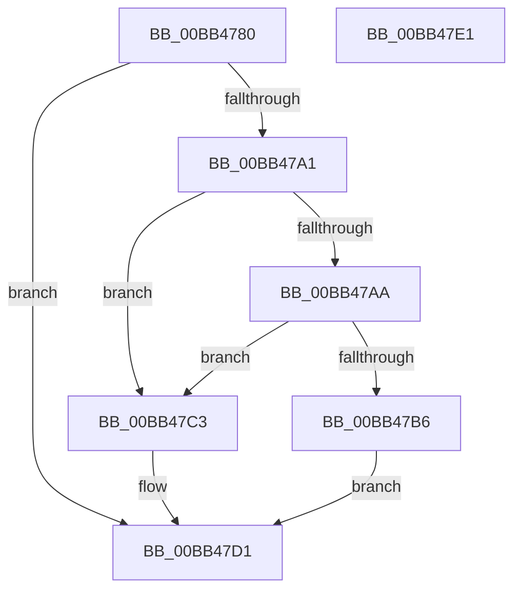

# MmApplyVerifierToRunningImage

- RVA: `0x00BB4780`–`0x00BB47E2` (길이 `98` bytes)
- VA: `0x0000000140BB4780`
- 실행 섹션: `PAGEVRFY`
- PDB 이름 있음: `예`; PDB Function 태그: `아니요`
- unwind 정보 RVA: `0x00060BC4`
- 디코드: `31`개 명령, `98/98` bytes 표시
- 미해석 바이트: `0` (있으면 어셈블리에 `.byte`로 보존)

> 이 문서는 커널 이미지의 기계어와 PDB 기호를 분석해 생성했습니다. 4번과 5번은 함수 원형과 자료형을 바이너리 사용 방식에서 추정한 C 해석이며 원본 소스 복구 결과는 아닙니다.

## 1. Dependencies

- 직접 호출 지점: **5**; 고유 호출 대상: **5**
- 직접 호출자로 확인된 함수: **3**
- RIP 상대 이미지 참조: **0**

### Outgoing calls
- `0x00BB4798` → [MmIsVerifierApplicableToImage](../../text/67/MmIsVerifierApplicableToImage_function_0067B5AC.md) (function, `0x0067B5AC`)
- `0x00BB47A1` → [KeIsImportOptimizationEnabled](../../text/4A/KeIsImportOptimizationEnabled_function_004A8FB8.md) (function, `0x004A8FB8`)
- `0x00BB47AD` → [MmHasImageBeenImportOptimized](../../page/70/MmHasImageBeenImportOptimized_function_00704CD8.md) (function, `0x00704CD8`)
- `0x00BB47BC` → [MiReapplyImportOptimizationForDriverVerifier](../../text/68/MiReapplyImportOptimizationForDriverVerifier_function_00682268.md) (function, `0x00682268`)
- `0x00BB47CC` → [MmReplaceImportEntriesForVerifier](../../page/7F/MmReplaceImportEntriesForVerifier_function_007FE040.md) (function, `0x007FE040`)

### Direct callers
- [VfThunkApplyDriverAddedThunks](../BA/VfThunkApplyDriverAddedThunks_function_00BA7008.md) at `0x00BA7134`
- [ViThunkApplyPristineCurrentSession](../BA/ViThunkApplyPristineCurrentSession_function_00BA72E4.md) at `0x00BA73D9`
- [ViThunkApplyWdmThunksCurrentSession](../BA/ViThunkApplyWdmThunksCurrentSession_function_00BA7414.md) at `0x00BA74AC`

### Static image references
- 디코드된 RIP-relative 메모리 참조가 없습니다.

## 2. Other-region calls and transfers

- 다른 실행 섹션으로 향하는 call: **5**
  - `0x00BB4798` → [MmIsVerifierApplicableToImage](../../text/67/MmIsVerifierApplicableToImage_function_0067B5AC.md) (`PAGEVRFY` → `.text`)
  - `0x00BB47A1` → [KeIsImportOptimizationEnabled](../../text/4A/KeIsImportOptimizationEnabled_function_004A8FB8.md) (`PAGEVRFY` → `.text`)
  - `0x00BB47AD` → [MmHasImageBeenImportOptimized](../../page/70/MmHasImageBeenImportOptimized_function_00704CD8.md) (`PAGEVRFY` → `PAGE`)
  - `0x00BB47BC` → [MiReapplyImportOptimizationForDriverVerifier](../../text/68/MiReapplyImportOptimizationForDriverVerifier_function_00682268.md) (`PAGEVRFY` → `.text`)
  - `0x00BB47CC` → [MmReplaceImportEntriesForVerifier](../../page/7F/MmReplaceImportEntriesForVerifier_function_007FE040.md) (`PAGEVRFY` → `PAGE`)
- 별도 외부 분기/꼬리 이동을 확인하지 못했습니다.

## 3. Assembly (complete function range)

```asm
00BB4780  48 89 5C 24 08                  mov qword ptr [rsp + 8], rbx
00BB4785  48 89 74 24 10                  mov qword ptr [rsp + 0x10], rsi
00BB478A  57                              push rdi
00BB478B  48 83 EC 20                     sub rsp, 0x20
00BB478F  41 8B F8                        mov edi, r8d
00BB4792  48 8B F2                        mov rsi, rdx
00BB4795  48 8B D9                        mov rbx, rcx
00BB4798  E8 0F 6E AC FF                  call 0x14067b5ac
00BB479D  85 C0                           test eax, eax
00BB479F  78 30                           js 0x140bb47d1
00BB47A1  E8 12 48 8F FF                  call 0x1404a8fb8
00BB47A6  84 C0                           test al, al
00BB47A8  74 19                           je 0x140bb47c3
00BB47AA  48 8B CB                        mov rcx, rbx
00BB47AD  E8 26 05 B5 FF                  call 0x140704cd8
00BB47B2  85 C0                           test eax, eax
00BB47B4  74 0D                           je 0x140bb47c3
00BB47B6  44 8B C7                        mov r8d, edi
00BB47B9  48 8B D6                        mov rdx, rsi
00BB47BC  E8 A7 DA AC FF                  call 0x140682268
00BB47C1  EB 0E                           jmp 0x140bb47d1
00BB47C3  44 8B C7                        mov r8d, edi
00BB47C6  48 8B D6                        mov rdx, rsi
00BB47C9  48 8B CB                        mov rcx, rbx
00BB47CC  E8 6F 98 C4 FF                  call 0x1407fe040
00BB47D1  48 8B 5C 24 30                  mov rbx, qword ptr [rsp + 0x30]
00BB47D6  48 8B 74 24 38                  mov rsi, qword ptr [rsp + 0x38]
00BB47DB  48 83 C4 20                     add rsp, 0x20
00BB47DF  5F                              pop rdi
00BB47E0  C3                              ret
00BB47E1  CC                              int3
```

## 4. C-style interpretation (structured pseudocode)

```c
__int64 __fastcall MmApplyVerifierToRunningImage(__int64 a1, __int64 a2, int a3)
{
    __int64 result;
    __int64 v_rsp;
    unsigned __int64 v_stack_p10;
    unsigned __int64 v_stack_p8;

    v_stack_p8 = v_rbx;
    v_stack_p10 = v_rsi;
    v_rsp = (v_rsp) - (32);
    result = MmIsVerifierApplicableToImage(a1, a2, a3, a4);
    if (sign_flag) goto loc_00BB47D1;
    result = KeIsImportOptimizationEnabled(a1, a2, a3, a4);
    if ((unsigned __int8)(result) == 0) goto loc_00BB47C3;
    result = MmHasImageBeenImportOptimized(a1, a2, a3, a4);
    if ((unsigned int)(result) == 0) goto loc_00BB47C3;
    result = MiReapplyImportOptimizationForDriverVerifier(a1, a2, (unsigned int)((unsigned int)((unsigned int)(a3))), a4);
    goto loc_00BB47D1;
loc_00BB47C3:
    result = MmReplaceImportEntriesForVerifier(a1, a2, (unsigned int)((unsigned int)((unsigned int)(a3))), a4);
loc_00BB47D1:
    v_rsp = (v_rsp) + (32);
    return result;
}
```

## 5. (Beta) C Style

```c
int64_t MmApplyVerifierToRunningImage(int64_t Arg1, int64_t Arg2, int32_t Arg3)
{
    int64_t result;
    int64_t local_rsp;
    uint64_t v_stack_p10;
    uint64_t v_stack_p8;

    v_stack_p8 = local_rbx;
    v_stack_p10 = local_rsi;
    local_rsp = (local_rsp) - (32);
    result = MmIsVerifierApplicableToImage(Arg1, Arg2, Arg3, a4);
    if (sign_flag) goto loc_00BB47D1;
    result = KeIsImportOptimizationEnabled(Arg1, Arg2, Arg3, a4);
    if ((uint8_t)(result) == 0) goto loc_00BB47C3;
    result = MmHasImageBeenImportOptimized(Arg1, Arg2, Arg3, a4);
    if ((uint32_t)(result) == 0) goto loc_00BB47C3;
    result = MiReapplyImportOptimizationForDriverVerifier(Arg1, Arg2, (uint32_t)((uint32_t)((uint32_t)(Arg3))), a4);
    goto loc_00BB47D1;
loc_00BB47C3:
    result = MmReplaceImportEntriesForVerifier(Arg1, Arg2, (uint32_t)((uint32_t)((uint32_t)(Arg3))), a4);
loc_00BB47D1:
    local_rsp = (local_rsp) + (32);
    return result;
}
```

## 6. Execution-region graph

[열기: 2D/3D 그래프와 함수 탐색 컨트롤 패널](../../../control-panel.html?section=pagevrfy&rva=0x00BB4780&view=graph)

- 2D 그래프는 위에서 아래로 흐르고, 3D 그래프는 빈 공간을 드래그해 회전합니다. Shift+드래그는 이동, 휠은 확대·축소, 함수 노드 선택은 대상 보고서 이동입니다.

### Static fallback


