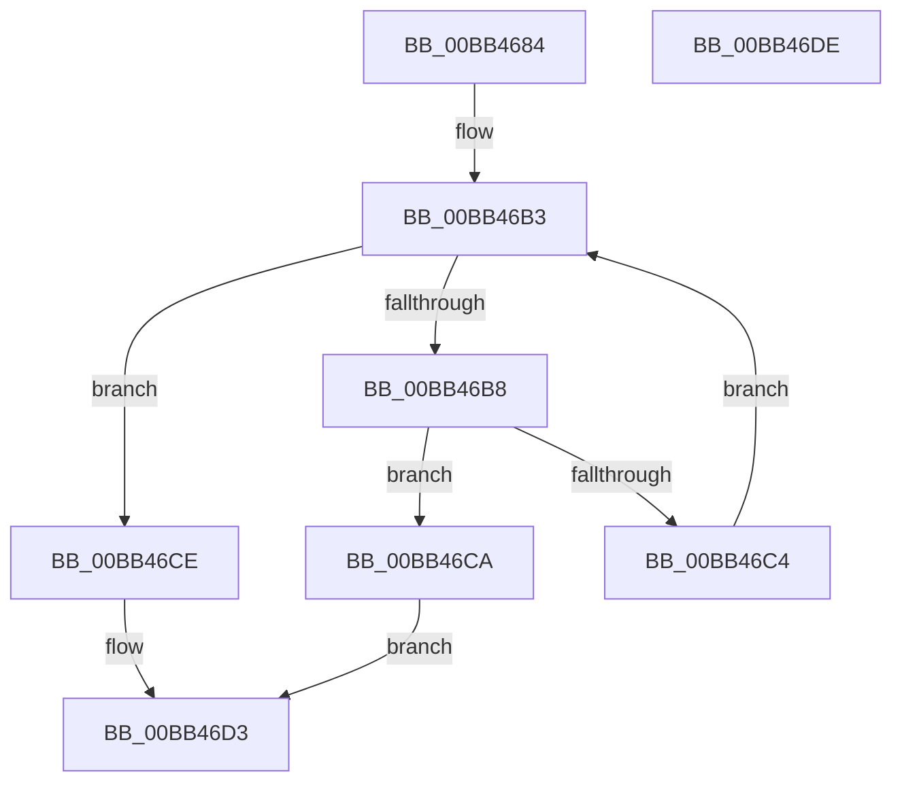

# MmAreMdlPagesLocked

- RVA: `0x00BB4684`–`0x00BB46DF` (길이 `91` bytes)
- VA: `0x0000000140BB4684`
- 실행 섹션: `PAGEVRFY`
- PDB 이름 있음: `예`; PDB Function 태그: `아니요`
- unwind 정보 RVA: `0x0005CAAC`
- 디코드: `28`개 명령, `91/91` bytes 표시
- 미해석 바이트: `0` (있으면 어셈블리에 `.byte`로 보존)

> 이 문서는 커널 이미지의 기계어와 PDB 기호를 분석해 생성했습니다. 4번과 5번은 함수 원형과 자료형을 바이너리 사용 방식에서 추정한 C 해석이며 원본 소스 복구 결과는 아닙니다.

## 1. Dependencies

- 직접 호출 지점: **1**; 고유 호출 대상: **1**
- 직접 호출자로 확인된 함수: **2**
- RIP 상대 이미지 참조: **0**

### Outgoing calls
- `0x00BB46BB` → [MmIsMdlPageLocked](MmIsMdlPageLocked_function_00BB46E8.md) (function, `0x00BB46E8`)

### Direct callers
- [VERIFY_BUFFER_LOCKED](../B9/VERIFY_BUFFER_LOCKED_function_00B94EA4.md) at `0x00B94EC5`
- [VfMiscMmBuildMdlForNonPagedPool_Exit](../BA/VfMiscMmBuildMdlForNonPagedPool_Exit_function_00BAE150.md) at `0x00BAE174`

### Static image references
- 디코드된 RIP-relative 메모리 참조가 없습니다.

## 2. Other-region calls and transfers

- 다른 실행 섹션으로 향하는 call: **0**
- 별도 외부 분기/꼬리 이동을 확인하지 못했습니다.

## 3. Assembly (complete function range)

```asm
00BB4684  48 89 5C 24 08                  mov qword ptr [rsp + 8], rbx
00BB4689  57                              push rdi
00BB468A  48 83 EC 20                     sub rsp, 0x20
00BB468E  8B 51 2C                        mov edx, dword ptr [rcx + 0x2c]
00BB4691  48 8D 59 30                     lea rbx, [rcx + 0x30]
00BB4695  03 51 20                        add edx, dword ptr [rcx + 0x20]
00BB4698  8B 49 28                        mov ecx, dword ptr [rcx + 0x28]
00BB469B  81 E2 FF 0F 00 00               and edx, 0xfff
00BB46A1  48 81 C1 FF 0F 00 00            add rcx, 0xfff
00BB46A8  48 03 CA                        add rcx, rdx
00BB46AB  48 C1 E9 0C                     shr rcx, 0xc
00BB46AF  48 8D 3C CB                     lea rdi, [rbx + rcx*8]
00BB46B3  48 3B DF                        cmp rbx, rdi
00BB46B6  73 16                           jae 0x140bb46ce
00BB46B8  48 8B 0B                        mov rcx, qword ptr [rbx]
00BB46BB  E8 28 00 00 00                  call 0x140bb46e8
00BB46C0  85 C0                           test eax, eax
00BB46C2  74 06                           je 0x140bb46ca
00BB46C4  48 83 C3 08                     add rbx, 8
00BB46C8  EB E9                           jmp 0x140bb46b3
00BB46CA  33 C0                           xor eax, eax
00BB46CC  EB 05                           jmp 0x140bb46d3
00BB46CE  B8 01 00 00 00                  mov eax, 1
00BB46D3  48 8B 5C 24 30                  mov rbx, qword ptr [rsp + 0x30]
00BB46D8  48 83 C4 20                     add rsp, 0x20
00BB46DC  5F                              pop rdi
00BB46DD  C3                              ret
00BB46DE  CC                              int3
```

## 4. C-style interpretation (structured pseudocode)

```c
__int64 __fastcall MmAreMdlPagesLocked(__int64 a1)
{
    __int64 result;
    __int64 v_rbx;
    __int64 v_rsp;
    unsigned __int64 v_stack_p8;

    v_stack_p8 = v_rbx;
    v_rsp = (v_rsp) - (32);
    a2 = (unsigned int)(((unsigned int)(*(unsigned int *)(a1 + 44))) + (*(unsigned int *)(a1 + 32)));
    a2 = (unsigned int)((a2) & (0xFFFULL));
    a1 = ((unsigned int)(*(unsigned int *)(a1 + 40))) + (0xFFFULL);
    a1 = (a1) + (a2);
    a1 = (a1) >> (12);
loc_00BB46B3:
    if ((a1 + 48) >= (a1 + 48 + a1 * 8)) goto loc_00BB46CE;
    result = MmIsMdlPageLocked(*(unsigned __int64 *)(a1 + 48), a2, a3, a4);
    if ((unsigned int)(result) == 0) goto loc_00BB46CA;
    v_rbx = (a1 + 48) + (8);
    goto loc_00BB46B3;
loc_00BB46CA:
    result = 0;
    goto loc_00BB46D3;
loc_00BB46CE:
loc_00BB46D3:
    v_rsp = (v_rsp) + (32);
    return 1;
}
```

## 5. (Beta) C Style

```c
int64_t MmAreMdlPagesLocked(void *Arg1)
{
    uint8_t *arg1 = (uint8_t *)Arg1;

    int64_t result;
    int64_t local_rbx;
    int64_t local_rsp;
    uint64_t v_stack_p8;

    v_stack_p8 = local_rbx;
    local_rsp = (local_rsp) - (32);
    a2 = (uint32_t)(((uint32_t)(*(uint32_t *)(arg1 + 0x2C))) + (*(uint32_t *)(arg1 + 0x20)));
    a2 = (uint32_t)((a2) & (0xFFFULL));
    Arg1 = ((uint32_t)(*(uint32_t *)(arg1 + 0x28))) + (0xFFFULL);
    Arg1 = (Arg1) + (a2);
    Arg1 = (Arg1) >> (12);
loc_00BB46B3:
    if ((Arg1 + 48) >= (Arg1 + 48 + Arg1 * 8)) goto loc_00BB46CE;
    result = MmIsMdlPageLocked(*(uint64_t *)(arg1 + 0x30), a2, a3, a4);
    if ((uint32_t)(result) == 0) goto loc_00BB46CA;
    local_rbx = (Arg1 + 48) + (8);
    goto loc_00BB46B3;
loc_00BB46CA:
    result = 0;
    goto loc_00BB46D3;
loc_00BB46CE:
loc_00BB46D3:
    local_rsp = (local_rsp) + (32);
    return 1;
}
```

### 관측된 메모리 오프셋

구조체 형식이 확인되지 않은 접근은 인자 기준의 오프셋으로만 기록했습니다.

| 기준 인자 | 오프셋 표현 | 폭 (bit) | 접근 |
|---|---:|---:|---|
| `Arg1` | `+ 0x0 + rcx*8` | `64` | `R` |
| `Arg1` | `+ 0x20` | `32` | `R` |
| `Arg1` | `+ 0x28` | `32` | `R` |
| `Arg1` | `+ 0x2C` | `32` | `R` |
| `Arg1` | `+ 0x30` | `64` | `R` |

## 6. Execution-region graph

[열기: 2D/3D 그래프와 함수 탐색 컨트롤 패널](../../../control-panel.html?section=pagevrfy&rva=0x00BB4684&view=graph)

- 2D 그래프는 위에서 아래로 흐르고, 3D 그래프는 빈 공간을 드래그해 회전합니다. Shift+드래그는 이동, 휠은 확대·축소, 함수 노드 선택은 대상 보고서 이동입니다.

### Static fallback


