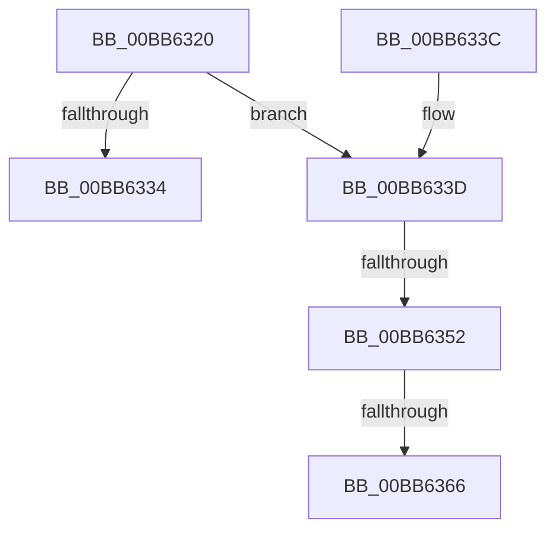

# MmIsDriverVerifyingByAddress

- RVA: `0x00BB6320`–`0x00BB6374` (길이 `84` bytes)
- VA: `0x0000000140BB6320`
- 실행 섹션: `PAGEVRFY`
- PDB 이름 있음: `예`; PDB Function 태그: `예`
- unwind 정보 RVA: `0x000929B4`
- 디코드: `24`개 명령, `84/84` bytes 표시
- 미해석 바이트: `0` (있으면 어셈블리에 `.byte`로 보존)

> 이 문서는 커널 이미지의 기계어와 PDB 기호를 분석해 생성했습니다. 4번과 5번은 함수 원형과 자료형을 바이너리 사용 방식에서 추정한 C 해석이며 원본 소스 복구 결과는 아닙니다.

## 1. Dependencies

- 직접 호출 지점: **2**; 고유 호출 대상: **2**
- 직접 호출자로 확인된 함수: **0**
- RIP 상대 이미지 참조: **1**

### Outgoing calls
- `0x00BB6344` → [MiLockLoadedDataTableEntryIfNecessary](../../text/2A/MiLockLoadedDataTableEntryIfNecessary_function_002A38B4.md) (function, `0x002A38B4`)
- `0x00BB6369` → [MmUnlockLoadedDataTableEntry](../../text/2A/MmUnlockLoadedDataTableEntry_function_002A3C98.md) (function, `0x002A3C98`)

### Direct callers
- 이 함수 시작 RVA로 연결되는 직접 call은 확인되지 않았습니다. 간접 호출은 완전히 역산할 수 없습니다.

### Static image references
- `0x00BB632B` → RVA `0x00E681A0` (`.data`; read)

## 2. Other-region calls and transfers

- 다른 실행 섹션으로 향하는 call: **2**
  - `0x00BB6344` → [MiLockLoadedDataTableEntryIfNecessary](../../text/2A/MiLockLoadedDataTableEntryIfNecessary_function_002A38B4.md) (`PAGEVRFY` → `.text`)
  - `0x00BB6369` → [MmUnlockLoadedDataTableEntry](../../text/2A/MmUnlockLoadedDataTableEntry_function_002A3C98.md) (`PAGEVRFY` → `.text`)
- call이 아닌 외부 분기/꼬리 이동: **3**
  - `0x00BB634C` → [sub_00BBBC58](Unknown_function_00BBBC58.md) (`tail-transfer`)
  - `0x00BB6360` → [sub_00BBBC58](Unknown_function_00BBBC58.md) (`tail-transfer`)
  - `0x00BB636F` → [sub_00BBBC58](Unknown_function_00BBBC58.md) (`tail-transfer`)

## 3. Assembly (complete function range)

```asm
00BB6320  40 53                           push rbx
00BB6322  48 83 EC 20                     sub rsp, 0x20
00BB6326  83 64 24 38 00                  and dword ptr [rsp + 0x38], 0
00BB632B  83 3D 6E 1E 2B 00 00            cmp dword ptr [rip + 0x2b1e6e], 0
00BB6332  75 09                           jne 0x140bb633d
00BB6334  33 C0                           xor eax, eax
00BB6336  48 83 C4 20                     add rsp, 0x20
00BB633A  5B                              pop rbx
00BB633B  C3                              ret
00BB633C  CC                              int3
00BB633D  48 8D 54 24 38                  lea rdx, [rsp + 0x38]
00BB6342  33 DB                           xor ebx, ebx
00BB6344  E8 6B D5 6E FF                  call 0x1402a38b4
00BB6349  48 85 C0                        test rax, rax
00BB634C  0F 84 06 59 00 00               je 0x140bbbc58
00BB6352  8B 58 68                        mov ebx, dword ptr [rax + 0x68]
00BB6355  C1 EB 19                        shr ebx, 0x19
00BB6358  83 E3 01                        and ebx, 1
00BB635B  83 7C 24 38 00                  cmp dword ptr [rsp + 0x38], 0
00BB6360  0F 84 F2 58 00 00               je 0x140bbbc58
00BB6366  48 8B C8                        mov rcx, rax
00BB6369  E8 2A D9 6E FF                  call 0x1402a3c98
00BB636E  90                              nop
00BB636F  E9 E4 58 00 00                  jmp 0x140bbbc58
```

## 4. C-style interpretation (structured pseudocode)

```c
__int64 __fastcall MmIsDriverVerifyingByAddress(void)
{
    __int64 result;
    __int64 v_rbx;
    __int64 v_rsp;
    unsigned int v_stack_p10;
    unsigned __int64 v_stack_p38;

    v_rsp = (v_rsp) - (32);
    if ((*(unsigned int *)(v_rip + 2825838)) != 0) goto loc_00BB633D;
    result = 0;
    v_rsp = (v_rsp) + (32);
    return result;
loc_00BB633D:
    v_rbx = 0;
    result = MiLockLoadedDataTableEntryIfNecessary(a1, v_stack_p38, a3, a4);
    v_rbx = (unsigned int)(((unsigned int)(*(unsigned int *)(result + 104))) >> (25));
    v_rbx = (unsigned int)((v_rbx) & (1));
    result = MmUnlockLoadedDataTableEntry(result, v_stack_p38, a3, a4);
}
```

## 5. (Beta) C Style

```c
void MmIsDriverVerifyingByAddress(void)
{
    int64_t result;
    int64_t local_rbx;
    int64_t local_rsp;
    uint32_t v_stack_p10;
    uint64_t v_stack_p38;

    local_rsp = (local_rsp) - (32);
    if ((*(uint32_t *)(v_rip + 0x2B1E6E)) != 0) goto loc_00BB633D;
    result = 0;
    local_rsp = (local_rsp) + (32);
    return result;
loc_00BB633D:
    local_rbx = 0;
    result = MiLockLoadedDataTableEntryIfNecessary(a1, v_stack_p38, a3, a4);
    local_rbx = (uint32_t)(((uint32_t)(*(uint32_t *)(result + 0x68))) >> (25));
    local_rbx = (uint32_t)((local_rbx) & (1));
    result = MmUnlockLoadedDataTableEntry(result, v_stack_p38, a3, a4);
}
```

## 6. Execution-region graph

[열기: 2D/3D 그래프와 함수 탐색 컨트롤 패널](../../../control-panel.html?section=pagevrfy&rva=0x00BB6320&view=graph)

- 2D 그래프는 위에서 아래로 흐르고, 3D 그래프는 빈 공간을 드래그해 회전합니다. Shift+드래그는 이동, 휠은 확대·축소, 함수 노드 선택은 대상 보고서 이동입니다.

### Static fallback


