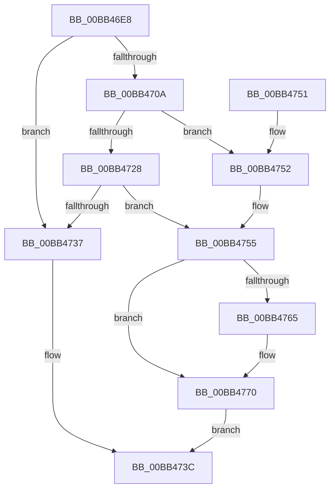

# MmIsMdlPageLocked

- RVA: `0x00BB46E8`–`0x00BB4779` (길이 `145` bytes)
- VA: `0x0000000140BB46E8`
- 실행 섹션: `PAGEVRFY`
- PDB 이름 있음: `예`; PDB Function 태그: `아니요`
- unwind 정보 RVA: `0x000848E8`
- 디코드: `42`개 명령, `145/145` bytes 표시
- 미해석 바이트: `0` (있으면 어셈블리에 `.byte`로 보존)

> 이 문서는 커널 이미지의 기계어와 PDB 기호를 분석해 생성했습니다. 4번과 5번은 함수 원형과 자료형을 바이너리 사용 방식에서 추정한 C 해석이며 원본 소스 복구 결과는 아닙니다.

## 1. Dependencies

- 직접 호출 지점: **4**; 고유 호출 대상: **4**
- 직접 호출자로 확인된 함수: **3**
- RIP 상대 이미지 참조: **1**

### Outgoing calls
- `0x00BB46FF` → [MiIsPfn](../../text/46/MiIsPfn_function_00462450.md) (function, `0x00462450`)
- `0x00BB472B` → [MiSafeLockPage](../../text/32/MiSafeLockPage_function_00321620.md) (function, `0x00321620`)
- `0x00BB4758` → [MiIsPfnLocked](../../text/41/MiIsPfnLocked_function_0041F354.md) (function, `0x0041F354`)
- `0x00BB476B` → [MiUnlockPage](../../text/31/MiUnlockPage_function_0031A3E0.md) (function, `0x0031A3E0`)

### Direct callers
- [MmAreMdlPagesLocked](MmAreMdlPagesLocked_function_00BB4684.md) at `0x00BB46BB`
- [ViSpMmMapIoSpace_Entry](ViSpMmMapIoSpace_Entry_function_00BB4A80.md) at `0x00BB4AF5`
- [ViSpMmMapLockedPagesSanityChecks](ViSpMmMapLockedPagesSanityChecks_function_00BB4B50.md) at `0x00BB4C81`

### Static image references
- `0x00BB471F` → RVA `0x00E3014C` (`.data`; read)

## 2. Other-region calls and transfers

- 다른 실행 섹션으로 향하는 call: **4**
  - `0x00BB46FF` → [MiIsPfn](../../text/46/MiIsPfn_function_00462450.md) (`PAGEVRFY` → `.text`)
  - `0x00BB472B` → [MiSafeLockPage](../../text/32/MiSafeLockPage_function_00321620.md) (`PAGEVRFY` → `.text`)
  - `0x00BB4758` → [MiIsPfnLocked](../../text/41/MiIsPfnLocked_function_0041F354.md) (`PAGEVRFY` → `.text`)
  - `0x00BB476B` → [MiUnlockPage](../../text/31/MiUnlockPage_function_0031A3E0.md) (`PAGEVRFY` → `.text`)
- 별도 외부 분기/꼬리 이동을 확인하지 못했습니다.

## 3. Assembly (complete function range)

```asm
00BB46E8  48 89 5C 24 08                  mov qword ptr [rsp + 8], rbx
00BB46ED  48 89 6C 24 10                  mov qword ptr [rsp + 0x10], rbp
00BB46F2  48 89 74 24 18                  mov qword ptr [rsp + 0x18], rsi
00BB46F7  57                              push rdi
00BB46F8  48 83 EC 20                     sub rsp, 0x20
00BB46FC  48 8B F1                        mov rsi, rcx
00BB46FF  E8 4C DD 8A FF                  call 0x140462450
00BB4704  33 DB                           xor ebx, ebx
00BB4706  85 C0                           test eax, eax
00BB4708  74 2D                           je 0x140bb4737
00BB470A  48 8D 3C 76                     lea rdi, [rsi + rsi*2]
00BB470E  48 C1 E7 04                     shl rdi, 4
00BB4712  48 B8 00 00 00 00 00 DE FF FF   movabs rax, 0xffffde0000000000
00BB471C  48 03 F8                        add rdi, rax
00BB471F  83 3D 26 BA 27 00 02            cmp dword ptr [rip + 0x27ba26], 2
00BB4726  74 2A                           je 0x140bb4752
00BB4728  48 8B CE                        mov rcx, rsi
00BB472B  E8 F0 CE 76 FF                  call 0x140321620
00BB4730  40 8A F0                        mov sil, al
00BB4733  3C 11                           cmp al, 0x11
00BB4735  75 1E                           jne 0x140bb4755
00BB4737  B8 01 00 00 00                  mov eax, 1
00BB473C  48 8B 5C 24 30                  mov rbx, qword ptr [rsp + 0x30]
00BB4741  48 8B 6C 24 38                  mov rbp, qword ptr [rsp + 0x38]
00BB4746  48 8B 74 24 40                  mov rsi, qword ptr [rsp + 0x40]
00BB474B  48 83 C4 20                     add rsp, 0x20
00BB474F  5F                              pop rdi
00BB4750  C3                              ret
00BB4751  CC                              int3
00BB4752  40 B6 11                        mov sil, 0x11
00BB4755  48 8B CF                        mov rcx, rdi
00BB4758  E8 F7 AB 86 FF                  call 0x14041f354
00BB475D  8B E8                           mov ebp, eax
00BB475F  40 80 FE 11                     cmp sil, 0x11
00BB4763  74 0B                           je 0x140bb4770
00BB4765  40 8A D6                        mov dl, sil
00BB4768  48 8B CF                        mov rcx, rdi
00BB476B  E8 70 5C 76 FF                  call 0x14031a3e0
00BB4770  85 ED                           test ebp, ebp
00BB4772  0F 95 C3                        setne bl
00BB4775  8B C3                           mov eax, ebx
00BB4777  EB C3                           jmp 0x140bb473c
```

## 4. C-style interpretation (structured pseudocode)

```c
__int64 __fastcall MmIsMdlPageLocked(__int64 a1)
{
    __int64 result;
    __int64 v_rbx;
    __int64 v_rdi;
    __int64 v_rsp;
    unsigned __int64 v_stack_p10;
    unsigned __int64 v_stack_p18;
    unsigned __int64 v_stack_p8;

    v_stack_p8 = v_rbx;
    v_stack_p10 = v_rbp;
    v_stack_p18 = v_rsi;
    v_rsp = (v_rsp) - (32);
    result = MiIsPfn(a1, a2, a3, a4);
    v_rbx = 0;
    if ((unsigned int)(result) == 0) goto loc_00BB4737;
    v_rdi = (a1 + a1 * 2) << (4);
    v_rdi = (v_rdi) + (result);
    if ((*(unsigned int *)(v_rip + 2603558)) == 2) goto loc_00BB4752;
    result = MiSafeLockPage(a1, a2, a3, a4);
    if (((unsigned __int8)(result)) != 17) goto loc_00BB4755;
loc_00BB4737:
loc_00BB473C:
    v_rsp = (v_rsp) + (32);
    return 1;
loc_00BB4752:
loc_00BB4755:
    result = MiIsPfnLocked(v_rdi, a2, a3, a4);
    if (17 != 17) {
        a2 = 17;
        a1 = v_rdi;
        result = MiUnlockPage(a1, a2, a3, a4);
    }
    v_rbx = ((unsigned int)((unsigned int)((unsigned int)(result))) != 0) ? 1 : 0;
    goto loc_00BB473C;
}
```

## 5. (Beta) C Style

```c
int64_t MmIsMdlPageLocked(void *Arg1)
{
    uint8_t *arg1 = (uint8_t *)Arg1;

    int64_t result;
    int64_t local_rbx;
    int64_t local_rdi;
    int64_t local_rsp;
    uint64_t v_stack_p10;
    uint64_t v_stack_p18;
    uint64_t v_stack_p8;

    v_stack_p8 = local_rbx;
    v_stack_p10 = local_rbp;
    v_stack_p18 = local_rsi;
    local_rsp = (local_rsp) - (32);
    result = MiIsPfn(Arg1, a2, a3, a4);
    local_rbx = 0;
    if ((uint32_t)(result) == 0) goto loc_00BB4737;
    local_rdi = (Arg1 + Arg1 * 2) << (4);
    local_rdi = (local_rdi) + (result);
    if ((*(uint32_t *)(v_rip + 0x27BA26)) == 2) goto loc_00BB4752;
    result = MiSafeLockPage(Arg1, a2, a3, a4);
    if (((uint8_t)(result)) != 17) goto loc_00BB4755;
loc_00BB4737:
loc_00BB473C:
    local_rsp = (local_rsp) + (32);
    return 1;
loc_00BB4752:
loc_00BB4755:
    result = MiIsPfnLocked(local_rdi, a2, a3, a4);
    if (17 != 17) {
        a2 = 17;
        Arg1 = local_rdi;
        result = MiUnlockPage(Arg1, a2, a3, a4);
    }
    local_rbx = ((uint32_t)((uint32_t)((uint32_t)(result))) != 0) ? 1 : 0;
    goto loc_00BB473C;
}
```

### 관측된 메모리 오프셋

구조체 형식이 확인되지 않은 접근은 인자 기준의 오프셋으로만 기록했습니다.

| 기준 인자 | 오프셋 표현 | 폭 (bit) | 접근 |
|---|---:|---:|---|
| `Arg1` | `+ 0x0 + rsi*2` | `64` | `R` |

## 6. Execution-region graph

[열기: 2D/3D 그래프와 함수 탐색 컨트롤 패널](../../../control-panel.html?section=pagevrfy&rva=0x00BB46E8&view=graph)

- 2D 그래프는 위에서 아래로 흐르고, 3D 그래프는 빈 공간을 드래그해 회전합니다. Shift+드래그는 이동, 휠은 확대·축소, 함수 노드 선택은 대상 보고서 이동입니다.

### Static fallback


