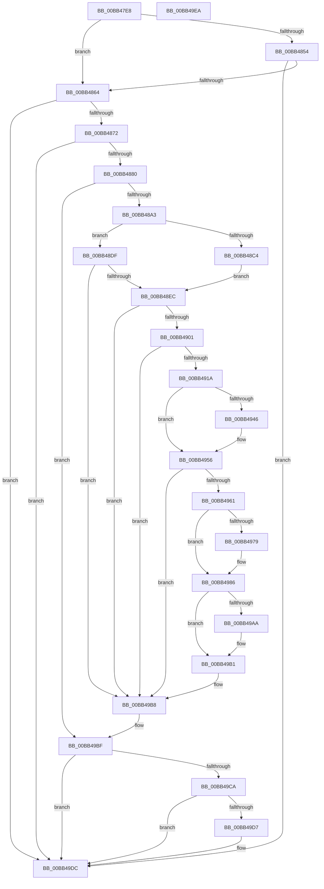

# MmVerifierTrimMemory

- RVA: `0x00BB47E8`–`0x00BB49EB` (길이 `515` bytes)
- VA: `0x0000000140BB47E8`
- 실행 섹션: `PAGEVRFY`
- PDB 이름 있음: `예`; PDB Function 태그: `아니요`
- unwind 정보 RVA: `0x000D7E58`
- 디코드: `116`개 명령, `515/515` bytes 표시
- 미해석 바이트: `0` (있으면 어셈블리에 `.byte`로 보존)

> 이 문서는 커널 이미지의 기계어와 PDB 기호를 분석해 생성했습니다. 4번과 5번은 함수 원형과 자료형을 바이너리 사용 방식에서 추정한 C 해석이며 원본 소스 복구 결과는 아닙니다.

## 1. Dependencies

- 직접 호출 지점: **8**; 고유 호출 대상: **6**
- 직접 호출자로 확인된 함수: **1**
- RIP 상대 이미지 참조: **14**

### Outgoing calls
- `0x00BB482C` → [KiQueryUnbiasedInterruptTime](../../text/42/KiQueryUnbiasedInterruptTime_function_0042D180.md) (function, `0x0042D180`)
- `0x00BB48A6` → [KiQueryUnbiasedInterruptTime](../../text/42/KiQueryUnbiasedInterruptTime_function_0042D180.md) (function, `0x0042D180`)
- `0x00BB48F4` → [RtlpGetStackLimits](../../text/2F/RtlpGetStackLimits_function_002F5F50.md) (function, `0x002F5F50`)
- `0x00BB4901` → [KeGetCurrentStackPointer](../../text/6B/KeGetCurrentStackPointer_function_006B1070.md) (function, `0x006B1070`)
- `0x00BB4934` → [KeQueryPerformanceCounter](../../text/37/KeQueryPerformanceCounter_function_0037E7E0.md) (function, `0x0037E7E0`)
- `0x00BB4958` → [MiTrimAllSystemPagableMemory](../../text/67/MiTrimAllSystemPagableMemory_function_0067EDF0.md) (function, `0x0067EDF0`)
- `0x00BB496A` → [KeQueryPerformanceCounter](../../text/37/KeQueryPerformanceCounter_function_0037E7E0.md) (function, `0x0037E7E0`)
- `0x00BB49D7` → [KiCheckForKernelApcDelivery](../../text/2E/KiCheckForKernelApcDelivery_function_002E2C80.md) (function, `0x002E2C80`)

### Direct callers
- [ViKeIrqlLogAndTrimMemory](ViKeIrqlLogAndTrimMemory_function_00BB7F58.md) at `0x00BB7FC1`

### Static image references
- `0x00BB4844` → RVA `0x00E374E0` (`.data`; read)
- `0x00BB4854` → RVA `0x00E374E8` (`.data`; read)
- `0x00BB4864` → RVA `0x00E374FC` (`.data`; read)
- `0x00BB4872` → RVA `0x00E37518` (`.data`; read)
- `0x00BB48C4` → RVA `0x00E374F8` (`.data`; read/write)
- `0x00BB48CB` → RVA `0x00E374E0` (`.data`; write)
- `0x00BB48D2` → RVA `0x00E374E8` (`.data`; write)
- `0x00BB491A` → RVA `0x00F04A40` (`.data`; read/write)
- `0x00BB492A` → RVA `0x00E37518` (`.data`; write)
- `0x00BB499A` → RVA `0x00E374E8` (`.data`; read/write)
- `0x00BB49A1` → RVA `0x00E374F0` (`.data`; read)
- `0x00BB49AA` → RVA `0x00E374F0` (`.data`; write)
- `0x00BB49B1` → RVA `0x00F04A44` (`.data`; read/write)
- `0x00BB49B8` → RVA `0x00E374FC` (`.data`; read/write)

## 2. Other-region calls and transfers

- 다른 실행 섹션으로 향하는 call: **8**
  - `0x00BB482C` → [KiQueryUnbiasedInterruptTime](../../text/42/KiQueryUnbiasedInterruptTime_function_0042D180.md) (`PAGEVRFY` → `.text`)
  - `0x00BB48A6` → [KiQueryUnbiasedInterruptTime](../../text/42/KiQueryUnbiasedInterruptTime_function_0042D180.md) (`PAGEVRFY` → `.text`)
  - `0x00BB48F4` → [RtlpGetStackLimits](../../text/2F/RtlpGetStackLimits_function_002F5F50.md) (`PAGEVRFY` → `.text`)
  - `0x00BB4901` → [KeGetCurrentStackPointer](../../text/6B/KeGetCurrentStackPointer_function_006B1070.md) (`PAGEVRFY` → `.text`)
  - `0x00BB4934` → [KeQueryPerformanceCounter](../../text/37/KeQueryPerformanceCounter_function_0037E7E0.md) (`PAGEVRFY` → `.text`)
  - `0x00BB4958` → [MiTrimAllSystemPagableMemory](../../text/67/MiTrimAllSystemPagableMemory_function_0067EDF0.md) (`PAGEVRFY` → `.text`)
  - `0x00BB496A` → [KeQueryPerformanceCounter](../../text/37/KeQueryPerformanceCounter_function_0037E7E0.md) (`PAGEVRFY` → `.text`)
  - `0x00BB49D7` → [KiCheckForKernelApcDelivery](../../text/2E/KiCheckForKernelApcDelivery_function_002E2C80.md) (`PAGEVRFY` → `.text`)
- 별도 외부 분기/꼬리 이동을 확인하지 못했습니다.

## 3. Assembly (complete function range)

```asm
00BB47E8  48 89 5C 24 08                  mov qword ptr [rsp + 8], rbx
00BB47ED  55                              push rbp
00BB47EE  57                              push rdi
00BB47EF  41 56                           push r14
00BB47F1  48 8B EC                        mov rbp, rsp
00BB47F4  48 83 EC 30                     sub rsp, 0x30
00BB47F8  48 83 65 F0 00                  and qword ptr [rbp - 0x10], 0
00BB47FD  48 B8 15 AE 47 E1 7A 14 AE 47   movabs rax, 0x47ae147ae147ae15
00BB4807  48 83 65 38 00                  and qword ptr [rbp + 0x38], 0
00BB480C  41 BE 01 00 00 00               mov r14d, 1
00BB4812  44 69 D9 80 96 98 00            imul r11d, ecx, 0x989680
00BB4819  41 8A CE                        mov cl, r14b
00BB481C  49 F7 E3                        mul r11
00BB481F  4C 2B DA                        sub r11, rdx
00BB4822  49 D1 EB                        shr r11, 1
00BB4825  4C 03 DA                        add r11, rdx
00BB4828  49 C1 EB 06                     shr r11, 6
00BB482C  E8 4F 89 87 FF                  call 0x14042d180
00BB4831  48 8B C8                        mov rcx, rax
00BB4834  48 BB BD 42 7A E5 D5 94 BF D6   movabs rbx, 0xd6bf94d5e57a42bd
00BB483E  48 8B C3                        mov rax, rbx
00BB4841  48 F7 E1                        mul rcx
00BB4844  48 8B 05 95 2C 28 00            mov rax, qword ptr [rip + 0x282c95]
00BB484B  48 C1 EA 17                     shr rdx, 0x17
00BB484F  48 3B D0                        cmp rdx, rax
00BB4852  75 10                           jne 0x140bb4864
00BB4854  48 8B 05 8D 2C 28 00            mov rax, qword ptr [rip + 0x282c8d]
00BB485B  49 3B C3                        cmp rax, r11
00BB485E  0F 83 78 01 00 00               jae 0x140bb49dc
00BB4864  8B 05 92 2C 28 00               mov eax, dword ptr [rip + 0x282c92]
00BB486A  85 C0                           test eax, eax
00BB486C  0F 85 6A 01 00 00               jne 0x140bb49dc
00BB4872  8B 05 A0 2C 28 00               mov eax, dword ptr [rip + 0x282ca0]
00BB4878  85 C0                           test eax, eax
00BB487A  0F 84 5C 01 00 00               je 0x140bb49dc
00BB4880  65 48 8B 3C 25 88 01 00 00      mov rdi, qword ptr gs:[0x188]
00BB4889  66 44 29 B7 E6 01 00 00         sub word ptr [rdi + 0x1e6], r14w
00BB4891  90                              nop
00BB4892  33 C0                           xor eax, eax
00BB4894  F0 44 0F B1 35 5F 2C 28 00      lock cmpxchg dword ptr [rip + 0x282c5f], r14d
00BB489D  0F 85 1C 01 00 00               jne 0x140bb49bf
00BB48A3  41 8A CE                        mov cl, r14b
00BB48A6  E8 D5 88 87 FF                  call 0x14042d180
00BB48AB  48 8B C8                        mov rcx, rax
00BB48AE  48 8B C3                        mov rax, rbx
00BB48B1  48 F7 E1                        mul rcx
00BB48B4  48 8B 05 25 2C 28 00            mov rax, qword ptr [rip + 0x282c25]
00BB48BB  48 C1 EA 17                     shr rdx, 0x17
00BB48BF  48 3B D0                        cmp rdx, rax
00BB48C2  74 1B                           je 0x140bb48df
00BB48C4  83 25 2D 2C 28 00 00            and dword ptr [rip + 0x282c2d], 0
00BB48CB  48 89 15 0E 2C 28 00            mov qword ptr [rip + 0x282c0e], rdx
00BB48D2  48 C7 05 0B 2C 28 00 00 00 00 00  mov qword ptr [rip + 0x282c0b], 0
00BB48DD  EB 0D                           jmp 0x140bb48ec
00BB48DF  4C 39 1D 02 2C 28 00            cmp qword ptr [rip + 0x282c02], r11
00BB48E6  0F 83 CC 00 00 00               jae 0x140bb49b8
00BB48EC  48 8D 55 38                     lea rdx, [rbp + 0x38]
00BB48F0  48 8D 4D F0                     lea rcx, [rbp - 0x10]
00BB48F4  E8 57 16 74 FF                  call 0x1402f5f50
00BB48F9  84 C0                           test al, al
00BB48FB  0F 84 B7 00 00 00               je 0x140bb49b8
00BB4901  E8 6A C7 AF FF                  call 0x1406b1070
00BB4906  48 89 45 38                     mov qword ptr [rbp + 0x38], rax
00BB490A  48 2B 45 F0                     sub rax, qword ptr [rbp - 0x10]
00BB490E  48 3D 30 1A 00 00               cmp rax, 0x1a30
00BB4914  0F 86 9E 00 00 00               jbe 0x140bb49b8
00BB491A  44 01 35 1F 01 35 00            add dword ptr [rip + 0x35011f], r14d
00BB4921  48 8D 4D 28                     lea rcx, [rbp + 0x28]
00BB4925  48 83 65 28 00                  and qword ptr [rbp + 0x28], 0
00BB492A  C7 05 E4 2B 28 00 00 00 00 00   mov dword ptr [rip + 0x282be4], 0
00BB4934  E8 A7 9E 7C FF                  call 0x14037e7e0
00BB4939  48 81 7D 28 80 96 98 00         cmp qword ptr [rbp + 0x28], 0x989680
00BB4941  48 8B D8                        mov rbx, rax
00BB4944  74 10                           je 0x140bb4956
00BB4946  48 69 C3 80 96 98 00            imul rax, rbx, 0x989680
00BB494D  48 99                           cqo
00BB494F  48 F7 7D 28                     idiv qword ptr [rbp + 0x28]
00BB4953  48 8B D8                        mov rbx, rax
00BB4956  33 C9                           xor ecx, ecx
00BB4958  E8 93 A4 AC FF                  call 0x14067edf0
00BB495D  85 C0                           test eax, eax
00BB495F  74 57                           je 0x140bb49b8
00BB4961  48 83 65 30 00                  and qword ptr [rbp + 0x30], 0
00BB4966  48 8D 4D 30                     lea rcx, [rbp + 0x30]
00BB496A  E8 71 9E 7C FF                  call 0x14037e7e0
00BB496F  48 81 7D 30 80 96 98 00         cmp qword ptr [rbp + 0x30], 0x989680
00BB4977  74 0D                           je 0x140bb4986
00BB4979  48 69 C0 80 96 98 00            imul rax, rax, 0x989680
00BB4980  48 99                           cqo
00BB4982  48 F7 7D 30                     idiv qword ptr [rbp + 0x30]
00BB4986  48 3B C3                        cmp rax, rbx
00BB4989  48 8B CB                        mov rcx, rbx
00BB498C  48 0F 43 C8                     cmovae rcx, rax
00BB4990  44 01 35 61 2B 28 00            add dword ptr [rip + 0x282b61], r14d
00BB4997  48 2B CB                        sub rcx, rbx
00BB499A  48 01 0D 47 2B 28 00            add qword ptr [rip + 0x282b47], rcx
00BB49A1  48 3B 0D 48 2B 28 00            cmp rcx, qword ptr [rip + 0x282b48]
00BB49A8  76 07                           jbe 0x140bb49b1
00BB49AA  48 89 0D 3F 2B 28 00            mov qword ptr [rip + 0x282b3f], rcx
00BB49B1  44 01 35 8C 00 35 00            add dword ptr [rip + 0x35008c], r14d
00BB49B8  F0 FF 0D 3D 2B 28 00            lock dec dword ptr [rip + 0x282b3d]
00BB49BF  90                              nop
00BB49C0  66 44 01 B7 E6 01 00 00         add word ptr [rdi + 0x1e6], r14w
00BB49C8  75 12                           jne 0x140bb49dc
00BB49CA  48 8D 87 98 00 00 00            lea rax, [rdi + 0x98]
00BB49D1  90                              nop
00BB49D2  48 39 00                        cmp qword ptr [rax], rax
00BB49D5  74 05                           je 0x140bb49dc
00BB49D7  E8 A4 E2 72 FF                  call 0x1402e2c80
00BB49DC  48 8B 5C 24 50                  mov rbx, qword ptr [rsp + 0x50]
00BB49E1  48 83 C4 30                     add rsp, 0x30
00BB49E5  41 5E                           pop r14
00BB49E7  5F                              pop rdi
00BB49E8  5D                              pop rbp
00BB49E9  C3                              ret
00BB49EA  CC                              int3
```

## 4. C-style interpretation (structured pseudocode)

```c
__int64 __fastcall MmVerifierTrimMemory(int a1, __int64 a2)
{
    __int64 result;
    __int64 v_r11;
    __int64 v_rbx;
    __int64 v_rsp;
    unsigned __int64 v_stack_m28;
    unsigned __int64 v_stack_p10;
    unsigned __int64 v_stack_p18;
    unsigned __int64 v_stack_p20;
    unsigned __int64 v_stack_p8;

    v_stack_p8 = v_rbx;
    v_rsp = (v_rsp) - (48);
    v_r11 = (unsigned int)((v_r11) * (a1));
    v_r11 = (v_r11) - (a2);
    v_r11 = (v_r11) >> (1);
    v_r11 = (v_r11) + (a2);
    v_r11 = (v_r11) >> (6);
    result = KiQueryUnbiasedInterruptTime(1, a2, a3, a4);
    a2 = (a2) >> (23);
    if (a2 != (*(unsigned __int64 *)(v_rip + 2632853))) goto loc_00BB4864;
    if ((*(unsigned __int64 *)(v_rip + 2632845)) >= v_r11) goto loc_00BB49DC;
loc_00BB4864:
    if ((unsigned int)((unsigned int)(*(unsigned int *)(v_rip + 2632850))) != 0) goto loc_00BB49DC;
    if ((unsigned int)((unsigned int)(*(unsigned int *)(v_rip + 2632864))) == 0) goto loc_00BB49DC;
    result = 0;
    if (condition_is_not_equal) goto loc_00BB49BF;
    result = KiQueryUnbiasedInterruptTime(1, a2, a3, a4);
    a2 = (a2) >> (23);
    if (a2 == (*(unsigned __int64 *)(v_rip + 2632741))) goto loc_00BB48DF;
    *(unsigned __int64 *)(v_rip + 2632718) = a2;
    *(unsigned __int64 *)(v_rip + 2632715) = 0;
    goto loc_00BB48EC;
loc_00BB48DF:
    if ((*(unsigned __int64 *)(v_rip + 2632706)) >= v_r11) goto loc_00BB49B8;
loc_00BB48EC:
    result = RtlpGetStackLimits(v_stack_m28, v_stack_p20, a3, a4);
    if ((unsigned __int8)(result) == 0) goto loc_00BB49B8;
    result = KeGetCurrentStackPointer(v_stack_m28, v_stack_p20, a3, a4);
    v_stack_p20 = result;
    result = (result) - (v_stack_m28);
    if (result <= 0x1A30ULL) goto loc_00BB49B8;
    *(unsigned int *)(v_rip + 2632676) = 0;
    result = KeQueryPerformanceCounter(v_stack_p10, v_stack_p20, a3, a4);
    v_rbx = result;
    if (v_stack_p10 != 0x989680ULL) {
        result = (result) * (result);
        v_rbx = result;
    }
    a1 = 0;
    result = MiTrimAllSystemPagableMemory(a1, v_stack_p20, a3, a4);
    if ((unsigned int)(result) == 0) goto loc_00BB49B8;
    result = KeQueryPerformanceCounter(v_stack_p18, v_stack_p20, a3, a4);
    if (v_stack_p18 != 0x989680ULL) {
        result = (result) * (result);
    }
    a1 = v_rbx;
    if (result >= v_rbx) { a1 = result; }
    a1 = (a1) - (v_rbx);
    if (a1 >= = (*(unsigned __int64 *)(v_rip + 2632520))) {
        *(unsigned __int64 *)(v_rip + 2632511) = a1;
    }
loc_00BB49B8:
loc_00BB49BF:
    if (a1 != (*(unsigned __int64 *)(v_rip + 2632520))) goto loc_00BB49DC;
    result = *(unsigned __int64 *)(gs_base + (0 + 392)) + 152;
    if ((*(unsigned __int64 *)(*(unsigned __int64 *)(gs_base + (0 + 392)) + 152)) != (*(unsigned __int64 *)(gs_base + (0 + 392)) + 152)) {
        result = KiCheckForKernelApcDelivery(a1, v_stack_p20, a3, a4);
    }
    v_rsp = (v_rsp) + (48);
    return result;
}
```

## 5. (Beta) C Style

```c
int64_t MmVerifierTrimMemory(int32_t Arg1, int64_t Arg2)
{
    int64_t result;
    int64_t local_r11;
    int64_t local_rbx;
    int64_t local_rsp;
    uint64_t v_stack_m28;
    uint64_t v_stack_p10;
    uint64_t v_stack_p18;
    uint64_t v_stack_p20;
    uint64_t v_stack_p8;

    v_stack_p8 = local_rbx;
    local_rsp = (local_rsp) - (48);
    local_r11 = (uint32_t)((local_r11) * (Arg1));
    local_r11 = (local_r11) - (Arg2);
    local_r11 = (local_r11) >> (1);
    local_r11 = (local_r11) + (Arg2);
    local_r11 = (local_r11) >> (6);
    result = KiQueryUnbiasedInterruptTime(1, Arg2, a3, a4);
    Arg2 = (Arg2) >> (23);
    if (Arg2 != (*(uint64_t *)(v_rip + 0x282C95))) goto loc_00BB4864;
    if ((*(uint64_t *)(v_rip + 0x282C8D)) >= local_r11) goto loc_00BB49DC;
loc_00BB4864:
    if ((uint32_t)((uint32_t)(*(uint32_t *)(v_rip + 0x282C92))) != 0) goto loc_00BB49DC;
    if ((uint32_t)((uint32_t)(*(uint32_t *)(v_rip + 0x282CA0))) == 0) goto loc_00BB49DC;
    result = 0;
    if (condition_is_not_equal) goto loc_00BB49BF;
    result = KiQueryUnbiasedInterruptTime(1, Arg2, a3, a4);
    Arg2 = (Arg2) >> (23);
    if (Arg2 == (*(uint64_t *)(v_rip + 0x282C25))) goto loc_00BB48DF;
    *(uint64_t *)(v_rip + 0x282C0E) = Arg2;
    *(uint64_t *)(v_rip + 0x282C0B) = 0;
    goto loc_00BB48EC;
loc_00BB48DF:
    if ((*(uint64_t *)(v_rip + 0x282C02)) >= local_r11) goto loc_00BB49B8;
loc_00BB48EC:
    result = RtlpGetStackLimits(v_stack_m28, v_stack_p20, a3, a4);
    if ((uint8_t)(result) == 0) goto loc_00BB49B8;
    result = KeGetCurrentStackPointer(v_stack_m28, v_stack_p20, a3, a4);
    v_stack_p20 = result;
    result = (result) - (v_stack_m28);
    if (result <= 0x1A30ULL) goto loc_00BB49B8;
    *(uint32_t *)(v_rip + 0x282BE4) = 0;
    result = KeQueryPerformanceCounter(v_stack_p10, v_stack_p20, a3, a4);
    local_rbx = result;
    if (v_stack_p10 != 0x989680ULL) {
        result = (result) * (result);
        local_rbx = result;
    }
    Arg1 = 0;
    result = MiTrimAllSystemPagableMemory(Arg1, v_stack_p20, a3, a4);
    if ((uint32_t)(result) == 0) goto loc_00BB49B8;
    result = KeQueryPerformanceCounter(v_stack_p18, v_stack_p20, a3, a4);
    if (v_stack_p18 != 0x989680ULL) {
        result = (result) * (result);
    }
    Arg1 = local_rbx;
    if (result >= local_rbx) { Arg1 = result; }
    Arg1 = (Arg1) - (local_rbx);
    if (Arg1 >= = (*(uint64_t *)(v_rip + 0x282B48))) {
        *(uint64_t *)(v_rip + 0x282B3F) = Arg1;
    }
loc_00BB49B8:
loc_00BB49BF:
    if (Arg1 != (*(uint64_t *)(v_rip + 0x282B48))) goto loc_00BB49DC;
    result = *(uint64_t *)(gs_base + (0 + 0x188)) + 152;
    if ((*(uint64_t *)(*(uint64_t *)(gs_base + (0 + 0x188)) + 0x98)) != (*(uint64_t *)(gs_base + (0 + 0x188)) + 152)) {
        result = KiCheckForKernelApcDelivery(Arg1, v_stack_p20, a3, a4);
    }
    local_rsp = (local_rsp) + (48);
    return result;
}
```

## 6. Execution-region graph

[열기: 2D/3D 그래프와 함수 탐색 컨트롤 패널](../../../control-panel.html?section=pagevrfy&rva=0x00BB47E8&view=graph)

- 2D 그래프는 위에서 아래로 흐르고, 3D 그래프는 빈 공간을 드래그해 회전합니다. Shift+드래그는 이동, 휠은 확대·축소, 함수 노드 선택은 대상 보고서 이동입니다.

### Static fallback


