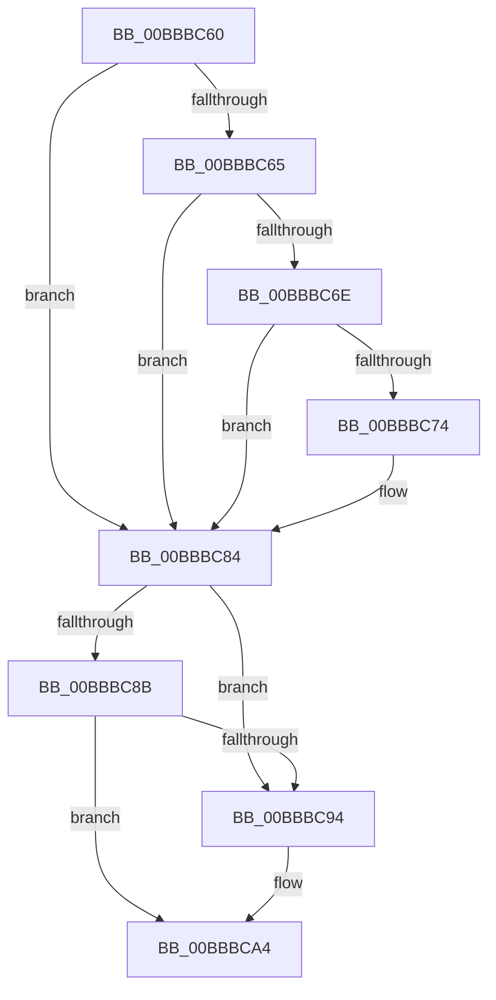

# sub_00BBBC60

- RVA: `0x00BBBC60`–`0x00BBBCB2` (길이 `82` bytes)
- VA: `0x0000000140BBBC60`
- 실행 섹션: `PAGEVRFY`
- PDB 이름 있음: `아니요`; PDB Function 태그: `아니요`
- unwind 정보 RVA: `0x000B079C`
- 디코드: `23`개 명령, `82/82` bytes 표시
- 미해석 바이트: `0` (있으면 어셈블리에 `.byte`로 보존)

> 이 문서는 커널 이미지의 기계어와 PDB 기호를 분석해 생성했습니다. 4번과 5번은 함수 원형과 자료형을 바이너리 사용 방식에서 추정한 C 해석이며 원본 소스 복구 결과는 아닙니다.

## 1. Dependencies

- 직접 호출 지점: **3**; 고유 호출 대상: **2**
- 직접 호출자로 확인된 함수: **0**
- RIP 상대 이미지 참조: **0**

### Outgoing calls
- `0x00BBBC7F` → [ViErrorReport1](../../text/61/ViErrorReport1_function_00614584.md) (function, `0x00614584`)
- `0x00BBBC9F` → [ViErrorReport1](../../text/61/ViErrorReport1_function_00614584.md) (function, `0x00614584`)
- `0x00BBBCA7` → [VfIrpDatabaseEntryReleaseLock](VfIrpDatabaseEntryReleaseLock_function_00BB3FD4.md) (function, `0x00BB3FD4`)

### Direct callers
- 이 함수 시작 RVA로 연결되는 직접 call은 확인되지 않았습니다. 간접 호출은 완전히 역산할 수 없습니다.

### Static image references
- 디코드된 RIP-relative 메모리 참조가 없습니다.

## 2. Other-region calls and transfers

- 다른 실행 섹션으로 향하는 call: **2**
  - `0x00BBBC7F` → [ViErrorReport1](../../text/61/ViErrorReport1_function_00614584.md) (`PAGEVRFY` → `.text`)
  - `0x00BBBC9F` → [ViErrorReport1](../../text/61/ViErrorReport1_function_00614584.md) (`PAGEVRFY` → `.text`)
- call이 아닌 외부 분기/꼬리 이동: **1**
  - `0x00BBBCAD` → [VfIoInitializeIrp + 0x2A](VfIoInitializeIrp_function_00BB66D4.md) (`tail-transfer`)

## 3. Assembly (complete function range)

```asm
00BBBC60  40 84 ED                        test bpl, bpl
00BBBC63  75 1F                           jne 0x140bbbc84
00BBBC65  F7 47 38 00 00 20 00            test dword ptr [rdi + 0x38], 0x200000
00BBBC6C  74 16                           je 0x140bbbc84
00BBBC6E  F6 43 47 01                     test byte ptr [rbx + 0x47], 1
00BBBC72  74 10                           je 0x140bbbc84
00BBBC74  4C 8B C3                        mov r8, rbx
00BBBC77  48 8B D6                        mov rdx, rsi
00BBBC7A  B9 0D 02 00 00                  mov ecx, 0x20d
00BBBC7F  E8 00 89 A5 FF                  call 0x140614584
00BBBC84  8B 43 10                        mov eax, dword ptr [rbx + 0x10]
00BBBC87  A8 08                           test al, 8
00BBBC89  75 09                           jne 0x140bbbc94
00BBBC8B  F7 47 38 00 10 00 00            test dword ptr [rdi + 0x38], 0x1000
00BBBC92  74 10                           je 0x140bbbca4
00BBBC94  4C 8B C3                        mov r8, rbx
00BBBC97  48 8B D6                        mov rdx, rsi
00BBBC9A  B9 11 03 00 00                  mov ecx, 0x311
00BBBC9F  E8 E0 88 A5 FF                  call 0x140614584
00BBBCA4  48 8B CF                        mov rcx, rdi
00BBBCA7  E8 28 83 FF FF                  call 0x140bb3fd4
00BBBCAC  90                              nop
00BBBCAD  E9 4C AA FF FF                  jmp 0x140bb66fe
```

## 4. C-style interpretation (structured pseudocode)

```c
__int64 __fastcall sub_00BBBC60(void)
{
    __int64 result;

    if ((unsigned __int8)(v_rbp) != 0) goto loc_00BBBC84;
    if (((*(unsigned int *)(v_rdi + 56)) & (0x200000ULL)) == 0) goto loc_00BBBC84;
    if (((*(unsigned __int8 *)(v_rbx + 71)) & (1)) != 0) {
        a3 = v_rbx;
        a2 = v_rsi;
        a1 = 525;
        result = ViErrorReport1(a1, a2, a3, a4);
    }
    if ((((unsigned __int8)((unsigned int)(*(unsigned int *)(v_rbx + 16)))) & (8)) != 0) goto loc_00BBBC94;
    result = (unsigned int)(*(unsigned int *)(v_rbx + 16));
    if (((*(unsigned int *)(v_rdi + 56)) & (0x1000ULL)) != 0) {
        a3 = v_rbx;
        a2 = v_rsi;
        a1 = 785;
        result = ViErrorReport1(a1, a2, a3, a4);
    }
    result = VfIrpDatabaseEntryReleaseLock(v_rdi, a2, a3, a4);
}
```

## 5. (Beta) C Style

```c
void sub_00BBBC60(void)
{
    int64_t result;

    if ((uint8_t)(local_rbp) != 0) goto loc_00BBBC84;
    if (((*(uint32_t *)(local_rdi + 0x38)) & (0x200000ULL)) == 0) goto loc_00BBBC84;
    if (((*(uint8_t *)(local_rbx + 0x47)) & (1)) != 0) {
        a3 = local_rbx;
        a2 = local_rsi;
        a1 = 525;
        result = ViErrorReport1(a1, a2, a3, a4);
    }
    if ((((uint8_t)((uint32_t)(*(uint32_t *)(local_rbx + 0x10)))) & (8)) != 0) goto loc_00BBBC94;
    result = (uint32_t)(*(uint32_t *)(local_rbx + 0x10));
    if (((*(uint32_t *)(local_rdi + 0x38)) & (0x1000ULL)) != 0) {
        a3 = local_rbx;
        a2 = local_rsi;
        a1 = 785;
        result = ViErrorReport1(a1, a2, a3, a4);
    }
    result = VfIrpDatabaseEntryReleaseLock(local_rdi, a2, a3, a4);
}
```

## 6. Execution-region graph

[열기: 2D/3D 그래프와 함수 탐색 컨트롤 패널](../../../control-panel.html?section=pagevrfy&rva=0x00BBBC60&view=graph)

- 2D 그래프는 위에서 아래로 흐르고, 3D 그래프는 빈 공간을 드래그해 회전합니다. Shift+드래그는 이동, 휠은 확대·축소, 함수 노드 선택은 대상 보고서 이동입니다.

### Static fallback


