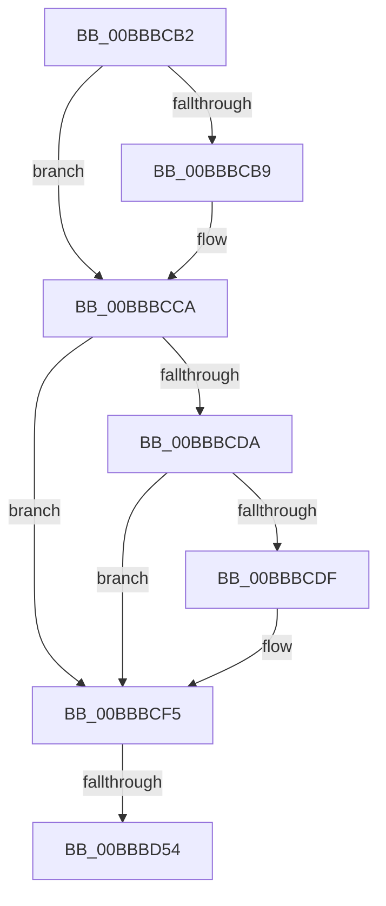

# sub_00BBBCB2

- RVA: `0x00BBBCB2`–`0x00BBBD62` (길이 `176` bytes)
- VA: `0x0000000140BBBCB2`
- 실행 섹션: `PAGEVRFY`
- PDB 이름 있음: `아니요`; PDB Function 태그: `아니요`
- unwind 정보 RVA: `0x000B07EC`
- 디코드: `42`개 명령, `176/176` bytes 표시
- 미해석 바이트: `0` (있으면 어셈블리에 `.byte`로 보존)

> 이 문서는 커널 이미지의 기계어와 PDB 기호를 분석해 생성했습니다. 4번과 5번은 함수 원형과 자료형을 바이너리 사용 방식에서 추정한 C 해석이며 원본 소스 복구 결과는 아닙니다.

## 1. Dependencies

- 직접 호출 지점: **5**; 고유 호출 대상: **5**
- 직접 호출자로 확인된 함수: **0**
- RIP 상대 이미지 참조: **0**

### Outgoing calls
- `0x00BBBCC5` → [ViErrorReport1](../../text/61/ViErrorReport1_function_00614584.md) (function, `0x00614584`)
- `0x00BBBCE2` → [VfPendingStartLogging](../BA/VfPendingStartLogging_function_00BA1CC4.md) (function, `0x00BA1CC4`)
- `0x00BBBD3E` → [IovpAdvanceStackDownwards](../B9/IovpAdvanceStackDownwards_function_00B9CB1C.md) (function, `0x00B9CB1C`)
- `0x00BBBD46` → [VfIrpDatabaseEntryReleaseLock](VfIrpDatabaseEntryReleaseLock_function_00BB3FD4.md) (function, `0x00BB3FD4`)
- `0x00BBBD57` → [VfPendingFinishLogging](../BA/VfPendingFinishLogging_function_00BA1A60.md) (function, `0x00BA1A60`)

### Direct callers
- 이 함수 시작 RVA로 연결되는 직접 call은 확인되지 않았습니다. 간접 호출은 완전히 역산할 수 없습니다.

### Static image references
- 디코드된 RIP-relative 메모리 참조가 없습니다.

## 2. Other-region calls and transfers

- 다른 실행 섹션으로 향하는 call: **1**
  - `0x00BBBCC5` → [ViErrorReport1](../../text/61/ViErrorReport1_function_00614584.md) (`PAGEVRFY` → `.text`)
- call이 아닌 외부 분기/꼬리 이동: **2**
  - `0x00BBBD4E` → [IovpCompleteRequest1 + 0x33](IovpCompleteRequest1_function_00BB69D8.md) (`tail-transfer`)
  - `0x00BBBD5D` → [IovpCompleteRequest1 + 0x33](IovpCompleteRequest1_function_00BB69D8.md) (`tail-transfer`)

## 3. Assembly (complete function range)

```asm
00BBBCB2  8B 40 38                        mov eax, dword ptr [rax + 0x38]
00BBBCB5  A8 10                           test al, 0x10
00BBBCB7  74 11                           je 0x140bbbcca
00BBBCB9  48 8B 56 20                     mov rdx, qword ptr [rsi + 0x20]
00BBBCBD  4C 8B C7                        mov r8, rdi
00BBBCC0  B9 09 02 00 00                  mov ecx, 0x209
00BBBCC5  E8 BA 88 A5 FF                  call 0x140614584
00BBBCCA  44 88 BB B9 00 00 00            mov byte ptr [rbx + 0xb9], r15b
00BBBCD1  48 39 AB D8 00 00 00            cmp qword ptr [rbx + 0xd8], rbp
00BBBCD8  74 1B                           je 0x140bbbcf5
00BBBCDA  39 6B 38                        cmp dword ptr [rbx + 0x38], ebp
00BBBCDD  7C 16                           jl 0x140bbbcf5
00BBBCDF  48 8B CF                        mov rcx, rdi
00BBBCE2  E8 DD 5F FE FF                  call 0x140ba1cc4
00BBBCE7  48 8B 8F B8 00 00 00            mov rcx, qword ptr [rdi + 0xb8]
00BBBCEE  48 8B E8                        mov rbp, rax
00BBBCF1  80 49 03 01                     or byte ptr [rcx + 3], 1
00BBBCF5  49 83 66 30 00                  and qword ptr [r14 + 0x30], 0
00BBBCFA  48 8D 84 24 88 00 00 00         lea rax, [rsp + 0x88]
00BBBD02  0F BE 4F 43                     movsx ecx, byte ptr [rdi + 0x43]
00BBBD06  4D 8B C4                        mov r8, r12
00BBBD09  44 0F B6 93 BA 00 00 00         movzx r10d, byte ptr [rbx + 0xba]
00BBBD11  44 2B D1                        sub r10d, ecx
00BBBD14  48 89 44 24 38                  mov qword ptr [rsp + 0x38], rax
00BBBD19  83 64 24 30 00                  and dword ptr [rsp + 0x30], 0
00BBBD1E  83 64 24 28 00                  and dword ptr [rsp + 0x28], 0
00BBBD23  49 63 CA                        movsxd rcx, r10d
00BBBD26  44 89 56 14                     mov dword ptr [rsi + 0x14], r10d
00BBBD2A  44 89 54 24 20                  mov dword ptr [rsp + 0x20], r10d
00BBBD2F  48 8D 14 C9                     lea rdx, [rcx + rcx*8]
00BBBD33  4D 8D 0C D4                     lea r9, [r12 + rdx*8]
00BBBD37  8A 57 43                        mov dl, byte ptr [rdi + 0x43]
00BBBD3A  49 8D 4E 50                     lea rcx, [r14 + 0x50]
00BBBD3E  E8 D9 0D FE FF                  call 0x140b9cb1c
00BBBD43  48 8B CB                        mov rcx, rbx
00BBBD46  E8 89 82 FF FF                  call 0x140bb3fd4
00BBBD4B  48 85 ED                        test rbp, rbp
00BBBD4E  0F 84 B7 AC FF FF               je 0x140bb6a0b
00BBBD54  48 8B CD                        mov rcx, rbp
00BBBD57  E8 04 5D FE FF                  call 0x140ba1a60
00BBBD5C  90                              nop
00BBBD5D  E9 A9 AC FF FF                  jmp 0x140bb6a0b
```

## 4. C-style interpretation (structured pseudocode)

```c
__int64 __fastcall sub_00BBBCB2(__int64 a1, __int64 a2, __int64 a3, __int64 a4, unsigned int a5, unsigned int a6, __int64 a7, __int64 a8, __int64 a9, __int64 a10, __int64 a11, __int64 a12, __int64 a13, __int64 a14, __int64 a15, __int64 a16, __int64 a17)
{
    __int64 result;
    __int64 v_r10;
    __int64 v_rbp;
    unsigned int v_stack_p20;
    unsigned __int64 v_stack_p38;

    result = (unsigned int)(*(unsigned int *)(result + 56));
    if ((((unsigned __int8)((unsigned int)(*(unsigned int *)(result + 56)))) & (16)) != 0) {
        a2 = *(unsigned __int64 *)(v_rsi + 32);
        a3 = v_rdi;
        a1 = 521;
        result = ViErrorReport1(a1, a2, a3, a4);
    }
    *(unsigned __int8 *)(v_rbx + 185) = (unsigned __int8)(v_r15);
    if ((*(unsigned __int64 *)(v_rbx + 216)) == v_rbp) goto loc_00BBBCF5;
    if ((*(unsigned int *)(v_rbx + 56)) >= ((unsigned int)(v_rbp))) {
        a1 = v_rdi;
        result = VfPendingStartLogging(a1, a2, a3, a4);
        a1 = *(unsigned __int64 *)(v_rdi + 184);
        v_rbp = result;
    }
    v_r10 = (unsigned int)((*(unsigned __int8 *)(v_rbx + 186)) - ((unsigned int)((__int8)(*(unsigned __int8 *)(v_rdi + 67)))));
    v_stack_p38 = a17;
    *(unsigned int *)(v_rsi + 20) = (unsigned int)(v_r10);
    v_stack_p20 = (unsigned int)(v_r10);
    result = IovpAdvanceStackDownwards(v_r14 + 80, *(unsigned __int8 *)(v_rdi + 67), v_r12, v_r12 + (int)((unsigned int)(v_r10)) + (int)((unsigned int)(v_r10)) * 8 * 8);
    result = VfIrpDatabaseEntryReleaseLock(v_rbx, *(unsigned __int8 *)(v_rdi + 67), v_r12, v_r12 + (int)((unsigned int)(v_r10)) + (int)((unsigned int)(v_r10)) * 8 * 8);
    result = VfPendingFinishLogging(v_rbp, *(unsigned __int8 *)(v_rdi + 67), v_r12, v_r12 + (int)((unsigned int)(v_r10)) + (int)((unsigned int)(v_r10)) * 8 * 8);
}
```

## 5. (Beta) C Style

```c
int64_t sub_00BBBCB2(int64_t Arg1, int64_t Arg2, int64_t Arg3, int64_t Arg4, uint32_t Arg5, uint32_t Arg6, uint64_t Arg7, uint64_t Arg8, uint64_t Arg9, uint64_t Arg10, uint64_t Arg11, uint64_t Arg12, uint64_t Arg13, uint64_t Arg14, uint64_t Arg15, uint64_t Arg16, int64_t Arg17)
{
    int64_t result;
    int64_t local_r10;
    int64_t local_rbp;
    uint32_t v_stack_p20;
    uint64_t v_stack_p38;

    result = (uint32_t)(*(uint32_t *)(result + 0x38));
    if ((((uint8_t)((uint32_t)(*(uint32_t *)(result + 0x38)))) & (16)) != 0) {
        Arg2 = *(uint64_t *)(local_rsi + 0x20);
        Arg3 = local_rdi;
        Arg1 = 521;
        result = ViErrorReport1(Arg1, Arg2, Arg3, Arg4);
    }
    *(uint8_t *)(local_rbx + 0xB9) = (uint8_t)(local_r15);
    if ((*(uint64_t *)(local_rbx + 0xD8)) == local_rbp) goto loc_00BBBCF5;
    if ((*(uint32_t *)(local_rbx + 0x38)) >= ((uint32_t)(local_rbp))) {
        Arg1 = local_rdi;
        result = VfPendingStartLogging(Arg1, Arg2, Arg3, Arg4);
        Arg1 = *(uint64_t *)(local_rdi + 0xB8);
        local_rbp = result;
    }
    local_r10 = (uint32_t)((*(uint8_t *)(local_rbx + 0xBA)) - ((uint32_t)((int8_t)(*(uint8_t *)(local_rdi + 0x43)))));
    v_stack_p38 = Arg17;
    *(uint32_t *)(local_rsi + 0x14) = (uint32_t)(local_r10);
    v_stack_p20 = (uint32_t)(local_r10);
    result = IovpAdvanceStackDownwards(local_r14 + 80, *(uint8_t *)(local_rdi + 0x43), local_r12, local_r12 + (int32_t)((uint32_t)(local_r10)) + (int32_t)((uint32_t)(local_r10)) * 8 * 8);
    result = VfIrpDatabaseEntryReleaseLock(local_rbx, *(uint8_t *)(local_rdi + 0x43), local_r12, local_r12 + (int32_t)((uint32_t)(local_r10)) + (int32_t)((uint32_t)(local_r10)) * 8 * 8);
    result = VfPendingFinishLogging(local_rbp, *(uint8_t *)(local_rdi + 0x43), local_r12, local_r12 + (int32_t)((uint32_t)(local_r10)) + (int32_t)((uint32_t)(local_r10)) * 8 * 8);
}
```

## 6. Execution-region graph

[열기: 2D/3D 그래프와 함수 탐색 컨트롤 패널](../../../control-panel.html?section=pagevrfy&rva=0x00BBBCB2&view=graph)

- 2D 그래프는 위에서 아래로 흐르고, 3D 그래프는 빈 공간을 드래그해 회전합니다. Shift+드래그는 이동, 휠은 확대·축소, 함수 노드 선택은 대상 보고서 이동입니다.

### Static fallback


