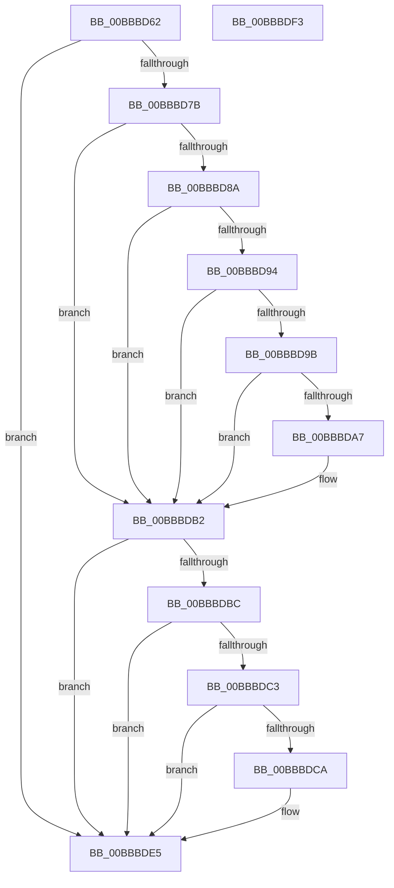

# sub_00BBBD62

- RVA: `0x00BBBD62`–`0x00BBBE00` (길이 `158` bytes)
- VA: `0x0000000140BBBD62`
- 실행 섹션: `PAGEVRFY`
- PDB 이름 있음: `아니요`; PDB Function 태그: `아니요`
- unwind 정보 RVA: `0x000B0824`
- 디코드: `40`개 명령, `158/158` bytes 표시
- 미해석 바이트: `0` (있으면 어셈블리에 `.byte`로 보존)

> 이 문서는 커널 이미지의 기계어와 PDB 기호를 분석해 생성했습니다. 4번과 5번은 함수 원형과 자료형을 바이너리 사용 방식에서 추정한 C 해석이며 원본 소스 복구 결과는 아닙니다.

## 1. Dependencies

- 직접 호출 지점: **4**; 고유 호출 대상: **4**
- 직접 호출자로 확인된 함수: **0**
- RIP 상대 이미지 참조: **1**

### Outgoing calls
- `0x00BBBD6A` → [KeAcquireSpinLockRaiseToDpc](../../text/20/KeAcquireSpinLockRaiseToDpc_function_00208470.md) (function, `0x00208470`)
- `0x00BBBDAD` → [MdlInvariantPostDriverCompletion](../../text/61/MdlInvariantPostDriverCompletion_function_00613A50.md) (function, `0x00613A50`)
- `0x00BBBDD5` → [ViErrorReport1](../../text/61/ViErrorReport1_function_00614584.md) (function, `0x00614584`)
- `0x00BBBDE8` → [VfIrpDatabaseEntryReleaseLock](VfIrpDatabaseEntryReleaseLock_function_00BB3FD4.md) (function, `0x00BB3FD4`)

### Direct callers
- 이 함수 시작 RVA로 연결되는 직접 call은 확인되지 않았습니다. 간접 호출은 완전히 역산할 수 없습니다.

### Static image references
- `0x00BBBD9B` → RVA `0x00F04A20` (`.data`; read)

## 2. Other-region calls and transfers

- 다른 실행 섹션으로 향하는 call: **3**
  - `0x00BBBD6A` → [KeAcquireSpinLockRaiseToDpc](../../text/20/KeAcquireSpinLockRaiseToDpc_function_00208470.md) (`PAGEVRFY` → `.text`)
  - `0x00BBBDAD` → [MdlInvariantPostDriverCompletion](../../text/61/MdlInvariantPostDriverCompletion_function_00613A50.md) (`PAGEVRFY` → `.text`)
  - `0x00BBBDD5` → [ViErrorReport1](../../text/61/ViErrorReport1_function_00614584.md) (`PAGEVRFY` → `.text`)
- call이 아닌 외부 분기/꼬리 이동: **2**
  - `0x00BBBDEE` → [IovpLocalCompletionRoutine + 0x19C](IovpLocalCompletionRoutine_function_00BB6B60.md) (`tail-transfer`)
  - `0x00BBBDFB` → [IovpLocalCompletionRoutine + 0x20B](IovpLocalCompletionRoutine_function_00BB6B60.md) (`tail-transfer`)

## 3. Assembly (complete function range)

```asm
00BBBD62  4D 8B 76 08                     mov r14, qword ptr [r14 + 8]
00BBBD66  49 8D 4E 08                     lea rcx, [r14 + 8]
00BBBD6A  E8 01 C7 64 FF                  call 0x140208470
00BBBD6F  41 88 46 10                     mov byte ptr [r14 + 0x10], al
00BBBD73  81 FD 16 00 00 C0               cmp ebp, 0xc0000016
00BBBD79  74 6A                           je 0x140bbbde5
00BBBD7B  8A 47 42                        mov al, byte ptr [rdi + 0x42]
00BBBD7E  4C 8B AF B8 00 00 00            mov r13, qword ptr [rdi + 0xb8]
00BBBD85  38 47 43                        cmp byte ptr [rdi + 0x43], al
00BBBD88  7F 28                           jg 0x140bbbdb2
00BBBD8A  41 8A 45 00                     mov al, byte ptr [r13]
00BBBD8E  2C 03                           sub al, 3
00BBBD90  3C 01                           cmp al, 1
00BBBD92  77 1E                           ja 0x140bbbdb2
00BBBD94  48 83 7F 08 00                  cmp qword ptr [rdi + 8], 0
00BBBD99  74 17                           je 0x140bbbdb2
00BBBD9B  F7 05 7B 8C 34 00 00 60 00 00   test dword ptr [rip + 0x348c7b], 0x6000
00BBBDA5  74 0B                           je 0x140bbbdb2
00BBBDA7  48 8B D7                        mov rdx, rdi
00BBBDAA  49 8B CE                        mov rcx, r14
00BBBDAD  E8 9E 7C A5 FF                  call 0x140613a50
00BBBDB2  49 83 BE D8 00 00 00 00         cmp qword ptr [r14 + 0xd8], 0
00BBBDBA  74 29                           je 0x140bbbde5
00BBBDBC  41 83 7E 38 00                  cmp dword ptr [r14 + 0x38], 0
00BBBDC1  7C 22                           jl 0x140bbbde5
00BBBDC3  41 F6 45 03 01                  test byte ptr [r13 + 3], 1
00BBBDC8  75 1B                           jne 0x140bbbde5
00BBBDCA  4C 8B C7                        mov r8, rdi
00BBBDCD  49 8B D4                        mov rdx, r12
00BBBDD0  B9 28 02 00 00                  mov ecx, 0x228
00BBBDD5  E8 AA 87 A5 FF                  call 0x140614584
00BBBDDA  48 8B 87 B8 00 00 00            mov rax, qword ptr [rdi + 0xb8]
00BBBDE1  80 48 03 01                     or byte ptr [rax + 3], 1
00BBBDE5  49 8B CE                        mov rcx, r14
00BBBDE8  E8 E7 81 FF FF                  call 0x140bb3fd4
00BBBDED  90                              nop
00BBBDEE  E9 09 AF FF FF                  jmp 0x140bb6cfc
00BBBDF3  48 8B 43 38                     mov rax, qword ptr [rbx + 0x38]
00BBBDF7  48 89 46 18                     mov qword ptr [rsi + 0x18], rax
00BBBDFB  E9 6B AF FF FF                  jmp 0x140bb6d6b
```

## 4. C-style interpretation (structured pseudocode)

```c
__int64 __fastcall sub_00BBBD62(void)
{
    __int64 result;

    result = KeAcquireSpinLockRaiseToDpc(*(unsigned __int64 *)(v_r14 + 8) + 8, a2, a3, a4);
    *(unsigned __int8 *)(*(unsigned __int64 *)(v_r14 + 8) + 16) = (unsigned __int8)(result);
    if (((unsigned int)(v_rbp)) == 0xC0000016ULL) goto loc_00BBBDE5;
    if ((*(unsigned __int8 *)(v_rdi + 67)) > ((unsigned __int8)(*(unsigned __int8 *)(v_rdi + 66)))) goto loc_00BBBDB2;
    result = (unsigned __int8)((*(unsigned __int8 *)(*(unsigned __int64 *)(v_rdi + 184))) - (3));
    if (((unsigned __int8)(result)) > 1) goto loc_00BBBDB2;
    if ((*(unsigned __int64 *)(v_rdi + 8)) == 0) goto loc_00BBBDB2;
    if (((*(unsigned int *)(v_rip + 3443835)) & (0x6000ULL)) != 0) {
        a2 = v_rdi;
        a1 = *(unsigned __int64 *)(v_r14 + 8);
        result = MdlInvariantPostDriverCompletion(a1, a2, a3, a4);
    }
    if ((*(unsigned __int64 *)(*(unsigned __int64 *)(v_r14 + 8) + 216)) == 0) goto loc_00BBBDE5;
    if ((*(unsigned int *)(*(unsigned __int64 *)(v_r14 + 8) + 56)) < 0) goto loc_00BBBDE5;
    if (((*(unsigned __int8 *)(*(unsigned __int64 *)(v_rdi + 184) + 3)) & (1)) == 0) {
        a3 = v_rdi;
        a2 = v_r12;
        a1 = 552;
        result = ViErrorReport1(a1, a2, a3, a4);
        result = *(unsigned __int64 *)(v_rdi + 184);
    }
    result = VfIrpDatabaseEntryReleaseLock(*(unsigned __int64 *)(v_r14 + 8), a2, a3, a4);
}
```

## 5. (Beta) C Style

```c
void sub_00BBBD62(void)
{
    int64_t result;

    result = KeAcquireSpinLockRaiseToDpc(*(uint64_t *)(local_r14 + 0x8) + 8, a2, a3, a4);
    *(uint8_t *)(*(uint64_t *)(local_r14 + 0x8) + 0x10) = (uint8_t)(result);
    if (((uint32_t)(local_rbp)) == 0xC0000016ULL) goto loc_00BBBDE5;
    if ((*(uint8_t *)(local_rdi + 0x43)) > ((uint8_t)(*(uint8_t *)(local_rdi + 0x42)))) goto loc_00BBBDB2;
    result = (uint8_t)((*(uint8_t *)(*(uint64_t *)(local_rdi + 0xB8))) - (3));
    if (((uint8_t)(result)) > 1) goto loc_00BBBDB2;
    if ((*(uint64_t *)(local_rdi + 0x8)) == 0) goto loc_00BBBDB2;
    if (((*(uint32_t *)(v_rip + 0x348C7B)) & (0x6000ULL)) != 0) {
        a2 = local_rdi;
        a1 = *(uint64_t *)(local_r14 + 0x8);
        result = MdlInvariantPostDriverCompletion(a1, a2, a3, a4);
    }
    if ((*(uint64_t *)(*(uint64_t *)(local_r14 + 0x8) + 0xD8)) == 0) goto loc_00BBBDE5;
    if ((*(uint32_t *)(*(uint64_t *)(local_r14 + 0x8) + 0x38)) < 0) goto loc_00BBBDE5;
    if (((*(uint8_t *)(*(uint64_t *)(local_rdi + 0xB8) + 0x3)) & (1)) == 0) {
        a3 = local_rdi;
        a2 = local_r12;
        a1 = 552;
        result = ViErrorReport1(a1, a2, a3, a4);
        result = *(uint64_t *)(local_rdi + 0xB8);
    }
    result = VfIrpDatabaseEntryReleaseLock(*(uint64_t *)(local_r14 + 0x8), a2, a3, a4);
}
```

## 6. Execution-region graph

[열기: 2D/3D 그래프와 함수 탐색 컨트롤 패널](../../../control-panel.html?section=pagevrfy&rva=0x00BBBD62&view=graph)

- 2D 그래프는 위에서 아래로 흐르고, 3D 그래프는 빈 공간을 드래그해 회전합니다. Shift+드래그는 이동, 휠은 확대·축소, 함수 노드 선택은 대상 보고서 이동입니다.

### Static fallback


