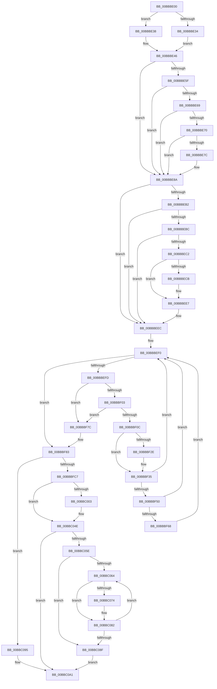

# sub_00BBBE00

- RVA: `0x00BBBE00`–`0x00BBC0B2` (길이 `690` bytes)
- VA: `0x0000000140BBBE00`
- 실행 섹션: `PAGEVRFY`
- PDB 이름 있음: `아니요`; PDB Function 태그: `아니요`
- unwind 정보 RVA: `0x000B0850`
- 디코드: `179`개 명령, `690/690` bytes 표시
- 미해석 바이트: `0` (있으면 어셈블리에 `.byte`로 보존)

> 이 문서는 커널 이미지의 기계어와 PDB 기호를 분석해 생성했습니다. 4번과 5번은 함수 원형과 자료형을 바이너리 사용 방식에서 추정한 C 해석이며 원본 소스 복구 결과는 아닙니다.

## 1. Dependencies

- 직접 호출 지점: **14**; 고유 호출 대상: **14**
- 직접 호출자로 확인된 함수: **0**
- RIP 상대 이미지 참조: **2**

### Outgoing calls
- `0x00BBBE85` → [MdlInvariantPostProcessing1](../../text/61/MdlInvariantPostProcessing1_function_00613AE0.md) (function, `0x00613AE0`)
- `0x00BBBE9A` → [VfMajorVerifyIrpStackUpward](../BA/VfMajorVerifyIrpStackUpward_function_00BA3270.md) (function, `0x00BA3270`)
- `0x00BBBEE2` → [ViErrorReport6](../../text/61/ViErrorReport6_function_00614740.md) (function, `0x00614740`)
- `0x00BBBF44` → [IovpValidateStatusInformation](../B9/IovpValidateStatusInformation_function_00B9D7DC.md) (function, `0x00B9D7DC`)
- `0x00BBBF5F` → [VfMajorAdvanceIrpStatus](../BA/VfMajorAdvanceIrpStatus_function_00BA2DB8.md) (function, `0x00BA2DB8`)
- `0x00BBBF96` → [memset](../../text/6C/memset_function_006C6C40.md) (function, `0x006C6C40`)
- `0x00BBBFDE` → [VfMajorVerifyFinalIrpStack](../BA/VfMajorVerifyFinalIrpStack_function_00BA3124.md) (function, `0x00BA3124`)
- `0x00BBBFF4` → [IovpSessionDataDereference](../BA/IovpSessionDataDereference_function_00BAC808.md) (function, `0x00BAC808`)
- `0x00BBC008` → [ViIrpDatabaseAcquireLockExclusive](../../text/61/ViIrpDatabaseAcquireLockExclusive_function_006176D8.md) (function, `0x006176D8`)
- `0x00BBC01D` → [guard_dispatch_icall](../../text/6B/guard_dispatch_icall_function_006BAAD0.md) (function, `0x006BAAD0`)
- `0x00BBC040` → [VfUtilAddressRangeRemoveCheckEmpty](../B9/VfUtilAddressRangeRemoveCheckEmpty_function_00B931A8.md) (function, `0x00B931A8`)
- `0x00BBC049` → [ViIrpDatabaseReleaseLockExclusive](../../text/61/ViIrpDatabaseReleaseLockExclusive_function_00617720.md) (function, `0x00617720`)
- `0x00BBC098` → [IovpSessionDataReference](../BA/IovpSessionDataReference_function_00BAC870.md) (function, `0x00BAC870`)
- `0x00BBC0A4` → [VfIrpDatabaseEntryReleaseLock](VfIrpDatabaseEntryReleaseLock_function_00BB3FD4.md) (function, `0x00BB3FD4`)

### Direct callers
- 이 함수 시작 RVA로 연결되는 직접 call은 확인되지 않았습니다. 간접 호출은 완전히 역산할 수 없습니다.

### Static image references
- `0x00BBBE70` → RVA `0x00F04A20` (`.data`; read)
- `0x00BBC039` → RVA `0x00F04880` (`.data`; read)

## 2. Other-region calls and transfers

- 다른 실행 섹션으로 향하는 call: **6**
  - `0x00BBBE85` → [MdlInvariantPostProcessing1](../../text/61/MdlInvariantPostProcessing1_function_00613AE0.md) (`PAGEVRFY` → `.text`)
  - `0x00BBBEE2` → [ViErrorReport6](../../text/61/ViErrorReport6_function_00614740.md) (`PAGEVRFY` → `.text`)
  - `0x00BBBF96` → [memset](../../text/6C/memset_function_006C6C40.md) (`PAGEVRFY` → `.text`)
  - `0x00BBC008` → [ViIrpDatabaseAcquireLockExclusive](../../text/61/ViIrpDatabaseAcquireLockExclusive_function_006176D8.md) (`PAGEVRFY` → `.text`)
  - `0x00BBC01D` → [guard_dispatch_icall](../../text/6B/guard_dispatch_icall_function_006BAAD0.md) (`PAGEVRFY` → `.text`)
  - `0x00BBC049` → [ViIrpDatabaseReleaseLockExclusive](../../text/61/ViIrpDatabaseReleaseLockExclusive_function_00617720.md) (`PAGEVRFY` → `.text`)
- call이 아닌 외부 분기/꼬리 이동: **1**
  - `0x00BBC0AD` → [IovpCompleteRequest2 + 0x22](IovpCompleteRequest2_function_00BB6DD4.md) (`tail-transfer`)

## 3. Assembly (complete function range)

```asm
00BBBE00  8B 43 30                        mov eax, dword ptr [rbx + 0x30]
00BBBE03  4D 8D 6E D8                     lea r13, [r14 - 0x28]
00BBBE07  48 0F BE 53 43                  movsx rdx, byte ptr [rbx + 0x43]
00BBBE0C  41 B8 00 00 00 40               mov r8d, 0x40000000
00BBBE12  89 84 24 80 00 00 00            mov dword ptr [rsp + 0x80], eax
00BBBE19  48 6B C2 78                     imul rax, rdx, 0x78
00BBBE1D  4C 03 E8                        add r13, rax
00BBBE20  48 89 84 24 88 00 00 00         mov qword ptr [rsp + 0x88], rax
00BBBE28  49 8B 4D 08                     mov rcx, qword ptr [r13 + 8]
00BBBE2C  8B 41 04                        mov eax, dword ptr [rcx + 4]
00BBBE2F  41 85 C0                        test r8d, eax
00BBBE32  74 04                           je 0x140bbbe38
00BBBE34  33 F6                           xor esi, esi
00BBBE36  EB 0E                           jmp 0x140bbbe46
00BBBE38  41 0B C0                        or eax, r8d
00BBBE3B  BE 01 00 00 00                  mov esi, 1
00BBBE40  89 41 04                        mov dword ptr [rcx + 4], eax
00BBBE43  8A 53 43                        mov dl, byte ptr [rbx + 0x43]
00BBBE46  4C 8B A3 B8 00 00 00            mov r12, qword ptr [rbx + 0xb8]
00BBBE4D  33 ED                           xor ebp, ebp
00BBBE4F  4C 3B E9                        cmp r13, rcx
00BBBE52  40 0F 94 C5                     sete bpl
00BBBE56  49 83 EC 48                     sub r12, 0x48
00BBBE5A  3A 53 42                        cmp dl, byte ptr [rbx + 0x42]
00BBBE5D  7F 2B                           jg 0x140bbbe8a
00BBBE5F  41 8A 04 24                     mov al, byte ptr [r12]
00BBBE63  2C 03                           sub al, 3
00BBBE65  3C 01                           cmp al, 1
00BBBE67  77 21                           ja 0x140bbbe8a
00BBBE69  48 83 7B 08 00                  cmp qword ptr [rbx + 8], 0
00BBBE6E  74 1A                           je 0x140bbbe8a
00BBBE70  F7 05 A6 8B 34 00 00 60 00 00   test dword ptr [rip + 0x348ba6], 0x6000
00BBBE7A  74 0E                           je 0x140bbbe8a
00BBBE7C  4D 8B C4                        mov r8, r12
00BBBE7F  48 8B D3                        mov rdx, rbx
00BBBE82  48 8B CF                        mov rcx, rdi
00BBBE85  E8 56 7C A5 FF                  call 0x140613ae0
00BBBE8A  44 8B CE                        mov r9d, esi
00BBBE8D  89 6C 24 20                     mov dword ptr [rsp + 0x20], ebp
00BBBE91  4D 8B C5                        mov r8, r13
00BBBE94  49 8B D4                        mov rdx, r12
00BBBE97  48 8B CF                        mov rcx, rdi
00BBBE9A  E8 D1 73 FE FF                  call 0x140ba3270
00BBBE9F  41 8B 46 20                     mov eax, dword ptr [r14 + 0x20]
00BBBEA3  8B 8C 24 80 00 00 00            mov ecx, dword ptr [rsp + 0x80]
00BBBEAA  89 4C 24 78                     mov dword ptr [rsp + 0x78], ecx
00BBBEAE  A8 02                           test al, 2
00BBBEB0  75 3A                           jne 0x140bbbeec
00BBBEB2  41 F7 45 04 00 00 00 04         test dword ptr [r13 + 4], 0x4000000
00BBBEBA  74 30                           je 0x140bbbeec
00BBBEBC  80 7B 41 00                     cmp byte ptr [rbx + 0x41], 0
00BBBEC0  75 2A                           jne 0x140bbbeec
00BBBEC2  F7 43 10 00 08 00 00            test dword ptr [rbx + 0x10], 0x800
00BBBEC9  74 1C                           je 0x140bbbee7
00BBBECB  48 8B 94 24 88 00 00 00         mov rdx, qword ptr [rsp + 0x88]
00BBBED3  44 8B C9                        mov r9d, ecx
00BBBED6  4C 8B C3                        mov r8, rbx
00BBBED9  B9 3E 02 00 00                  mov ecx, 0x23e
00BBBEDE  4A 8B 14 32                     mov rdx, qword ptr [rdx + r14]
00BBBEE2  E8 59 88 A5 FF                  call 0x140614740
00BBBEE7  41 83 4E 20 02                  or dword ptr [r14 + 0x20], 2
00BBBEEC  49 8D 6D 10                     lea rbp, [r13 + 0x10]
00BBBEF0  48 8B 75 00                     mov rsi, qword ptr [rbp]
00BBBEF4  48 3B F5                        cmp rsi, rbp
00BBBEF7  0F 84 86 00 00 00               je 0x140bbbf83
00BBBEFD  48 39 6E 08                     cmp qword ptr [rsi + 8], rbp
00BBBF01  75 79                           jne 0x140bbbf7c
00BBBF03  48 8B 06                        mov rax, qword ptr [rsi]
00BBBF06  48 39 70 08                     cmp qword ptr [rax + 8], rsi
00BBBF0A  75 70                           jne 0x140bbbf7c
00BBBF0C  48 89 45 00                     mov qword ptr [rbp], rax
00BBBF10  48 89 68 08                     mov qword ptr [rax + 8], rbp
00BBBF14  8B 4E F8                        mov ecx, dword ptr [rsi - 8]
00BBBF17  0F BA E9 1E                     bts ecx, 0x1e
00BBBF1B  89 4E F8                        mov dword ptr [rsi - 8], ecx
00BBBF1E  8B 84 24 80 00 00 00            mov eax, dword ptr [rsp + 0x80]
00BBBF25  89 46 18                        mov dword ptr [rsi + 0x18], eax
00BBBF28  80 7B 41 00                     cmp byte ptr [rbx + 0x41], 0
00BBBF2C  74 07                           je 0x140bbbf35
00BBBF2E  0F BA E9 19                     bts ecx, 0x19
00BBBF32  89 4E F8                        mov dword ptr [rsi - 8], ecx
00BBBF35  4D 8B 4F 20                     mov r9, qword ptr [r15 + 0x20]
00BBBF39  4C 8D 46 30                     lea r8, [rsi + 0x30]
00BBBF3D  48 8B 56 28                     mov rdx, qword ptr [rsi + 0x28]
00BBBF41  48 8B CF                        mov rcx, rdi
00BBBF44  E8 93 18 FE FF                  call 0x140b9d7dc
00BBBF49  8B 47 38                        mov eax, dword ptr [rdi + 0x38]
00BBBF4C  A8 20                           test al, 0x20
00BBBF4E  75 A0                           jne 0x140bbbef0
00BBBF50  8B 54 24 78                     mov edx, dword ptr [rsp + 0x78]
00BBBF54  4C 8D 84 24 80 00 00 00         lea r8, [rsp + 0x80]
00BBBF5C  49 8B CC                        mov rcx, r12
00BBBF5F  E8 54 6E FE FF                  call 0x140ba2db8
00BBBF64  85 C0                           test eax, eax
00BBBF66  74 88                           je 0x140bbbef0
00BBBF68  0F BA 6E F8 1B                  bts dword ptr [rsi - 8], 0x1b
00BBBF6D  8B 84 24 80 00 00 00            mov eax, dword ptr [rsp + 0x80]
00BBBF74  89 46 1C                        mov dword ptr [rsi + 0x1c], eax
00BBBF77  E9 74 FF FF FF                  jmp 0x140bbbef0
00BBBF7C  B9 03 00 00 00                  mov ecx, 3
00BBBF81  CD 29                           int 0x29
00BBBF83  8B 84 24 80 00 00 00            mov eax, dword ptr [rsp + 0x80]
00BBBF8A  33 D2                           xor edx, edx
00BBBF8C  49 8B CD                        mov rcx, r13
00BBBF8F  89 43 30                        mov dword ptr [rbx + 0x30], eax
00BBBF92  44 8D 42 78                     lea r8d, [rdx + 0x78]
00BBBF96  E8 A5 AC B0 FF                  call 0x1406c6c40
00BBBF9B  48 89 6D 08                     mov qword ptr [rbp + 8], rbp
00BBBF9F  48 89 6D 00                     mov qword ptr [rbp], rbp
00BBBFA3  BD 01 00 00 00                  mov ebp, 1
00BBBFA8  8A 43 43                        mov al, byte ptr [rbx + 0x43]
00BBBFAB  0F B6 97 B8 00 00 00            movzx edx, byte ptr [rdi + 0xb8]
00BBBFB2  40 02 C5                        add al, bpl
00BBBFB5  88 87 BA 00 00 00               mov byte ptr [rdi + 0xba], al
00BBBFBB  0F BE 43 43                     movsx eax, byte ptr [rbx + 0x43]
00BBBFBF  3B D0                           cmp edx, eax
00BBBFC1  0F 85 CE 00 00 00               jne 0x140bbc095
00BBBFC7  33 F6                           xor esi, esi
00BBBFC9  48 8B CF                        mov rcx, rdi
00BBBFCC  49 89 37                        mov qword ptr [r15], rsi
00BBBFCF  49 89 77 08                     mov qword ptr [r15 + 8], rsi
00BBBFD3  48 8B 93 B8 00 00 00            mov rdx, qword ptr [rbx + 0xb8]
00BBBFDA  48 83 EA 48                     sub rdx, 0x48
00BBBFDE  E8 41 71 FE FF                  call 0x140ba3124
00BBBFE3  49 8B 06                        mov rax, qword ptr [r14]
00BBBFE6  49 8B CE                        mov rcx, r14
00BBBFE9  83 60 38 FE                     and dword ptr [rax + 0x38], 0xfffffffe
00BBBFED  48 89 B0 F0 00 00 00            mov qword ptr [rax + 0xf0], rsi
00BBBFF4  E8 0F 08 FF FF                  call 0x140bac808
00BBBFF9  29 6F 18                        sub dword ptr [rdi + 0x18], ebp
00BBBFFC  40 88 74 24 78                  mov byte ptr [rsp + 0x78], sil
00BBC001  75 4B                           jne 0x140bbc04e
00BBC003  48 8D 4C 24 78                  lea rcx, [rsp + 0x78]
00BBC008  E8 CB B6 A5 FF                  call 0x1406176d8
00BBC00D  48 8B 1F                        mov rbx, qword ptr [rdi]
00BBC010  44 8B C5                        mov r8d, ebp
00BBC013  48 8B 47 30                     mov rax, qword ptr [rdi + 0x30]
00BBC017  48 8B D3                        mov rdx, rbx
00BBC01A  48 8B CF                        mov rcx, rdi
00BBC01D  E8 AE EA AF FF                  call 0x1406baad0
00BBC022  48 8B C3                        mov rax, rbx
00BBC025  48 89 37                        mov qword ptr [rdi], rsi
00BBC028  48 C1 E8 0C                     shr rax, 0xc
00BBC02C  48 8B D3                        mov rdx, rbx
00BBC02F  6B C0 83                        imul eax, eax, -0x7d
00BBC032  0F B6 C8                        movzx ecx, al
00BBC035  48 C1 E1 04                     shl rcx, 4
00BBC039  48 03 0D 40 88 34 00            add rcx, qword ptr [rip + 0x348840]
00BBC040  E8 63 71 FD FF                  call 0x140b931a8
00BBC045  8A 4C 24 78                     mov cl, byte ptr [rsp + 0x78]
00BBC049  E8 D2 B6 A5 FF                  call 0x140617720
00BBC04E  F0 FF 4F 14                     lock dec dword ptr [rdi + 0x14]
00BBC052  48 8B 87 E0 00 00 00            mov rax, qword ptr [rdi + 0xe0]
00BBC059  48 85 C0                        test rax, rax
00BBC05C  74 43                           je 0x140bbc0a1
00BBC05E  8B D6                           mov edx, esi
00BBC060  39 30                           cmp dword ptr [rax], esi
00BBC062  76 2B                           jbe 0x140bbc08f
00BBC064  4C 8B 40 08                     mov r8, qword ptr [rax + 8]
00BBC068  8B CA                           mov ecx, edx
00BBC06A  48 C1 E1 05                     shl rcx, 5
00BBC06E  4A 39 34 01                     cmp qword ptr [rcx + r8], rsi
00BBC072  74 0E                           je 0x140bbc082
00BBC074  0F 57 C0                        xorps xmm0, xmm0
00BBC077  42 0F 11 04 01                  movups xmmword ptr [rcx + r8], xmm0
00BBC07C  42 0F 11 44 01 10               movups xmmword ptr [rcx + r8 + 0x10], xmm0
00BBC082  48 8B 87 E0 00 00 00            mov rax, qword ptr [rdi + 0xe0]
00BBC089  03 D5                           add edx, ebp
00BBC08B  3B 10                           cmp edx, dword ptr [rax]
00BBC08D  72 D5                           jb 0x140bbc064
00BBC08F  48 89 70 10                     mov qword ptr [rax + 0x10], rsi
00BBC093  EB 0C                           jmp 0x140bbc0a1
00BBC095  49 8B CE                        mov rcx, r14
00BBC098  E8 D3 07 FF FF                  call 0x140bac870
00BBC09D  F0 01 6F 14                     lock add dword ptr [rdi + 0x14], ebp
00BBC0A1  48 8B CF                        mov rcx, rdi
00BBC0A4  E8 2B 7F FF FF                  call 0x140bb3fd4
00BBC0A9  41 FF 4F 14                     dec dword ptr [r15 + 0x14]
00BBC0AD  E9 44 AD FF FF                  jmp 0x140bb6df6
```

## 4. C-style interpretation (structured pseudocode)

```c
__int64 __fastcall sub_00BBBE00(__int64 a1, __int64 a2, __int64 a3, __int64 a4, __int64 a5, __int64 a6, __int64 a7, __int64 a8, __int64 a9, __int64 a10, __int64 a11, __int64 a12, __int64 a13, __int64 a14, unsigned __int8 a15, unsigned int a16, __int64 a17)
{
    __int64 result;
    __int64 v_r12;
    __int64 v_r13;
    __int64 v_rbp;
    __int64 v_rbx;
    __int64 v_rsi;
    unsigned int v_stack_p20;
    unsigned int v_stack_p78;
    unsigned int v_stack_p80;
    unsigned __int64 v_stack_p88;

    v_stack_p80 = (unsigned int)((unsigned int)(*(unsigned int *)(v_rbx + 48)));
    result = ((unsigned int)(*(unsigned int *)(v_rbx + 48))) * ((__int8)(*(unsigned __int8 *)(v_rbx + 67)));
    v_r13 = (v_r14 - 40) + (result);
    v_stack_p88 = result;
    if ((((unsigned int)((unsigned int)(0x40000000ULL))) & ((unsigned int)((unsigned int)(*(unsigned int *)(*(unsigned __int64 *)(v_r13 + 8) + 4))))) == 0) goto loc_00BBBE38;
    v_rsi = 0;
    goto loc_00BBBE46;
loc_00BBBE38:
    result = (unsigned int)(((unsigned int)(*(unsigned int *)(*(unsigned __int64 *)(v_r13 + 8) + 4))) | ((unsigned int)((unsigned int)(0x40000000ULL))));
    *(unsigned int *)(*(unsigned __int64 *)(v_r13 + 8) + 4) = (unsigned int)(result);
loc_00BBBE46:
    v_rbp = 0;
    v_rbp = (v_r13 == (*(unsigned __int64 *)(v_r13 + 8))) ? 1 : 0;
    v_r12 = (*(unsigned __int64 *)(v_rbx + 184)) - (72);
    if (((unsigned __int8)(*(unsigned __int8 *)(v_rbx + 67))) > (*(unsigned __int8 *)(v_rbx + 66))) goto loc_00BBBE8A;
    result = (unsigned __int8)((*(unsigned __int8 *)(v_r12)) - (3));
    if (((unsigned __int8)(result)) > 1) goto loc_00BBBE8A;
    if ((*(unsigned __int64 *)(v_rbx + 8)) == 0) goto loc_00BBBE8A;
    if (((*(unsigned int *)(v_rip + 3443622)) & (0x6000ULL)) != 0) {
        a3 = v_r12;
        a2 = v_rbx;
        a1 = v_rdi;
        result = MdlInvariantPostProcessing1(a1, a2, a3, a4);
    }
    v_stack_p20 = (unsigned int)(v_rbp);
    result = VfMajorVerifyIrpStackUpward(v_rdi, v_r12, v_r13, 1);
    v_stack_p78 = (unsigned int)((unsigned int)(a16));
    if ((((unsigned __int8)((unsigned int)(*(unsigned int *)(v_r14 + 32)))) & (2)) != 0) goto loc_00BBBEEC;
    if (((*(unsigned int *)(v_r13 + 4)) & (0x4000000ULL)) == 0) goto loc_00BBBEEC;
    if ((*(unsigned __int8 *)(v_rbx + 65)) != 0) goto loc_00BBBEEC;
    result = (unsigned int)(*(unsigned int *)(v_r14 + 32));
    if (((*(unsigned int *)(v_rbx + 16)) & (0x800ULL)) != 0) {
        a2 = a17;
        a4 = (unsigned int)((unsigned int)(a16));
        a3 = v_rbx;
        a1 = 574;
        a2 = *(unsigned __int64 *)(a2 + v_r14 * 1);
        result = ViErrorReport6(a1, a2, a3, a4);
    }
loc_00BBBEEC:
loc_00BBBEF0:
    if ((*(unsigned __int64 *)(v_r13 + 16)) == (v_r13 + 16)) goto loc_00BBBF83;
    if ((*(unsigned __int64 *)(*(unsigned __int64 *)(v_r13 + 16) + 8)) != (v_r13 + 16)) goto loc_00BBBF7C;
    if ((*(unsigned __int64 *)(*(unsigned __int64 *)(*(unsigned __int64 *)(v_r13 + 16)) + 8)) != (*(unsigned __int64 *)(v_r13 + 16))) goto loc_00BBBF7C;
    *(unsigned __int64 *)(v_r13 + 16) = *(unsigned __int64 *)(*(unsigned __int64 *)(v_r13 + 16));
    *(unsigned __int64 *)(*(unsigned __int64 *)(*(unsigned __int64 *)(v_r13 + 16)) + 8) = v_r13 + 16;
    *(unsigned int *)(*(unsigned __int64 *)(v_r13 + 16) - 8) = (unsigned int)((unsigned int)(*(unsigned int *)(*(unsigned __int64 *)(v_r13 + 16) - 8)));
    *(unsigned int *)(*(unsigned __int64 *)(v_r13 + 16) + 24) = (unsigned int)((unsigned int)(a16));
    if ((*(unsigned __int8 *)(v_rbx + 65)) != 0) {
        *(unsigned int *)(*(unsigned __int64 *)(v_r13 + 16) - 8) = (unsigned int)((unsigned int)(*(unsigned int *)(*(unsigned __int64 *)(v_r13 + 16) - 8)));
    }
    result = IovpValidateStatusInformation(v_rdi, *(unsigned __int64 *)(*(unsigned __int64 *)(v_r13 + 16) + 40), *(unsigned __int64 *)(v_r13 + 16) + 48, *(unsigned __int64 *)(v_r15 + 32));
    if ((((unsigned __int8)((unsigned int)(*(unsigned int *)(v_rdi + 56)))) & (32)) != 0) goto loc_00BBBEF0;
    result = VfMajorAdvanceIrpStatus(v_r12, (unsigned int)(a15), a16, *(unsigned __int64 *)(v_r15 + 32));
    if ((unsigned int)(result) == 0) goto loc_00BBBEF0;
    *(unsigned int *)(*(unsigned __int64 *)(v_r13 + 16) + 28) = (unsigned int)((unsigned int)(a16));
    goto loc_00BBBEF0;
loc_00BBBF7C:
loc_00BBBF83:
    a2 = 0;
    *(unsigned int *)(v_rbx + 48) = (unsigned int)((unsigned int)(a16));
    result = memset(v_r13, a2, a2 + 120, *(unsigned __int64 *)(v_r15 + 32));
    *(unsigned __int64 *)(v_r13 + 16 + 8) = v_r13 + 16;
    *(unsigned __int64 *)(v_r13 + 16) = v_r13 + 16;
    result = (unsigned __int8)((*(unsigned __int8 *)(v_rbx + 67)) + (1));
    *(unsigned __int8 *)(v_rdi + 186) = (unsigned __int8)(result);
    if (((unsigned int)(*(unsigned __int8 *)(v_rdi + 184))) != ((unsigned int)((__int8)(*(unsigned __int8 *)(v_rbx + 67))))) goto loc_00BBC095;
    v_rsi = 0;
    *(unsigned __int64 *)(v_r15) = 0;
    *(unsigned __int64 *)(v_r15 + 8) = 0;
    a2 = (*(unsigned __int64 *)(v_rbx + 184)) - (72);
    result = VfMajorVerifyFinalIrpStack(v_rdi, a2, a2 + 120, *(unsigned __int64 *)(v_r15 + 32));
    *(unsigned __int64 *)(*(unsigned __int64 *)(v_r14) + 240) = 0;
    result = IovpSessionDataDereference(v_r14, a2, a2 + 120, *(unsigned __int64 *)(v_r15 + 32));
    v_stack_p78 = 0;
    if (!(condition_is_not_equal)) {
        a1 = a15;
        result = ViIrpDatabaseAcquireLockExclusive(a1, a2, a2 + 120, *(unsigned __int64 *)(v_r15 + 32));
        v_rbx = *(unsigned __int64 *)(v_rdi);
        a3 = 1;
        result = *(unsigned __int64 *)(v_rdi + 48);
        a2 = v_rbx;
        a1 = v_rdi;
        result = guard_dispatch_icall(a1, a2, a3, *(unsigned __int64 *)(v_r15 + 32));
        result = v_rbx;
        *(unsigned __int64 *)(v_rdi) = 0;
        result = (result) >> (12);
        a2 = v_rbx;
        result = (unsigned int)((result) * ((unsigned int)(result)));
        a1 = (unsigned __int8)(result);
        a1 = (a1) << (4);
        a1 = (a1) + (*(unsigned __int64 *)(v_rip + 3442752));
        result = VfUtilAddressRangeRemoveCheckEmpty(a1, a2, a3, *(unsigned __int64 *)(v_r15 + 32));
        a1 = a15;
        result = ViIrpDatabaseReleaseLockExclusive(a1, a2, a3, *(unsigned __int64 *)(v_r15 + 32));
    }
    if (*(unsigned __int64 *)(v_rdi + 224) == 0) goto loc_00BBC0A1;
    if ((*(unsigned int *)(*(unsigned __int64 *)(v_rdi + 224))) <= 0) goto loc_00BBC08F;
loc_00BBC064:
    a1 = (0) << (5);
    if ((*(unsigned __int64 *)(a1 + *(unsigned __int64 *)(*(unsigned __int64 *)(v_rdi + 224) + 8) * 1)) != 0) {
        *(unsigned __int64 *)(a1 + *(unsigned __int64 *)(*(unsigned __int64 *)(v_rdi + 224) + 8) * 1) = v_xmm0;
        *(unsigned __int64 *)(a1 + *(unsigned __int64 *)(*(unsigned __int64 *)(v_rdi + 224) + 8) * 1 + 16) = v_xmm0;
    }
    a2 = (unsigned int)((0) + (1));
    if (((unsigned int)(a2)) < (*(unsigned int *)(*(unsigned __int64 *)(v_rdi + 224)))) goto loc_00BBC064;
loc_00BBC08F:
    *(unsigned __int64 *)(*(unsigned __int64 *)(v_rdi + 224) + 16) = 0;
    goto loc_00BBC0A1;
loc_00BBC095:
    result = IovpSessionDataReference(v_r14, a2, *(unsigned __int64 *)(*(unsigned __int64 *)(v_rdi + 224) + 8), *(unsigned __int64 *)(v_r15 + 32));
loc_00BBC0A1:
    result = VfIrpDatabaseEntryReleaseLock(v_rdi, a2, *(unsigned __int64 *)(*(unsigned __int64 *)(v_rdi + 224) + 8), *(unsigned __int64 *)(v_r15 + 32));
}
```

## 5. (Beta) C Style

```c
int64_t sub_00BBBE00(int64_t Arg1, int64_t Arg2, int64_t Arg3, int64_t Arg4, uint64_t Arg5, uint64_t Arg6, uint64_t Arg7, uint64_t Arg8, uint64_t Arg9, uint64_t Arg10, uint64_t Arg11, uint64_t Arg12, uint64_t Arg13, uint64_t Arg14, uint8_t Arg15, uint32_t Arg16, void *Arg17)
{
    uint8_t *arg17 = (uint8_t *)Arg17;

    int64_t result;
    int64_t local_r12;
    int64_t local_r13;
    int64_t local_rbp;
    int64_t local_rbx;
    int64_t local_rsi;
    uint32_t v_stack_p20;
    uint32_t v_stack_p78;
    uint32_t v_stack_p80;
    uint64_t v_stack_p88;

    v_stack_p80 = (uint32_t)((uint32_t)(*(uint32_t *)(local_rbx + 0x30)));
    result = ((uint32_t)(*(uint32_t *)(local_rbx + 0x30))) * ((int8_t)(*(uint8_t *)(local_rbx + 0x43)));
    local_r13 = (local_r14 - 40) + (result);
    v_stack_p88 = result;
    if ((((uint32_t)((uint32_t)(0x40000000ULL))) & ((uint32_t)((uint32_t)(*(uint32_t *)(*(uint64_t *)(local_r13 + 0x8) + 0x4))))) == 0) goto loc_00BBBE38;
    local_rsi = 0;
    goto loc_00BBBE46;
loc_00BBBE38:
    result = (uint32_t)(((uint32_t)(*(uint32_t *)(*(uint64_t *)(local_r13 + 0x8) + 0x4))) | ((uint32_t)((uint32_t)(0x40000000ULL))));
    *(uint32_t *)(*(uint64_t *)(local_r13 + 0x8) + 0x4) = (uint32_t)(result);
loc_00BBBE46:
    local_rbp = 0;
    local_rbp = (local_r13 == (*(uint64_t *)(local_r13 + 0x8))) ? 1 : 0;
    local_r12 = (*(uint64_t *)(local_rbx + 0xB8)) - (72);
    if (((uint8_t)(*(uint8_t *)(local_rbx + 0x43))) > (*(uint8_t *)(local_rbx + 0x42))) goto loc_00BBBE8A;
    result = (uint8_t)((*(uint8_t *)(local_r12)) - (3));
    if (((uint8_t)(result)) > 1) goto loc_00BBBE8A;
    if ((*(uint64_t *)(local_rbx + 0x8)) == 0) goto loc_00BBBE8A;
    if (((*(uint32_t *)(v_rip + 0x348BA6)) & (0x6000ULL)) != 0) {
        Arg3 = local_r12;
        Arg2 = local_rbx;
        Arg1 = local_rdi;
        result = MdlInvariantPostProcessing1(Arg1, Arg2, Arg3, Arg4);
    }
    v_stack_p20 = (uint32_t)(local_rbp);
    result = VfMajorVerifyIrpStackUpward(local_rdi, local_r12, local_r13, 1);
    v_stack_p78 = (uint32_t)((uint32_t)(Arg16));
    if ((((uint8_t)((uint32_t)(*(uint32_t *)(local_r14 + 0x20)))) & (2)) != 0) goto loc_00BBBEEC;
    if (((*(uint32_t *)(local_r13 + 0x4)) & (0x4000000ULL)) == 0) goto loc_00BBBEEC;
    if ((*(uint8_t *)(local_rbx + 0x41)) != 0) goto loc_00BBBEEC;
    result = (uint32_t)(*(uint32_t *)(local_r14 + 0x20));
    if (((*(uint32_t *)(local_rbx + 0x10)) & (0x800ULL)) != 0) {
        Arg2 = Arg17;
        Arg4 = (uint32_t)((uint32_t)(Arg16));
        Arg3 = local_rbx;
        Arg1 = 574;
        Arg2 = *(uint64_t *)(Arg2 + local_r14 * 1);
        result = ViErrorReport6(Arg1, Arg2, Arg3, Arg4);
    }
loc_00BBBEEC:
loc_00BBBEF0:
    if ((*(uint64_t *)(local_r13 + 0x10)) == (local_r13 + 16)) goto loc_00BBBF83;
    if ((*(uint64_t *)(*(uint64_t *)(local_r13 + 0x10) + 0x8)) != (local_r13 + 16)) goto loc_00BBBF7C;
    if ((*(uint64_t *)(*(uint64_t *)(*(uint64_t *)(local_r13 + 0x10)) + 0x8)) != (*(uint64_t *)(local_r13 + 0x10))) goto loc_00BBBF7C;
    *(uint64_t *)(local_r13 + 0x10) = *(uint64_t *)(*(uint64_t *)(local_r13 + 0x10));
    *(uint64_t *)(*(uint64_t *)(*(uint64_t *)(local_r13 + 0x10)) + 0x8) = local_r13 + 16;
    *(uint32_t *)(*(uint64_t *)(local_r13 + 0x10) - 0x8) = (uint32_t)((uint32_t)(*(uint32_t *)(*(uint64_t *)(local_r13 + 0x10) - 0x8)));
    *(uint32_t *)(*(uint64_t *)(local_r13 + 0x10) + 0x18) = (uint32_t)((uint32_t)(Arg16));
    if ((*(uint8_t *)(local_rbx + 0x41)) != 0) {
        *(uint32_t *)(*(uint64_t *)(local_r13 + 0x10) - 0x8) = (uint32_t)((uint32_t)(*(uint32_t *)(*(uint64_t *)(local_r13 + 0x10) - 0x8)));
    }
    result = IovpValidateStatusInformation(local_rdi, *(uint64_t *)(*(uint64_t *)(local_r13 + 0x10) + 0x28), *(uint64_t *)(local_r13 + 0x10) + 48, *(uint64_t *)(local_r15 + 0x20));
    if ((((uint8_t)((uint32_t)(*(uint32_t *)(local_rdi + 0x38)))) & (32)) != 0) goto loc_00BBBEF0;
    result = VfMajorAdvanceIrpStatus(local_r12, (uint32_t)(Arg15), Arg16, *(uint64_t *)(local_r15 + 0x20));
    if ((uint32_t)(result) == 0) goto loc_00BBBEF0;
    *(uint32_t *)(*(uint64_t *)(local_r13 + 0x10) + 0x1C) = (uint32_t)((uint32_t)(Arg16));
    goto loc_00BBBEF0;
loc_00BBBF7C:
loc_00BBBF83:
    Arg2 = 0;
    *(uint32_t *)(local_rbx + 0x30) = (uint32_t)((uint32_t)(Arg16));
    result = memset(local_r13, Arg2, Arg2 + 120, *(uint64_t *)(local_r15 + 0x20));
    *(uint64_t *)(local_r13 + 0x10 + 0x8) = local_r13 + 16;
    *(uint64_t *)(local_r13 + 0x10) = local_r13 + 16;
    result = (uint8_t)((*(uint8_t *)(local_rbx + 0x43)) + (1));
    *(uint8_t *)(local_rdi + 0xBA) = (uint8_t)(result);
    if (((uint32_t)(*(uint8_t *)(local_rdi + 0xB8))) != ((uint32_t)((int8_t)(*(uint8_t *)(local_rbx + 0x43))))) goto loc_00BBC095;
    local_rsi = 0;
    *(uint64_t *)(local_r15) = 0;
    *(uint64_t *)(local_r15 + 0x8) = 0;
    Arg2 = (*(uint64_t *)(local_rbx + 0xB8)) - (72);
    result = VfMajorVerifyFinalIrpStack(local_rdi, Arg2, Arg2 + 120, *(uint64_t *)(local_r15 + 0x20));
    *(uint64_t *)(*(uint64_t *)(local_r14) + 0xF0) = 0;
    result = IovpSessionDataDereference(local_r14, Arg2, Arg2 + 120, *(uint64_t *)(local_r15 + 0x20));
    v_stack_p78 = 0;
    if (!(condition_is_not_equal)) {
        Arg1 = Arg15;
        result = ViIrpDatabaseAcquireLockExclusive(Arg1, Arg2, Arg2 + 120, *(uint64_t *)(local_r15 + 0x20));
        local_rbx = *(uint64_t *)(local_rdi);
        Arg3 = 1;
        result = *(uint64_t *)(local_rdi + 0x30);
        Arg2 = local_rbx;
        Arg1 = local_rdi;
        result = guard_dispatch_icall(Arg1, Arg2, Arg3, *(uint64_t *)(local_r15 + 0x20));
        result = local_rbx;
        *(uint64_t *)(local_rdi) = 0;
        result = (result) >> (12);
        Arg2 = local_rbx;
        result = (uint32_t)((result) * ((uint32_t)(result)));
        Arg1 = (uint8_t)(result);
        Arg1 = (Arg1) << (4);
        Arg1 = (Arg1) + (*(uint64_t *)(v_rip + 0x348840));
        result = VfUtilAddressRangeRemoveCheckEmpty(Arg1, Arg2, Arg3, *(uint64_t *)(local_r15 + 0x20));
        Arg1 = Arg15;
        result = ViIrpDatabaseReleaseLockExclusive(Arg1, Arg2, Arg3, *(uint64_t *)(local_r15 + 0x20));
    }
    if (*(uint64_t *)(local_rdi + 0xE0) == 0) goto loc_00BBC0A1;
    if ((*(uint32_t *)(*(uint64_t *)(local_rdi + 0xE0))) <= 0) goto loc_00BBC08F;
loc_00BBC064:
    Arg1 = (0) << (5);
    if ((*(uint64_t *)(Arg1 + *(uint64_t *)(*(uint64_t *)(local_rdi + 0xE0) + 0x8) * 1)) != 0) {
        *(uint64_t *)(Arg1 + *(uint64_t *)(*(uint64_t *)(local_rdi + 0xE0) + 0x8) * 1) = v_xmm0;
        *(uint64_t *)(Arg1 + *(uint64_t *)(*(uint64_t *)(local_rdi + 0xE0) + 0x8) * 1 + 0x10) = v_xmm0;
    }
    Arg2 = (uint32_t)((0) + (1));
    if (((uint32_t)(Arg2)) < (*(uint32_t *)(*(uint64_t *)(local_rdi + 0xE0)))) goto loc_00BBC064;
loc_00BBC08F:
    *(uint64_t *)(*(uint64_t *)(local_rdi + 0xE0) + 0x10) = 0;
    goto loc_00BBC0A1;
loc_00BBC095:
    result = IovpSessionDataReference(local_r14, Arg2, *(uint64_t *)(*(uint64_t *)(local_rdi + 0xE0) + 0x8), *(uint64_t *)(local_r15 + 0x20));
loc_00BBC0A1:
    result = VfIrpDatabaseEntryReleaseLock(local_rdi, Arg2, *(uint64_t *)(*(uint64_t *)(local_rdi + 0xE0) + 0x8), *(uint64_t *)(local_r15 + 0x20));
}
```

### 관측된 메모리 오프셋

구조체 형식이 확인되지 않은 접근은 인자 기준의 오프셋으로만 기록했습니다.

| 기준 인자 | 오프셋 표현 | 폭 (bit) | 접근 |
|---|---:|---:|---|
| `Arg17` | `+ 0x0 + r14*1` | `64` | `R` |

## 6. Execution-region graph

[열기: 2D/3D 그래프와 함수 탐색 컨트롤 패널](../../../control-panel.html?section=pagevrfy&rva=0x00BBBE00&view=graph)

- 2D 그래프는 위에서 아래로 흐르고, 3D 그래프는 빈 공간을 드래그해 회전합니다. Shift+드래그는 이동, 휠은 확대·축소, 함수 노드 선택은 대상 보고서 이동입니다.

### Static fallback


