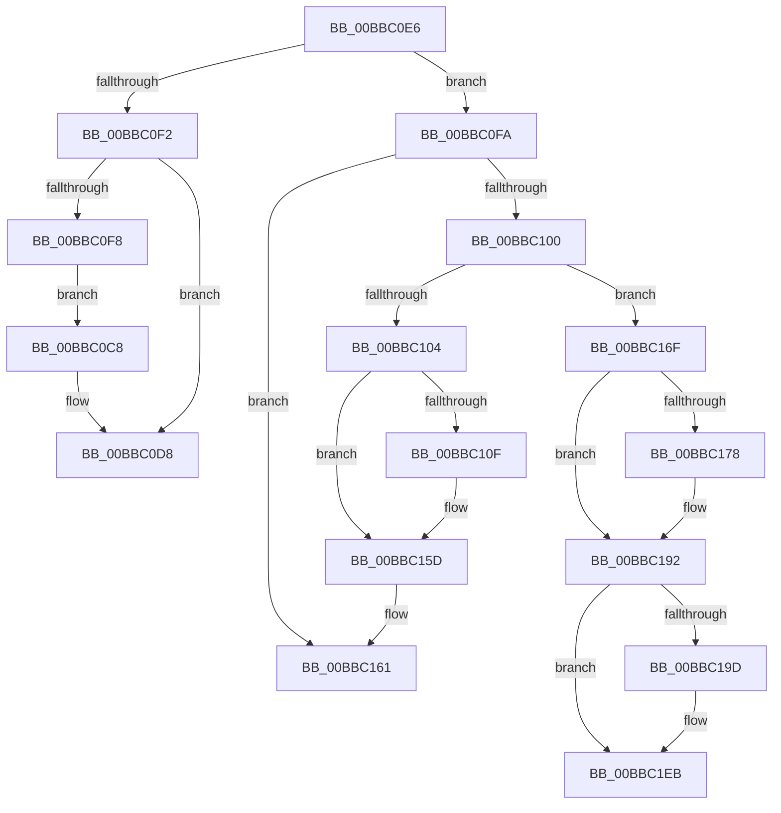

# sub_00BBC0C8

- RVA: `0x00BBC0C8`–`0x00BBC207` (길이 `319` bytes)
- VA: `0x0000000140BBC0C8`
- 실행 섹션: `PAGEVRFY`
- PDB 이름 있음: `아니요`; PDB Function 태그: `아니요`
- unwind 정보 RVA: `0x000B0884`
- 디코드: `84`개 명령, `319/319` bytes 표시
- 미해석 바이트: `0` (있으면 어셈블리에 `.byte`로 보존)

> 이 문서는 커널 이미지의 기계어와 PDB 기호를 분석해 생성했습니다. 4번과 5번은 함수 원형과 자료형을 바이너리 사용 방식에서 추정한 C 해석이며 원본 소스 복구 결과는 아닙니다.

## 1. Dependencies

- 직접 호출 지점: **15**; 고유 호출 대상: **9**
- 직접 호출자로 확인된 함수: **0**
- RIP 상대 이미지 참조: **1**

### Outgoing calls
- `0x00BBC0D3` → [ViErrorReport1](../../text/61/ViErrorReport1_function_00614584.md) (function, `0x00614584`)
- `0x00BBC0DB` → [VfIrpDatabaseEntryReleaseLock](VfIrpDatabaseEntryReleaseLock_function_00BB3FD4.md) (function, `0x00BB3FD4`)
- `0x00BBC114` → [ViIrpDatabaseAcquireLockExclusive](../../text/61/ViIrpDatabaseAcquireLockExclusive_function_006176D8.md) (function, `0x006176D8`)
- `0x00BBC12C` → [guard_dispatch_icall](../../text/6B/guard_dispatch_icall_function_006BAAD0.md) (function, `0x006BAAD0`)
- `0x00BBC14F` → [VfUtilAddressRangeRemoveCheckEmpty](../B9/VfUtilAddressRangeRemoveCheckEmpty_function_00B931A8.md) (function, `0x00B931A8`)
- `0x00BBC158` → [ViIrpDatabaseReleaseLockExclusive](../../text/61/ViIrpDatabaseReleaseLockExclusive_function_00617720.md) (function, `0x00617720`)
- `0x00BBC164` → [VfIrpDatabaseEntryReleaseLock](VfIrpDatabaseEntryReleaseLock_function_00BB3FD4.md) (function, `0x00BB3FD4`)
- `0x00BBC17F` → [PsReturnProcessNonPagedPoolQuota](../../text/41/PsReturnProcessNonPagedPoolQuota_function_0041C200.md) (function, `0x0041C200`)
- `0x00BBC18D` → [ObfDereferenceObjectWithTag](../../text/2F/ObfDereferenceObjectWithTag_function_002F78E0.md) (function, `0x002F78E0`)
- `0x00BBC1A2` → [ViIrpDatabaseAcquireLockExclusive](../../text/61/ViIrpDatabaseAcquireLockExclusive_function_006176D8.md) (function, `0x006176D8`)
- `0x00BBC1BA` → [guard_dispatch_icall](../../text/6B/guard_dispatch_icall_function_006BAAD0.md) (function, `0x006BAAD0`)
- `0x00BBC1DD` → [VfUtilAddressRangeRemoveCheckEmpty](../B9/VfUtilAddressRangeRemoveCheckEmpty_function_00B931A8.md) (function, `0x00B931A8`)
- `0x00BBC1E6` → [ViIrpDatabaseReleaseLockExclusive](../../text/61/ViIrpDatabaseReleaseLockExclusive_function_00617720.md) (function, `0x00617720`)
- `0x00BBC1F2` → [VfIrpDatabaseEntryReleaseLock](VfIrpDatabaseEntryReleaseLock_function_00BB3FD4.md) (function, `0x00BB3FD4`)
- `0x00BBC1FC` → [ExFreePoolWithTag](../../poolcode/B8/ExFreePoolWithTag_function_00B82870.md) (function, `0x00B82870`)

### Direct callers
- 이 함수 시작 RVA로 연결되는 직접 call은 확인되지 않았습니다. 간접 호출은 완전히 역산할 수 없습니다.

### Static image references
- `0x00BBC148` → RVA `0x00F04880` (`.data`; read)

## 2. Other-region calls and transfers

- 다른 실행 섹션으로 향하는 call: **10**
  - `0x00BBC0D3` → [ViErrorReport1](../../text/61/ViErrorReport1_function_00614584.md) (`PAGEVRFY` → `.text`)
  - `0x00BBC114` → [ViIrpDatabaseAcquireLockExclusive](../../text/61/ViIrpDatabaseAcquireLockExclusive_function_006176D8.md) (`PAGEVRFY` → `.text`)
  - `0x00BBC12C` → [guard_dispatch_icall](../../text/6B/guard_dispatch_icall_function_006BAAD0.md) (`PAGEVRFY` → `.text`)
  - `0x00BBC158` → [ViIrpDatabaseReleaseLockExclusive](../../text/61/ViIrpDatabaseReleaseLockExclusive_function_00617720.md) (`PAGEVRFY` → `.text`)
  - `0x00BBC17F` → [PsReturnProcessNonPagedPoolQuota](../../text/41/PsReturnProcessNonPagedPoolQuota_function_0041C200.md) (`PAGEVRFY` → `.text`)
  - `0x00BBC18D` → [ObfDereferenceObjectWithTag](../../text/2F/ObfDereferenceObjectWithTag_function_002F78E0.md) (`PAGEVRFY` → `.text`)
  - `0x00BBC1A2` → [ViIrpDatabaseAcquireLockExclusive](../../text/61/ViIrpDatabaseAcquireLockExclusive_function_006176D8.md) (`PAGEVRFY` → `.text`)
  - `0x00BBC1BA` → [guard_dispatch_icall](../../text/6B/guard_dispatch_icall_function_006BAAD0.md) (`PAGEVRFY` → `.text`)
  - `0x00BBC1E6` → [ViIrpDatabaseReleaseLockExclusive](../../text/61/ViIrpDatabaseReleaseLockExclusive_function_00617720.md) (`PAGEVRFY` → `.text`)
  - `0x00BBC1FC` → [ExFreePoolWithTag](../../poolcode/B8/ExFreePoolWithTag_function_00B82870.md) (`PAGEVRFY` → `POOLCODE`)
- call이 아닌 외부 분기/꼬리 이동: **3**
  - `0x00BBC0E1` → [IovFreeIrpPrivate + 0x41](IovFreeIrpPrivate_function_00BB6F20.md) (`tail-transfer`)
  - `0x00BBC16A` → [IovFreeIrpPrivate + 0x39](IovFreeIrpPrivate_function_00BB6F20.md) (`tail-transfer`)
  - `0x00BBC202` → [IovFreeIrpPrivate + 0x41](IovFreeIrpPrivate_function_00BB6F20.md) (`tail-transfer`)

## 3. Assembly (complete function range)

```asm
00BBC0C8  B9 0B 02 00 00                  mov ecx, 0x20b
00BBC0CD  48 8B D3                        mov rdx, rbx
00BBC0D0  4C 8B C6                        mov r8, rsi
00BBC0D3  E8 AC 84 A5 FF                  call 0x140614584
00BBC0D8  48 8B CF                        mov rcx, rdi
00BBC0DB  E8 F4 7E FF FF                  call 0x140bb3fd4
00BBC0E0  90                              nop
00BBC0E1  E9 7B AE FF FF                  jmp 0x140bb6f61
00BBC0E6  8B 40 38                        mov eax, dword ptr [rax + 0x38]
00BBC0E9  48 39 AF F0 00 00 00            cmp qword ptr [rdi + 0xf0], rbp
00BBC0F0  74 08                           je 0x140bbc0fa
00BBC0F2  0F BA E0 16                     bt eax, 0x16
00BBC0F6  72 E0                           jb 0x140bbc0d8
00BBC0F8  EB CE                           jmp 0x140bbc0c8
00BBC0FA  0F BA E0 15                     bt eax, 0x15
00BBC0FE  73 61                           jae 0x140bbc161
00BBC100  A8 08                           test al, 8
00BBC102  75 6B                           jne 0x140bbc16f
00BBC104  83 6F 18 01                     sub dword ptr [rdi + 0x18], 1
00BBC108  40 88 6C 24 60                  mov byte ptr [rsp + 0x60], bpl
00BBC10D  75 4E                           jne 0x140bbc15d
00BBC10F  48 8D 4C 24 60                  lea rcx, [rsp + 0x60]
00BBC114  E8 BF B5 A5 FF                  call 0x1406176d8
00BBC119  48 8B 1F                        mov rbx, qword ptr [rdi]
00BBC11C  41 B8 01 00 00 00               mov r8d, 1
00BBC122  48 8B 47 30                     mov rax, qword ptr [rdi + 0x30]
00BBC126  48 8B D3                        mov rdx, rbx
00BBC129  48 8B CF                        mov rcx, rdi
00BBC12C  E8 9F E9 AF FF                  call 0x1406baad0
00BBC131  48 8B C3                        mov rax, rbx
00BBC134  48 89 2F                        mov qword ptr [rdi], rbp
00BBC137  48 C1 E8 0C                     shr rax, 0xc
00BBC13B  48 8B D3                        mov rdx, rbx
00BBC13E  6B C0 83                        imul eax, eax, -0x7d
00BBC141  0F B6 C8                        movzx ecx, al
00BBC144  48 C1 E1 04                     shl rcx, 4
00BBC148  48 03 0D 31 87 34 00            add rcx, qword ptr [rip + 0x348731]
00BBC14F  E8 54 70 FD FF                  call 0x140b931a8
00BBC154  8A 4C 24 60                     mov cl, byte ptr [rsp + 0x60]
00BBC158  E8 C3 B5 A5 FF                  call 0x140617720
00BBC15D  F0 FF 4F 14                     lock dec dword ptr [rdi + 0x14]
00BBC161  48 8B CF                        mov rcx, rdi
00BBC164  E8 6B 7E FF FF                  call 0x140bb3fd4
00BBC169  90                              nop
00BBC16A  E9 EA AD FF FF                  jmp 0x140bb6f59
00BBC16F  F6 46 47 01                     test byte ptr [rsi + 0x47], 1
00BBC173  66 89 2E                        mov word ptr [rsi], bp
00BBC176  74 1A                           je 0x140bbc192
00BBC178  8B 57 54                        mov edx, dword ptr [rdi + 0x54]
00BBC17B  48 8B 4F 58                     mov rcx, qword ptr [rdi + 0x58]
00BBC17F  E8 7C 00 86 FF                  call 0x14041c200
00BBC184  48 8B 4F 58                     mov rcx, qword ptr [rdi + 0x58]
00BBC188  BA 56 72 66 49                  mov edx, 0x49667256
00BBC18D  E8 4E B7 73 FF                  call 0x1402f78e0
00BBC192  83 6F 18 01                     sub dword ptr [rdi + 0x18], 1
00BBC196  40 88 6C 24 68                  mov byte ptr [rsp + 0x68], bpl
00BBC19B  75 4E                           jne 0x140bbc1eb
00BBC19D  48 8D 4C 24 68                  lea rcx, [rsp + 0x68]
00BBC1A2  E8 31 B5 A5 FF                  call 0x1406176d8
00BBC1A7  48 8B 1F                        mov rbx, qword ptr [rdi]
00BBC1AA  41 B8 01 00 00 00               mov r8d, 1
00BBC1B0  48 8B 47 30                     mov rax, qword ptr [rdi + 0x30]
00BBC1B4  48 8B D3                        mov rdx, rbx
00BBC1B7  48 8B CF                        mov rcx, rdi
00BBC1BA  E8 11 E9 AF FF                  call 0x1406baad0
00BBC1BF  48 8B C3                        mov rax, rbx
00BBC1C2  48 89 2F                        mov qword ptr [rdi], rbp
00BBC1C5  48 C1 E8 0C                     shr rax, 0xc
00BBC1C9  48 8B D3                        mov rdx, rbx
00BBC1CC  6B C0 83                        imul eax, eax, -0x7d
00BBC1CF  0F B6 C8                        movzx ecx, al
00BBC1D2  48 C1 E1 04                     shl rcx, 4
00BBC1D6  48 03 0D A3 86 34 00            add rcx, qword ptr [rip + 0x3486a3]
00BBC1DD  E8 C6 6F FD FF                  call 0x140b931a8
00BBC1E2  8A 4C 24 68                     mov cl, byte ptr [rsp + 0x68]
00BBC1E6  E8 35 B5 A5 FF                  call 0x140617720
00BBC1EB  F0 FF 4F 14                     lock dec dword ptr [rdi + 0x14]
00BBC1EF  48 8B CF                        mov rcx, rdi
00BBC1F2  E8 DD 7D FF FF                  call 0x140bb3fd4
00BBC1F7  33 D2                           xor edx, edx
00BBC1F9  48 8B CE                        mov rcx, rsi
00BBC1FC  E8 6F 66 FC FF                  call 0x140b82870
00BBC201  90                              nop
00BBC202  E9 5A AD FF FF                  jmp 0x140bb6f61
```

## 4. C-style interpretation (structured pseudocode)

```c
__int64 __fastcall sub_00BBC0C8(void)
{
    __int64 result;
    unsigned __int8 v_stack_p60;
    unsigned __int8 v_stack_p68;

    result = ViErrorReport1(523, v_rbx, v_rsi, a4);
loc_00BBC0D8:
    result = VfIrpDatabaseEntryReleaseLock(v_rdi, v_rbx, v_rsi, a4);
}
```

## 5. (Beta) C Style

```c
void sub_00BBC0C8(void)
{
    int64_t result;
    uint8_t v_stack_p60;
    uint8_t v_stack_p68;

    result = ViErrorReport1(523, local_rbx, local_rsi, a4);
loc_00BBC0D8:
    result = VfIrpDatabaseEntryReleaseLock(local_rdi, local_rbx, local_rsi, a4);
}
```

## 6. Execution-region graph

[열기: 2D/3D 그래프와 함수 탐색 컨트롤 패널](../../../control-panel.html?section=pagevrfy&rva=0x00BBC0C8&view=graph)

- 2D 그래프는 위에서 아래로 흐르고, 3D 그래프는 빈 공간을 드래그해 회전합니다. Shift+드래그는 이동, 휠은 확대·축소, 함수 노드 선택은 대상 보고서 이동입니다.

### Static fallback


