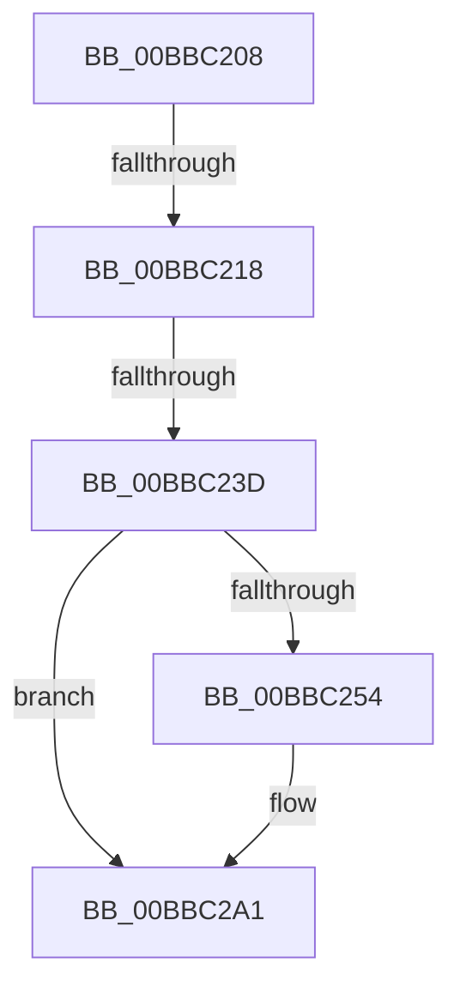

# sub_00BBC208

- RVA: `0x00BBC208`–`0x00BBC2B3` (길이 `171` bytes)
- VA: `0x0000000140BBC208`
- 실행 섹션: `PAGEVRFY`
- PDB 이름 있음: `아니요`; PDB Function 태그: `아니요`
- unwind 정보 RVA: `0x000B08B0`
- 디코드: `44`개 명령, `171/171` bytes 표시
- 미해석 바이트: `0` (있으면 어셈블리에 `.byte`로 보존)

> 이 문서는 커널 이미지의 기계어와 PDB 기호를 분석해 생성했습니다. 4번과 5번은 함수 원형과 자료형을 바이너리 사용 방식에서 추정한 C 해석이며 원본 소스 복구 결과는 아닙니다.

## 1. Dependencies

- 직접 호출 지점: **8**; 고유 호출 대상: **7**
- 직접 호출자로 확인된 함수: **0**
- RIP 상대 이미지 참조: **1**

### Outgoing calls
- `0x00BBC20B` → [VfIrpDatabaseEntryReleaseLock](VfIrpDatabaseEntryReleaseLock_function_00BB3FD4.md) (function, `0x00BB3FD4`)
- `0x00BBC22E` → [ViPendingDelayCompletion](../BA/ViPendingDelayCompletion_function_00BA1E78.md) (function, `0x00BA1E78`)
- `0x00BBC241` → [KeAcquireSpinLockRaiseToDpc](../../text/20/KeAcquireSpinLockRaiseToDpc_function_00208470.md) (function, `0x00208470`)
- `0x00BBC259` → [ViIrpDatabaseAcquireLockExclusive](../../text/61/ViIrpDatabaseAcquireLockExclusive_function_006176D8.md) (function, `0x006176D8`)
- `0x00BBC26F` → [guard_dispatch_icall](../../text/6B/guard_dispatch_icall_function_006BAAD0.md) (function, `0x006BAAD0`)
- `0x00BBC293` → [VfUtilAddressRangeRemoveCheckEmpty](../B9/VfUtilAddressRangeRemoveCheckEmpty_function_00B931A8.md) (function, `0x00B931A8`)
- `0x00BBC29C` → [ViIrpDatabaseReleaseLockExclusive](../../text/61/ViIrpDatabaseReleaseLockExclusive_function_00617720.md) (function, `0x00617720`)
- `0x00BBC2A8` → [VfIrpDatabaseEntryReleaseLock](VfIrpDatabaseEntryReleaseLock_function_00BB3FD4.md) (function, `0x00BB3FD4`)

### Direct callers
- 이 함수 시작 RVA로 연결되는 직접 call은 확인되지 않았습니다. 간접 호출은 완전히 역산할 수 없습니다.

### Static image references
- `0x00BBC28C` → RVA `0x00F04880` (`.data`; read)

## 2. Other-region calls and transfers

- 다른 실행 섹션으로 향하는 call: **4**
  - `0x00BBC241` → [KeAcquireSpinLockRaiseToDpc](../../text/20/KeAcquireSpinLockRaiseToDpc_function_00208470.md) (`PAGEVRFY` → `.text`)
  - `0x00BBC259` → [ViIrpDatabaseAcquireLockExclusive](../../text/61/ViIrpDatabaseAcquireLockExclusive_function_006176D8.md) (`PAGEVRFY` → `.text`)
  - `0x00BBC26F` → [guard_dispatch_icall](../../text/6B/guard_dispatch_icall_function_006BAAD0.md) (`PAGEVRFY` → `.text`)
  - `0x00BBC29C` → [ViIrpDatabaseReleaseLockExclusive](../../text/61/ViIrpDatabaseReleaseLockExclusive_function_00617720.md) (`PAGEVRFY` → `.text`)
- call이 아닌 외부 분기/꼬리 이동: **3**
  - `0x00BBC212` → [VfPendingMoreProcessingRequired + 0x34](VfPendingMoreProcessingRequired_function_00BB6FF0.md) (`tail-transfer`)
  - `0x00BBC237` → [VfPendingMoreProcessingRequired + 0x34](VfPendingMoreProcessingRequired_function_00BB6FF0.md) (`tail-transfer`)
  - `0x00BBC2AE` → [VfPendingMoreProcessingRequired + 0x34](VfPendingMoreProcessingRequired_function_00BB6FF0.md) (`tail-transfer`)

## 3. Assembly (complete function range)

```asm
00BBC208  48 8B CF                        mov rcx, rdi
00BBC20B  E8 C4 7D FF FF                  call 0x140bb3fd4
00BBC210  85 F6                           test esi, esi
00BBC212  0F 84 0C AE FF FF               je 0x140bb7024
00BBC218  48 8B 44 24 70                  mov rax, qword ptr [rsp + 0x70]
00BBC21D  4C 8B CD                        mov r9, rbp
00BBC220  4C 8B C3                        mov r8, rbx
00BBC223  48 89 44 24 20                  mov qword ptr [rsp + 0x20], rax
00BBC228  48 8B D7                        mov rdx, rdi
00BBC22B  49 8B CE                        mov rcx, r14
00BBC22E  E8 45 5C FE FF                  call 0x140ba1e78
00BBC233  8B F0                           mov esi, eax
00BBC235  85 C0                           test eax, eax
00BBC237  0F 85 E7 AD FF FF               jne 0x140bb7024
00BBC23D  48 8D 4F 08                     lea rcx, [rdi + 8]
00BBC241  E8 2A C2 64 FF                  call 0x140208470
00BBC246  83 6F 18 01                     sub dword ptr [rdi + 0x18], 1
00BBC24A  88 47 10                        mov byte ptr [rdi + 0x10], al
00BBC24D  40 88 74 24 30                  mov byte ptr [rsp + 0x30], sil
00BBC252  75 4D                           jne 0x140bbc2a1
00BBC254  48 8D 4C 24 30                  lea rcx, [rsp + 0x30]
00BBC259  E8 7A B4 A5 FF                  call 0x1406176d8
00BBC25E  48 8B 1F                        mov rbx, qword ptr [rdi]
00BBC261  44 8D 46 01                     lea r8d, [rsi + 1]
00BBC265  48 8B 47 30                     mov rax, qword ptr [rdi + 0x30]
00BBC269  48 8B D3                        mov rdx, rbx
00BBC26C  48 8B CF                        mov rcx, rdi
00BBC26F  E8 5C E8 AF FF                  call 0x1406baad0
00BBC274  48 83 27 00                     and qword ptr [rdi], 0
00BBC278  48 8B C3                        mov rax, rbx
00BBC27B  48 C1 E8 0C                     shr rax, 0xc
00BBC27F  48 8B D3                        mov rdx, rbx
00BBC282  6B C0 83                        imul eax, eax, -0x7d
00BBC285  0F B6 C8                        movzx ecx, al
00BBC288  48 C1 E1 04                     shl rcx, 4
00BBC28C  48 03 0D ED 85 34 00            add rcx, qword ptr [rip + 0x3485ed]
00BBC293  E8 10 6F FD FF                  call 0x140b931a8
00BBC298  8A 4C 24 30                     mov cl, byte ptr [rsp + 0x30]
00BBC29C  E8 7F B4 A5 FF                  call 0x140617720
00BBC2A1  F0 FF 4F 14                     lock dec dword ptr [rdi + 0x14]
00BBC2A5  48 8B CF                        mov rcx, rdi
00BBC2A8  E8 27 7D FF FF                  call 0x140bb3fd4
00BBC2AD  90                              nop
00BBC2AE  E9 71 AD FF FF                  jmp 0x140bb7024
```

## 4. C-style interpretation (structured pseudocode)

```c
__int64 __fastcall sub_00BBC208(__int64 a1, __int64 a2, __int64 a3, __int64 a4, __int64 a5, unsigned __int8 a6, __int64 a7, __int64 a8, __int64 a9, __int64 a10, __int64 a11, __int64 a12, __int64 a13, __int64 a14)
{
    __int64 result;
    __int64 v_rbx;
    unsigned __int64 v_stack_p20;
    unsigned __int8 v_stack_p30;

    result = VfIrpDatabaseEntryReleaseLock(v_rdi, a2, a3, a4);
    v_stack_p20 = a14;
    result = ViPendingDelayCompletion(v_r14, v_rdi, v_rbx, v_rbp);
    result = KeAcquireSpinLockRaiseToDpc(v_rdi + 8, v_rdi, v_rbx, v_rbp);
    *(unsigned __int8 *)(v_rdi + 16) = (unsigned __int8)(result);
    v_stack_p30 = (unsigned __int8)((unsigned int)((unsigned int)(result)));
    if ((unsigned int)(result) == 0) {
        a1 = a6;
        result = ViIrpDatabaseAcquireLockExclusive(a1, v_rdi, v_rbx, v_rbp);
        v_rbx = *(unsigned __int64 *)(v_rdi);
        a3 = (unsigned int)((unsigned int)(result)) + 1;
        result = *(unsigned __int64 *)(v_rdi + 48);
        a2 = v_rbx;
        a1 = v_rdi;
        result = guard_dispatch_icall(a1, a2, a3, v_rbp);
        result = v_rbx;
        result = (result) >> (12);
        a2 = v_rbx;
        result = (unsigned int)((result) * ((unsigned int)(result)));
        a1 = (unsigned __int8)(result);
        a1 = (a1) << (4);
        a1 = (a1) + (*(unsigned __int64 *)(v_rip + 3442157));
        result = VfUtilAddressRangeRemoveCheckEmpty(a1, a2, a3, v_rbp);
        a1 = a6;
        result = ViIrpDatabaseReleaseLockExclusive(a1, a2, a3, v_rbp);
    }
    result = VfIrpDatabaseEntryReleaseLock(v_rdi, a2, a3, v_rbp);
}
```

## 5. (Beta) C Style

```c
int64_t sub_00BBC208(int64_t Arg1, int64_t Arg2, int64_t Arg3, int64_t Arg4, uint64_t Arg5, uint8_t Arg6, uint64_t Arg7, uint64_t Arg8, uint64_t Arg9, uint64_t Arg10, uint64_t Arg11, uint64_t Arg12, uint64_t Arg13, int64_t Arg14)
{
    int64_t result;
    int64_t local_rbx;
    uint64_t v_stack_p20;
    uint8_t v_stack_p30;

    result = VfIrpDatabaseEntryReleaseLock(local_rdi, Arg2, Arg3, Arg4);
    v_stack_p20 = Arg14;
    result = ViPendingDelayCompletion(local_r14, local_rdi, local_rbx, local_rbp);
    result = KeAcquireSpinLockRaiseToDpc(local_rdi + 8, local_rdi, local_rbx, local_rbp);
    *(uint8_t *)(local_rdi + 0x10) = (uint8_t)(result);
    v_stack_p30 = (uint8_t)((uint32_t)((uint32_t)(result)));
    if ((uint32_t)(result) == 0) {
        Arg1 = Arg6;
        result = ViIrpDatabaseAcquireLockExclusive(Arg1, local_rdi, local_rbx, local_rbp);
        local_rbx = *(uint64_t *)(local_rdi);
        Arg3 = (uint32_t)((uint32_t)(result)) + 1;
        result = *(uint64_t *)(local_rdi + 0x30);
        Arg2 = local_rbx;
        Arg1 = local_rdi;
        result = guard_dispatch_icall(Arg1, Arg2, Arg3, local_rbp);
        result = local_rbx;
        result = (result) >> (12);
        Arg2 = local_rbx;
        result = (uint32_t)((result) * ((uint32_t)(result)));
        Arg1 = (uint8_t)(result);
        Arg1 = (Arg1) << (4);
        Arg1 = (Arg1) + (*(uint64_t *)(v_rip + 0x3485ED));
        result = VfUtilAddressRangeRemoveCheckEmpty(Arg1, Arg2, Arg3, local_rbp);
        Arg1 = Arg6;
        result = ViIrpDatabaseReleaseLockExclusive(Arg1, Arg2, Arg3, local_rbp);
    }
    result = VfIrpDatabaseEntryReleaseLock(local_rdi, Arg2, Arg3, local_rbp);
}
```

## 6. Execution-region graph

[열기: 2D/3D 그래프와 함수 탐색 컨트롤 패널](../../../control-panel.html?section=pagevrfy&rva=0x00BBC208&view=graph)

- 2D 그래프는 위에서 아래로 흐르고, 3D 그래프는 빈 공간을 드래그해 회전합니다. Shift+드래그는 이동, 휠은 확대·축소, 함수 노드 선택은 대상 보고서 이동입니다.

### Static fallback


