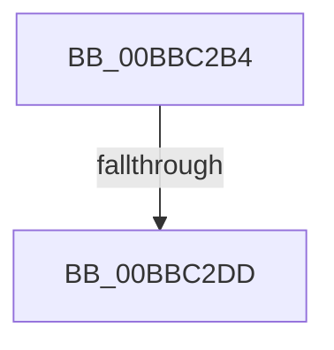

# sub_00BBC2B4

- RVA: `0x00BBC2B4`–`0x00BBC2EC` (길이 `56` bytes)
- VA: `0x0000000140BBC2B4`
- 실행 섹션: `PAGEVRFY`
- PDB 이름 있음: `아니요`; PDB Function 태그: `아니요`
- unwind 정보 RVA: `0x000B08D0`
- 디코드: `14`개 명령, `56/56` bytes 표시
- 미해석 바이트: `0` (있으면 어셈블리에 `.byte`로 보존)

> 이 문서는 커널 이미지의 기계어와 PDB 기호를 분석해 생성했습니다. 4번과 5번은 함수 원형과 자료형을 바이너리 사용 방식에서 추정한 C 해석이며 원본 소스 복구 결과는 아닙니다.

## 1. Dependencies

- 직접 호출 지점: **3**; 고유 호출 대상: **3**
- 직접 호출자로 확인된 함수: **0**
- RIP 상대 이미지 참조: **0**

### Outgoing calls
- `0x00BBC2BE` → [ViIrpDatabaseReleaseLockShared](../../text/61/ViIrpDatabaseReleaseLockShared_function_00617740.md) (function, `0x00617740`)
- `0x00BBC2C7` → [KeAcquireSpinLockRaiseToDpc](../../text/20/KeAcquireSpinLockRaiseToDpc_function_00208470.md) (function, `0x00208470`)
- `0x00BBC2E0` → [VfIrpDatabaseEntryReleaseLock](VfIrpDatabaseEntryReleaseLock_function_00BB3FD4.md) (function, `0x00BB3FD4`)

### Direct callers
- 이 함수 시작 RVA로 연결되는 직접 call은 확인되지 않았습니다. 간접 호출은 완전히 역산할 수 없습니다.

### Static image references
- 디코드된 RIP-relative 메모리 참조가 없습니다.

## 2. Other-region calls and transfers

- 다른 실행 섹션으로 향하는 call: **2**
  - `0x00BBC2BE` → [ViIrpDatabaseReleaseLockShared](../../text/61/ViIrpDatabaseReleaseLockShared_function_00617740.md) (`PAGEVRFY` → `.text`)
  - `0x00BBC2C7` → [KeAcquireSpinLockRaiseToDpc](../../text/20/KeAcquireSpinLockRaiseToDpc_function_00208470.md) (`PAGEVRFY` → `.text`)
- call이 아닌 외부 분기/꼬리 이동: **2**
  - `0x00BBC2D7` → [VfIrpDatabaseEntryFindAndLock + 0x1C](VfIrpDatabaseEntryFindAndLock_function_00BB7074.md) (`tail-transfer`)
  - `0x00BBC2E7` → [VfIrpDatabaseEntryFindAndLock + 0x1C](VfIrpDatabaseEntryFindAndLock_function_00BB7074.md) (`tail-transfer`)

## 3. Assembly (complete function range)

```asm
00BBC2B4  F0 FF 40 14                     lock inc dword ptr [rax + 0x14]
00BBC2B8  8A 5C 24 38                     mov bl, byte ptr [rsp + 0x38]
00BBC2BC  8A CB                           mov cl, bl
00BBC2BE  E8 7D B4 A5 FF                  call 0x140617740
00BBC2C3  48 8D 4F 08                     lea rcx, [rdi + 8]
00BBC2C7  E8 A4 C1 64 FF                  call 0x140208470
00BBC2CC  88 5F 10                        mov byte ptr [rdi + 0x10], bl
00BBC2CF  F0 FF 4F 14                     lock dec dword ptr [rdi + 0x14]
00BBC2D3  83 7F 18 00                     cmp dword ptr [rdi + 0x18], 0
00BBC2D7  0F 85 B3 AD FF FF               jne 0x140bb7090
00BBC2DD  48 8B CF                        mov rcx, rdi
00BBC2E0  E8 EF 7C FF FF                  call 0x140bb3fd4
00BBC2E5  33 FF                           xor edi, edi
00BBC2E7  E9 A4 AD FF FF                  jmp 0x140bb7090
```

## 4. C-style interpretation (structured pseudocode)

```c
__int64 __fastcall sub_00BBC2B4(__int64 a1, __int64 a2, __int64 a3, __int64 a4, __int64 a5, __int64 a6, unsigned __int8 a7)
{
    __int64 result;
    __int64 v_rdi;

    result = ViIrpDatabaseReleaseLockShared(a7, a2, a3, a4);
    result = KeAcquireSpinLockRaiseToDpc(v_rdi + 8, a2, a3, a4);
    *(unsigned __int8 *)(v_rdi + 16) = a7;
    result = VfIrpDatabaseEntryReleaseLock(v_rdi, a2, a3, a4);
    v_rdi = 0;
}
```

## 5. (Beta) C Style

```c
int64_t sub_00BBC2B4(int64_t Arg1, int64_t Arg2, int64_t Arg3, int64_t Arg4, uint64_t Arg5, uint64_t Arg6, uint8_t Arg7)
{
    int64_t result;
    int64_t local_rdi;

    result = ViIrpDatabaseReleaseLockShared(Arg7, Arg2, Arg3, Arg4);
    result = KeAcquireSpinLockRaiseToDpc(local_rdi + 8, Arg2, Arg3, Arg4);
    *(uint8_t *)(local_rdi + 0x10) = Arg7;
    result = VfIrpDatabaseEntryReleaseLock(local_rdi, Arg2, Arg3, Arg4);
    local_rdi = 0;
}
```

## 6. Execution-region graph

[열기: 2D/3D 그래프와 함수 탐색 컨트롤 패널](../../../control-panel.html?section=pagevrfy&rva=0x00BBC2B4&view=graph)

- 2D 그래프는 위에서 아래로 흐르고, 3D 그래프는 빈 공간을 드래그해 회전합니다. Shift+드래그는 이동, 휠은 확대·축소, 함수 노드 선택은 대상 보고서 이동입니다.

### Static fallback


