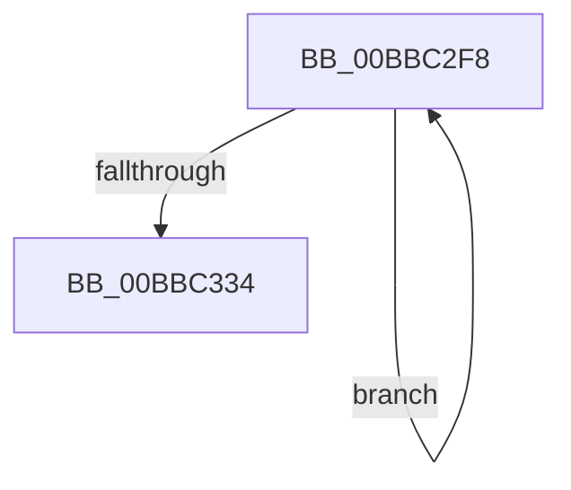

# sub_00BBC2F8

- RVA: `0x00BBC2F8`–`0x00BBC339` (길이 `65` bytes)
- VA: `0x0000000140BBC2F8`
- 실행 섹션: `PAGEVRFY`
- PDB 이름 있음: `아니요`; PDB Function 태그: `아니요`
- unwind 정보 RVA: `0x000B5128`
- 디코드: `18`개 명령, `65/65` bytes 표시
- 미해석 바이트: `0` (있으면 어셈블리에 `.byte`로 보존)

> 이 문서는 커널 이미지의 기계어와 PDB 기호를 분석해 생성했습니다. 4번과 5번은 함수 원형과 자료형을 바이너리 사용 방식에서 추정한 C 해석이며 원본 소스 복구 결과는 아닙니다.

## 1. Dependencies

- 직접 호출 지점: **2**; 고유 호출 대상: **2**
- 직접 호출자로 확인된 함수: **0**
- RIP 상대 이미지 참조: **0**

### Outgoing calls
- `0x00BBC315` → [ViDeadlockRemoveMemoryRangeResources](../../text/61/ViDeadlockRemoveMemoryRangeResources_function_00615FE8.md) (function, `0x00615FE8`)
- `0x00BBC326` → [ViDeadlockRemoveMemoryRangeThreads](../../text/61/ViDeadlockRemoveMemoryRangeThreads_function_00616148.md) (function, `0x00616148`)

### Direct callers
- 이 함수 시작 RVA로 연결되는 직접 call은 확인되지 않았습니다. 간접 호출은 완전히 역산할 수 없습니다.

### Static image references
- 디코드된 RIP-relative 메모리 참조가 없습니다.

## 2. Other-region calls and transfers

- 다른 실행 섹션으로 향하는 call: **2**
  - `0x00BBC315` → [ViDeadlockRemoveMemoryRangeResources](../../text/61/ViDeadlockRemoveMemoryRangeResources_function_00615FE8.md) (`PAGEVRFY` → `.text`)
  - `0x00BBC326` → [ViDeadlockRemoveMemoryRangeThreads](../../text/61/ViDeadlockRemoveMemoryRangeThreads_function_00616148.md) (`PAGEVRFY` → `.text`)
- call이 아닌 외부 분기/꼬리 이동: **1**
  - `0x00BBC334` → [VfFreeMemoryNotification + 0x29](VfFreeMemoryNotification_function_00BB7A6C.md) (`tail-transfer`)

## 3. Assembly (complete function range)

```asm
00BBC2F8  49 8D 86 00 10 00 00            lea rax, [r14 + 0x1000]
00BBC2FF  48 8B DD                        mov rbx, rbp
00BBC302  48 3B C5                        cmp rax, rbp
00BBC305  4C 8B CD                        mov r9, rbp
00BBC308  4C 8B C7                        mov r8, rdi
00BBC30B  49 8B CE                        mov rcx, r14
00BBC30E  48 0F 46 D8                     cmovbe rbx, rax
00BBC312  48 8B D3                        mov rdx, rbx
00BBC315  E8 CE 9C A5 FF                  call 0x140615fe8
00BBC31A  4C 8B CD                        mov r9, rbp
00BBC31D  4C 8B C7                        mov r8, rdi
00BBC320  48 8B D3                        mov rdx, rbx
00BBC323  49 8B CE                        mov rcx, r14
00BBC326  E8 1D 9E A5 FF                  call 0x140616148
00BBC32B  4C 8B F3                        mov r14, rbx
00BBC32E  49 83 EF 01                     sub r15, 1
00BBC332  75 C4                           jne 0x140bbc2f8
00BBC334  E9 5C B7 FF FF                  jmp 0x140bb7a95
```

## 4. C-style interpretation (structured pseudocode)

```c
__int64 __fastcall sub_00BBC2F8(void)
{
    __int64 result;
    __int64 v_r15;
    __int64 v_rbx;

    v_rbx = v_rbp;
    if ((v_r14 + 4096) <= v_rbp) { v_rbx = v_r14 + 4096; }
    result = ViDeadlockRemoveMemoryRangeResources(v_r14, v_rbx, v_rdi, v_rbp);
    result = ViDeadlockRemoveMemoryRangeThreads(v_r14, v_rbx, v_rdi, v_rbp);
    v_r15 = (v_r15) - (1);
    if (condition_is_not_equal) goto loc_00BBC2F8;
}
```

## 5. (Beta) C Style

```c
void sub_00BBC2F8(void)
{
    int64_t result;
    int64_t local_r15;
    int64_t local_rbx;

    local_rbx = local_rbp;
    if ((local_r14 + 4096) <= local_rbp) { local_rbx = local_r14 + 4096; }
    result = ViDeadlockRemoveMemoryRangeResources(local_r14, local_rbx, local_rdi, local_rbp);
    result = ViDeadlockRemoveMemoryRangeThreads(local_r14, local_rbx, local_rdi, local_rbp);
    local_r15 = (local_r15) - (1);
    if (condition_is_not_equal) goto loc_00BBC2F8;
}
```

## 6. Execution-region graph

[열기: 2D/3D 그래프와 함수 탐색 컨트롤 패널](../../../control-panel.html?section=pagevrfy&rva=0x00BBC2F8&view=graph)

- 2D 그래프는 위에서 아래로 흐르고, 3D 그래프는 빈 공간을 드래그해 회전합니다. Shift+드래그는 이동, 휠은 확대·축소, 함수 노드 선택은 대상 보고서 이동입니다.

### Static fallback


