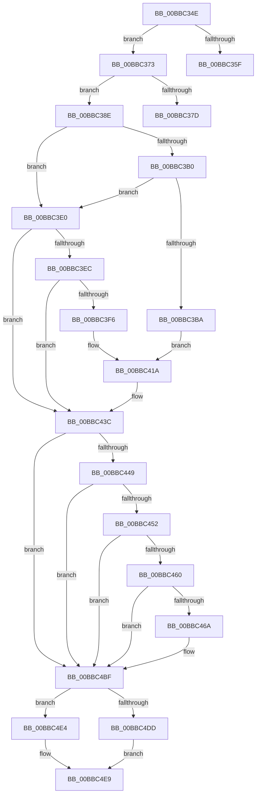

# sub_00BBC34E

- RVA: `0x00BBC34E`–`0x00BBC519` (길이 `459` bytes)
- VA: `0x0000000140BBC34E`
- 실행 섹션: `PAGEVRFY`
- PDB 이름 있음: `아니요`; PDB Function 태그: `아니요`
- unwind 정보 RVA: `0x000B6AE8`
- 디코드: `99`개 명령, `459/459` bytes 표시
- 미해석 바이트: `0` (있으면 어셈블리에 `.byte`로 보존)

> 이 문서는 커널 이미지의 기계어와 PDB 기호를 분석해 생성했습니다. 4번과 5번은 함수 원형과 자료형을 바이너리 사용 방식에서 추정한 C 해석이며 원본 소스 복구 결과는 아닙니다.

## 1. Dependencies

- 직접 호출 지점: **14**; 고유 호출 대상: **11**
- 직접 호출자로 확인된 함수: **0**
- RIP 상대 이미지 참조: **10**

### Outgoing calls
- `0x00BBC356` → [VfIrpAllocateCallDriverData](../B9/VfIrpAllocateCallDriverData_function_00B9DE90.md) (function, `0x00B9DE90`)
- `0x00BBC368` → [IovpCallDriverWithStackBuffer](../B9/IovpCallDriverWithStackBuffer_function_00B92940.md) (function, `0x00B92940`)
- `0x00BBC383` → [IovpCallDriverNoIrpTracking](../B9/IovpCallDriverNoIrpTracking_function_00B928F8.md) (function, `0x00B928F8`)
- `0x00BBC3C1` → [KeAcquireSpinLockRaiseToDpc](../../text/20/KeAcquireSpinLockRaiseToDpc_function_00208470.md) (function, `0x00208470`)
- `0x00BBC3E3` → [IovpValidateDeviceObject](../B9/IovpValidateDeviceObject_function_00B92C10.md) (function, `0x00B92C10`)
- `0x00BBC3FD` → [KeAcquireSpinLockRaiseToDpc](../../text/20/KeAcquireSpinLockRaiseToDpc_function_00208470.md) (function, `0x00208470`)
- `0x00BBC436` → [VfBugCheckNoStackUsage](../../text/61/VfBugCheckNoStackUsage_function_00613F98.md) (function, `0x00613F98`)
- `0x00BBC471` → [KeAcquireSpinLockRaiseToDpc](../../text/20/KeAcquireSpinLockRaiseToDpc_function_00208470.md) (function, `0x00208470`)
- `0x00BBC4B9` → [VfBugCheckNoStackUsage](../../text/61/VfBugCheckNoStackUsage_function_00613F98.md) (function, `0x00613F98`)
- `0x00BBC4C8` → [VfBeforeCallDriver](../B9/VfBeforeCallDriver_function_00B9DC58.md) (function, `0x00B9DC58`)
- `0x00BBC4DD` → [IopPerfCallDriver](../../text/4A/IopPerfCallDriver_function_004A9680.md) (function, `0x004A9680`)
- `0x00BBC4E4` → [IopfCallDriver](../../text/29/IopfCallDriver_function_0029C474.md) (function, `0x0029C474`)
- `0x00BBC4FC` → [VfAfterCallDriver](../B9/VfAfterCallDriver_function_00B9DA84.md) (function, `0x00B9DA84`)
- `0x00BBC50D` → [ExFreeToNPagedLookasideList](../../text/38/ExFreeToNPagedLookasideList_function_0038D9D0.md) (function, `0x0038D9D0`)

### Direct callers
- 이 함수 시작 RVA로 연결되는 직접 call은 확인되지 않았습니다. 간접 호출은 완전히 역산할 수 없습니다.

### Static image references
- `0x00BBC3B0` → RVA `0x00E681A0` (`.data`; read)
- `0x00BBC3BA` → RVA `0x00FFDA70` (`PAGEVRFD`; read)
- `0x00BBC3D3` → RVA `0x00FFDA38` (`PAGEVRFD`; write)
- `0x00BBC41D` → RVA `0x00FFDA30` (`PAGEVRFD`; write)
- `0x00BBC428` → RVA `0x00FFDA48` (`PAGEVRFD`; read)
- `0x00BBC42F` → RVA `0x00FFDA40` (`PAGEVRFD`; write)
- `0x00BBC491` → RVA `0x00FFDA48` (`PAGEVRFD`; write)
- `0x00BBC49C` → RVA `0x00FFDA50` (`PAGEVRFD`; write)
- `0x00BBC4CD` → RVA `0x00E66114` (`.data`; read)
- `0x00BBC503` → RVA `0x00FFF500` (`PAGEVRFD`; read)

## 2. Other-region calls and transfers

- 다른 실행 섹션으로 향하는 call: **8**
  - `0x00BBC3C1` → [KeAcquireSpinLockRaiseToDpc](../../text/20/KeAcquireSpinLockRaiseToDpc_function_00208470.md) (`PAGEVRFY` → `.text`)
  - `0x00BBC3FD` → [KeAcquireSpinLockRaiseToDpc](../../text/20/KeAcquireSpinLockRaiseToDpc_function_00208470.md) (`PAGEVRFY` → `.text`)
  - `0x00BBC436` → [VfBugCheckNoStackUsage](../../text/61/VfBugCheckNoStackUsage_function_00613F98.md) (`PAGEVRFY` → `.text`)
  - `0x00BBC471` → [KeAcquireSpinLockRaiseToDpc](../../text/20/KeAcquireSpinLockRaiseToDpc_function_00208470.md) (`PAGEVRFY` → `.text`)
  - `0x00BBC4B9` → [VfBugCheckNoStackUsage](../../text/61/VfBugCheckNoStackUsage_function_00613F98.md) (`PAGEVRFY` → `.text`)
  - `0x00BBC4DD` → [IopPerfCallDriver](../../text/4A/IopPerfCallDriver_function_004A9680.md) (`PAGEVRFY` → `.text`)
  - `0x00BBC4E4` → [IopfCallDriver](../../text/29/IopfCallDriver_function_0029C474.md) (`PAGEVRFY` → `.text`)
  - `0x00BBC50D` → [ExFreeToNPagedLookasideList](../../text/38/ExFreeToNPagedLookasideList_function_0038D9D0.md) (`PAGEVRFY` → `.text`)
- call이 아닌 외부 분기/꼬리 이동: **3**
  - `0x00BBC36E` → [IovCallDriver + 0x44](IovCallDriver_function_00BB7D30.md) (`tail-transfer`)
  - `0x00BBC389` → [IovCallDriver + 0x44](IovCallDriver_function_00BB7D30.md) (`tail-transfer`)
  - `0x00BBC514` → [IovCallDriver + 0x44](IovCallDriver_function_00BB7D30.md) (`tail-transfer`)

## 3. Assembly (complete function range)

```asm
00BBC34E  48 8D 54 24 58                  lea rdx, [rsp + 0x58]
00BBC353  48 8B CB                        mov rcx, rbx
00BBC356  E8 35 1B FE FF                  call 0x140b9de90
00BBC35B  85 C0                           test eax, eax
00BBC35D  75 14                           jne 0x140bbc373
00BBC35F  4C 8B C5                        mov r8, rbp
00BBC362  48 8B D3                        mov rdx, rbx
00BBC365  48 8B CE                        mov rcx, rsi
00BBC368  E8 D3 65 FD FF                  call 0x140b92940
00BBC36D  90                              nop
00BBC36E  E9 01 BA FF FF                  jmp 0x140bb7d74
00BBC373  48 8B 7C 24 58                  mov rdi, qword ptr [rsp + 0x58]
00BBC378  48 85 FF                        test rdi, rdi
00BBC37B  75 11                           jne 0x140bbc38e
00BBC37D  48 8B D3                        mov rdx, rbx
00BBC380  48 8B CE                        mov rcx, rsi
00BBC383  E8 70 65 FD FF                  call 0x140b928f8
00BBC388  90                              nop
00BBC389  E9 E6 B9 FF FF                  jmp 0x140bb7d74
00BBC38E  48 89 B7 A0 00 00 00            mov qword ptr [rdi + 0xa0], rsi
00BBC395  48 89 9F A8 00 00 00            mov qword ptr [rdi + 0xa8], rbx
00BBC39C  48 89 AF B0 00 00 00            mov qword ptr [rdi + 0xb0], rbp
00BBC3A3  48 8B 87 A8 00 00 00            mov rax, qword ptr [rdi + 0xa8]
00BBC3AA  66 83 38 06                     cmp word ptr [rax], 6
00BBC3AE  74 30                           je 0x140bbc3e0
00BBC3B0  0F BA 25 E8 BD 2A 00 16         bt dword ptr [rip + 0x2abde8], 0x16
00BBC3B8  72 26                           jb 0x140bbc3e0
00BBC3BA  48 8D 0D AF 16 44 00            lea rcx, [rip + 0x4416af]
00BBC3C1  E8 AA C0 64 FF                  call 0x140208470
00BBC3C6  88 87 9D 00 00 00               mov byte ptr [rdi + 0x9d], al
00BBC3CC  48 8B 87 A8 00 00 00            mov rax, qword ptr [rdi + 0xa8]
00BBC3D3  48 C7 05 5A 16 44 00 03 00 00 00  mov qword ptr [rip + 0x44165a], 3
00BBC3DE  EB 3A                           jmp 0x140bbc41a
00BBC3E0  48 8B CE                        mov rcx, rsi
00BBC3E3  E8 28 68 FD FF                  call 0x140b92c10
00BBC3E8  84 C0                           test al, al
00BBC3EA  75 50                           jne 0x140bbc43c
00BBC3EC  0F BA 25 AC BD 2A 00 16         bt dword ptr [rip + 0x2abdac], 0x16
00BBC3F4  72 46                           jb 0x140bbc43c
00BBC3F6  48 8D 0D 73 16 44 00            lea rcx, [rip + 0x441673]
00BBC3FD  E8 6E C0 64 FF                  call 0x140208470
00BBC402  88 87 9D 00 00 00               mov byte ptr [rdi + 0x9d], al
00BBC408  48 8B 87 A0 00 00 00            mov rax, qword ptr [rdi + 0xa0]
00BBC40F  48 C7 05 1E 16 44 00 04 00 00 00  mov qword ptr [rip + 0x44161e], 4
00BBC41A  0F 57 C0                        xorps xmm0, xmm0
00BBC41D  48 C7 05 08 16 44 00 C9 00 00 00  mov qword ptr [rip + 0x441608], 0xc9
00BBC428  0F 11 05 19 16 44 00            movups xmmword ptr [rip + 0x441619], xmm0
00BBC42F  48 89 05 0A 16 44 00            mov qword ptr [rip + 0x44160a], rax
00BBC436  E8 5D 7B A5 FF                  call 0x140613f98
00BBC43B  CC                              int3
00BBC43C  48 8B AB B8 00 00 00            mov rbp, qword ptr [rbx + 0xb8]
00BBC443  80 7D B8 00                     cmp byte ptr [rbp - 0x48], 0
00BBC447  75 76                           jne 0x140bbc4bf
00BBC449  48 8B 45 E8                     mov rax, qword ptr [rbp - 0x18]
00BBC44D  48 85 C0                        test rax, rax
00BBC450  74 6D                           je 0x140bbc4bf
00BBC452  8B 40 50                        mov eax, dword ptr [rax + 0x50]
00BBC455  B9 00 40 20 00                  mov ecx, 0x204000
00BBC45A  23 C1                           and eax, ecx
00BBC45C  3B C1                           cmp eax, ecx
00BBC45E  75 5F                           jne 0x140bbc4bf
00BBC460  0F BA 25 38 BD 2A 00 16         bt dword ptr [rip + 0x2abd38], 0x16
00BBC468  72 55                           jb 0x140bbc4bf
00BBC46A  48 8D 0D FF 15 44 00            lea rcx, [rip + 0x4415ff]
00BBC471  E8 FA BF 64 FF                  call 0x140208470
00BBC476  88 87 9D 00 00 00               mov byte ptr [rdi + 0x9d], al
00BBC47C  48 8B 87 A0 00 00 00            mov rax, qword ptr [rdi + 0xa0]
00BBC483  48 89 05 B6 15 44 00            mov qword ptr [rip + 0x4415b6], rax
00BBC48A  48 8B 87 A8 00 00 00            mov rax, qword ptr [rdi + 0xa8]
00BBC491  48 89 05 B0 15 44 00            mov qword ptr [rip + 0x4415b0], rax
00BBC498  48 8B 45 E8                     mov rax, qword ptr [rbp - 0x18]
00BBC49C  48 89 05 AD 15 44 00            mov qword ptr [rip + 0x4415ad], rax
00BBC4A3  48 C7 05 82 15 44 00 C9 00 00 00  mov qword ptr [rip + 0x441582], 0xc9
00BBC4AE  48 C7 05 7F 15 44 00 0F 00 00 00  mov qword ptr [rip + 0x44157f], 0xf
00BBC4B9  E8 DA 7A A5 FF                  call 0x140613f98
00BBC4BE  CC                              int3
00BBC4BF  4C 8B C7                        mov r8, rdi
00BBC4C2  48 8B D3                        mov rdx, rbx
00BBC4C5  48 8B CE                        mov rcx, rsi
00BBC4C8  E8 8B 17 FE FF                  call 0x140b9dc58
00BBC4CD  8B 05 41 9C 2A 00               mov eax, dword ptr [rip + 0x2a9c41]
00BBC4D3  48 8B D3                        mov rdx, rbx
00BBC4D6  48 8B CE                        mov rcx, rsi
00BBC4D9  A8 02                           test al, 2
00BBC4DB  74 07                           je 0x140bbc4e4
00BBC4DD  E8 9E D1 8E FF                  call 0x1404a9680
00BBC4E2  EB 05                           jmp 0x140bbc4e9
00BBC4E4  E8 8B FF 6D FF                  call 0x14029c474
00BBC4E9  48 8D 9F B8 00 00 00            lea rbx, [rdi + 0xb8]
00BBC4F0  89 87 B8 00 00 00               mov dword ptr [rdi + 0xb8], eax
00BBC4F6  48 8B D3                        mov rdx, rbx
00BBC4F9  48 8B CF                        mov rcx, rdi
00BBC4FC  E8 83 15 FE FF                  call 0x140b9da84
00BBC501  8B 1B                           mov ebx, dword ptr [rbx]
00BBC503  48 8D 0D F6 2F 44 00            lea rcx, [rip + 0x442ff6]
00BBC50A  48 8B D7                        mov rdx, rdi
00BBC50D  E8 BE 14 7D FF                  call 0x14038d9d0
00BBC512  8B C3                           mov eax, ebx
00BBC514  E9 5B B8 FF FF                  jmp 0x140bb7d74
```

## 4. C-style interpretation (structured pseudocode)

```c
__int64 __fastcall sub_00BBC34E(__int64 a1, __int64 a2, __int64 a3, __int64 a4, __int64 a5, __int64 a6, __int64 a7, __int64 a8, __int64 a9, __int64 a10, __int64 a11)
{
    __int64 result;

    result = VfIrpAllocateCallDriverData(v_rbx, a11, a3, a4);
    if ((unsigned int)(result) != 0) goto loc_00BBC373;
    result = IovpCallDriverWithStackBuffer(v_rsi, v_rbx, v_rbp, a4);
loc_00BBC373:
    if (a11 != 0) goto loc_00BBC38E;
    result = IovpCallDriverNoIrpTracking(v_rsi, v_rbx, v_rbp, a4);
loc_00BBC38E:
    *(unsigned __int64 *)(a11 + 160) = v_rsi;
    *(unsigned __int64 *)(a11 + 168) = v_rbx;
    *(unsigned __int64 *)(a11 + 176) = v_rbp;
    if ((*(unsigned __int16 *)(*(unsigned __int64 *)(a11 + 168))) == 6) goto loc_00BBC3E0;
    if ((*(unsigned __int16 *)(*(unsigned __int64 *)(a11 + 168))) < 6) goto loc_00BBC3E0;
    result = KeAcquireSpinLockRaiseToDpc(v_rip + 4462255, v_rbx, v_rbp, a4);
    *(unsigned __int8 *)(a11 + 157) = (unsigned __int8)(result);
    *(unsigned __int64 *)(v_rip + 4462170) = 3;
    goto loc_00BBC41A;
loc_00BBC3E0:
    result = IovpValidateDeviceObject(v_rsi, v_rbx, v_rbp, a4);
    if ((unsigned __int8)(result) != 0) goto loc_00BBC43C;
    if (condition_is_below) goto loc_00BBC43C;
    result = KeAcquireSpinLockRaiseToDpc(v_rip + 4462195, v_rbx, v_rbp, a4);
    *(unsigned __int8 *)(a11 + 157) = (unsigned __int8)(result);
    *(unsigned __int64 *)(v_rip + 4462110) = 4;
loc_00BBC41A:
    *(unsigned __int64 *)(v_rip + 4462088) = 201;
    *(unsigned __int64 *)(v_rip + 4462105) = v_xmm0;
    *(unsigned __int64 *)(v_rip + 4462090) = *(unsigned __int64 *)(a11 + 160);
    result = VfBugCheckNoStackUsage(v_rip + 4462195, v_rbx, v_rbp, a4);
loc_00BBC43C:
    if ((*(unsigned __int8 *)(*(unsigned __int64 *)(v_rbx + 184) - 72)) != 0) goto loc_00BBC4BF;
    if (*(unsigned __int64 *)(*(unsigned __int64 *)(v_rbx + 184) - 24) == 0) goto loc_00BBC4BF;
    result = (unsigned int)(((unsigned int)(*(unsigned int *)(*(unsigned __int64 *)(*(unsigned __int64 *)(v_rbx + 184) - 24) + 80))) & ((unsigned int)((unsigned int)(0x204000ULL))));
    if (((unsigned int)(result)) != ((unsigned int)((unsigned int)(0x204000ULL)))) goto loc_00BBC4BF;
    if (((unsigned int)(result)) >= ((unsigned int)((unsigned int)(0x204000ULL)))) {
        a1 = v_rip + 4462079;
        result = KeAcquireSpinLockRaiseToDpc(a1, v_rbx, v_rbp, a4);
        *(unsigned __int8 *)(a11 + 157) = (unsigned __int8)(result);
        result = *(unsigned __int64 *)(a11 + 160);
        *(unsigned __int64 *)(v_rip + 4462006) = result;
        result = *(unsigned __int64 *)(a11 + 168);
        *(unsigned __int64 *)(v_rip + 4462000) = result;
        result = *(unsigned __int64 *)(*(unsigned __int64 *)(v_rbx + 184) - 24);
        *(unsigned __int64 *)(v_rip + 4461997) = result;
        *(unsigned __int64 *)(v_rip + 4461954) = 201;
        *(unsigned __int64 *)(v_rip + 4461951) = 15;
        result = VfBugCheckNoStackUsage(a1, v_rbx, v_rbp, a4);
    }
    result = VfBeforeCallDriver(v_rsi, v_rbx, a11, a4);
    if ((((unsigned __int8)((unsigned int)(*(unsigned int *)(v_rip + 2792513)))) & (2)) == 0) goto loc_00BBC4E4;
    result = IopPerfCallDriver(v_rsi, v_rbx, a11, a4);
    goto loc_00BBC4E9;
loc_00BBC4E4:
    result = IopfCallDriver(v_rsi, v_rbx, a11, a4);
loc_00BBC4E9:
    *(unsigned int *)(a11 + 184) = (unsigned int)(result);
    result = VfAfterCallDriver(a11, a11 + 184, a11, a4);
    result = ExFreeToNPagedLookasideList(v_rip + 4468726, a11, a11, a4);
}
```

## 5. (Beta) C Style

```c
int64_t sub_00BBC34E(int64_t Arg1, int64_t Arg2, int64_t Arg3, int64_t Arg4, uint64_t Arg5, uint64_t Arg6, uint64_t Arg7, uint64_t Arg8, uint64_t Arg9, uint64_t Arg10, int64_t Arg11)
{
    int64_t result;

    result = VfIrpAllocateCallDriverData(local_rbx, Arg11, Arg3, Arg4);
    if ((uint32_t)(result) != 0) goto loc_00BBC373;
    result = IovpCallDriverWithStackBuffer(local_rsi, local_rbx, local_rbp, Arg4);
loc_00BBC373:
    if (Arg11 != 0) goto loc_00BBC38E;
    result = IovpCallDriverNoIrpTracking(local_rsi, local_rbx, local_rbp, Arg4);
loc_00BBC38E:
    *(uint64_t *)(Arg11 + 0xA0) = local_rsi;
    *(uint64_t *)(Arg11 + 0xA8) = local_rbx;
    *(uint64_t *)(Arg11 + 0xB0) = local_rbp;
    if ((*(uint16_t *)(*(uint64_t *)(Arg11 + 0xA8))) == 6) goto loc_00BBC3E0;
    if ((*(uint16_t *)(*(uint64_t *)(Arg11 + 0xA8))) < 6) goto loc_00BBC3E0;
    result = KeAcquireSpinLockRaiseToDpc(v_rip + 4462255, local_rbx, local_rbp, Arg4);
    *(uint8_t *)(Arg11 + 0x9D) = (uint8_t)(result);
    *(uint64_t *)(v_rip + 0x44165A) = 3;
    goto loc_00BBC41A;
loc_00BBC3E0:
    result = IovpValidateDeviceObject(local_rsi, local_rbx, local_rbp, Arg4);
    if ((uint8_t)(result) != 0) goto loc_00BBC43C;
    if (condition_is_below) goto loc_00BBC43C;
    result = KeAcquireSpinLockRaiseToDpc(v_rip + 4462195, local_rbx, local_rbp, Arg4);
    *(uint8_t *)(Arg11 + 0x9D) = (uint8_t)(result);
    *(uint64_t *)(v_rip + 0x44161E) = 4;
loc_00BBC41A:
    *(uint64_t *)(v_rip + 0x441608) = 201;
    *(uint64_t *)(v_rip + 0x441619) = v_xmm0;
    *(uint64_t *)(v_rip + 0x44160A) = *(uint64_t *)(Arg11 + 0xA0);
    result = VfBugCheckNoStackUsage(v_rip + 4462195, local_rbx, local_rbp, Arg4);
loc_00BBC43C:
    if ((*(uint8_t *)(*(uint64_t *)(local_rbx + 0xB8) - 0x48)) != 0) goto loc_00BBC4BF;
    if (*(uint64_t *)(*(uint64_t *)(local_rbx + 0xB8) - 0x18) == 0) goto loc_00BBC4BF;
    result = (uint32_t)(((uint32_t)(*(uint32_t *)(*(uint64_t *)(*(uint64_t *)(local_rbx + 0xB8) - 0x18) + 0x50))) & ((uint32_t)((uint32_t)(0x204000ULL))));
    if (((uint32_t)(result)) != ((uint32_t)((uint32_t)(0x204000ULL)))) goto loc_00BBC4BF;
    if (((uint32_t)(result)) >= ((uint32_t)((uint32_t)(0x204000ULL)))) {
        Arg1 = v_rip + 4462079;
        result = KeAcquireSpinLockRaiseToDpc(Arg1, local_rbx, local_rbp, Arg4);
        *(uint8_t *)(Arg11 + 0x9D) = (uint8_t)(result);
        result = *(uint64_t *)(Arg11 + 0xA0);
        *(uint64_t *)(v_rip + 0x4415B6) = result;
        result = *(uint64_t *)(Arg11 + 0xA8);
        *(uint64_t *)(v_rip + 0x4415B0) = result;
        result = *(uint64_t *)(*(uint64_t *)(local_rbx + 0xB8) - 0x18);
        *(uint64_t *)(v_rip + 0x4415AD) = result;
        *(uint64_t *)(v_rip + 0x441582) = 201;
        *(uint64_t *)(v_rip + 0x44157F) = 15;
        result = VfBugCheckNoStackUsage(Arg1, local_rbx, local_rbp, Arg4);
    }
    result = VfBeforeCallDriver(local_rsi, local_rbx, Arg11, Arg4);
    if ((((uint8_t)((uint32_t)(*(uint32_t *)(v_rip + 0x2A9C41)))) & (2)) == 0) goto loc_00BBC4E4;
    result = IopPerfCallDriver(local_rsi, local_rbx, Arg11, Arg4);
    goto loc_00BBC4E9;
loc_00BBC4E4:
    result = IopfCallDriver(local_rsi, local_rbx, Arg11, Arg4);
loc_00BBC4E9:
    *(uint32_t *)(Arg11 + 0xB8) = (uint32_t)(result);
    result = VfAfterCallDriver(Arg11, Arg11 + 184, Arg11, Arg4);
    result = ExFreeToNPagedLookasideList(v_rip + 4468726, Arg11, Arg11, Arg4);
}
```

## 6. Execution-region graph

[열기: 2D/3D 그래프와 함수 탐색 컨트롤 패널](../../../control-panel.html?section=pagevrfy&rva=0x00BBC34E&view=graph)

- 2D 그래프는 위에서 아래로 흐르고, 3D 그래프는 빈 공간을 드래그해 회전합니다. Shift+드래그는 이동, 휠은 확대·축소, 함수 노드 선택은 대상 보고서 이동입니다.

### Static fallback


