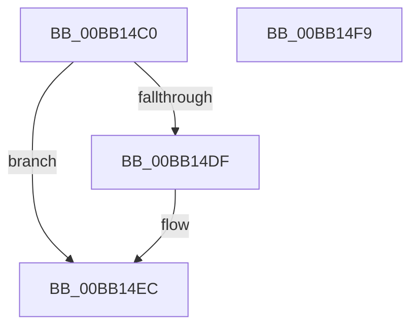

# VerifierEtwRegister

- RVA: `0x00BB14C0`–`0x00BB14FA` (길이 `58` bytes)
- VA: `0x0000000140BB14C0`
- 실행 섹션: `PAGEVRFY`
- PDB 이름 있음: `예`; PDB Function 태그: `아니요`
- unwind 정보 RVA: `0x0006E5F8`
- 디코드: `18`개 명령, `58/58` bytes 표시
- 미해석 바이트: `0` (있으면 어셈블리에 `.byte`로 보존)

> 이 문서는 커널 이미지의 기계어와 PDB 기호를 분석해 생성했습니다. 4번과 5번은 함수 원형과 자료형을 바이너리 사용 방식에서 추정한 C 해석이며 원본 소스 복구 결과는 아닙니다.

## 1. Dependencies

- 직접 호출 지점: **2**; 고유 호출 대상: **2**
- 직접 호출자로 확인된 함수: **0**
- RIP 상대 이미지 참조: **1**

### Outgoing calls
- `0x00BB14D4` → [guard_dispatch_icall](../../text/6B/guard_dispatch_icall_function_006BAAD0.md) (function, `0x006BAAD0`)
- `0x00BB14E7` → [VfTargetEtwRegister](../B9/VfTargetEtwRegister_function_00B9B49C.md) (function, `0x00B9B49C`)

### Direct callers
- 이 함수 시작 RVA로 연결되는 직접 call은 확인되지 않았습니다. 간접 호출은 완전히 역산할 수 없습니다.

### Static image references
- `0x00BB14CA` → RVA `0x00FFE188` (`PAGEVRFD`; read)

## 2. Other-region calls and transfers

- 다른 실행 섹션으로 향하는 call: **1**
  - `0x00BB14D4` → [guard_dispatch_icall](../../text/6B/guard_dispatch_icall_function_006BAAD0.md) (`PAGEVRFY` → `.text`)
- 별도 외부 분기/꼬리 이동을 확인하지 못했습니다.

## 3. Assembly (complete function range)

```asm
00BB14C0  48 89 5C 24 08                  mov qword ptr [rsp + 8], rbx
00BB14C5  57                              push rdi
00BB14C6  48 83 EC 30                     sub rsp, 0x30
00BB14CA  48 8B 05 B7 CC 44 00            mov rax, qword ptr [rip + 0x44ccb7]
00BB14D1  49 8B F9                        mov rdi, r9
00BB14D4  E8 F7 95 B0 FF                  call 0x1406baad0
00BB14D9  8B D8                           mov ebx, eax
00BB14DB  85 C0                           test eax, eax
00BB14DD  78 0D                           js 0x140bb14ec
00BB14DF  48 8B 54 24 38                  mov rdx, qword ptr [rsp + 0x38]
00BB14E4  48 8B 0F                        mov rcx, qword ptr [rdi]
00BB14E7  E8 B0 9F FE FF                  call 0x140b9b49c
00BB14EC  8B C3                           mov eax, ebx
00BB14EE  48 8B 5C 24 40                  mov rbx, qword ptr [rsp + 0x40]
00BB14F3  48 83 C4 30                     add rsp, 0x30
00BB14F7  5F                              pop rdi
00BB14F8  C3                              ret
00BB14F9  CC                              int3
```

## 4. C-style interpretation (structured pseudocode)

```c
__int64 __fastcall VerifierEtwRegister(__int64 a1, __int64 a2, __int64 a3, __int64 a4)
{
    __int64 result;
    __int64 v_rsp;
    unsigned __int64 v_stack_p0;
    unsigned __int64 v_stack_p8;

    v_stack_p8 = v_rbx;
    v_rsp = (v_rsp) - (48);
    result = guard_dispatch_icall(a1, a2, a3, a4);
    if (!(sign_flag)) {
        a2 = v_stack_p0;
        a1 = *(unsigned __int64 *)(a4);
        result = VfTargetEtwRegister(a1, a2, a3, a4);
    }
    v_rsp = (v_rsp) + (48);
    return (unsigned int)((unsigned int)((unsigned int)((unsigned int)(result))));
}
```

## 5. (Beta) C Style

```c
int64_t VerifierEtwRegister(int64_t Arg1, int64_t Arg2, int64_t Arg3, void *Arg4)
{
    uint8_t *arg4 = (uint8_t *)Arg4;

    int64_t result;
    int64_t local_rsp;
    uint64_t v_stack_p0;
    uint64_t v_stack_p8;

    v_stack_p8 = local_rbx;
    local_rsp = (local_rsp) - (48);
    result = guard_dispatch_icall(Arg1, Arg2, Arg3, Arg4);
    if (!(sign_flag)) {
        Arg2 = v_stack_p0;
        Arg1 = *(uint64_t *)(arg4);
        result = VfTargetEtwRegister(Arg1, Arg2, Arg3, Arg4);
    }
    local_rsp = (local_rsp) + (48);
    return (uint32_t)((uint32_t)((uint32_t)((uint32_t)(result))));
}
```

### 관측된 메모리 오프셋

구조체 형식이 확인되지 않은 접근은 인자 기준의 오프셋으로만 기록했습니다.

| 기준 인자 | 오프셋 표현 | 폭 (bit) | 접근 |
|---|---:|---:|---|
| `Arg4` | `+ 0x0` | `64` | `R` |

## 6. Execution-region graph

[열기: 2D/3D 그래프와 함수 탐색 컨트롤 패널](../../../control-panel.html?section=pagevrfy&rva=0x00BB14C0&view=graph)

- 2D 그래프는 위에서 아래로 흐르고, 3D 그래프는 빈 공간을 드래그해 회전합니다. Shift+드래그는 이동, 휠은 확대·축소, 함수 노드 선택은 대상 보고서 이동입니다.

### Static fallback


